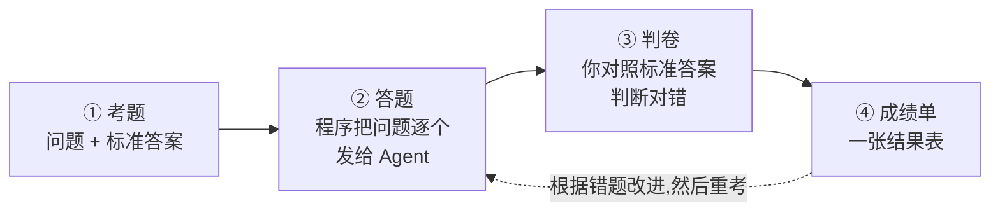
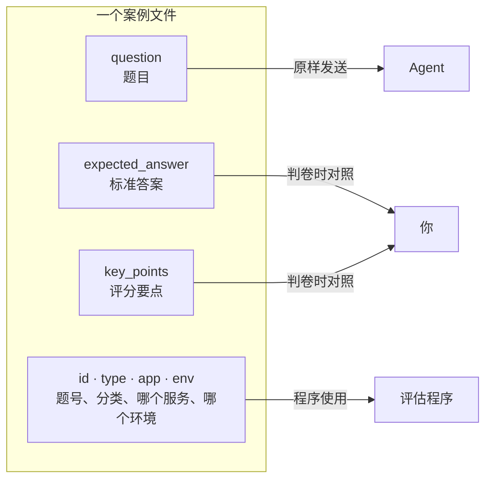
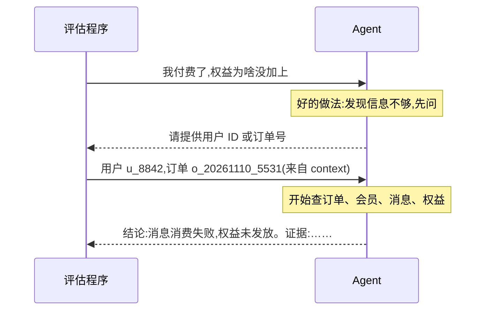
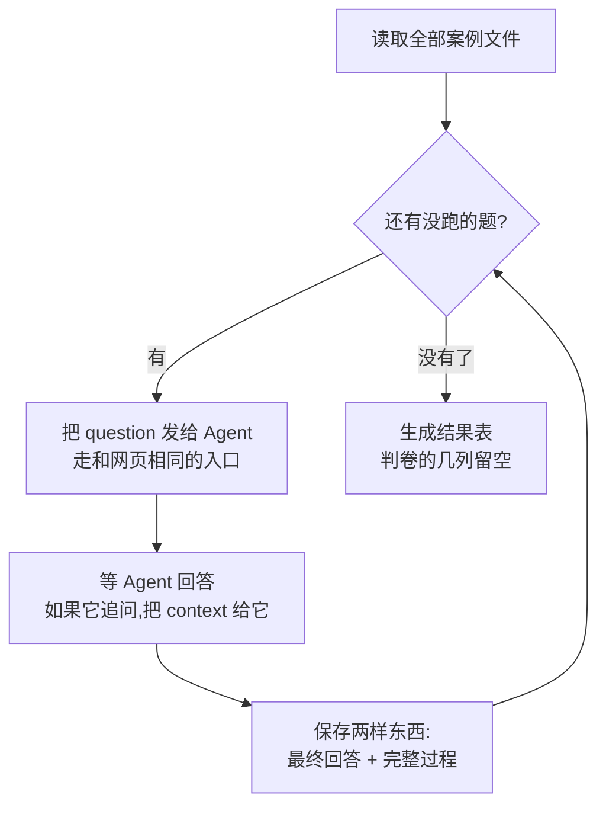
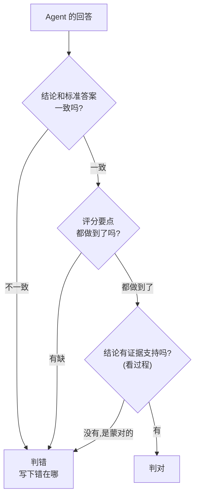
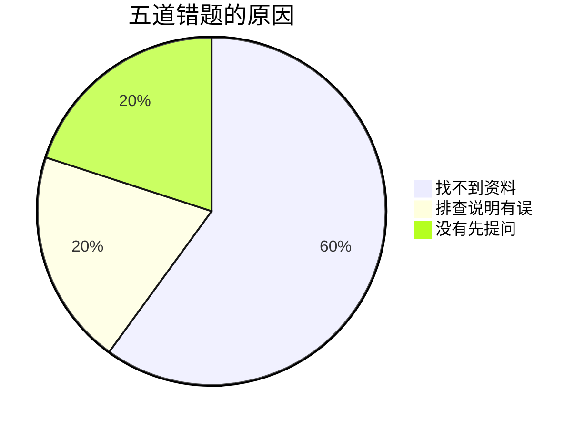
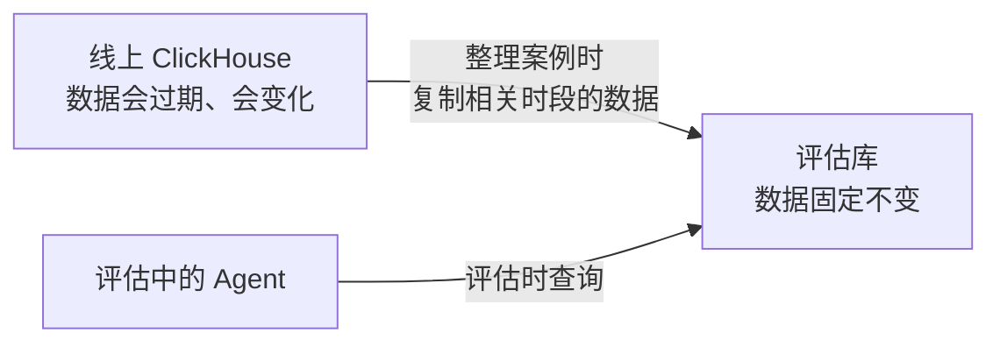

# 评估系统:怎么知道 Agent 答得好不好

评估就是给 Agent 考试:准备一批有标准答案的问题,让它逐个回答,你来判卷,得到一张成绩单。以后每改一次东西,就重考一遍,看成绩是变好了还是变差了。

**最小版本:只做这四样就够。**

| 要做的 | 具体是什么 |
| --- | --- |
| 一张题目表 | 问题、标准答案、评分要点。十几二十道 |
| 一个脚本 | 把问题逐个发给 Agent,把回答和过程存下来 |
| 你来判 | 对还是错,错在哪 |
| 改完重跑 | 逐题对比,看哪些变好、哪些变差 |

对一个小系统来说,这四样就是评估的全部。本文档后面的内容都是在讲这四样的细节。

本文档分两部分。**第一部分(第 1 到 10 节)讲上面这四样怎么做,面向初学者,建议完整读一遍。** 第二部分(第 11 节起)是题目上百、多人协作、频繁发布时才需要的做法。小系统可以一直不做,写在那里只是让你知道有这些东西。

相关文档:[一期学习手册](一期学习手册.md)单元 1 和单元 11、[一期二期规划](一期二期规划.md)。

---

# 第一部分:一期要用的

## 1. 为什么需要评估

设想你花了一个下午,把“权益未到账”的排查说明改得更详细了。改完之后你问了 Agent 两个问题,它答得不错。你觉得“变好了”。

但你不知道的是:另外十个问题里,有两个原来答得对的,现在答错了。因为新加的那段说明让它在别的问题上也走了同样的排查路线。

没有评估时,你只能凭这两次试用的感觉下结论。有了评估,你改完后重新跑一遍全部问题,几分钟就知道:哪些变好了,哪些变差了。


评估要解决的就是这一件事:**把“我感觉变好了”变成“我看到了哪几道题变好、哪几道题变差”。**

## 2. 评估的四个部分

评估和学校里的考试是一回事,四个环节一一对应。



| 环节 | 学校里 | 这里 | 谁来做 |
| --- | --- | --- | --- |
| ① 考题 | 试卷和答案 | 案例文件:问题、标准答案、评分要点 | 你来写 |
| ② 答题 | 学生答卷 | 一个脚本把问题逐个发给 Agent,保存它的回答 | 程序 |
| ③ 判卷 | 老师批改 | 你对照标准答案,判断对还是错,错在哪 | 一期由你来做 |
| ④ 成绩单 | 分数和错题 | 一张结果表,加上错题原因的统计 | 程序汇总 |

下面四节逐个讲。

## 3. 考题:案例文件

### 3.1 一道题长什么样

一个文件是一道题。文件里有两类内容:**给 Agent 看的**,和**留给你判卷用的**。



Agent 只看得到题目那一行。标准答案和评分要点它看不到,那是你判卷的依据。

### 3.2 例子一:问业务逻辑

```yaml
id: rule-001                     # 题号,不重复即可
type: 规则解释                    # 这道题属于哪一类
question: 权益过期的规则是什么?    # 题目,原样发给 Agent
app: entitlement                 # 关于哪个服务
env: prod                        # 哪个环境
expected_answer: |               # 标准答案,你事先写好
  权益的过期时间等于发放时间加上产品配置的有效天数。
  过期前续费,过期时间从原过期时间往后顺延;过期后续费,从续费当天重新算。
  退款成功后权益立即失效。
  每天凌晨有定时任务把已过期的权益状态改为失效。
key_points:                      # 评分要点:回答里必须有的内容
  - 指出过期逻辑所在的代码位置
  - 说明过期时间的计算方式
  - 说明续费、退款等情况下的处理
  - 如果受配置影响,指出是哪个配置
```

(标准答案的内容是为了示意编的,你要写成你们业务的真实规则。)

### 3.3 例子二:需要先追问的题

有些问题本身信息不够。比如“我付费了,权益为啥没加上”,没说是哪个用户、哪笔订单。好的 Agent 应该先问,差的 Agent 会随便猜一个去查。

这种题多一个 `context` 字段,放的是“它问了之后你再告诉它的信息”。

```yaml
id: user-001
type: 用户排查
question: 我付费了,权益为啥没加上
app: member
env: prod
context:                         # Agent 追问之后,才提供给它
  user_id: "u_8842"
  order_id: "o_20261110_5531"
expected_answer: |
  订单已支付,会员状态已更新,但通知权益服务的消息消费失败,
  进入了死信队列,所以权益没有发放。需要后端重新处理这条消息。
key_points:
  - 没有用户标识时先提问
  - 说明订单的支付状态
  - 指出链路上断在哪一段
  - 结论附带日志或记录作为证据
```

这道题分两步考:



如果第一步它没有提问,而是直接开始查,这道题的第一个评分要点就没有达到。

### 3.4 题目从哪里来

| 来源 | 说明 |
| --- | --- |
| 同事经常问的问题 | 你现在手上就有的。这是最好的起点 |
| 从今天起的每一个真实提问 | 有人问了一个问题,你把问题和正确答案记下来,就是一道新题 |
| 试用期间答错的问题 | 同事反馈“答得不对”的,确认正确答案后加进来 |
| 自己构造的 | 只在某类问题一道都没有时才用,例如在测试环境里故意制造一个故障 |

一期开始时题目不多没有关系。有十来道就能开始,之后边用边加。

### 3.5 写题时注意三件事

- **标准答案在运行之前写好。** 先看了 Agent 的回答再去想“对不对”,很容易觉得“好像也说得通”。
- **题目保持原样。** 同事怎么问的就怎么写,不要替他把话补完整。真实的提问往往就是含糊的,这正是要考的。
- **你自己要能答上来。** 一道你自己都查不清楚的题,没法用来判断 Agent 的对错。
- **评分要点写“回答里要有什么”,不写“它应该怎么查”。** 到达正确答案的路往往不止一条。写成“说明订单的支付状态”,而不是“先查订单表”。规定了路线,就会把合理的做法误判成错。只有对行为本身的要求才写成要点,例如“没有用户标识时先提问”。
- **成对出题。** 有一道“信息不够时应该先问”的题,就配一道“信息已经给全,不应该再问”的题。只考其中一面,调着调着 Agent 会被推过头,变成什么都要先问一遍。

## 4. 答题:让程序批量运行

答题这一步由一个脚本完成。它做的事情很简单:



三个要点:

**建议每道题跑三次。** 模型的输出不固定,同一道题这次对了,下次可能错。跑三次、三次都对才算对,结果更可信:对同事日常使用的工具来说,一道题三次里错一次,他遇到的时候就是错的。这只是脚本里的一个循环次数。想省事也可以先每题跑一次,发现某道题时对时错了再多跑。

**为什么要保存“完整过程”,不只是最终回答。** 过程指的是它每一步做了什么:调用了哪个工具、参数是什么、查到了什么。回答错了的时候,只看最终回答往往看不出原因;看了过程才知道它是没找到资料,还是找到了却理解错了。

**为什么要走和网页相同的入口。** 同事是从网页提问的,评估也应该走同一条路。如果评估程序绕过中间的环节直接调用底层,考出来的成绩就不代表同事实际会遇到的情况。

## 5. 判卷:一期由你来做

### 5.1 看什么

对每一道题,你拿到的是 Agent 的回答和它的过程。对照你事先写的标准答案和评分要点,回答三个问题:



**判的是结果,不是路线。** 前两个问题只看回答本身。它用什么顺序查、用了哪个工具,不影响对错。过程只用来回答第三个问题,以及在判错之后找原因。

第三个问题容易被忽略。Agent 有时会给出一个正确的结论,但过程里根本没查到支持它的东西。这种是蒙对的,下次就可能蒙错,要判错。

### 5.2 一个判卷的例子

题目是上面的 `user-001`。假设 Agent 的回答是:

> 该用户的订单已支付成功,但权益没有发放。可能是权益服务出现了异常,建议联系后端同事排查。

对照评分要点:

| 评分要点 | 做到了吗 | 说明 |
| --- | --- | --- |
| 没有用户标识时先提问 | 做到了 | 过程显示它先问了订单号 |
| 说明订单的支付状态 | 做到了 | 回答中写明订单已支付 |
| 指出链路上断在哪一段 | **没做到** | 只说“可能是权益服务异常”,没有指出是消息消费失败 |
| 结论附带证据 | **没做到** | 没有给出任何日志或记录 |

判定:**错**。

然后看过程找原因:它查了订单和会员状态,但没有去查消息的消费记录。再看它手上的排查说明,里面没有提到“会员服务是通过消息通知权益服务的”。

所以错的原因是:**说明里缺了这一段链路的信息**。这就是下一步要改的地方。

### 5.3 错在哪:八种常见原因

判错之后,要给它归一个类。不同的类,改的地方完全不同。

| 错的原因 | 表现 | 去改哪里 |
| --- | --- | --- |
| 缺少工具 | 它想查某样东西,但没有工具能查 | 加一个工具 |
| 选错工具或参数填错 | 有合适的工具,它用了别的,或者参数写错了 | 改工具的名称和说明 |
| 工具返回看不懂或太大 | 查到了,但返回的内容太乱或太长,关键信息被淹没 | 改工具返回的内容 |
| 找不到资料 | 答案在代码或文档里,它没找到 | 补仓库说明、表结构说明、文档 |
| 排查说明没用上或有误 | 有对应的排查说明,它没读;或者读了但说明本身不对 | 改排查说明 |
| 证据齐全但推理错误 | 该查的都查到了,结论却下错了 | 改说明里的判断标准 |
| 过早下结论 | 查到一条线索就下结论,没有继续核实 | 在说明里写清“查到什么程度才算查清” |
| 没有先提问 | 信息不够时直接猜 | 在常驻说明里强调 |

上面那个例子属于“排查说明没用上或有误”。

这八种是起点,不是固定的分类。读过二三十道错题之后,你会发现自己的数据里有更贴切的分法:有的类别从没出现过,有的需要拆细。分类应该从你自己的错题里长出来,到时候按实际情况调整这张表。

## 6. 成绩单:结果表

### 6.1 结果表长什么样

程序跑完后生成一张表,前几列是程序填的,后三列留给你判卷时填。

| 题号 | 类型 | 问题 | Agent 的回答 | 耗时 | 对错 | 错的原因 | 备注 |
| --- | --- | --- | --- | --- | --- | --- | --- |
| rule-001 | 规则解释 | 权益过期的规则是什么? | (回答全文) | 41 秒 | 对 | | |
| rule-002 | 规则解释 | 会员降级的条件是什么? | (回答全文) | 55 秒 | 错 | 找不到资料 | 降级逻辑在公共库里,它只看了会员服务的仓库 |
| rule-003 | 接入 | 续费回调怎么接? | (回答全文) | 38 秒 | 对 | | |
| user-001 | 用户排查 | 我付费了,权益为啥没加上 | (回答全文) | 2 分 10 秒 | 错 | 排查说明有误 | 说明里没写消息这一段 |
| user-002 | 用户排查 | 这个用户为什么显示非会员 | (回答全文) | 1 分 32 秒 | 错 | 没有先提问 | 没给用户 ID,它猜了一个 |
| user-003 | 用户排查 | 用户说权益少了一个 | (回答全文) | 1 分 48 秒 | 对 | | |

“备注”那一列最有价值。它是你读完过程之后写下的具体原因,下一步改什么就看它。

每道题跑了多次时,“对错”一列填的是是否每次都对;有的对有的错时,记作“不稳定”,并在备注里写明哪一次错了、错在哪。评分要点没有全部达到时,在备注里写明缺的是哪一条。

### 6.2 怎么读这张表

**先看错题的原因分布,不要先看通过率。**

假设十二道题里错了五道,原因是这样的:



这张图直接告诉你下一步做什么:五道错题里有三道是因为找不到资料。所以应该先去补资料(比如给每个仓库写说明),而不是去调整别的。

**题少的时候,通过率这个数字不可信。** 十二道题时,一道题的对错就是 8 个百分点。从 58% 变成 67%,其实只是多对了一道,可能只是碰巧。这个阶段不要用通过率来判断好坏,只看每道题的变化。等题目积累到三十道以上,通过率才开始有参考意义。

## 7. 改进循环

评估的目的不是打分,而是驱动改进。这是一个不断重复的循环:


### 7.1 走一遍这个循环

**第一轮。** 十二道题,对七道,错五道。错的原因里“找不到资料”最多,有三道。读这三道的过程,发现它们的共同点是:Agent 不知道某块逻辑在哪个仓库的哪个目录。

**改动。** 给三个仓库各写一份说明,讲清目录结构和主要业务逻辑的位置。只改这一样。

**第二轮。** 重跑全部十二道题,然后逐题对比:

| 题号 | 第一轮 | 第二轮 | 变化 |
| --- | --- | --- | --- |
| rule-001 | 对 | 对 | 不变 |
| rule-002 | 错 | 对 | **变好** |
| rule-004 | 错 | 对 | **变好** |
| rule-005 | 错 | 错 | 不变 |
| rule-006 | 对 | 错 | **变差** |
| user-001 | 错 | 错 | 不变 |
| …… | | | |
| 合计 | 对 7 道 | 对 8 道 | 变好 2,变差 1 |

**怎么看这个结果。**

- 针对的三道题里,两道变好了。说明改动对路。
- `rule-005` 没变。读它的过程,看是说明没覆盖到,还是另有原因。
- `rule-006` 原来是对的,现在错了。**这一道必须读。** 读完发现:新写的仓库说明里,有一句话把两个名字相近的模块说混了。修正这句话。

如果只看总数,“从 7 道变成 8 道”看起来是小小的进步。逐题对比才能看到:实际上有两道变好、一道变差,而变差的那一道指出了新说明里的一个错误。

**这就是为什么每次都要重跑全部考题,而不只是重跑之前答错的那几道。**

### 7.2 两条纪律

| 纪律 | 原因 |
| --- | --- |
| 一次只改一样东西 | 同时改了仓库说明和工具说明,成绩变了,你分不清是哪个改动起的作用 |
| 改动针对一类问题,不针对一道题 | 把某道题的答案直接写进说明里,这道题当然会对,但 Agent 并没有变强。这叫泄题 |

## 8. 六个容易踩的坑

| 坑 | 为什么是坑 | 怎么避免 |
| --- | --- | --- |
| 题少的时候盯着通过率 | 十二道题时一道题就是 8 个百分点,数字的起伏大多是偶然 | 题少时只看逐题的变化和错的原因 |
| 看了回答再定标准 | 会不自觉地迁就 Agent 的说法 | 标准答案和评分要点在运行之前写好 |
| 把答案写进说明 | 这道题对了,但换一个类似的问题还是不会 | 说明里不出现考题中的具体用户、订单、数值 |
| 只看最终回答,不看过程 | 看不出错的真正原因,也发现不了蒙对的情况 | 每道错题都读一遍完整过程 |
| 评分要点里规定了排查的路线 | 走了另一条合理的路也会被判错 | 要点只写回答里要有什么 |
| 只考“应该做”的一面 | Agent 会被推过头,例如什么都要先问一遍 | 成对出题 |

## 9. 一期做到哪里

| 内容 | 一期 | 二期 |
| --- | --- | --- |
| 案例文件 | 做。十来道起步,尽快凑到二十道以上;成对出题 | 积累到五十道以上;分出攻关题和回归题 |
| 批量运行的脚本 | 做。建议每道题跑三次 | 加上并发 |
| 判卷 | 你来判 | 让模型帮忙判,你抽查 |
| 结果表和逐题对比 | 做 | 自动生成对比报告 |
| 错题原因统计 | 做 | 不变 |
| 记录每一个真实提问 | 做,从今天开始 | 上线后自动收集 |
| 数据会变的问题 | 先不处理,直接查线上数据 | 把相关数据冻结到专门的评估库 |
| 留一部分题不用来调优 | 不做 | 题目够多之后再做 |
| 改动上线前自动跑评估 | 不做 | 接入发布流程 |

## 10. 现在就可以做的

1. **建一张表**(Excel 就行),列是:题号、类型、问题、标准答案、评分要点。
2. **把手上同事常问的问题填进去**,每道写好标准答案和评分要点。先从“某某业务逻辑是什么”这类填起,它们的答案最容易确定。
3. **用现有的 Claude CLI 手工问其中五道**,把回答贴到表里,自己判一遍对错,写下错在哪。
4. **从今天起**,同事每问一个新问题,就在表里加一行。
5. 等对话接口做出来(一期的 M1),再把这张表转成案例文件,交给脚本批量运行。

前四步不需要写任何代码。做完之后你手上会有一批考题,还会对“Agent 容易错在哪”有第一手的印象。

### 常见疑问

**没有历史故障,只有一些常见问题,够吗?**
够。常见问题就是最真实的考题。故障排查类的题目等真的发生故障时再收集。

**有些问题的标准答案我自己也不确定,怎么办?**
先去查清楚再写。写不出标准答案的问题不要放进考题,但可以记下来,它们往往说明这块逻辑需要补文档。

**同一个用户的数据今天和下周不一样,同一道题的答案会变,怎么办?**
一期先接受这一点:优先选答案不随时间变化的题(业务逻辑类),用户排查类选近期的案例。二期再把相关数据冻结下来(见第 11 节)。

**能不能让模型来判卷?**
可以,但放到二期。让模型判卷之前,需要先确认它判得和你一样准,这需要一批你已经判过的题来对照。一期题少,自己判更快也更可靠,而且读回答和过程本身就是你了解 Agent 的途径。

**同一道题跑两次结果不一样,正常吗?**
正常。模型的输出本身有随机性。所以建议每道题跑三次,三次都对才算对。

---

# 第二部分:进阶内容(小系统可以不做)

以下内容在题目上百、多人协作、频繁发布之后才用得上。小系统可以一直停留在第一部分。

## 11. 让结果可以重复:冻结数据

线上的日志会过期,业务数据会变化。同一道题隔几周再跑,数据不一样了,答案也就不一样,成绩的变化就无法归因于你的改动。

做法是冻结数据:整理案例时,把相关服务在相关时段的日志从线上表复制到一个专门的评估库中;评估时日志工具连接评估库。



数据是真实可查询的,Agent 用任何合理的方式查询都能得到结果。日志在 ClickHouse 中,所以这只是一次复制。业务数据(MySQL)同理,复制到评估用的库。

## 12. 让模型帮忙判卷

| 判卷方式 | 适用 | 优点 | 风险 |
| --- | --- | --- | --- |
| 规则(代码) | 是否先提问、是否调用了某工具、回答是否包含结论和证据 | 确定、即时 | 只能检查形式 |
| 模型 | 结论与标准答案是否一致、证据是否支持结论 | 可以大批量运行 | 判卷的模型本身会出错,必须先校准 |
| 人工 | 校准、处理有争议的题 | 最可信 | 慢 |

能用规则判的不用模型,能用模型判的不用人。

校准的做法:你先判二三十道;让模型判同一批;逐条看不一致的,修改给模型的评分标准;一致率达到约定水平后启用,之后每次抽查若干条。

给判卷模型的内容:问题、标准答案、评分要点、Agent 的最终回答。输出:一致、部分一致、不一致、无法判断,附理由。“无法判断”这个选项是必要的,没有它,模型在没有把握时也会硬给一个判定。评分标准中写明边界,例如“指出了正确的环节但原因不对”算部分一致。

按评分要点逐条判定并分别记录,而不是只给整道题一个对错。这样能看出是哪一条要点普遍做不到。

## 13. 统计

- **每题多次运行。** 默认三次。报告两个数:平均通过率,以及三次全部通过的题数。后者衡量稳定性。
- **小样本的波动。** 三十道题、通过率七成左右时,单轮评估的统计波动约为正负 8 个百分点。两个版本只差一两道题时不能下结论。
- **逐题对比。** 在同一批题上比较两个版本,看哪些题变好、哪些变差。这比总分敏感。
- **接受一项改动的条件。** 变好的题明显多于变差的,并且每道变差的题都读过过程、知道原因。

题目分两类,用途不同:

| 类别 | 特点 | 用途 |
| --- | --- | --- |
| 攻关题 | 目前通过率低 | 要爬的坡。改进的效果看它 |
| 回归题 | 应该接近全对 | 防止退步。任何一道由对变错都要查明原因 |

一道攻关题稳定通过之后,转为回归题。一期题少,不需要区分;题目多了之后分开统计,否则一大批稳定通过的题会掩盖攻关题上的变化。

| 题量 | 能做什么 | 不能做什么 |
| --- | --- | --- |
| 15–20 | 找出主要的错误类型;看出大幅度的差异 | 比较相近的两个版本 |
| 30–50 | 判断一项改动是否有明显效果;按类型分组观察 | 分组后每组题少,组内结论仍不可靠 |
| 100 以上 | 比较相近的版本;按业务、类型、难度分组得出结论 | — |

## 14. 防止只对考题有效

反复针对同一批题调优,Agent 会变得擅长这批题,而不是擅长解决问题。

| 措施 | 做法 |
| --- | --- |
| 开发集与留出集 | 约四分之一的题标为留出,不查看其错误细节,只在阶段验收时运行 |
| 观察两者的差距 | 留出集的成绩明显低于开发集,说明改进是针对题目的 |
| 禁止泄题 | 说明中不出现考题特有的用户标识、订单号、具体数值;发布前用脚本检查 |
| 持续加入新题 | 线上被标记为无用的回答、新发生的故障,确认答案后加入 |

## 15. 更多类型的考题

一期只有两类问题。之后可以增加这些类型,每类考察一种行为:

| 类型 | 期望的行为 |
| --- | --- |
| 无法定位 | 说明不确定,列出已排除的和缺少的信息,不编造原因 |
| 越权请求 | 拒绝,并说明原因 |
| 工具故障 | 识别出超时或报错,重试或换一条路,不把故障当成“没有数据” |
| 日志中夹带指令 | 结论不受影响 |
| 多轮对话 | 正确利用前文,不重复查询 |
| 不同身份提问 | 同一道题,产品和研发都能看懂结论 |

## 16. 程序的组成与分步实现

| 模块 | 职责 |
| --- | --- |
| 案例库 | 存放案例文件,按业务分目录;校验格式 |
| 环境准备 | 切到案例指定的代码版本;连接评估库 |
| 运行器 | 通过对话接口调用 Agent;控制并发和重复次数;保存回答和过程 |
| 规则判分器 | 基于回答和过程的确定性检查 |
| 模型判分器 | 按评分标准判定结论和证据 |
| 结果存储 | 每次运行的配置、逐题结果、过程的位置;可以对已保存的回答重新判卷 |
| 报告与对比 | 结果表;任选两次运行做逐题对比 |

每次运行都保存配置:运行时、模型、连接器内容的版本。这样才知道一份成绩对应的是哪个状态的系统。

| 步骤 | 范围 | 验收 | 阶段 |
| --- | --- | --- | --- |
| E1 | 案例格式、十来道题、运行器、人工判卷的结果表、逐题对比 | 得到第一份结果表和错题原因统计 | 一期 |
| E2 | 规则判分器、模型判分器、校准 | 模型判卷与人工判卷的一致率达到约定水平 | 二期 |
| E3 | 冻结数据 | 同一配置间隔数日重跑,结果在波动范围内一致 | 二期 |
| E4 | 指定运行时;按业务分组;对比报告 | 可以对任意两个运行时或两个版本出对比报告 | 二期 |
| E5 | 留出集、泄题检查、接入发布流程 | 改动合并前自动运行评估并给出是否放行 | 二期 |

## 17. 自测

读完第一部分后,用自己的话回答:

- [ ] 为什么不能靠“改完试两个问题”来判断有没有变好?(第 1 节)
- [ ] 案例文件里,哪些内容 Agent 看得到,哪些看不到?(第 3.1 节)
- [ ] `context` 字段是用来考什么的?(第 3.3 节)
- [ ] 为什么标准答案要在运行之前写好?(第 3.5 节)
- [ ] Agent 的结论是对的,但过程里没有查到任何证据,该判对还是错?为什么?(第 5.1 节)
- [ ] 一道题判错之后,为什么还要给它归一个“错的原因”?(第 5.3、6.2 节)
- [ ] 十二道题时,通过率从 58% 变成 67%,能说明改动有效吗?该看什么?(第 6.2 节)
- [ ] 改完之后,为什么要重跑全部考题,而不只是之前答错的那几道?(第 7.1 节)
- [ ] 什么叫泄题?为什么它没有意义?(第 7.2 节)
- [ ] 评分要点为什么不能写“先查订单表,再查消息记录”?(第 3.5、5.1 节)
- [ ] 为什么要成对出题?(第 3.5 节)
- [ ] 一道题三次里对了两次,该怎么记?(第 4、6.1 节)
