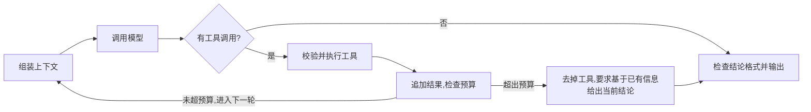
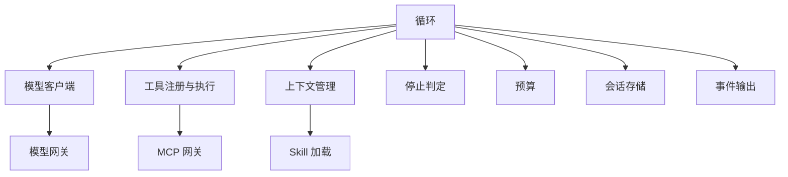

# 自研运行时:原理与设计

运行时(harness)是包在模型外面的一层程序。模型只负责“根据眼前的内容决定下一步”;让它看到什么、执行它要求的动作、何时停止、出错怎么办,都由运行时负责。同一个模型在不同运行时下表现的差异,主要来自这一层。

本页先讲理念和原理,再给出模块划分和验收标准。实现交给编码工具,设计决策需要人理解并确认。

相关文档:[总体设计](01-总体设计.md)、[评估系统:原理与设计](02-评估系统-原理与设计.md)。

## 1. 基本理念

| 理念 | 含义 | 对设计的影响 |
| --- | --- | --- |
| 模型是无状态的 | 每次调用都从头阅读完整的上下文,调用之间不保留任何东西 | “记得之前的事”完全靠运行时每次把历史再发一遍 |
| 上下文是唯一的工作记忆 | 模型能用的信息只有这一次调用里的文字 | 运行时最核心的工作是决定上下文里放什么 |
| 模型提议,运行时执行 | 模型不能直接做任何事,只能输出“我想调用某个工具” | 执行、校验、拒绝的权力都在运行时,安全边界可以用代码强制 |
| 能用代码确定的不交给模型 | 预算、权限、超时、任务信息是确定性的 | 这些用代码实现;只有需要判断的事(下一步查什么)交给模型 |
| 一切可观察 | 每一步都留下事件 | 没有轨迹就无法做失败分析,也就无法改进 |
| 策略可替换 | 截断、压缩、停止等策略都是可配置的 | 每次实验只改一个策略,用评估对比 |

## 2. 核心循环的原理

循环本身很短,复杂度在每一步的策略里。

1. **组装上下文。** 系统提示(常驻说明、Skill 描述、任务信息)加工具定义加消息历史。
2. **调用模型。** 把组装好的内容发给模型。
3. **看模型返回什么。** 只有两种可能:纯文字,表示它认为可以回答了;或者一个到多个工具调用请求,每个包含工具名和参数。
4. **有工具调用时,运行时校验并执行。** 执行结果作为一条新消息追加到历史末尾。
5. **检查预算,回到第 1 步。** 模型在下一轮会看到工具结果,再决定下一步。
6. **没有工具调用时,检查结论是否合格并输出。**

两个要点:

- **消息历史就是任务的全部状态。** 保存它就能接续任务,重放它就能复现问题。
- **历史只追加、不修改。** 原因见第 3 节的第一项决策。

## 3. 关键设计决策

| 问题 | 选择 | 原理 |
| --- | --- | --- |
| 状态放在哪里 | 消息历史是唯一状态,只追加 | 可持久化、可重放。模型服务对重复的前缀有缓存,前缀不变时重复部分的费用大幅降低;修改历史前部会让缓存失效 |
| 工具出错怎么办 | 把错误作为工具结果返回给模型,不中断循环 | 模型看到错误后可以修正参数或换路径。错误信息写得是否清楚,决定它能否自己修正 |
| 什么时候停 | 模型不再调用工具;或轮数、费用、时长超限;或用户取消;或需要用户补充信息 | 只靠模型自己停会出现死循环。超限时不直接断掉,而是去掉工具再调用一次,让它基于已有信息给出当前结论 |
| 一次返回多个工具调用 | 只读工具并行执行,结果按原顺序返回 | 缩短耗时。只读没有副作用,并行是安全的;将来的写工具必须串行 |
| 工具结果多大 | 运行时设硬上限,超出则截断,并告诉模型被截断了、如何缩小范围 | 不能指望每个工具自觉。一次超大结果会挤掉其他信息,并在之后每一轮重复计费 |
| 怎样算完成 | 输出必须包含结论、证据、不确定项、建议;缺项时追加一条提示要求补全,最多一次 | 防止提前下结论和空泛的回答 |
| 重复调用 | 检测到连续的相同工具加相同参数时,追加一条提示 | 这是常见的失败模式,通常源于之前的结果被淹没或被压缩 |
| 模型接口报错 | 限流和超时按退避重试;仍失败则任务失败,保留历史 | 历史还在,就能从上一步继续,不必重头开始 |

## 4. 上下文管理的原理

本节讲单个任务内的上下文管理。跨轮次的部分(一轮结束后留下什么、下一轮带上什么)见 [上下文与多轮会话:原理与设计](06-上下文与多轮会话-原理与设计.md)。

上下文越长,模型越容易漏看关键信息,每一轮的费用也越高。管理的目标是:在不丢失关键事实的前提下,让上下文尽量小。

五种手段,按从无损到有损排列:

| 手段 | 做法 | 代价 |
| --- | --- | --- |
| 按需加载 | Skill 正文、知识文档只在需要时读取 | 可能该读的没读,取决于描述的质量 |
| 入口截断 | 工具结果进入历史前按上限截断,并注明总量和缩小范围的方法 | 可能截掉需要的内容,所以必须告诉模型怎么取更多 |
| 子任务 | 耗上下文的工作在独立的上下文中完成,只返回结论 | 子任务看不到主任务的背景,任务说明必须写清楚 |
| 清理旧工具结果 | 较早轮次的工具结果替换成一行占位,保留“调用过什么”的记录 | 模型可能需要重查;会让缓存失效一次 |
| 摘要压缩 | 接近上限时,把早期历史总结成结构化摘要:已确认的事实、证据位置、已排除的假设、待办 | 丢失细节;摘要本身可能出错 |

配套的补救措施是**外置笔记**:要求模型在复杂任务中把关键事实写入笔记文件,压缩之后重新读取。笔记在上下文之外,不会被压缩掉。

原则:

- **先用无损的,再用有损的。** 前三种不丢信息,始终开启;后两种只在接近上限时触发。
- **稳定的内容放前面,变化的放后面。** 系统提示和工具定义在最前,任务中不改动,这样缓存一直有效。
- **有损操作成批进行。** 每次修改历史都会让缓存失效,所以一次清理足够多,而不是每轮都改一点。
- **触发阈值和保留范围是参数。** 用评估比较不同取值下的成功率和成本。

## 5. Skill 按需加载的原理

Skill 分三层进入上下文,越具体的内容越晚加载。

| 层 | 内容 | 何时进入上下文 |
| --- | --- | --- |
| 描述 | 每个 Skill 的名称、一两行适用场景、文件路径 | 始终在系统提示中 |
| 正文 | 排查思路、判断标准、停止条件 | 模型判断相关时,用读文件工具读取 |
| 附属文件 | 错误码表、字段含义等细节 | 正文指引下再读取 |

实现上不需要专门的机制:Skill 就是文件,读取用普通的读文件工具。运行时只需要在启动时扫描 Skill 目录,把描述清单写进系统提示。

这个设计的成败取决于描述写得好不好。评估时单独统计 Skill 命中率:该用的案例中,实际读取了正文的比例。

## 6. 工具层的原理

工具定义是提示词的一部分。模型只凭名称、说明、参数结构来决定是否调用、怎么填参数,所以工具设计的质量直接决定 Agent 的表现。

工具有两类来源:

| 来源 | 包含 | 说明 |
| --- | --- | --- |
| 内置 | 读文件、内容搜索、路径匹配、笔记读写、计划 | 运行时自己实现 |
| MCP | 日志、监控、发布、会员等业务工具 | 启动时连接 MCP 网关,拉取工具列表,转换成模型能识别的工具定义 |

所有工具调用经过同一条执行管道,没有例外:

1. **参数校验。** 不符合参数结构时,返回说明哪个参数错、正确格式是什么。
2. **权限检查。** 工具是否在白名单内;文件路径是否在工作目录内。
3. **执行。** 带超时。
4. **结果整形。** 截断、标注总量、区分无数据和失败。
5. **记录事件。** 工具名、参数、结果摘要、耗时。

内置文件工具的约束:路径解析后必须落在工作目录内;只读;单次返回有上限;搜索结果返回文件名、行号、匹配行,而不是整个文件。

## 7. 模块划分

循环只负责推进,策略都在独立的模块里。这样每次实验只换一个模块的策略。

| 模块 | 职责 |
| --- | --- |
| 循环 | 推进一轮:请求组装上下文、调用模型、分发工具调用、询问是否停止。不包含任何具体策略 |
| 模型客户端 | 封装模型调用、流式输出、重试、用量统计。经模型网关访问,可切换模型 |
| 工具注册与执行 | 注册内置工具和 MCP 工具;实现第 6 节的执行管道 |
| 上下文管理 | 组装系统提示;实现截断、清理、摘要的策略和触发条件 |
| Skill 加载 | 扫描 Skill 目录,生成描述清单,供上下文管理写入系统提示 |
| 停止判定 | 判断完成、超限、重复调用、需要用户补充 |
| 预算 | 统计轮数、费用、时长 |
| 会话存储 | 持久化消息历史和任务状态,支持接续 |
| 事件输出 | 把每一步转成事件流,按运行时接口输出,并写入轨迹 |

依赖方向是单向的:循环依赖各模块,各模块不依赖循环,彼此之间也尽量不依赖。

## 8. 分步实现与验收

每一步的交付物是三样:设计说明、实现、评估对比记录。

| 步骤 | 范围 | 验收 |
| --- | --- | --- |
| A1 | 循环、模型客户端、内置文件工具、预算、停止判定、事件输出 | 全部评估案例能跑完;轨迹完整;超限时按设计结束并给出当前结论 |
| A2 | 接入业务工具:先复用现有脚本,网关就绪后改为 MCP | 与现有 CLI 原型在相同条件下的分数对比,并完成差距分析 |
| B1 | Skill 加载 | Skill 命中率;与把 Skill 全部写进系统提示相比的分数和成本 |
| B2 | 上下文管理,按截断、清理、摘要、笔记的顺序逐项加入 | 每加一项的前后对比:长案例的成功率、单任务成本 |
| B3 | 会话存储 | 多轮案例的成功率;进程重启后能接续 |
| B4 | 健壮性:工具超时与重试、并行调用、取消、模型接口报错 | 工具故障类案例的成功率;同一案例 3 次运行的一致性 |

## 9. 理解检查

交给编码工具实现之前,这些问题应当能用自己的话回答。答不上来的,对应章节需要再读或讨论。

- [ ] 模型不记得上一轮的内容,多轮工具调用是怎么连贯起来的?(第 1、2 节)
- [ ] 为什么消息历史只追加不修改?什么情况下不得不修改,代价是什么?(第 3、4 节)
- [ ] 工具执行失败时,为什么把错误返回给模型而不是终止任务?(第 3 节)
- [ ] 预算用完时直接结束和让模型给出当前结论,差别在哪里?(第 3 节)
- [ ] 截断、清理、摘要分别丢失什么?为什么按这个顺序使用?(第 4 节)
- [ ] Skill 的描述写得不好会导致什么现象?怎么发现?(第 5 节)
- [ ] 为什么说工具定义是提示词的一部分?(第 6 节)
- [ ] 哪些事情用代码强制,哪些交给模型判断?划分的依据是什么?(第 1 节)
