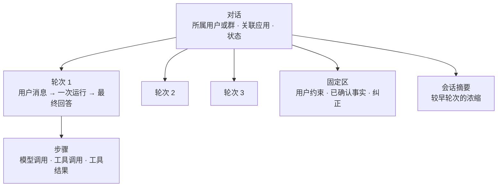
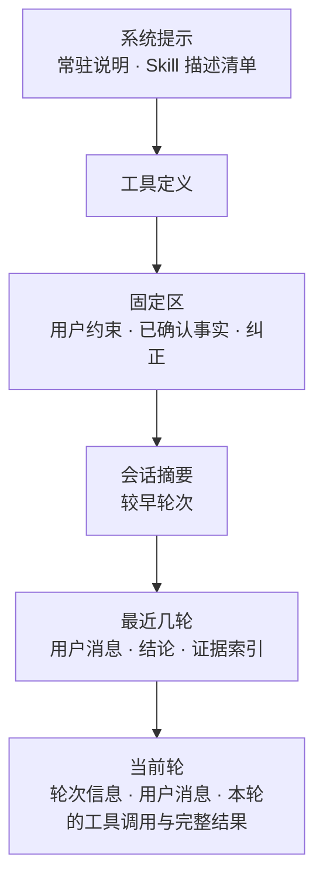

# 上下文与多轮会话:原理与设计

会话是存下来的完整记录,上下文是每次调用模型时从记录里组装出来的一份视图。两者不是一回事:会话可以无限增长,上下文必须保持小而准。多轮会话的设计,就是规定每一轮结束后留下什么、下一轮开始时带上什么。

相关文档:[总体设计](01-总体设计.md)第 7 节给出分层,[自研运行时](03-自研运行时-原理与设计.md)第 4 节讲单个任务内的上下文管理。本文档讲跨轮次的部分。

## 1. 基本理念

| 理念 | 含义 | 对设计的影响 |
| --- | --- | --- |
| 会话与上下文分离 | 会话是事实记录,上下文是为这一次调用挑选和整理出来的内容 | 存储完整,发送精简;两者分开保存 |
| 三种东西,三种寿命 | 上下文只活一次调用;会话活到对话结束;记忆跨对话存在 | 分别设计,不互相替代 |
| 轮次是天然的整理点 | 一轮结束时结论已经得出,原始的工具结果不再需要逐字保留 | 在轮次边界做压缩,而不是等到快满了才压缩 |
| 结论和证据分开保存 | 下一轮通常只需要知道“查到了什么”,偶尔需要回看原始数据 | 上下文里留结论和证据索引,原始数据放在外部,可按引用取回 |
| 事实有时效 | 订单状态、错误率这类信息会变 | 每条证据带取数时间,过期的要重新查询 |
| 用户说的话优先级最高 | 用户给的约束和纠正不能被压缩掉 | 固定保留,不参与压缩 |
| 稳定的在前,变化的在后 | 模型服务对重复的前缀有缓存 | 每轮新增的信息追加在末尾,不改动前面的内容 |

## 2. 三份数据

同一个对话,保存三份不同用途的数据:

| 数据 | 内容 | 给谁用 | 是否压缩 |
| --- | --- | --- | --- |
| 展示记录 | 用户的每条消息、Agent 的每次最终回答、进度提示 | 用户界面 | 不压缩,完整保留 |
| 模型历史 | 发给模型的消息序列 | 运行时 | 按本设计压缩 |
| 轨迹 | 每一步的模型输出、工具调用、原始工具结果、耗时、费用 | 排错、评估、审计 | 不压缩,原始结果单独存储,按引用访问 |

常见的错误是只存一份,既用来展示又用来发给模型。结果是:要么为了展示完整而让上下文膨胀,要么为了压缩上下文而让用户看不到之前的内容。

## 3. 会话模型



| 对象 | 含义 | 关键字段 |
| --- | --- | --- |
| 对话 | 用户看到的一个聊天 | 对话 ID、所属用户或群、关联应用与环境、所用运行时、状态、累计费用 |
| 轮次 | 一条用户消息到一次最终回答 | 轮次 ID、发言人、开始和结束时间、状态、结论、证据索引、费用 |
| 步骤 | 轮次内的一次模型调用或工具调用 | 步骤 ID、类型、输入输出的引用、耗时 |
| 固定区 | 不参与压缩的内容 | 条目、来源(用户说的还是查证的)、记录时间 |
| 会话摘要 | 较早轮次的结构化浓缩 | 摘要内容、覆盖到第几轮、生成时间 |

轮次的状态:运行中、等待用户补充、已完成、已取消、超预算终止、失败。一个对话同一时间只有一个轮次在运行。

## 4. 上下文的组装

每次调用模型时,上下文按固定顺序组装:



| 区块 | 变化频率 | 说明 |
| --- | --- | --- |
| 系统提示、工具定义 | 整个对话内不变 | 放最前面,缓存始终有效 |
| 固定区 | 很少变,只追加 | 用户说过的约束和纠正,任何时候都在 |
| 会话摘要 | 偶尔更新 | 只在对话很长时出现 |
| 最近几轮 | 每轮结束时追加一条 | 已经是压缩后的形式 |
| 当前轮 | 每一步都在增长 | 唯一保留完整工具结果的区块 |

规则:**完整的工具结果只在产生它的那一轮里出现。** 轮次结束后,它被替换成证据索引。

## 5. 轮次边界的压缩

### 5.1 一轮结束后留下什么

| 保留在模型历史中 | 移出模型历史,存入轨迹 |
| --- | --- |
| 用户的原始消息 | 中间的模型输出 |
| 最终回答(结论、证据、不确定项、建议) | 工具调用的完整参数 |
| 证据索引 | 工具返回的原始内容 |

证据索引是一个简短的列表,每条包含:

| 字段 | 例子 |
| --- | --- |
| 查了什么 | `logs_count_by_error`,member-service,prod,14:00–15:00 |
| 关键发现 | 回调超时错误 312 次,14:20 起出现 |
| 取数时间 | 15:32 |
| 引用 | 原始结果的存储标识,可用工具取回 |

提供一个取回工具:Agent 在后续轮次需要回看原始数据时,凭引用取回,而不是重新查询或凭印象回答。

### 5.2 为什么在轮次边界压缩

- **此时信息已经被消化。** 结论已经写出,原始数据的价值已经转移到结论和证据索引里。
- **不损失缓存。** 修改历史会让缓存失效,但用户阅读回答、输入下一个问题通常需要几分钟,缓存本来也快过期了。
- **压缩内容是确定的。** 不需要让模型判断“哪些该留”,规则固定,可以用代码完成,不引入额外的出错机会。

对比:只在上下文快满时才压缩,压缩的是一大段混杂的内容,需要模型来做摘要,既花钱又可能丢掉关键信息。

### 5.3 对话很长时:会话摘要

最近几轮的条数有上限。超出时,把最早的若干轮合并进会话摘要。摘要是结构化的:

- 讨论过哪些问题,各自的结论。
- 仍然有效的事实和它们的来源。
- 已经排除的假设。
- 尚未解决的问题。

固定区的内容不进入摘要,始终原样保留。

## 6. 多轮中的具体情况

### 6.1 四种追问

| 类型 | 例子 | 处理 |
| --- | --- | --- |
| 细化 | “那回调为什么会超时?” | 沿用上一轮的结论和证据索引继续查;需要原始数据时凭引用取回 |
| 换对象 | “再看看另一个用户 B” | 沿用排查方法,不沿用上一个对象的结论;轮次信息里更新对象 |
| 纠正 | “不对,这个用户是昨天付的款” | 把用户的说法写入固定区,标明来源是用户;与已有证据冲突时明确指出冲突,不默默改口 |
| 换话题 | 从会员问题转到一个无关的发布问题 | 建议新开对话(第 6.3 节) |

### 6.2 每轮注入的信息

每一轮开始时,由 Agent 服务用代码生成一段轮次信息,和用户消息一起追加在末尾:

```
[轮次信息]
当前时间: 2026-11-11 17:45 (UTC+8),距上一轮 2 小时 10 分
发言人: 张三
线上版本: v1.9.1 (16:30 发布,上一轮时为 v1.9.0)
上一轮的证据取数时间: 15:32
```

要点:

- **追加在末尾,不修改系统提示。** 系统提示不变,缓存才有效。
- **只写变化和时间。** 应用、环境这些不变的信息在第一轮已经给过。
- **版本变化单独指出。** 两轮之间发生了发布,是排查时最重要的线索之一。

### 6.3 话题切换

前一个话题的结论和证据留在上下文里,会干扰新话题的判断,也白白增加成本。

- 界面始终提供“新建对话”。
- 新一轮涉及的应用或环境与当前对话不同时,Agent 服务提示用户:“这看起来是一个新问题,建议新开对话”,由用户决定。
- 不做静默的自动切分。系统误判话题切换时,用户会发现 Agent 突然“失忆”,而且不知道原因。
- 用户选择新开时,可以把上一个对话的结论摘要带过去,作为新对话的背景。

### 6.4 证据的时效

| 信息类型 | 例子 | 跨轮处理 |
| --- | --- | --- |
| 不会变的 | 某笔订单的创建时间、某个版本的代码 | 直接沿用 |
| 会变的状态 | 会员是否生效、当前错误率、当前线上版本 | 距取数时间超过阈值时重新查询 |
| 历史时段的统计 | 昨天 14 点到 15 点的错误数 | 直接沿用 |

证据索引里的取数时间和轮次信息里的当前时间,让模型能自己判断。常驻说明里写明规则:引用会变的状态之前,先看取数时间。

### 6.5 等待用户补充

Agent 缺少必要信息时,不猜测,结束本次运行并提出问题,轮次进入“等待用户补充”状态。用户回答后,在同一个轮次内继续,之前查到的内容仍然完整保留。这和开始一个新轮次不同:轮次没有结束,所以不做轮次边界的压缩。

### 6.6 运行中收到新消息

| 情况 | 处理 |
| --- | --- |
| 用户补充信息(“对了,订单号是 123”) | 在下一步之前插入当前轮,Agent 立即可见 |
| 用户要求停止 | 取消当前运行,轮次标记为已取消,已查到的内容生成证据索引保留 |
| 用户提出另一个问题 | 排队,当前轮结束后作为下一轮 |

默认按第一种处理,界面上提供明确的停止按钮。

### 6.7 多人对话

- 每条用户消息标明发言人,写入轮次信息。
- 工具调用的权限按**当前轮的发言人**判断。
- 群对话的可查询范围,限定在群内所有成员都有权限的范围内。这样留在上下文里的内容,任何成员都有权看到。
- 需要查询超出这个范围的数据时,转到与该成员的单独对话。

## 7. 存储

| 数据 | 存储要求 |
| --- | --- |
| 对话、轮次、固定区、摘要 | 数据库。每个 Agent 服务实例都能读写,不依赖本机磁盘 |
| 模型历史 | 数据库或对象存储,按对话保存。每轮结束后写入压缩后的版本 |
| 原始工具结果 | 对象存储,按引用访问。设置保留期限 |
| 轨迹 | 追加写入,按轮次索引 |

访问控制:取回原始工具结果时,按当前发言人的权限重新判断。不能因为数据“已经查出来过”就对所有人开放。

## 8. 与运行时的分工

| 归属 | 内容 |
| --- | --- |
| Agent 服务 | 对话和轮次的管理、展示记录、固定区、轮次信息的生成、话题切换的提示、并发控制、存储 |
| 运行时 | 当前轮内的循环和上下文管理;按本设计的顺序组装上下文;轮次结束时产出结论和证据索引 |

对可替换运行时的要求:

- **自研运行时。** 完整实现本设计。模型历史由 Agent 服务保存,每轮开始时交给运行时。
- **Claude Agent SDK。** SDK 自己管理会话历史和压缩,机制见第 8.1 节。适配层负责:每轮注入轮次信息;轮次结束时从输出中提取结论和证据索引,存入 Agent 服务;多实例部署时通过 SessionStore 适配器把会话记录同步到自己的存储。
- **切换运行时。** 各运行时的模型历史格式不同,不能直接互换。切换时新建对话,带上固定区和各轮的结论与证据索引。这些是与运行时无关的格式,正是为此设计的。

### 8.1 Claude Agent SDK 的会话与上下文机制

以下内容依据 SDK 官方文档([会话](https://code.claude.com/docs/en/agent-sdk/sessions)、[Agent 循环](https://code.claude.com/docs/en/agent-sdk/agent-loop))。SDK 更新较快,实现前以官方文档为准。

会话:

| 项目 | SDK 的行为 |
| --- | --- |
| 会话是什么 | 累积的对话历史:提问、工具调用、工具结果、回答。保存的是对话,不包括文件系统的改动 |
| 存储 | 自动写入本机磁盘,`~/.claude/projects/<编码后的工作目录>/<会话 ID>.jsonl` |
| 会话 ID | 每次运行结束时的结果消息里带有 `session_id`,成功或失败都有 |
| 接续 | `resume` 传入会话 ID,恢复指定会话;continue 恢复当前目录下最近的会话;fork 复制历史生成新会话,原会话不变 |
| 接续后恢复的内容 | 完整上下文:读过的文件、做过的分析、做过的决定 |
| 跨机器 | 会话文件只在创建它的机器上。可用 SessionStore 适配器同步到自己的后端,或自行搬运会话文件,或不依赖会话恢复、把结果存成应用状态后放进新会话的提示词 |

上下文:

| 项目 | SDK 的行为 |
| --- | --- |
| 累积方式 | 一个会话内上下文不重置,系统提示、工具定义、对话历史、工具输入输出全部累积 |
| 缓存 | 不变的内容(系统提示、工具定义、CLAUDE.md)自动使用提示缓存 |
| 工具定义 | 核心内置工具每次请求都带;MCP 工具默认通过工具搜索按需加载 |
| Skill | 会话开始时只加载简短描述,正文在调用时加载 |
| 自动压缩 | 上下文接近上限时,把较早的历史总结成摘要,保留最近的交流和关键决定;消息流中出现 `compact_boundary` 系统消息 |
| 压缩的副作用 | 对话早期给的具体指令可能丢失。需要长期遵守的规则应写在 CLAUDE.md 中,它每次请求都会重新注入 |
| 干预压缩 | 在 CLAUDE.md 中写明总结时必须保留的内容;`PreCompact` hook 在压缩前运行自定义逻辑;发送 `/compact` 手动触发 |
| 子 Agent | 只返回最终回答,主 Agent 的上下文只增加一段摘要 |
| 限制 | `max_turns` 限制轮数,`max_budget_usd` 限制费用;到达时结果消息的子类型为 `error_max_turns` 或 `error_max_budget_usd`,仍带有会话 ID,可提高上限后接续 |

与本设计的差异:

| | SDK 默认行为 | 本设计 |
| --- | --- | --- |
| 轮次之间 | 之前的工具结果原样保留 | 轮次结束时压缩成结论加证据索引 |
| 压缩时机 | 上下文接近上限时 | 每一轮结束时 |
| 压缩方式 | 模型生成摘要 | 规则确定,由代码完成 |
| 早期指令 | 压缩后可能丢失,靠 CLAUDE.md 补救 | 固定区,不参与压缩 |
| 原始数据 | 压缩后不可恢复 | 外部存储,可凭引用取回 |

SDK 的方式实现简单,短对话中信息完整、缓存命中率高;代价出现在长对话和多轮追问中,每一轮都携带之前全部的工具结果。SDK 文档建议的“不依赖会话恢复、把结果存成应用状态”与本设计的结论加证据索引是同一个思路。

SDK 适配层的做法:

| 需求 | 做法 |
| --- | --- |
| 多轮接续 | Agent 服务保存对话 ID 到 SDK 会话 ID 的映射,每轮用 `resume` 接续 |
| 多实例 | SessionStore 适配器;接续时工作目录与原来保持一致 |
| 每轮注入轮次信息 | 拼在用户消息中,或使用 `UserPromptSubmit` hook |
| 用户约束不丢失 | 固定区的内容每轮随轮次信息一起注入;通用规则写入 CLAUDE.md,并在其中加一段压缩时的保留说明 |
| 完整记录存档 | 从消息流写入轨迹;`PreCompact` hook 在压缩前存档 |
| 与其他运行时交接 | 每轮结束时提取结论和证据索引,存入 Agent 服务 |
| 成本与轮数 | 用 `max_turns` 和 `max_budget_usd`;超限后可提高上限并接续 |

自研运行时完整实现第 5 节的轮次边界压缩。两个运行时在多轮案例上的成功率和每轮输入量,是评估时的一组直接对比。

## 9. 成本

- 轮次边界压缩之后,每一轮开始时的上下文大小大致与轮数成正比,而不是与历史上所有工具结果的总量成正比。这是多轮对话成本可控的主要原因。
- 按轮次记录输入量、缓存命中量、输出量和费用。某一轮输入量异常大,说明上一轮的压缩没有生效或证据索引过长。
- 单个对话有累计费用上限,到达后提示新开对话并附上结论摘要。

## 10. 多轮对话的评估

单轮案例测不出本设计的效果,需要专门的多轮案例:

| 案例类型 | 检查什么 |
| --- | --- |
| 细化追问 | 是否利用了上一轮的结论;是否重复查询已有的数据 |
| 换对象 | 是否把上一个对象的结论错用到新对象上 |
| 用户纠正 | 是否采纳纠正;与证据冲突时是否指出 |
| 隔时追问 | 是否重新查询了会变的状态;是否注意到中间的发布 |
| 长对话 | 第一轮给出的约束,在第十轮是否仍被遵守 |
| 回看数据 | 需要原始数据时,是凭引用取回还是凭印象回答 |
| 信息不全 | 是否提问而不是猜测;用户补充后是否在原有基础上继续 |

过程指标:每轮的输入量、重复查询次数、取回工具的使用次数。

## 11. 分步实现与验收

| 步骤 | 范围 | 验收 |
| --- | --- | --- |
| S1 | 对话与轮次的数据模型;三份数据分开存储;每轮注入轮次信息 | 多实例下任意实例都能接续同一个对话;隔时追问案例通过 |
| S2 | 轮次边界压缩:结论加证据索引;原始结果外存和取回工具 | 细化追问和回看数据案例通过;第 N 轮的输入量不随之前工具结果的总量增长 |
| S3 | 固定区;用户纠正的处理 | 用户纠正和长对话案例通过 |
| S4 | 等待用户补充;运行中收到新消息;取消 | 信息不全案例通过;取消后已查到的内容仍可在下一轮使用 |
| S5 | 会话摘要;话题切换提示 | 超长对话下成功率不下降;误提示率在可接受范围 |
| S6 | 多人对话的权限范围;运行时切换时的交接 | 群对话中不出现越权数据;切换运行时后能基于交接内容继续 |

## 12. 理解检查

- [ ] 会话和上下文有什么区别?为什么要保存三份数据而不是一份?(第 1、2 节)
- [ ] 为什么选在轮次边界压缩,而不是等上下文快满了再压缩?(第 5.2 节)
- [ ] 轮次结束后原始工具结果被移走,下一轮需要它时怎么办?(第 5.1 节)
- [ ] 每轮的时间和版本信息为什么追加在末尾,而不是更新系统提示?(第 6.2 节)
- [ ] 为什么不自动切分话题?(第 6.3 节)
- [ ] “等待用户补充”和“开始新一轮”有什么不同?(第 6.5 节)
- [ ] 群对话里,甲查出的数据留在上下文中,乙追问时会不会看到无权看的内容?设计如何避免?(第 6.7 节)
- [ ] 从 SDK 切换到自研运行时,对话历史怎么带过去?(第 8 节)
