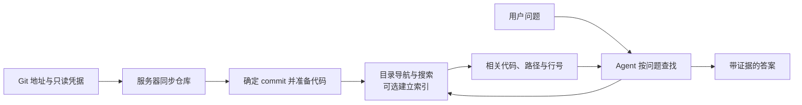
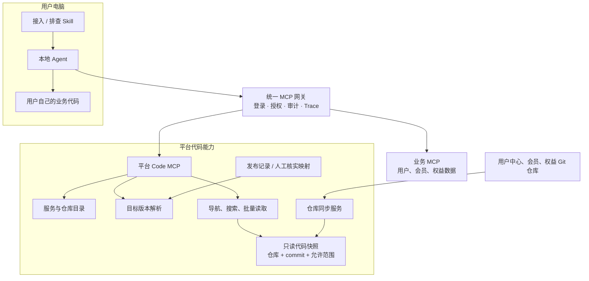
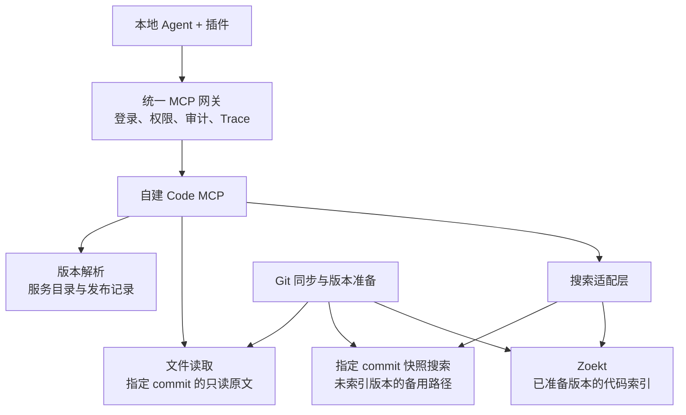

# Code MCP：平台代码知识服务设计

状态：设计建议，尚未实施和验证。本文采用“平台托管仓库 + 版本快照 + 导航与搜索 + Code MCP”的思路，不预设采购或部署 Sourcegraph，不将公开产品能力等同于本平台的生产可用性。

试用候选：Sourcegraph 的完整代码平台路线与 Zoekt 的搜索底座路线均安排验证，OpenGrok 作为备选。Sourcegraph 单独核实具体版本、许可与 MCP 可用性，不将其整套产品归为开源组件。平台统一管理授权、版本依据与审计，按候选能力决定代理已有 MCP 或自行适配。最终选型依据试用结果，不表示已经完成部署或性能验收。

相关文档：[插件形态](09-插件.md)、[代码仓库管理](08-代码仓库管理-原理与设计.md)、[评估系统](02-评估系统-原理与设计.md)。身份、集中授权、动态工具管理和审计以文档 09 的最新约定为准。

## 1. 解决什么问题

业务开发本地有自己的项目，但没有用户中心、会员、权益等基础服务仓库。接入和排查时，本地 Agent 需要了解这些服务的接口契约及实现，且不能要求开发者克隆完整基础服务仓库。

平台统一获取并管理基础服务代码，通过受控工具提供必要上下文。本地 Agent 负责理解业务需求、修改用户项目和组织答案；Code MCP 提供代码证据，不代替本地 Agent。

本文第一阶段假设允许返回经过授权的必要代码片段。必须区分：

- 不克隆完整仓库：可以通过 MCP 返回片段，但片段仍可能进入本地对话记录和模型服务。
- 任何源码都不得返回用户侧：不适用开放 `code_read` 的方案，需要受控文档或服务端分析，并检查分析输出是否泄露源码。

不提供仓库下载按钮，并不能阻止有广泛读取权限的用户通过多次调用累积源码。工具范围、返回策略必须与实际代码开放政策一致。

## 2. “配置 Git 链接就能理解代码”的原理

Git 地址只是代码来源。私有仓库还需要访问凭据，跨服务关系和部署版本也需要外部信息。模型通常是根据每次问题搜索、读取上下文，并非配置链接后永久学会整个仓库。

| 实现路线 | 工作方式 | 本方案取舍 |
| --- | --- | --- |
| 远程工作区 | 服务器检出代码，Agent 使用文件搜索与阅读工具 | 借鉴代码准备方式，一期不运行通用远程开发环境 |
| 代码检索服务 | 服务端保存代码，提供搜索、读取和导航接口 | 一期采用 |
| 服务端代码分析 Agent | 在服务器多轮查找代码，返回分析结论 | 后续按评估需要增加，会引入模型费用与运行时管理 |

代码索引也有不同类型：全文索引用于关键词搜索，符号/引用索引用于导航，向量索引用于语义召回。它们不是同一个组件，也不必同时建设。

## 3. 可行性证据与成熟度边界

### 3.1 已查到的公开证据

| 来源 | 支持的结论 | 不能据此得出的结论 |
| --- | --- | --- |
| Sourcegraph 架构文档 | 产品维护仓库缓存与同步服务，具有索引搜索和未索引版本搜索路径 | 我们自建相同结构即可得到相同性能和可靠性 |
| Sourcegraph MCP 文档 | 产品公开提供按版本读文件、搜索、导航及 MCP 访问能力 | 所有客户端、版本和私有部署都已在我们的环境验证 |
| Lyft 客户案例 | 集中式跨仓库搜索用于其服务迁移与调用点核查 | Lyft 使用了本文全部组件或 Code MCP |
| Priceline 工程师文章 | 有通过 Sourcegraph API 将代码上下文接入 Agent 的实践，文章描述从原型扩展 | 这等于完整生产级 MCP 网关方案及可靠性证明 |
| GitHub Copilot 文档 | 仓库索引和按需取代码上下文是公开产品能力 | 其内部架构、部署版本解析与本方案完全相同 |

来源：

- [Sourcegraph 架构](https://sourcegraph.com/docs/admin/architecture)
- [Sourcegraph MCP 工具](https://sourcegraph.com/docs/api/mcp)
- [Lyft 客户案例（厂商发布）](https://sourcegraph.com/case-studies/lyft-monolith-to-microservices)
- [Priceline 工程师实践](https://sourcegraph.com/blog/pricelines-innovations-in-agentic-ai-with-sourcegraph)
- [GitHub Copilot 仓库索引](https://docs.github.com/en/copilot/concepts/prompting-and-context/repository-indexing)

### 3.2 如何判断成熟度

`sourcegraph/docs` 是文档站仓库，其 Star 数既不能证明整个产品成熟，也不能证明整个产品不成熟。公开文档证明“有此能力”，客户案例证明特定使用实践；长期稳定性、维护成本、许可和支持条件仍需单独核验。

本方案的准确定位是：基础组成有既有实现可参考，完整链路在本平台尚未验证。不能把“可行”写成“已成熟可上线”。也不能用早期代码搜索案例证明后来 MCP 接口的生产成熟度。

采用任何第三方组件前，检查实际版本与发布状态、私有部署与许可、升级和回滚、目标 Git 平台兼容性、权限撤销、故障恢复，以及真实业务题的效果。本文不作产品采购推荐。

### 3.3 开源候选比较

以下依据截至 2026-11-15 本次查阅的公开资料。成熟度主要看维护历史、实际集成、版本和运维能力，不按 Star 数排序。

| 候选 | 公开能力与许可 | 平台仍需实现 | 适用判断 |
| --- | --- | --- | --- |
| Zoekt | 跨仓库全文、子串、正则与布尔搜索，代码索引和搜索 API；Apache-2.0 | Code MCP、用户授权、服务与版本映射、按 commit 读取、审计 | 优先验证，适合给本地 Agent 提供搜索底座 |
| OpenGrok | 代码搜索、交叉引用、源码浏览与版本历史；CDDL | MCP 适配、统一授权、目标版本查询编排与审计 | 备选；需要同时提供代码浏览站点时更值得评估 |

Zoekt 官方仓库说明，当前维护源自 2017 年从原始 `google/zoekt` 分出的分支。GitLab 官方也提供 Zoekt 集成、部署和管理文档，这是代码搜索组件的实际产品集成证据；不等于本平台整套 Code MCP 已被验证。Zoekt 本身开源，也不意味着 GitLab 提供的相关产品功能免费。[Zoekt 官方仓库](https://github.com/sourcegraph/zoekt)、[许可证](https://github.com/sourcegraph/zoekt/blob/main/LICENSE)、[GitLab 集成文档](https://docs.gitlab.com/integration/zoekt/)。

OpenGrok 使用 Java，运行环境包含 Servlet 容器和 Universal Ctags，项目资料明确其搜索、导航、历史和 CDDL 许可。选择它主要考虑是否需要这些完整的浏览能力及团队运维经验，不据此断言它在所有方面优于或劣于 Zoekt。[OpenGrok 官方说明](https://oracle.github.io/opengrok/)、[项目仓库](https://github.com/oracle/opengrok)。

目前查阅的证据不足以推荐一款同时满足“持续开源、配置 Git 即用、AI 理解、MCP、企业权限、审计”且完整链路成熟度明确的产品。因此将已有搜索组件与平台适配层分开选型。

### 3.4 Sourcebot 的开源状态

Sourcebot 官方于 2026-10-08 宣布从 v6 开始将后续开发移入私有仓库，继续分发自托管版本，旧版本仍公开。因此不能把其当前产品直接列为持续开源的完整替代方案。旧版本公开不等于其全部功能采用相同开放许可，也不保证获得后续维护；若考虑旧版，需核实具体版本、组件许可证和维护责任。[Sourcebot 官方公告](https://www.sourcebot.dev/blog/sourcebot-is-now-closed-source)。

自托管、源代码可见、开源和免费是不同条件，不能互相替代。

### 3.5 Sourcegraph 纳入试用

Sourcegraph 不仅作为架构参考，也作为实际试用候选。验证目标是：其现有仓库同步、搜索、导航和 MCP 能力，是否能减少平台自建工作，并满足三个基础服务的接入与排查需求。

| 验证项 | 具体要求 |
| --- | --- |
| 版本与许可 | 记录试用版本、部署方式、授权期限、费用及功能范围；核实该版本是否开放所需 MCP/API，不假设自托管即免费或开源 |
| 仓库接入 | 验证内部 Git 地址、只读凭据、网络连通、三个仓库同步和更新失败处理 |
| 搜索与版本 | 使用指定 commit 搜索和读取；验证历史版本及未索引版本的行为，不混用默认分支结果 |
| MCP 接入 | 优先通过统一网关代理可用的原生 MCP；若需 API 适配，记录额外工作量和功能差异 |
| 平台权限 | 用户授权仍由平台管理；验证上游连接身份与仓库范围，不让共享上游凭据扩大用户可见数据 |
| 观测与运维 | 验证网关审计、上游调用 trace、资源占用、升级回滚和故障恢复；内部 trace 以实际能力为准 |

平台是否能够在所有搜索、读取、导航及结果链接上完整限制仓库范围，是试用门槛。若共享上游身份无法满足隔离，应评估平台配置的受限上游身份或其他部署隔离方式，并记录成本；不能要求业务服务自行实现员工权限来弥补。

使用与 Zoekt 相同的仓库、commit、案例、客户端和模型比较正确率、证据命中、总耗时、接入工作量、运维与许可成本。测试资源可以分阶段部署，生产方案在评审后确定，不提前承诺同时运行多个搜索平台。

## 4. 整体架构

原始 Git 平台仍是代码的权威来源。平台托管的是供查询使用的副本和索引，不迁移业务开发主仓库。一期不执行仓库中的构建脚本、钩子或任意命令，也不需要安装所有业务运行依赖。

### 4.1 优先验证的组件组合

上图展示 Zoekt 路线：Zoekt 负责搜索，平台负责身份、仓库范围、版本选择、读取与证据格式。平台不重新开发搜索引擎，也不把搜索引擎当成完整权限系统。搜索适配层保持内部接口稳定，便于比较或替换后端。

Sourcegraph 路线另行试用：本地 Agent → 平台网关 → Sourcegraph 原生 MCP（目标版本具备时）或平台 API 适配器 → Sourcegraph 仓库缓存与检索。复用其已有能力，不强制重复建设整套 Git 缓存；平台仍维护服务与部署版本映射、授权和审计。两条路线按第 3.5 节比较后确定一期实现。

需要主动验证以下边界：

- 搜索索引记录实际 commit，只有与本次目标版本一致时才使用。不能将默认分支索引命中与历史版本文件拼接成一份证据。
- 未索引的 commit 由平台准备快照后采用有范围和时间限制的文本搜索，或明确返回准备状态。这条备用路径由平台实现，不假定 Zoekt 自动覆盖任意历史版本。
- 仓库和路径限制由平台构造为不可被用户查询覆盖的条件，并核验返回结果。不能只在用户输入前拼接一个可能被布尔表达式绕过的过滤字符串。
- Zoekt、快照读取服务只在平台受控链路内开放；搜索 API、目录列表和缓存同样不能绕过网关授权。
- 符号相关匹配不代表编译器级引用分析，更不代表完整跨服务调用图。精确导航能力单独评估。

## 5. 仓库接入与代码准备

平台管理员登记以下信息，业务服务不需要增加员工权限接口：

| 字段 | 用途 |
| --- | --- |
| 仓库 ID、Git 地址、只读凭据引用 | 建立稳定来源，秘密存储在平台密钥管理中 |
| 服务 ID、负责人、服务目录 | 从业务问题定位代码，支持一仓多服务 |
| 默认分支、允许读取的路径 | 控制默认查询与开放范围 |
| 接口契约、SDK 示例、仓库导航位置 | 优先提供对外接入依据 |
| 版本来源 | 发布记录，或经过核实的人工映射 |
| 用户/团队授权 | 平台维护允许的 MCP、工具和仓库范围 |

接入状态：待验证 → 同步中 → 快照准备中 → 可查询；失败显示阶段与原因。Git 地址和访问目标由平台管理员登记，不能由模型临时提交任意地址。

一期用脚本或后台任务同步三个仓库，按需准备指定 commit。重复请求同一版本共用缓存，准备过程使用锁和临时目录，完成后原子发布；不让查询读取未完成的快照。

镜像中已存在目标 commit 时，同步失败不影响该版本查询。目标 commit 不存在时，返回不可用或准备中，不能默默改用最新代码。活动任务使用的快照避免被清理；当前部署版本和评估引用版本纳入保留策略。

## 6. 版本与证据

| 问题 | 选择版本 |
| --- | --- |
| 开发接入 | 目标测试环境、指定 API/SDK 版本；未指定时说明所用默认分支 commit |
| 当前线上故障 | 目标服务实际部署 commit |
| 历史故障 | 问题发生时部署版本 |
| 回归评估 | 案例冻结的 commit |

解析后得到各仓库的版本组合，同一轮搜索、阅读与引用都使用该组合。跨服务不要求 commit 相同，但必须说明各自版本依据。依赖库依据锁定文件或子模块解析，不能直接取最新版。

灰度时需要结合实例或请求信息定位版本；不能确定则返回多个候选并说明限制。发布版本映射查不到时，代码仍可作为参考，但不能声称已验证线上逻辑。

每段证据返回仓库、commit、文件路径、行号及截断状态。分支名会变化，最终证据固定到 commit。代码说明可能的执行逻辑，日志和数据证明具体请求发生了什么。

## 7. 一期工具契约

服务发现沿用文档 09 的 `service_search`、`service_get`。下面是拟实现工具，不代表当前已提供：

| 工具 | 输入 | 输出 |
| --- | --- | --- |
| `code_resolve_context` | 服务、问题类型、环境/时间或明确版本 | 仓库与 commit、允许范围、版本依据、导航位置、准备状态 |
| `code_search` | 仓库、commit、路径范围、关键词、返回上限 | 路径、行号、上下文片段、截断与继续查询信息 |
| `code_read` | 仓库、commit、文件及行范围，可批量 | 原文片段、证据定位、未返回内容的说明 |

每次调用检查当前身份和仓库权限，解析结果不能代替后续授权。工具仅接受已登记仓库，限定路径、结果大小和查询时限。正则查询若支持，应限制资源消耗。目录遍历、符号链接、敏感文件和子模块访问均受平台范围约束。

区分无匹配、无权限、版本未知、版本准备中、同步失败与查询超时；不要将不同状态都返回空列表。无权知道的仓库不通过错误信息泄露。

后续可增加 `code_find_references` 或符号定位；精确导航需要适合语言的索引，单纯文本匹配不能宣称得到完整调用图。

## 8. 导航、搜索与性能

一期先提供简短服务说明、目录索引和关键词搜索。每个仓库的导航描述入口、核心模块、上下游和常见定位线索，与源码一起随版本维护。自动生成的摘要注明来源 commit，只作定位线索。

查询顺序：服务 → 导航 → 搜索相关模块 → 批量读取函数及调用上下文。优先接口路径、错误码、字段、函数名，遇到证据指向其他服务时再扩展范围，不遍历全部仓库。

| 开销 | 控制方式 |
| --- | --- |
| 首次拉取和检出 | 后台准备常用版本，冷启动返回明确状态 |
| 远程往返 | 命中附带适量上下文，批量读取相关片段 |
| 搜索范围过大 | 服务和路径过滤，限制单次结果和执行时间 |
| 重复工作 | 按仓库、commit、路径策略与索引规则版本缓存 |
| 无关上下文 | 不全量注入仓库、全部文档或历史搜索结果 |

一期不建向量库。若评估显示业务表达与实现用词差异导致经常找不到代码，再增加语义检索；首先评估文档与服务说明，再评估代码。语义检索仍限定授权范围和目标 commit，命中后回到原文核对。

## 9. 接入开发与故障排查

### 9.1 业务接入

用户提出“给这个项目接入用户、会员和权益”时：

1. 本地 Agent 读取项目框架、登录方式和已有调用。
2. 加载接入 Skill，查询目标版本的接口契约、SDK 与示例。
3. 明确用户标识传递、鉴权、会员状态、权益校验与错误处理。
4. 文档不清楚时用 Code MCP 核实实现，保留无法确认的问题。
5. 按用户授权修改本地业务代码，运行测试；具备测试地址、账号与授权后再联调。

优先使用对外契约，不将内部函数或未公开接口当作稳定接入规范。身份关联、幂等、扣减和重试等业务语义不能靠模型自行假设。模拟测试成功与真实联调成功分别报告。

### 9.2 故障排查

先查订单、用户、会员、权益和日志，缩小异常环节，再读对应部署版本的代码，对照实际数据形成结论。版本或运行时证据缺失时，保留不确定性。

## 10. 平台集中权限、审计与 Trace

复用文档 09 的公司登录和统一网关。平台管理用户/团队到 MCP/工具的授权。由于 Code MCP 可以访问多个仓库，平台还需对其施加仓库和必要的路径范围，不能将“允许 code_read”解释为允许读取所有仓库。这是平台自建能力中的授权，不要求基础业务服务接入权限 SDK。

代码返回前、缓存命中时、后续翻页时都重新核验权限。平台读取 Git 的凭据不交给用户或模型；上游仓库连接与 Code MCP 内部访问限制在平台链路内。

审计记录操作人、工具、仓库、commit、必要的路径范围、授权结果、执行结果、返回量、request_id 与 trace_id，不复制完整源码或凭据。

Trace 至少覆盖网关鉴权、版本解析、快照准备/等待、搜索、读取与结果整形。分别统计冷缓存、热缓存和端到端耗时。网关无法观察本地推理与文件操作，不将平台调用耗时冒充完整用户任务耗时。

## 11. 是否需要服务端代码分析 Agent

一期由本地 Agent 调用检索工具，不增加服务器模型推理。以下情况出现后，再评估远程 `code_analyze`：

- 跨仓库探索需要大量往返，基础检索优化后仍影响体验。
- 需要平台统一组织较长的分析任务和分析证据。
- 源码不能返回用户侧，只允许受控解释；同时能够满足服务器模型和输出策略要求。

服务端分析器必须继承用户的仓库范围，不使用全仓库超级权限。长任务具有独立任务 ID、预算、取消、超时与结果权限检查。结果给出版本、证据、结论和未确认项。加入该能力意味着增加专门的运行时、模型成本和任务管理，需要更新原有“平台不运行 Agent”的边界。

## 12. 分步实施与验收

| 阶段 | 交付 | 验收 |
| --- | --- | --- |
| C1 | 三个仓库登记、只读获取、指定 commit 快照 | 目标版本可重建；准备失败不返回其他版本冒充 |
| C1a | 固定 Zoekt 候选版本，建立三个仓库的索引并接入搜索适配层 | 与同版本快照文本搜索对照；验证版本一致、授权过滤、索引更新及故障备用路径 |
| C1b | 固定 Sourcegraph 试用版本及许可，接入相同三个仓库，通过网关连接 MCP 或 API 适配器 | 验证指定版本查询、权限隔离、审计、更新与故障处理；记录许可成本及节省的自建工作量 |
| C2 | 服务导航、三个代码工具、统一网关授权 | 本地无基础服务仓库仍可找到相关实现；跨仓库越权被拒绝 |
| C3 | 接入和排查 Skill、真实案例集 | 回答引用正确版本，能区分契约与内部实现、推测与已验证事实 |
| C4 | 缓存、审计、trace 与失败处理 | 冷/热缓存分别有数据；撤销后不可继续读取；并发查询不见半成品快照 |
| C5 | 小范围试用与评审 | 根据正确率、证据命中、耗时及维护成本决定继续投入或替换检索后端 |

至少覆盖：无本地仓库、未知版本、历史版本、跨服务依赖、权限撤销、无匹配、同步失败、并发准备、结果截断和敏感内容过滤。固定案例数据、模型/客户端、插件、工具和代码版本，比较改动效果。

性能阈值需由用户可接受等待时间和基线测试确定。尚无测量前不承诺“秒级理解整个仓库”，也不以产品案例中的收益替代自己的实测结果。

候选选型另记录：首次索引与增量更新耗时、内存与磁盘占用、并发查询延迟、冷/热缓存差异、升级回滚和运维工作量。测试使用真实接口、错误码、字段与业务描述，逐题核对证据命中和最终答案。Sourcegraph 与 Zoekt 均进入试用计划，汇总效果、集成工作量和总成本后决策；必要时继续评估 OpenGrok 或有界的快照搜索。若候选受许可或环境条件阻碍而未能完成试用，记录阻碍，不记为通过或性能失败。不能因底座有长期维护证据就跳过整条链路的测试。

## 13. 实施前待确认

- [ ] 允许返回哪些源码片段？是否存在任何源码均不得进入本地或外部模型的限制？
- [ ] 三个服务的仓库、只读访问方式、契约入口和负责人是否齐全？
- [ ] 测试与生产版本能否可靠映射到 commit？历史和灰度场景一期覆盖到哪里？
- [ ] 哪些团队可以访问哪些仓库和路径？权限撤销的失效时限是什么？
- [ ] 能否用一批真实接入和排查问题建立正确答案与关键证据？
- [ ] 自建轻量检索与接入现成代码平台的运维、许可和兼容性成本各是多少？
- [ ] 固定哪个 Zoekt 版本？索引版本信息、目标 commit 搜索、权限过滤和快照备用路径是否通过验证？
- [ ] Sourcegraph 采用哪个试用版本、部署方式和许可？所需 MCP/API 是否可用，是否完成与 Zoekt 的同条件比较？
- [ ] 是否确实需要人用代码浏览站点，足以支持引入 OpenGrok 的额外部署与集成成本？

本文建议先验证最小链路，保留替换代码检索后端的接口，不将某家产品作为既定依赖。
