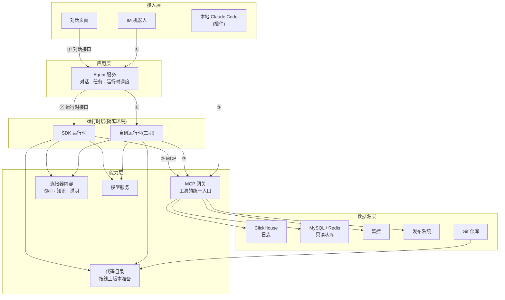
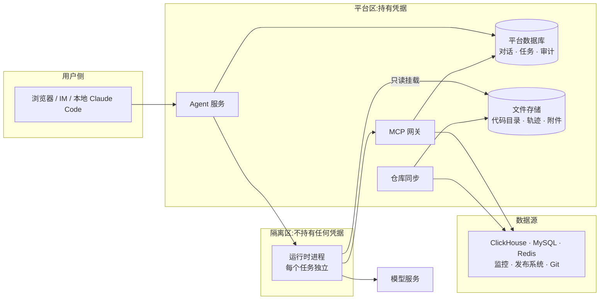

# 架构总览

整个系统分五层,靠四个接口连接。把这四个接口定住,每一层内部的实现都可以先做最简单的版本,之后再逐个加厚或替换。本文档只讲框架,各部分的细节在对应的专题文档里。

## 1. 分层



| 层 | 回答的问题 | 包含 |
| --- | --- | --- |
| 接入层 | 用户从哪里提问 | 对话页面、IM 机器人、本地 Claude Code |
| 应用层 | 一次提问如何变成一个可追踪的任务 | Agent 服务 |
| 运行时层 | 谁来驱动模型一步步把任务做完 | 一期只有 SDK 运行时;二期增加自研运行时,可切换 |
| 能力层 | Agent 能用什么 | 工具(经网关)、连接器内容、代码目录、模型 |
| 数据源层 | 事实从哪里来 | 日志、业务数据、监控、发布系统、代码仓库 |

贯穿各层的四件事,不属于某一层:

| 横切关注点 | 落在哪里 |
| --- | --- |
| 身份与权限 | 接入层认证,Agent 服务传递身份,MCP 网关做授权判断 |
| 审计与轨迹 | MCP 网关记录每次工具调用,Agent 服务记录每个任务的完整过程 |
| 评估 | 独立的评估程序,通过对话接口或运行时接口调用系统 |
| 配置与发布 | 连接器内容、常驻说明、运行配置都在代码仓库中,经评估后发布 |

## 2. 四个接口

框架稳不稳,取决于这四个接口。它们定下来之后,两侧可以各自演进。

| 编号 | 接口 | 两侧 | 内容 | 细节在 |
| --- | --- | --- | --- | --- |
| ① | 对话接口 | 接入层与 Agent 服务 | 创建对话、发送消息、订阅事件流、取消、反馈 | 文档 06 |
| ② | 运行时接口 | Agent 服务与运行时 | 启动或接续一轮、取消;返回事件流和结果 | 文档 01 第 4.5 节、文档 03 |
| ③ | 工具接口 | 运行时与 MCP 网关 | MCP 协议,附带发起人身份 | 文档 05 |
| ④ | 连接器规范 | 业务方与平台 | 一个目录:清单、工具、Skill、知识、案例、仓库声明 | 文档 04 |

从第一版起就要遵守的三条约定:

- **消息是内容块的列表。** 即使第一版只有文字,接口里也不用单个字符串表示消息。
- **每个请求都带身份。** 即使第一版只有你一个用户,发起人身份也要从接入层一路传到网关。
- **每个任务都有标识。** 任务标识贯穿 Agent 服务、运行时、网关的日志,事后能把一次任务的全部记录串起来。

## 3. 组件

| 组件 | 职责 | 不负责 | 第一版的最小形态 |
| --- | --- | --- | --- |
| 对话页面 | 输入问题、显示过程和回答、反馈;二期增加选择 Agent 和选择连接器 | 任何业务逻辑 | 一个单页面,能发消息、能显示流式回答 |
| Agent 服务 | 管理对话和任务;准备任务信息和代码目录;调用运行时;保存轨迹 | 决定怎么排查;直接访问数据源 | 一个进程,几个接口,对话存在数据库的一两张表里 |
| 运行时 | 驱动模型:组装上下文、调用模型、执行工具、判断停止 | 管理用户和对话;保存业务数据 | 只有 SDK 运行时,包一层适配实现运行时接口 |
| MCP 网关 | 工具的统一入口:认证、授权、调用数据源、整形结果、审计 | 业务逻辑;决定调用哪个工具 | 一个进程,两三个工具,身份校验和审计日志 |
| 连接器内容 | 各业务的 Skill、知识、表结构说明、仓库说明 | 运行任何代码 | 仓库里的一个目录,放三个基础服务的内容 |
| 代码目录 | 让运行时读到线上版本的代码 | 让 Agent 操作 git | 手动克隆到服务器上的固定目录 |
| 评估程序 | 批量提问、保存结果、汇总 | 在线上流程中运行 | 一个脚本,读案例文件,调用对话接口 |

## 4. 一次提问的路径

1. 用户在对话页面提问。请求带着用户身份到达 Agent 服务(接口 ①)。
2. Agent 服务创建任务,查出涉及的应用,准备任务信息和代码目录。
3. Agent 服务通过运行时接口启动一轮(接口 ②),指定使用哪个运行时。
4. 运行时组装上下文:常驻说明、Skill 清单、工具定义、任务信息、用户消息。调用模型。
5. 模型要求调用工具时,运行时通过 MCP 把调用发给网关(接口 ③),附带发起人身份。
6. 网关判断权限,查询数据源,整形并脱敏结果,写审计,返回。
7. 运行时把结果交给模型,重复第 4 到 6 步,直到模型给出结论。
8. 运行时把事件流和最终结果返回 Agent 服务。Agent 服务保存轨迹,把回答推送给页面。

本地 Claude Code 的路径更短:它自己就是运行时,通过插件直接使用接口 ③ 和连接器内容。

## 5. 部署与信任边界



三个区的划分是安全设计的骨架:

| 区 | 里面有什么 | 持有的凭据 | 能访问什么 |
| --- | --- | --- | --- |
| 平台区 | Agent 服务、MCP 网关、仓库同步、平台数据库 | 数据源的只读账号、Git 的部署密钥 | 数据源、文件存储 |
| 隔离区 | 运行时进程 | 只有本次任务的身份令牌和模型访问凭据 | 只读的任务代码目录、MCP 网关、模型服务。不能直接访问数据源,读不到平台区的文件 |
| 数据源 | 日志、业务库、监控、发布系统、Git | 无 | 无 |

要点:**模型驱动的那部分代码(运行时)跑在一个拿不到任何数据源凭据的环境里。** 它要数据只能经过网关,而网关按发起人的权限判断。这样即使模型被诱导,也越不过这条边界。

第一版里,隔离区可以简单到“用一个单独的系统用户、在只挂载了任务目录的容器里启动运行时进程”。

## 6. 技术选型

| 项目 | 建议 | 状态 |
| --- | --- | --- |
| 后端语言 | Go 加 Python。平台区的服务(Agent 服务、MCP 网关、仓库同步)用 Go;隔离区的运行时(SDK 适配、自研运行时)和评估程序用 Python | 已定 |
| 跨语言接口 | 只有接口 ②。用 gRPC,以一份 proto 文件作为运行时接口的唯一定义,两边的代码都由它生成;流式返回事件。骨架阶段可先用 HTTP 加 SSE | 已定 |
| 前端 | 外观要求:简洁、有成品感。技术给出当前建议,不锁定。详见下文 | 方向已定,技术可替换 |
| 运行时 | 一期只用 Claude Agent SDK;二期增加自研运行时作为第二实现 | 已定 |
| 工具协议 | MCP | 已定 |
| 日志查询 | ClickHouse,只读账号加查询上限 | 已定 |
| 业务数据 | MySQL 只读从库;Redis 只提供按业务语义读取的工具 | 已定 |
| 平台自己的数据 | 一个关系数据库,存对话、任务、审计。用团队已有的 MySQL 即可 | 建议 |
| 轨迹与附件 | 先放服务器磁盘,之后换对象存储 | 建议 |
| 模型网关、注册表快照、消息队列 | 第一版不做 | 已定 |

语言边界与信任边界重合:

| | 平台区 | 隔离区 |
| --- | --- | --- |
| 语言 | Go | Python |
| 组件 | Agent 服务、MCP 网关、仓库同步 | SDK 运行时、自研运行时 |
| 凭据 | 持有数据源账号和部署密钥 | 不持有 |
| 职责约束 | 不写任何与模型交互的逻辑,只管理任务、转发调用、保存记录 | 不直接访问任何数据源,只通过 MCP 网关取数据 |

两边本来就是不同的进程、运行在不同的环境里,所以使用两种语言没有增加新的边界。四个接口中只有接口 ② 跨语言:接口 ① 是 HTTP,接口 ③ 是标准的 MCP 协议,接口 ④ 是文件。

选择 Python 写运行时的原因是 Claude Agent SDK 只提供 Python 和 TypeScript 版本。MCP 网关使用 MCP 的 Go SDK,实现前确认其成熟度;不合适时网关改用 Python,对架构没有影响。

前端:

目标是简洁、耐看、有成品感的界面,参考当前主流 AI 产品的布局和交互方式,配色、图标和名称使用自己的。技术栈是当前的建议,可以整体替换;不可变的约束只有三条:

1. 前端只通过接口 ① 与后端交互。
2. 消息按内容块渲染:文字、工具调用过程、图片、图表各有自己的展示方式。
3. 不自动加载回答中的外部资源。

界面设计方向:

| 方面 | 做法 |
| --- | --- |
| 布局 | 左侧窄导航(对话列表、新建);中间一列宽度适中、居中的对话区;底部固定的输入框;内容多时右侧滑出面板 |
| 留白与层级 | 间距宽松;字号层级控制在三四级;正文用清晰的无衬线字体,代码用等宽字体 |
| 颜色 | 大面积中性色,一种强调色只用于最重要的操作;支持浅色和深色 |
| 过程展示 | 排查步骤显示为紧凑的状态行,默认折叠,可展开查看;不把原始工具输出直接铺在对话中 |
| 长内容 | 证据、代码片段、图表放入右侧面板或可折叠区域 |
| 空状态 | 新对话显示问候和几个可点击的示例问题 |
| 动效 | 少而轻:文字流式出现、面板滑入、状态切换淡入淡出 |
| 细节 | 圆角和边框统一;复制、重试、反馈等操作在悬停时出现;提供键盘快捷键 |

本产品特有的三个界面:

| 界面 | 内容 |
| --- | --- |
| 结论卡片 | 回答最上方的一张卡:是什么情况、什么原因、接下来找谁。不懂技术的同事只看这张卡即可 |
| 链路视图 | 跨服务排查的结果用一条链路图展示,例如订单、支付回调、会员状态、权益发放,每一段标出正常或异常 |
| 对比视图 | 两个 Agent 并排回答同一个问题,对齐显示耗时、费用、步骤数 |

当前建议的技术:

| 层面 | 选择 | 说明 |
| --- | --- | --- |
| 框架 | React 加 TypeScript | 最主流,编码工具支持最好 |
| 构建 | Vite | 后端是 Go,前端做成纯客户端应用。需要服务端渲染或在前端侧处理登录会话时再换 Next.js |
| 样式与组件 | Tailwind CSS 加 shadcn/ui | 组件代码在自己的仓库里,可随意修改 |
| 对话界面 | 专门的 AI 对话组件库(例如 assistant-ui) | 流式输出、工具调用过程展示等已有现成实现 |
| 流式传输 | SSE | 回答是单向持续推送,比 WebSocket 简单 |
| 内容渲染 | 支持流式的 Markdown 渲染,代码高亮,Mermaid | 回答中有表格、代码位置、流程图 |
| 数据与状态 | TanStack Query 加 Zustand | 服务端数据与界面状态分开管理 |

前端要支持的功能:

| 功能 | 阶段 |
| --- | --- |
| 流式显示回答;展示排查过程(每步调用的工具,可折叠);渲染 Mermaid 和表格 | 骨架 |
| 回答分两层(结论在上,依据可展开);反馈;历史对话;显示当前加载的连接器和使用的运行时 | 一期加厚 |
| 选择 Agent;选择连接器;对比模式 | 二期 |
| 上传截图和文件 | 之后 |

两点说明:

- 接口 ① 的事件流可以参考业界正在形成的 Agent 与前端之间的事件协议(例如 AG-UI)来划分事件类型:开始运行、文本增量、工具调用开始与结束、状态变化、结束。这类协议较新,采用前评估其成熟度。
- **前端不自动加载回答中的外部资源。** 图片只允许来自平台自己的附件存储,外部链接显示为文本或需点击确认。否则被诱导的 Agent 可以通过一个带数据的图片地址把信息发送到外部。

具体的库和版本在开始实现前端时再确认,前端生态变化较快。

## 7. 平台自己的代码仓库结构

```
agent-platform/
  apps/
    web/                 对话页面                      React + TypeScript + Vite
    agent-service/       Agent 服务                    Go
  proto/
    runtime.proto        运行时接口的唯一定义,生成 Go 和 Python 两边的代码
  runtimes/
    sdk/                 Claude Agent SDK 的适配       Python
    native/              自研运行时(二期)              Python
  gateway/               MCP 网关(核心不含业务代码)    Go
  connectors/
    _platform/           公共连接器:日志、监控、发布、通用排查方法(始终加载)
    membership/          基础业务连接器:用户、会员、权益(默认加载)
      connector.yaml
      tools/
      skills/
      knowledge/
      evals/
  evals/                 评估程序                      Python
  repo-sync/             仓库同步                      Go
  runtime-config/        常驻说明、运行配置
  docs/                  本套设计文档
```

目录结构和第 1 节的分层一一对应。每个目录就是一个可以单独交给 AI 编码工具实现的单元。

## 8. 搭建顺序:先打通,再加厚

先让一个问题从页面走到答案,每一层都用最薄的实现;然后逐层加厚。这样任何时候系统都是能跑的,每次只改一层。

第一阶段:打通骨架

| 组件 | 骨架版本 |
| --- | --- |
| 对话页面 | 一个输入框,显示流式回答 |
| Agent 服务 | 一个发送消息的接口,对话存在内存或一张表里,用户身份先写死为你自己 |
| 运行时接口 | 定义好,只有 SDK 适配这一个实现 |
| MCP 网关 | 一个工具:查询 ClickHouse 日志。校验身份令牌,写一行审计日志 |
| 连接器内容 | 一份常驻说明,一份日志表结构说明 |
| 代码目录 | 手动克隆的一个仓库 |
| 评估程序 | 读案例文件,调用对话接口,输出结果表 |

骨架的完成标志:在页面上问一个“某某业务逻辑是什么”的问题和一个需要查日志的问题,都能得到回答;评估程序能跑完全部案例。

第二阶段:逐层加厚

| 顺序 | 加厚哪里 | 内容 | 细节在 |
| --- | --- | --- | --- |
| 1 | 能力层 | MySQL、Redis、发布记录的工具;排查说明;服务地图 | 入口文档第 4 节 |
| 2 | 运行时层 | 自研运行时,接入运行时接口,页面上可切换 | 文档 03 |
| 3 | 应用层 | 多轮对话、轮次信息、会话存储 | 文档 06 |
| 4 | 横切 | 真实的登录、按应用授权、隔离区 | 本文档第 5 节 |
| 5 | 能力层 | 代码目录按线上版本准备、多仓库 | 文档 08 |
| 6 | 接入层 | 本地插件、IM 机器人 | 文档 05 |

每加厚一处,评估程序重跑一遍。顺序 1 到 3 之间没有硬依赖,可以按你最想做的调整。

本节说明的是搭建的思路。具体的分期、里程碑和每一期的范围以 [一期二期规划](一期二期规划.md) 为准:骨架对应一期的 M1;能力层、多轮对话、登录与隔离对应一期的 M2 至 M4;自研运行时、使用方选择连接器、代码版本管理、更多入口属于二期。

## 9. 哪些现在定下来,哪些以后可以换

| 现在定下来,之后改动代价大 | 之后可以随时替换 |
| --- | --- |
| 五层的划分和四个接口 | 每一层内部的实现 |
| 消息是内容块列表;请求带身份;任务有标识 | 用哪个模型 |
| 运行时拿不到数据源凭据,只能经网关 | 用哪个运行时 |
| 工具走 MCP | 工具是直接写查询还是封装好的 |
| 一个业务的内容放在一个连接器目录里 | 上下文怎么压缩、Skill 怎么组织 |
| 所有变更经评估后发布 | 存储用什么、前端长什么样 |

左边这一列就是“外层大框架”。右边的所有细节,都可以在框架搭好之后,用评估的结果来决定。

## 10. 为二期预留的扩展点

二期的功能一期不实现,但一期要把位置留好。下表列出每项二期功能在一期需要遵守的约定。只要这些约定在一期保持住,二期增加功能时就不需要改动已有的接口和数据。

| 二期功能 | 一期预留的位置 | 一期的状态 |
| --- | --- | --- |
| 自研运行时 | 接口 ② 只描述输入、事件、结果,不出现 SDK 特有的概念;Agent 服务通过运行时注册表调用运行时 | 注册表只有 SDK 一项 |
| 选择 Agent、对比模式 | 接口 ① 的发送消息请求中有“使用的运行时”字段;任务记录保存运行时的名称和版本;前端按统一的事件渲染,不依赖某个运行时 | 字段由服务端填默认值;界面只显示 |
| 使用方选择连接器 | 接口 ① 的创建对话请求中有“启用的连接器”字段;所有内容按连接器目录组织;每个连接器有清单;任务记录保存加载的连接器及版本 | 字段由服务端填入全部连接器;界面只显示 |
| 连接器之间的隔离 | 平台的常驻说明不含业务特有的内容,业务规则放在连接器自己的说明里;工具名和 Skill 名带连接器前缀;工具清单、Skill 清单、知识目录、代码目录都由“启用的连接器”这一个输入生成 | 两个连接器都加载,但内容已按此分开存放 |
| 业务方接入连接器 | 接口 ④ 的目录结构和清单格式;工具名带前缀;网关的适配层与其他四层分开 | 只有公共和基础业务两个连接器,由平台维护 |
| 按任务加载工具 | 网关返回工具清单时以“本次对话启用的连接器”为输入 | 返回全部工具 |
| 细粒度授权 | 每个请求带发起人身份并传到网关;网关的策略层独立于其他层 | 策略是“白名单内全部允许” |
| 多模态 | 所有接口中的消息是内容块列表;存储中为附件引用留有字段 | 只有文字块 |
| 轮次边界压缩、固定区 | 展示记录、模型历史、轨迹三份数据分开保存;轮次是独立的对象,有自己的结论字段 | 模型历史由 SDK 管理 |
| 代码按线上版本准备 | 任务信息中有“代码版本”和“版本来源”两项;任务代码目录下有清单文件 | 版本来源填“主干最新”或“手动指定” |
| 模型网关 | 运行时调用模型的地址和凭据来自配置 | 配置直接指向模型服务 |
| 自动判分、发布门禁 | 评估程序把“运行”和“判断”分成两步;每次运行保存配置和完整过程 | 判断由人完成 |
| 子 Agent、多 Agent | 轨迹中的步骤可以有上下级关系;预算按任务统计 | 步骤只有一层 |
| 更多入口 | 所有入口都通过接口 ① 或接口 ③,没有第三条路径 | 只有网页 |
| 受控写操作 | 工具声明是否只读;网关策略层可以按工具属性区别对待 | 全部只读,不提供写工具 |

评审一期的实现时,除了功能是否可用,还要逐行核对这张表:每一项预留的位置是否都保持住了。
