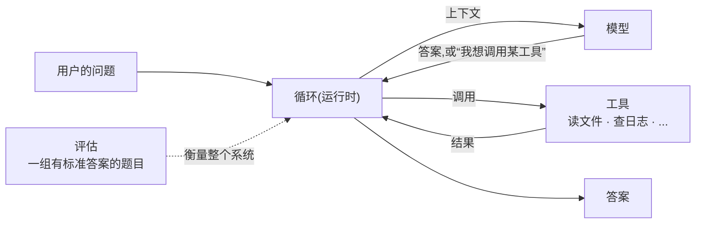

# 从这里开始

一句话说清一期:同事在自己的 Claude Code 里装上平台唯一的一个插件,用公司账号登录一次,就能提问和排查用户、会员、权益三个服务的问题。插件只是一张名片,能力都在云端:各业务提供 MCP 服务,平台把它们的工具和业务写的 Skill 组合成业务包,按权限提供给同事。

建议的阅读顺序:

1. 本文档:五个基本概念、已确认的前提、用户会问的四类问题。
2. [架构总览](架构总览.md):整体结构和设计决定清单。这是总纲,其他文档与它不一致时以它为准。
3. [一期二期规划](一期二期规划.md):两期各做什么。
4. [开发路线](开发路线.md):十二个模块、执行顺序、现在该做什么。
5. 按 [一期学习手册](一期学习手册.md) 逐个模块学习和评审。

## 1. 整个系统其实只有五个概念

所有文档讲的东西,都是下面五个概念的展开。先把这五个弄懂,其他的都能对上号。

| 概念 | 用大白话说 |
| --- | --- |
| 模型 | 一个只会“读一段文字,再写一段文字”的程序。它不记事,不能自己做任何操作 |
| 工具 | 一个普通的函数,比如“查日志”“读文件”。模型不能直接调用,只能写出“我想调用查日志,参数是这些” |
| 循环 | 一段反复执行的程序:把问题给模型 → 模型说要调用工具 → 程序去调用 → 把结果再给模型 → 直到模型给出答案。这段程序就叫运行时(harness) |
| 上下文 | 每次给模型看的全部文字:问题、规则、工具清单、之前的工具结果。模型只知道上下文里有的东西 |
| 评估 | 一组有标准答案的题目。改了任何东西之后重新跑一遍,看分数是升是降 |



其他名词都是这五个概念在规模变大之后的管理办法:

| 名词 | 它其实是 | 什么时候才需要 |
| --- | --- | --- |
| Skill | 写给模型看的操作说明,放在上下文里 | 模型不知道某类问题该怎么查的时候 |
| MCP | 工具的一种标准接法 | 工具要给多个程序共用的时候 |
| MCP 网关 | 工具多了以后的统一入口,负责权限和审计 | 要给别人用的时候 |
| 业务包 | 一个业务的工具和 Skill 的组合,是授权和发布的单位 | 从第一个业务开始就用,以后的业务照同样的方式接入 |
| 会话 | 用户多次提问之间,保留哪些内容 | 要支持追问的时候 |
| 代码仓库管理 | 代码这种特殊资料怎么准备给模型读 | 要分析线上版本的代码的时候 |
| 模型网关 | 调用模型的统一入口 | 要用多个模型的时候 |

## 2. 文档地图

| 类别 | 文档 | 说明 |
| --- | --- | --- |
| 总纲 | [架构总览](架构总览.md) | 整体结构、核心概念、设计决定清单、已知风险 |
| 计划 | [一期二期规划](一期二期规划.md) | 两期各做什么、里程碑、评审方式 |
| 路线 | [开发路线](开发路线.md) | 十二个模块、约定、执行顺序、阶段 0 的验证 |
| 学习 | [一期学习手册](一期学习手册.md) | 按模块:先读什么、要弄懂什么、评审看什么 |
| 基础 | [13-数据定义](13-数据定义-原理与设计.md) | 平台里所有核心数据的结构。所有模块的共同基础 |
| 模块设计 | [15-网关核心](15-网关核心-原理与设计.md) | 模块 1 |
| 模块设计 | [09-插件形态](09-插件形态-原理与设计.md) | 模块 2、3:插件、登录、安装与更新、客户端一侧的安全 |
| 模块设计 | [12-权限管理](12-权限管理-原理与设计.md) | 模块 4 |
| 模块设计 | [16-MCP 接入与工具库](16-MCP接入与工具库-原理与设计.md) | 模块 5、6、10:登记、发现、批准、通用查询服务、SDK |
| 模块设计 | [11-业务包与 Skill](11-业务包与Skill-原理与设计.md) | 模块 7、8、11:业务包、Skill、考题、发布、Skill 下发 |
| 模块设计 | [10-代码查询](10-代码查询-原理与设计.md) | 模块 9 |
| 模块设计 | [02-评估系统](02-评估系统-原理与设计.md) | 模块 12 |
| 上线 | [14-生产化与部署](14-生产化与部署-原理与设计.md) | K8s 部署、凭据、保护后端、可观测、上线前清单 |
| 图 | `图` 目录 | 整体架构、业务包架构、三者关系、插件视角的流程、权限模块 |
| 参考 | `参考` 目录 | 早期的设计和二期才用到的专题。与总纲不一致时以总纲为准 |

## 3. 已确认的前提

| 事项 | 结论 | 对实现的影响 |
| --- | --- | --- |
| 数据能否交给模型 | 日志、用户信息、代码都可以 | 不需要为合规调整方案 |
| 日志在哪里 | ClickHouse | 由平台的查日志服务提供,必须带时间范围。专用的只读账号,设配额、执行时间和行数上限。不让模型自己写查询语句 |
| 使用方式 | 一期是 Claude Code 插件;网页版、Codex 在二期 | 平台不做对话页面和运行时,集中做网关、MCP 管理和业务包 |
| 定位 | 生产系统,不是演示 | 架构一步到位,功能分期上线。部署在 K8s 上 |
| 权限 | 只有平台一处;平台管理员在管理页面上管理 | 按业务包授权给用户组,可排除其中的某些 MCP;敏感 MCP 要明确勾选;一期全部只读 |
| 业务怎么接入 | 业务提供 MCP 服务(自己用 SDK 写,或由平台的通用查询服务代接),注册到平台;业务在平台上配置自己的业务包和 Skill | 以后的服务照同样的方式接入,不改平台代码 |
| 登录 | 公司已有 SSO;平台提供登录授权页接上它 | 同事在浏览器里登录一次;网关每次调用都校验 |
| 代码怎么给 Agent | 三个基础服务的代码按版本存在平台的代码服务里,通过网关搜索和读取 | 同事本地不需要有这些仓库。要先确认其他团队可以看到哪些源码 |
| 评估案例 | 没有历史故障,有一批用户常问的问题,数量不多 | 第一个场景是答疑。评估从常见问题做起,人工判断;从现在开始记录每一个真实提问 |
| 日志、监控、发布系统 | 都有查询接口,功能不全,但团队有开发权限 | 缺什么查询能力由评估中的失败案例决定,再到对应系统里补 |
| 谁来提问 | 内部同事:测试、客户端和后端研发、产品。产品不一定懂技术 | 回答分两层:结论用大白话,不含技术术语;依据(代码位置、日志、记录)供需要的人查看。事实不因人而异。追问和工具参数使用对方手上有的标识(手机号、订单号) |
| 开发语言 | 后端 Go 加 Python;前端 React 加 TypeScript、Tailwind CSS 加 shadcn/ui | 一期:平台的服务用 Go,评估脚本用 Python,管理页面用前端这一套 |
| 业务数据在哪里 | MySQL 和 Redis,提供只读访问 | 由通用查询服务或业务自己的 MCP 服务访问,网关不碰。MySQL 连只读从库,敏感字段打码,限制执行时间和返回行数;查询都是配置好的参数化查询。Redis 只提供按业务语义读取的工具,不开放任意命令,禁止全量扫描 |

## 4. 四类问题与起步顺序

用户的提问分四类,需要的东西差别很大。按成本从低到高,一类一类做。

| 顺序 | 类型 | 例子 | 需要什么 | 要新做的东西 |
| --- | --- | --- | --- | --- |
| 1 | 规则解释、接入 | “某某业务逻辑是什么”“续费回调怎么接” | 代码、文档 | 代码服务;每个仓库一份代码导航 |
| 2 | 针对具体用户的排查 | “我付费了,权益为啥没加上” | 订单、会员、权益的数据,该用户的日志 | 几个查询工具,一份 Skill |
| 3 | 整体异常排查 | “今天回调失败率为什么升高” | 日志统计、监控、发布记录 | 统计类查询、发布记录查询 |

与两期的对应:一期覆盖第 1、2 类问题;第 3 类放在二期。

人工评估时的判断要点:

| 类型 | 答得好的标志 |
| --- | --- |
| 规则解释、接入 | 指出代码的具体位置;讲清条件和分支,不只讲主流程;逻辑受配置或开关影响时明确说明;代码里找不到依据时说“没找到”,不编造 |
| 针对具体用户的排查 | 缺用户标识或订单号时先提问;沿“订单 → 支付回调 → 会员状态 → 权益发放”逐段确认,指出断在哪一段;结论附证据;查不出来时说明已排除什么、还缺什么;检查数据库与缓存是否一致;结论部分不懂技术的同事也能看懂 |
| 整体异常排查 | 先确认异常是否存在、何时开始、影响多大;检查该时间点前后的发布和配置变更;区分相关和原因,证据不足时不下定论 |

第一批要准备的东西:

| 类型 | 工具 | 给模型看的说明 |
| --- | --- | --- |
| 规则解释、接入 | 代码服务的搜索和读取(平台提供) | 每个仓库一份代码导航:目录结构、关键入口、主要业务流程分别在哪里 |
| 针对具体用户的排查 | 查日志(平台提供);按订单号、用户标识查订单、会员、权益的工具;读取某个用户缓存的工具;之后把反复出现的查询固化成按订单返回链路各段状态的汇总工具。这些工具先由通用查询服务代接 | 一份“概览”Skill:服务地图,附件放表结构、状态码、缓存 key 的命名规则;一份“付费后权益未到账”Skill:链路有哪几段、每段怎么确认、查到什么程度才能下结论 |
| 整体异常排查 | 最近的发布记录;监控指标 | 一份 Skill;指标清单及含义作为附件 |

跨服务的问题:

用户、会员、权益是不同的服务,“付费后权益没到账”这类问题是一条跨服务链路上某一段断了。处理它用一个 Agent 即可,不需要每个服务一个 Agent。需要准备三样东西:

| 要准备的 | 内容 | 形式 |
| --- | --- | --- |
| 服务地图 | 按业务流程写:一条链路经过哪些服务、每一段靠什么连接(接口调用或消息)、每一段成功的标志、常见的断点 | “概览”Skill |
| 贯穿各服务的关联标识 | 每条日志带调用链标识;涉及用户或订单的日志记录用户标识和订单号;发消息时把调用链标识放进消息头 | 在各服务中补齐日志字段 |
| 链路级的工具 | 输入订单号或用户标识,按链路顺序返回每一段的状态,直接看出断在哪一段 | 一个汇总查询工具,由业务自己的 MCP 服务实现 |

每个仓库的代码导航里另外写明两项:对外提供的接口和消费的消息在哪里实现;依赖的下游是谁、调用了什么接口、发了什么消息。

Skill 里列出跨服务问题的常见原因:同步调用超时、消息丢失或积压或消费失败、重试与幂等、最终一致的延迟、各服务版本不一致、各服务配置不一致。

链路类的 Skill 归属于业务流程,不归属于单个服务。现阶段三个服务由同一个团队负责,放在同一个业务包里即可;以后跨不同团队的链路,建一个专门的业务包,把两边需要的工具都选进来。

考题的写法:

考题放在业务包里,在平台上编写;也可以先用一张表格记。一道题是给 Agent 的题目,外加一份由人事先写好的标准答案和评分要点。评估时,程序只把 `question` 发给 Agent;其余字段 Agent 看不到,是留给人判断回答对错用的。

| 字段 | 含义 | 谁用 |
| --- | --- | --- |
| `id` | 题号,不重复即可 | 程序、人 |
| `type` | 问题属于哪一类,用于分类统计 | 人 |
| `question` | 题目,原样发给 Agent | Agent |
| `app`、`env` | 关于哪个服务;这道题在哪一套部署上跑(测试或生产) | 评估脚本。工具本身没有“环境”参数 |
| `expected_answer` | 标准答案,由人在运行之前写好 | 人 |
| `key_points` | 评分要点:回答里必须具备的内容 | 人 |
| `context` | 可选。Agent 追问之后才提供给它的信息,用来考察“信息不够时是否先提问” | 程序 |

下面两个例子中,括号里的文字是占位,需要换成真实内容。数量少时用一张表格记录也可以,列与上表相同。

```yaml
id: rule-001
type: 规则解释
question: 权益过期的规则是什么?
app: entitlement
env: prod
expected_answer: |
  (正确的答案:过期时间如何计算、有哪些例外情况)
key_points:
  - 指出过期逻辑所在的代码位置
  - 说明过期时间的计算方式
  - 说明续费、退款等情况下的处理
  - 如果受配置影响,指出是哪个配置
```

```yaml
id: user-001
type: 用户排查
question: 我付费了,权益为啥没加上
app: member
env: prod
context:                    # 模拟用户对追问的回答,第一轮不提供
  user_id: "脱敏后的用户标识"
  order_id: "脱敏后的订单号"
expected_answer: |
  (这个案例的真实原因)
key_points:
  - 没有用户标识时先提问
  - 说明订单的支付状态
  - 指出链路上断在哪一段
  - 结论附带日志或记录作为证据
```

## 5. 三条使用建议

1. **一次只做一个模块。** 当前模块的验收达到之前,不要读后面的内容。后面的设计现在看不懂是正常的,做到那里自然就懂了。
2. **设计文档是给 AI 的输入。** 每个模块把对应的文档章节和数据定义一起交给编码工具。你负责读懂它写的东西,并判断是否符合设计。
3. **卡住时缩小问题。** 把那一步的文档章节、你的代码、报错信息放在一起问。如果是设计本身没讲清楚,回来改设计文档。

## 6. 现在就做的事

当前处在阶段 0,见 [开发路线](开发路线.md) 第 4、7 节:完成阶段 0 的验证;开始记题目表;申请各数据源的只读账号和三个仓库的只读部署密钥;写出服务地图的初稿。

另外有几件事要先问清楚:公司 SSO 怎么接入、能否带回部门、找谁配置;其他团队的同事可以看到基础服务的哪些源码;能否要求接入平台的电脑使用统一的 Claude Code 管理配置;以及 [生产化与部署](14-生产化与部署-原理与设计.md) 第 10 节列出的几个问题。
