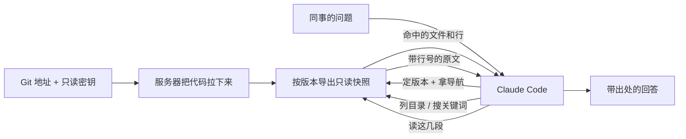
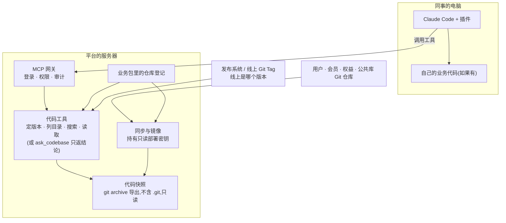

# 代码查询:原理与设计

提问的同事大多没有用户、会员、权益这三个服务仓库的 `git clone` 权限。所以平台把代码放在受控服务器上统一管理,绝不把业务源码静态打包进插件发到同事本机;本地的 Claude Code 需要了解代码逻辑时,统一通过网关向平台的代码服务查询。这项能力在一期建设。

**最小版本:只做这四样。**

| 要做的 | 具体是什么 |
| --- | --- |
| 仓库登记 | 在业务包里填写:哪个服务对应哪个仓库(含共用的公共库)、允许读取的目录、排除哪些路径 |
| 同步与快照 | 用只读的部署密钥把代码拉到服务器上,按版本用 `git archive` 导出只读快照 |
| 四个工具(或服务端只返结论) | 默认提供确定版本、列目录、搜索、读取四个工具;若公司严禁外传源码片段,则复用同一底座改为只返结论的 `ask_codebase` + 规则文档(第 7 节) |
| 每个仓库一份导航 | 告诉 Agent 目录入口、受线上配置影响的开关、以及业务术语与代码词的对照 |

一期不需要代码搜索引擎,不需要向量库。三个仓库的规模,直接在快照文件上做文本搜索只要几十毫秒,足够快。

相关文档:[插件形态](09-插件形态-原理与设计.md)、[代码仓库管理](参考/08-代码仓库管理-原理与设计.md)(仓库怎么拉取、怎么按版本存放,本文复用它的做法)、[数据定义](13-数据定义-原理与设计.md)、[生产化与部署](14-生产化与部署-原理与设计.md)。

## 1. 先纠正一个常见的误解

“给一个 Git 地址,AI 就能理解整个仓库”,实际发生的事情是这样的:

模型并没有“学会”这个仓库。它是每次遇到问题时现查:先定版本看导航,再列目录或搜索,再读命中的那几段,然后回答。这和一位新同事接手陌生代码时的做法一样。

所以这件事的关键不在模型,而在三点:代码拿得到、版本对得上、能快速定位到相关的那几段。

## 2. 整体结构

| 部分 | 做什么 |
| --- | --- |
| 仓库登记 | 服务、仓库、目录、排除的路径。登记在所属的业务包里(文档 11 第 2.4 节)。**用户、会员、权益共用的内部公共库/协议仓一并登记**,避免查到一半在二方包处断链。新增一个业务不需要新写代码工具,只需登记仓库 |
| 同步与镜像 | 持有只读部署密钥,维护每个仓库的 bare 镜像;定时或按需 `git fetch`,并用 `git archive` 按 commit 导出只读快照 |
| 代码快照 | 某个仓库在某个版本下的文件副本,只读且天然不含 `.git/` 目录。按“仓库 + 提交号”缓存,配 LRU 清理(只保留最近 N 个版本和当前线上版本) |
| 代码工具 | 代码服务对外提供的 MCP 工具,放在公共包里供所有业务共用 |

Git 仓库仍然是代码的正本。服务器上的只是一份供查询的副本。服务器不运行仓库里的任何代码和脚本。

同步、镜像、快照和查询实现合在一起,是一个独立部署的服务,叫代码服务。它是平台自己的一个 MCP 服务,和其他 MCP 服务一样登记在平台上,只有网关能访问它。

**部署存储建议**:三个业务仓库体量较小,K8s 上优先使用本地高速 `emptyDir`(Pod 启动时自动拉 bare 镜像、按需导出快照、LRU 清理),避免默认 RWO 云盘在滚动更新时出现双 Pod 挂载冲突,实现无状态多副本无缝发版。

Git 的密钥只在代码服务那里。网关、Claude Code、模型都接触不到。

登录、权限判定、限流、审计由网关统一处理。网关转发时会透传调用者身份及有效权限中允许访问的仓库范围(`allowed_repos`),代码服务严格只开放授权范围内的仓库和目录。返回结果遵守 [数据定义](13-数据定义-原理与设计.md) 第 10 节的约定。

## 3. 最重要的一件事:版本

同一个文件,上周的版本和今天的版本可能不一样。排查线上问题时读错版本,会得出错误的结论,而且看起来很有道理。

| 问的是什么 | 应该读哪个版本 |
| --- | --- |
| 现在线上的问题 | 这个服务现在线上运行的版本 |
| 上周三发生的问题 | 上周三当时线上运行的版本 |
| “某某逻辑是什么”、怎么接入 | 线上版本;问的是还没上线的功能时,用主干最新版本并说明 |
| 评估考题 | 考题里写死的版本 |

四条约定:

1. **先确定版本,再查询和读取。** 一次提问里,对同一个仓库的所有查询和读取都用同一个版本。
2. **版本用提交号表示。** 分支名会移动,提交号不会变。
3. **查不到线上版本时要明说。** 可以用主干最新版本作参考,但回答里必须写“未能确认这是线上版本”。不能把主干当成线上。
4. **每段代码证据都带出处。** 仓库、提交号、文件路径、行号。

“线上是哪个版本”的获取优先级:

1. 发布系统接口(有接口优先接);
2. 发版流水线自动打的线上 Git Tag / Release 分支(很多团队发版会自动打 Tag,接入成本最低);
3. 以上暂时都没有时,一期允许人工维护一张“服务 → 当前线上提交号”的映射表,并写明是谁、什么时候核实的。

公共库一期可先跟随默认分支最新版本(在返回结果中注明),等出现因公共库版本不一致导致的错题时再做依赖锁文件版本反推。

代码说明“这个版本会怎样执行”,日志和业务数据说明“这一次实际发生了什么”。两者要对照着用,只凭一段代码不能认定某次线上故障的原因。

## 4. 四个工具(分支 A:允许返回非涉密源码片段时)

| 工具 | 输入 | 返回 |
| --- | --- | --- |
| `code_resolve_context` | 服务名;可选的问题发生时间,或一个明确指定的提交号(不带“环境”参数,由所处部署环境决定) | 仓库、提交号、版本来源、导航文件路径;**导航文件不大(如 < 8KB)时直接内联返回导航正文**,省掉一轮读取往返 |
| `code_list_files` | 仓库、提交号;可选的目录范围、文件名匹配模式(glob) | 命中的文件列表(限制返回条数,如最多 100 条),帮模型快速摸清目录与文件名,不再盲猜关键词 |
| `code_search` | 仓库、提交号、关键词;可选的目录范围、`file_glob`、正则开关(默认字面量搜索)、是否包含测试代码(默认排除) | 命中的文件、行号、前后上下文(如上下 2~3 行);超过上限时用 `limit + 1` 判断并提示“还有更多结果,请缩小范围” |
| `code_read` | 仓库、提交号、文件路径、行范围;支持一次读多段 | **每行带行号的原文**、实际返回的行范围、是否被截断 |

设计要点:

- **同步备好快照,不返回“正在准备”**:`code_resolve_context` 发现目标提交号的快照尚未生成时,在服务端用并发合并(`singleflight`)同步拉取并 `git archive` 导出(设超时如 15 秒;本地已有 bare 镜像时通常 0.2~1 秒完成)。模型不会自己休眠重试,避免因返回“正在准备”导致死循环或直接放弃。
- **默认降噪**:`code_search` 默认过滤 `*_test.go`、`mock`、`vendor`、自动生成代码目录(可通过参数显式开启),防止核心函数的命中结果被单测占满;默认使用字面量匹配,防止模型传入 `func(` 等字符触发正则错误。
- **单次上限与行号**:`code_read` 必须为每行拼上精确行号,并限制单次读取总行数(如 400 行),防止读大文件撑爆上下文。
- **路径与敏感文件边界**:只接受业务包里登记过的服务和仓库,不接受任意 Git 地址或服务器路径;路径经规范化与符号链接检查后必须落在快照目录之内;快照里的密钥文件、配置密码等敏感路径在列目录、搜索和读取之前统一排除。
- **明确区分返回状态**:按约定区分没有匹配(`empty`)、没有权限、版本未知、同步失败、查询超时(`error`),不能全部返回空。
- **审计**:每次调用都校验身份并记审计(谁、哪个仓库、哪个版本、搜了什么或读了哪个文件),审计里不保存源码原文。

*(注:如果采用第 7 节的分支 B“源码严禁外传”,则不向同事开放 `code_list_files` / `code_search` / `code_read`,上述四个工具仅在代码服务内部使用,对外改为暴露 `ask_codebase`。)*

## 5. 导航:让 Agent 少走弯路

没有任何指引时,Agent 只能靠猜关键词来搜,又慢又容易漏。每个仓库里放一份导航文件,例如 `docs/agent-overview.md`,随代码一起维护:

- 这个服务负责什么。
- 目录结构,每个目录放什么。
- 关键入口:对外接口在哪、消费消息的地方在哪、定时任务在哪。
- 上游和下游各是谁(调用了哪些接口、发了哪些消息)。
- **线上动态配置与开关清单**:哪些核心业务规则受配置中心或数据库开关控制、配置 Key 是什么、去哪查当前线上值(避免只看代码默认值得出错误结论)。
- **业务术语与代码词对照表**:例如“权益”对应 `entitlement`/`benefit`、“续费”对应 `renew`/`auto_sub`(低成本解决业务说法和代码命名不一致的问题)。
- 常见报错对应哪个模块。

三类内容各放各的位置,不要互相复制:

| 内容 | 回答的问题 | 放在哪里 |
| --- | --- | --- |
| Skill | 这类问题怎么查 | 业务包,在平台上配置 |
| 导航 | 去仓库的哪里看、有哪些开关和术语对应 | 业务仓库,随版本走 |
| 代码原文 | 具体是怎么写的 | 服务器上的只读快照 |

建议的查找顺序:确定服务(同时拿到版本和内联导航正文)→ 必要时列目录找文件 → 在相关目录精准搜 → 读命中的函数和上下文。优先搜接口路径、错误码、字段名、函数名这类精确的词。证据指向另一个服务或公共库时,再扩展过去,不要一上来搜全部仓库。

只查业务数据就能回答的问题,不必读代码。

## 6. 本地代码和服务器代码

| 情况 | 做法 |
| --- | --- |
| 问的是自己正在开发的代码 | Claude Code 直接读本地 |
| 问的是用户、会员、权益的代码 | 通过网关的代码工具 |
| 本地恰好有这三个仓库 | 排查线上问题时仍以网关的版本为准。本地可能是旧的,也可能有没提交的修改 |
| 问题跨几个服务 | 按证据一个一个查,每个服务各自确定版本 |

## 7. 权限与“无 `git clone` 权限”的两种落地分支

一期的权限规则很简单:有某个业务包权限的同事(文档 12),才能查询这个业务包登记过的仓库中允许的目录。

**反模式(千万不要做):把业务源码静态打包进插件仓库。** Claude Code 安装插件的本质是把插件仓库 `git clone` 到同事本机硬盘;把无权限同事的源码塞进插件等于绕过权限把整仓代码拷贝到所有人本地,且业务发版后静态代码几天就会过期,查线上问题必给错结论。

实现前需要先确认一个政策问题:**没有 `git clone` 权限的其他团队同事,能否通过受控网关看到基础服务的非涉密源码片段?** 这和“数据可以发给模型”是两个问题,决定了对外暴露哪一层接口(**两种分支共用 80% 底层同步与快照底座,不返工**):

| 政策口径 | 落地分支 | 具体做法 | 特点 |
| --- | --- | --- | --- |
| **可以 / 部分目录可以** | **分支 A:云端受控查片段** | 按第 4 节开放四个工具;若只允许部分目录,在仓库登记里配目录白名单 | 最省事,平台无需调模型 API;需按“对方能看到允许目录全部内容”来评估开放范围 |
| **不可以(严禁外传源码原文及片段)** | **分支 B:代码不出服务端,只返结论** | 关闭 `code_read`,采用两层组合: ① **规则文档层(第 1 周最快落地,覆盖 80% 问题)**:在有权限侧定期从源码提炼纯 Markdown《业务规则与接口文档》(含条件分支、配置项、错误码,不含源码原文)进 Skill/知识库; ② **实时兜底层(`ask_codebase`,兜底 20% 细节)**:对外只暴露 `ask_codebase(service, question)`,由代码服务在服务器内部读线上快照并调一次轻量模型总结,只返回“业务规则结论 + 涉及模块/配置名 + 提交号” | 100% 合规,源码永远不离开受控服务器;同时帮主对话省去多轮读代码的上下文开销 |

## 8. 一期分步

| 步骤 | 内容 | 验收 |
| --- | --- | --- |
| C1 | 业务包里的仓库登记(含公共库);bare 镜像同步;按提交号 `git archive` 导出快照 + `emptyDir` 与 LRU 清理 | 同一个提交号重复准备内容一致,快照中不含 `.git/`;并发请求合并生效;准备失败时不拿别的版本顶替 |
| C2 | 四个工具接入网关(若走分支 B,则接入规则文档与 `ask_codebase`) | 本机没有这三个仓库也能回答业务逻辑问题;读不到快照和授权目录之外的文件;单测默认不干扰核心搜索 |
| C3 | 三个仓库的导航文件(含配置开关清单和术语对照表);通用规范加入“先确定版本” | `code_resolve_context` 同步内联返回导航;回答中的代码证据带仓库、提交号、路径和精确行号 |
| C4 | 线上版本的来源(发布系统、线上 Git Tag 或人工映射表) | 把线上版本切到旧提交号后提问,读到的是旧版本代码 |
| C5 | 评估考题(第 9 节) | 这些题进入每次批量运行 |

## 9. 评估要增加的考题

| 考题 | 检查什么 |
| --- | --- |
| 本机没有三个基础服务的仓库 | 通过网关拿到代码证据,完成排查 |
| 本地有一份旧版本的代码 | 没有把本地的实现当成线上事实 |
| 问题跨两个服务或涉及公共库 | 按证据找到第二个服务或公共库,没有把所有仓库盲搜一遍 |
| 线上版本查不到 | 明确说明限制,继续做能做的数据排查,没有假称已核对线上实现 |
| 规则受线上配置开关影响 | 明确指出受哪个配置影响,没有只按代码默认值下结论 |
| 只靠业务数据就能回答 | 没有多余地去读代码 |

每次运行记录各仓库使用的提交号。除了对错,再记两项:关键的那段代码有没有找到;代码工具调用了几次、耗时多久。

## 10. 进阶内容(按 ROI 优先级排序)

以下进阶能力按**投入产出比**分两档。引入任何一项之前,在同一批考题上对比引入前后的命中率、正确率和耗时,有明显改善且维护得起再正式采用。

### 10.1 高性价比优先项(投入小、收益大,可优先考虑)

| 优先级 | 能力 | 是什么 | 什么时候做 / 解决什么痛点 |
| :---: | :--- | :--- | :--- |
| **1** | **服务器上的代码分析 Agent(`ask_codebase`)** | 在代码服务内部跑轻量只读分析循环(读本地快照 + 调模型),只返回规则结论与定位信息 | **首选进阶项**:既彻底解决“同事无 `git clone` 权限不能看源码”的合规顾虑,又把主对话的 10 轮翻代码压缩成 1 次调用,不污染主上下文 |
| **2** | **极简静态 AST 业务入口索引** | 用 Go 标准库 `go/ast` 写约 100 行脚本(零运维),每次生成快照时 0.3 秒自动提取 5 张精准映射表:HTTP/RPC 路由、MQ 消费 Topic、错误码抛出点、配置开关读取点、DB/Redis 读写点 | 替代重型 LSP 服务。同事带接口/报错码/Topic 来排查时,AI 第 1 步直接空降精准函数;搭配 `ask_codebase` 可把分析耗时从 ~50 秒压到 ~15 秒 |
| **3** | **最近发布变更工具(`code_recent_changes`)** | 基于 `git log` 输出某服务最近 1~3 次发版的提交列表、改动范围与一句话变更摘要(不含源码原文) | 开发只要半天,专治“昨天还好好的,今天突然异常”,让 AI 一眼把故障时间和最近发版对上 |
| **4** | **发布后自动预热(极简版)** | 发版流水线末尾加一条 Webhook/回调,触发 `code-service` 提前 `git fetch` 并生成新版本快照与 AST 入口表 | 半天即可落地。发版后半小时正是排查最密集的时候,消除首次等待 |
| **5** | **发版增量编译「活业务手册」** | 挂在发版 CI 上,按每次 `git diff` 用 AI 增量刷新结构化业务规则手册,作为 `ask_codebase` 前面的“缓存层” | 高频重复问同一批核心规则、希望从 15 秒进一步压到 3 秒秒答时引入;80% 高频题走活手册,20% 冷门细节落回 `ask_codebase` 兜底 |

### 10.2 大规模后才考虑(小系统先不做)

| 能力 | 是什么 | 什么时候才需要 |
| --- | --- | --- |
| 复杂自动版本解析 | 灰度多版本并存、历史任意时间点回溯、公共库依赖锁文件自动推导(注:自动拿“当前线上 commit”应尽早做,复杂场景延后) | 错题里真实出现因灰度或历史版本导致的误判 |
| 符号和引用导航(完整 LSP) | 运行 `gopls` 等语言服务查全仓调用图 | 仓库庞大、大量同名接口实现导致文本搜和 AST 入口表仍频繁找不到调用方 |
| 代码搜索引擎 | 预先建全文索引(如开源 Zoekt、OpenGrok;商业 Sourcegraph) | 仓库增长到 30~50 个以上,或实测 `ripgrep` 搜索明显变慢(3 个仓实测仅几十毫秒) |
| 语义检索(向量库) | 用自然语言语义匹配代码片段 | 错题里持续出现“关键词反复搜不到”。源码切块容易搜偏,优先靠导航里的“术语对照表”和文档层解决 |

为了以后能换,代码工具内部把“搜索”做成一个独立接口:现在是在快照文件上做文本搜索(`ripgrep`),以后可以无缝换成搜索引擎,对外输入和返回不变。

关于第三方产品,早期参考资料里引用了一些未经核实的信息(例如某产品近期改为闭源的公告、几个客户案例)。真要选型时,以当时的官方文档、许可证和你自己的试用结果为准。

## 11. 待确认

- [ ] 无 `git clone` 权限的其他团队同事,能否通过受控网关看非涉密源码片段?决定走分支 A 还是分支 B。(第 7 节)
- [ ] 三个服务各自对应哪些仓库、目录,以及是否依赖需要一并登记的内部公共库?谁来写初版导航文件?
- [ ] 发版流程有没有自动打线上 Git Tag?没有的话,发布系统能否给出当前线上提交号,或由谁维护映射表?
- [ ] 如果走分支 B(`ask_codebase`),代码服务侧使用公司哪个模型接口与账号?

## 12. 自测

- [ ] 配了 Git 地址之后,模型是“学会”了仓库吗?它实际是怎么回答代码问题的?(第 1 节)
- [ ] 为什么不能把静态代码直接打包进插件给无权限同事用?(第 7 节)
- [ ] 为什么要先确定版本再查询?读错版本会有什么后果?(第 3 节)
- [ ] 四个工具分别做什么?为什么 `code_resolve_context` 要同步备好快照并内联导航正文,且不带“环境”参数?(第 4 节)
- [ ] 同事没有 `git clone` 权限时,分支 A 和分支 B 的区别是什么?两者哪些底层建设可以共用?(第 7 节)
- [ ] 导航文件里为什么要加上“配置开关清单”和“术语对照表”?(第 5 节)
- [ ] 为什么进阶时优先推荐 `ask_codebase`、静态 AST 入口索引和 `code_recent_changes`,而不是一上来做搜索引擎、LSP 或向量库?(第 10 节)
