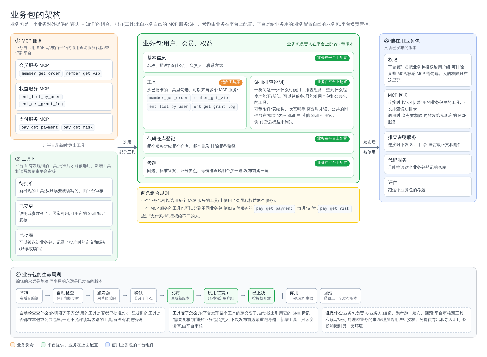
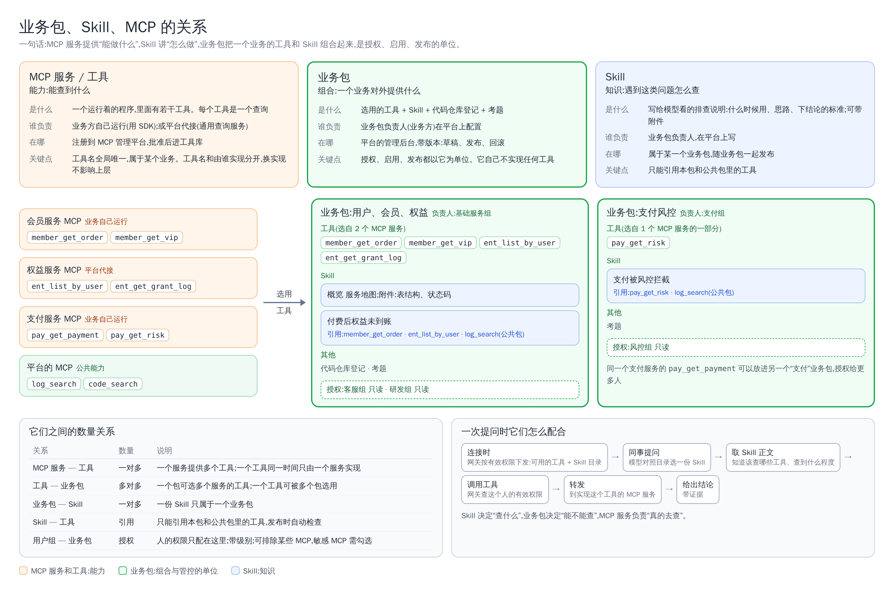
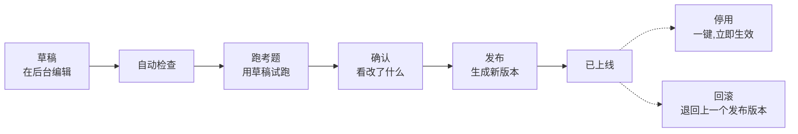
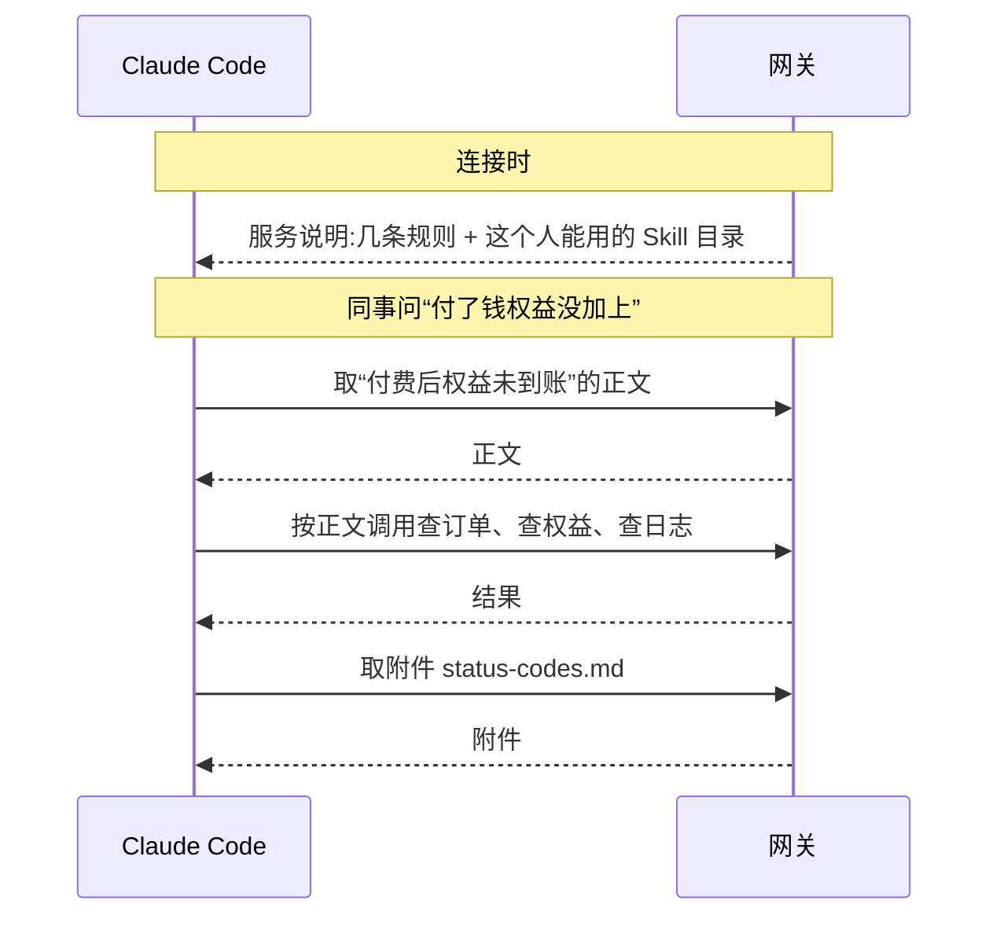

# 业务包与 Skill:原理与设计

业务包是平台的组织单位:一个业务对外提供的“能力 + 知识”的组合。能力是从工具库里选用的工具,知识是业务在平台上写的 Skill。授权、启用、发布,都以业务包为单位。

**一句话:MCP 服务提供“能做什么”,Skill 讲“怎么做”,业务包把一个业务的工具和 Skill 组合起来。**

**最小版本:一个业务包里有五样东西。**

| 内容 | 来源 |
| --- | --- |
| 基本信息 | 业务在平台上填写 |
| 工具 | 从工具库里选用已批准的工具 |
| Skill(可带附件) | 业务在平台上写 |
| 代码仓库登记 | 业务在平台上填写 |
| 考题 | 业务在平台上写 |

相关文档:[MCP 接入与工具库](16-MCP接入与工具库-原理与设计.md)、[权限管理](12-权限管理-原理与设计.md)、[数据定义](13-数据定义-原理与设计.md) 第 4、5 节、[评估系统](02-评估系统-原理与设计.md)。



## 1. 三者的关系



| | MCP 服务 / 工具 | 业务包 | Skill |
| --- | --- | --- | --- |
| 回答 | 能查到什么 | 一个业务对外提供什么 | 遇到这类问题怎么查 |
| 谁负责 | 业务自己运行,或平台代接 | 业务包负责人,在平台上配置 | 业务包负责人,在平台上写 |
| 在哪 | 登记到平台,批准后进工具库 | 管理后台,带版本 | 属于某一个业务包,随它发布 |

| 关系 | 数量 | 说明 |
| --- | --- | --- |
| MCP 服务 — 工具 | 一对多 | 一个工具同一时间只由一个服务实现 |
| 工具 — 业务包 | 多对多 | 一个包可选多个服务的工具;一个工具可被多个包选用 |
| 业务包 — Skill | 一对多 | 一份 Skill 只属于一个业务包 |
| Skill — 工具 | 引用 | 只能引用本包和公共包里的工具 |
| 用户组 — 业务包 | 授权 | 人的权限只配在这里(文档 12) |

**Skill 决定“查什么”,业务包和授权决定“能不能查”,MCP 服务负责“真的去查”。**

## 2. 业务包里有什么

### 2.1 基本信息

名称、描述(“管什么”)、负责人、联系方式。描述会出现在同事的服务说明里,用来告诉模型这个业务包是干什么的。

### 2.2 工具

从工具库里勾选**已批准**的工具。可以来自多个 MCP 服务,例如“用户、会员、权益”选用了会员服务和权益服务两个服务的工具。

一个服务的工具也可以分到不同的业务包。例如支付服务的 `pay_get_payment` 放进“支付”,`pay_get_risk` 放进“支付风控”,授权给不同的人。

工具数量不宜太多。一个人能用的工具越多,模型越容易选错。一个业务包里的工具,建议控制在一二十个以内。

### 2.3 Skill

见第 3 节。

### 2.4 代码仓库登记

哪个服务对应哪个仓库、哪个目录,排除哪些路径。代码查询只能搜读业务包登记过的仓库(文档 10)。

### 2.5 考题

见第 4 节。

## 3. Skill

### 3.1 Skill 是什么

写给模型看的排查说明。一类问题一份。

```
名称:付费后权益未到账
什么时候用:用户付了钱,但会员没有开通或权益没有加上。常见说法:“付了钱没开通”“权益没到账”

需要的信息
  订单号,或者用户标识加大致的付费时间。没有就先问。

怎么查
  1. 先查订单,确认钱付成功了没有
  2. 付成功了,再查会员有没有开通
  3. 会员开通了,再查权益有没有发放
  4. 找到第一个没成功的环节,查那个时间点的日志

查到什么程度才能下结论
  必须指出断在哪一段,并给出那一段的记录或日志。

附件
  订单和权益的状态码见《概览》的附件 status-codes.md
```

| 部分 | 要求 |
| --- | --- |
| 什么时候用 | 写具体的现象和同事常用的说法。它进入 Skill 目录,决定这份 Skill 会不会被取用 |
| 正文 | 写思路和判断标准,不写死步骤;必须写清“查到什么程度才能下结论” |
| 附件 | 表结构、状态码这类对照资料,需要时才读 |

格式和 Claude Skill 的 `SKILL.md` 兼容:开头是名称和“什么时候用”,下面是正文,附件按文件名引用。这样以后要改成在插件里下发(第 6 节),不用改内容。

### 3.2 几份 Skill 共用的资料

建一份“概览”Skill:服务地图、主要的表结构、状态码作为它的附件。其他 Skill 写“见《概览》的附件”。

服务地图按业务流程写:一条链路依次经过哪些服务、每一段靠什么字段关联、每一段成功的标志是什么、常见的断点在哪里。

### 3.3 写法要点

- 同一条信息只写一处。单个工具的用法写在工具的说明里;一类问题怎么查写在 Skill 里;所有任务都遵守的规则写在平台的通用规范里。
- Skill 里不写考题中的具体数据(订单号、用户号),否则等于泄题。
- Skill 只能引用本包和公共包里的工具。跨业务的链路(例如同时要查支付和会员),建一个专门的业务包,把两边需要的工具都选进来。
- 说明写得再好也只是建议,模型可能不照做。不能被违反的要求(只读、权限、上限)由平台强制。

## 4. 考题

和 [评估系统](02-评估系统-原理与设计.md) 的格式相同:问题、标准答案、评分要点,可选的追问信息。

| 要求 | 原因 |
| --- | --- |
| 每份 Skill 至少对应一道题 | 没有题,就不知道这份 Skill 有没有用 |
| 至少一道“信息不够,应该先问”的题 | 检查它不乱猜 |
| 至少一道业务逻辑题(答案在代码里) | 检查仓库登记和代码导航是否管用 |

发布前跑一遍这个业务包的考题。之后每次修改再跑一遍。

## 5. 生命周期



| 规定 | 内容 |
| --- | --- |
| 编辑和使用分开 | 编辑的永远是草稿;同事用的永远是已发布的版本 |
| 版本是完整快照 | 发布时记下所选工具的定义摘要。同一个版本号对应确定的内容,评估和审计能对上 |
| 停用 | 平台管理员和业务包负责人都可以一键停用,对所有人立即不可用 |
| 回滚 | 把已发布版本指回上一个 |
| 导出和导入 | 用于备份,以及在测试和生产两套环境之间搬运 |

### 5.1 自动检查

保存和发布时自动跑:

| 检查 | 不通过时 |
| --- | --- |
| 必填项齐全;每份 Skill 有“什么时候用”和“下结论的标准” | 不能发布 |
| 选用的工具都已批准 | 不能发布 |
| Skill 引用的工具都在本包或公共包里 | 不能发布 |
| 一期不允许读写级别的工具 | 不能发布 |
| 内容里没有混进密码、密钥 | 不能发布 |
| 每份 Skill 至少有一道考题 | 提醒 |
| 有工具处于“已变更”,引用它的 Skill 还没复核 | 提醒 |

### 5.2 工具变了怎么办

工具在业务那边改了说明或参数,工具库把它标为“已变更”(文档 16 第 4 节)。平台找出引用它的 Skill,标记“需要复核”,通知业务包负责人。负责人确认 Skill 不用改或改完之后,重新跑考题、发布。

## 6. Skill 怎么送到同事那里

### 6.1 默认:服务器上按需取



平台自己的“Skill 下发”服务提供两个工具:按名称取正文和附件;按一句描述搜索 Skill。连接时,网关在服务说明里放上这个人能用的 Skill 目录(名称加“什么时候用”)。目录放不下时,只放各业务包的简介,提示用搜索。

好处:改了立即生效;按人控制能看到哪些;平台知道哪份被用了。代价:这不是 Claude Code 的原生机制,模型要主动去取,可能会跳过。

### 6.2 退路:发布到插件里

如果阶段 0 的对比测试发现模型经常不去取,改成:业务包发布时,平台把 Skill 导出成插件里的 `SKILL.md` 文件,提交到插件仓库,同事的 Claude Code 自动更新后原生加载。业务方完全感觉不到区别,还是在平台上点发布。

| | 服务器上按需取 | 发布到插件里 |
| --- | --- | --- |
| 改了多久生效 | 立即 | 同事的插件更新之后 |
| 按人控制可见范围 | 能 | 按业务包拆成多个插件,按需安装 |
| 平台知道哪份被用了 | 能 | 不能,只能从工具调用推断 |
| 会不会被用上 | 要实测 | 原生机制,较可靠 |

为了随时能切换,现在就守住四条约定:格式用原生的 `SKILL.md`;正文里不写平台特有的取法,附件用文件名引用;Skill 名称全平台唯一;发布步骤做成可以挂多个出口。

## 7. 一个新业务接入的完整样子

假设以后“优惠券”要接入:

1. **提供工具**:业务用 SDK 写一个 MCP 服务,或者请平台在通用查询服务里配置几条查询;登记到平台(文档 16)。
2. **批准**:平台管理员批准新工具。
3. **建业务包**:业务包负责人在后台新建“优惠券”,选用这些工具,写一份概览 Skill 和一两份排查 Skill,填仓库登记,写五道考题。
4. **检查、跑考题、发布**。
5. **授权**:平台管理员把业务包授权给相关的用户组(文档 12)。

同事那边什么都不用装,下次打开 Claude Code 就能用。平台的代码一行不改。

## 8. 一期做到哪里

| 部分 | 一期 | 二期 |
| --- | --- | --- |
| 业务包 | 两个:公共包、基础业务包(用户、会员、权益) | 更多业务 |
| 编辑 | 后台编辑;负责人都是你 | 各业务的负责人自己维护 |
| 生命周期 | 草稿、自动检查、跑考题、发布、停用、回滚 | 试用状态(先对指定用户组开放);评审流程 |
| Skill 下发 | 服务器上按需取;阶段 0 做两种方式的对比 | 按对比结果决定是否加插件方式 |
| 工具变了 | 手工处理 | 自动标记复核 |

## 9. 待确认

- [ ] 基础业务包里有哪些工具?需要三个服务的主要表、状态字段和现有的内部查询接口。
- [ ] 第一批 Skill 写哪几类问题?建议从同事最常问的两三类开始。

## 10. 自测

- [ ] MCP 服务、业务包、Skill 各回答什么问题?(第 1 节)
- [ ] 一个工具可以在几个业务包里?一份 Skill 呢?(第 1 节)
- [ ] Skill 的“什么时候用”为什么要写具体的现象?(第 3.1 节)
- [ ] 几份 Skill 共用的状态码表放在哪里?(第 3.2 节)
- [ ] 业务包的发布版本为什么要记下工具的定义摘要?(第 5 节)
- [ ] Skill 放在服务器上的代价是什么?退路是什么?为了随时能切换,现在要守住哪几条?(第 6 节)
