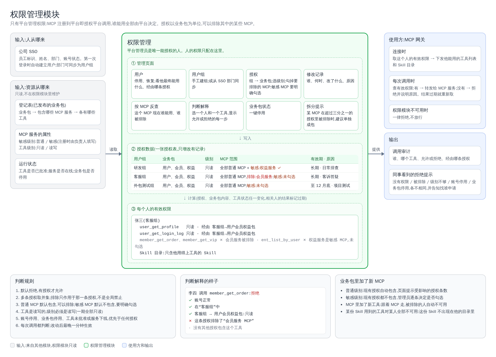

# 权限管理:原理与设计

登录解决“你是谁”,权限管理解决“你能用什么”。平台只有一套权限:MCP 服务注册到平台,就等于授权平台调用它;谁能用,全部由平台决定。管理员在管理页面上把业务包授权给用户组,必要时排除其中的某些 MCP;网关每次调用前查一次。

**最小版本:做这四样。**

| 要做的 | 具体是什么 |
| --- | --- |
| 一张授权表 | 用户组 → 业务包,带级别和 MCP 范围 |
| 有效权限 | 由授权算出每个人能用哪些工具,网关直接查 |
| 管理页面 | 用户、用户组、授权、修改记录,加上反查和判断解释 |
| 一条初始规则 | 第一个管理员写在部署配置里 |

相关文档:[数据定义](13-数据定义-原理与设计.md) 第 6、9 节、[业务包与 Skill](11-业务包与Skill-原理与设计.md)、[MCP 接入与工具库](16-MCP接入与工具库-原理与设计.md)、[网关核心](15-网关核心-原理与设计.md)。



## 1. 三件容易混在一起的事

| | 回答的问题 | 比喻 | 谁决定 |
| --- | --- | --- | --- |
| 登录 | 你是谁 | 刷工牌进大楼 | 公司 SSO |
| 权限 | 你能用什么 | 工牌能刷开哪几层的门 | 平台管理员 |
| 启用 | 你想用什么 | 今天打算去哪几层 | 同事自己 |

三个都满足,才能用。一期所有业务包对有权限的人默认启用,“启用”这张表先建好,二期再开放给同事自己选。

## 2. 角色

| 角色 | 能做什么 | 不能做什么 |
| --- | --- | --- |
| 平台管理员 | 授权;审核新工具和读写级别;紧急停用任何东西 | |
| 业务包负责人 | 编辑、发布、回滚、停用自己的业务包 | 给人授权 |
| MCP 服务负责人 | 登记、更新、下线自己的服务;注册时填敏感级别 | 决定谁能用 |
| 同事 | 使用被授权的业务包 | |

**人的权限只配在一个地方:平台的授权表。** MCP 服务这一层不对人授权,业务的 MCP 服务只认平台。这样永远不会出现“这里允许、那里不允许,听谁的”。

一期,三个服务和两个业务包的负责人都是你,平台管理员也是你。角色在数据上分好,二期业务方加入时直接用。

## 3. 授权

### 3.1 授权的样子

授权的单位是业务包。每条授权可以调整这个业务包里哪些 MCP 服务对这个组可用。

| 用户组 | 业务包 | 级别 | MCP 范围 | 有效期 · 原因 |
| --- | --- | --- | --- | --- |
| 研发组 | 用户、会员、权益 | 只读 | 全部普通 MCP;另外勾选了敏感的权益服务 | 长期 · 日常排查 |
| 客服组 | 用户、会员、权益 | 只读 | 全部普通 MCP,排除会员服务;敏感的未勾选 | 长期 · 客诉答疑 |
| 外包测试组 | 用户、会员、权益 | 只读 | 全部普通 MCP;敏感的未勾选 | 至 12 月底 · 项目测试 |

### 3.2 MCP 范围的默认值

| MCP 的敏感级别 | 授权业务包时 | 业务包里新加了这样的 MCP 时 |
| --- | --- | --- |
| 普通 | 默认包含,可以排除 | 现有授权自动包含;页面提示受影响的授权条数 |
| 敏感 | 默认不包含,要明确勾选 | 现有授权都不包含;管理员逐条决定是否勾选 |

为什么默认值相反:普通的东西保持方便;敏感的东西必须有人明确点头,不会因为业务包加了一个服务,权限就悄悄变大。

### 3.3 级别

每个工具声明自己的级别:只读,或会改数据。授权时也选级别:只读或读写。工具会改数据时,这个人的级别必须是读写;只读级别的人,工具列表里看不到改数据的工具。

一期所有工具和授权都是只读。字段从第一天就有,二期开放写操作时不用改表。

### 3.4 授权给组,不给个人

新人入职,把他加进组就有了权限;转岗换组;离职停用账号。用户组可以从公司 SSO 的部门自动同步,也可以在平台上手工建。个人授权留给少数例外。

评估脚本这类平台自己的程序,作为“应用”被授权,规则和人一样。

## 4. 判断规则

1. **默认拒绝。** 没有授权就不能用。
2. **多条授权取并集。** 一个人在多个组,只要有任何一条授权给了他,他就能用;级别取最高的。
3. **排除只作用于那一条授权。** 不是全局的禁止。张三同时在客服组(排除会员服务)和研发组(不排除),他能用会员服务。
4. **普通 MCP 默认包含,敏感 MCP 默认不包含。**
5. **会改数据的工具要读写级别。**
6. **停用优先。** 账号停用、业务包停用、工具未批准或已下线、MCP 服务不在线,优先于任何授权。
7. **每次调用都判断。** 工具列表里看得到,不等于调用时一定放行。
8. **权限模块不可用时,一律拒绝。**

一个工具可能同时在几个业务包里。判断时看的是:这个人有权限并启用的业务包里,**有没有任何一个**包含这个工具、没有排除它所在的 MCP、级别够。审计里记下这次是经由哪条授权放行的。

不设“明确禁止”这种规则。如果以后确实需要“这个人无论在哪个组都绝对不能用某个服务”,再加一份禁止名单,并规定禁止优先。

## 5. 有效权限

每次调用都去算一遍太慢,所以权限模块提前算好每个人的**有效权限**:他能用哪些工具、什么级别、经由哪条授权;他能看到哪些 Skill;哪些工具对他不可用、原因是什么。结构见文档 13 第 9 节。

| 时机 | 发生什么 |
| --- | --- |
| 同事连接时 | 网关取他的有效权限,生成工具列表和 Skill 目录 |
| 每次调用时 | 网关查有效权限,不用再去问权限模块 |
| 授权、业务包、工具状态、账号状态任一变化 | 相关人的有效权限标记过期,下次调用时重新计算 |

改动后最晚一分钟生效。

Skill 的显示也跟着有效权限走:某份 Skill 用到的工具对这个人**全部**不可用,这份 Skill 不出现在他的目录里;只有一部分不可用,照常显示,调到不可用的工具时会收到明确的提示。

## 6. 业务的能力变了,权限怎么跟上

权限表里不存工具清单,只存“谁、哪个业务包、什么级别、哪些 MCP”。工具清单以登记表为准,判断时两边对照。

| 发生了什么 | 结果 | 管理员要做什么 |
| --- | --- | --- |
| 某个 MCP 服务里新增了工具 | 批准并被选进业务包后,按 MCP 范围自动落到对应的人;被排除的人自动不可用 | 不用做 |
| 业务包里加了一个普通 MCP | 现有授权自动包含 | 看一眼提示,需要时排除 |
| 业务包里加了一个敏感 MCP | 现有授权都不包含 | 逐条决定是否勾选 |
| 新建了一个业务包 | 默认没人能用 | 给相关的组授权 |
| 工具下线、业务包停用 | 立即不可用 | 不用做 |

“这个工具该不该存在”在工具批准时把关;“它在哪个业务包里”由业务包负责人决定;“这个人能不能用”在授权这里把关。三件事分开,权限才能这么简单。

## 7. 管理页面

| 页面 | 能做什么 |
| --- | --- |
| 用户 | 查看所有登录过的用户;停用和恢复;设为管理员;**看某个人最终能用什么、经由哪条授权** |
| 用户组 | 建组、改名、加人、移人;从 SSO 同步来的组只能看 |
| 授权 | 以业务包为行,看授权给了哪些组、什么级别、MCP 范围;新增、修改、撤销;必须填原因;可设有效期 |
| 按 MCP 反查 | 选一个 MCP 服务:哪些业务包包含它,哪些组经由哪条授权能用它,哪些被排除,展开到具体的人 |
| 判断解释 | 选一个人和一个工具,显示允许或拒绝的每一步 |
| 修改记录 | 谁、何时、改了什么、改之前、改之后、原因 |

判断解释的样子:

```
李四 调用 member_get_order:拒绝
  ✓ 账号正常
  ✓ 在“客服组”中
  ✓ 客服组 → 用户会员权益包:只读
  ✗ 这条授权排除了“会员服务 MCP”
  · 没有其他授权包含这个工具
```

几条设计要点:

- **撤销授权时,提示这个人是否仍通过别的组拥有权限。** 否则管理员以为撤掉了,实际上没有。
- **拆分提示。** 某个 MCP 在超过三分之一的授权里被排除时,提示管理员考虑把它拆到单独的业务包。排除是给少数例外用的,不该成为常态。
- **管理页面也用公司 SSO 登录。** 只有管理员能进,只在公司内网可访问。
- **第一个管理员写在部署配置里。** 之后由他在页面上指定其他管理员。

## 8. 被拒绝时同事看到什么

网关把原因返回给 Claude Code,由它用大白话告诉同事。

| 原因 | 同事看到的意思 |
| --- | --- |
| 没有登录或登录过期 | 需要重新登录 |
| 账号停用 | 你的账号已停用,请联系管理员 |
| 没有授权 | 你没有“某某业务”的使用权限,可以找某某申请 |
| 被排除 / 敏感未勾选 | 你的授权里不包含这项功能,可以找某某申请 |
| 级别不够 | 你只有只读权限,这个操作需要读写权限 |
| 不可用 | 这项功能当前不可用 |

通用规范里要求:遇到权限问题就停下来说明,不反复重试,也不换别的工具绕过去。

## 9. 有权限的人能查任意用户的数据吗

能。权限管到“能不能用这个业务的这些服务”,管不到“能查哪些用户”。一期用几条办法兜住:

| 办法 | 做在哪 |
| --- | --- |
| 查询必须带具体的标识(订单号、用户号),不提供“列出所有用户”这类工具 | 工具批准时检查 |
| 每个人每天查询的不同用户数超过阈值,告警 | 网关统计 |
| 审计里记下查询目的 | 通用规范要求模型附带,尽力而为 |
| 敏感字段打码 | MCP 服务;网关出口再按通用规则兜底 |

按数据行控制(“只能查自己负责的数据”)放在二期。真需要时,由业务的 MCP 服务根据网关传过去的调用者身份自己判断。

## 10. 和调用审计的区别

| | 修改记录 | 调用审计 |
| --- | --- | --- |
| 记什么 | 谁改了谁的权限 | 谁在什么时候调用了什么工具,被允许还是拒绝,经由哪条授权 |
| 谁写 | 权限管理 | 网关 |
| 回答 | 他的权限是谁给的 | 他查了什么数据 |

两者都只增不删。

## 11. 一期做到哪里

| 部分 | 一期 | 二期 |
| --- | --- | --- |
| 授权 | 用户组 → 业务包;MCP 范围的排除和敏感勾选 | 排除到单个工具 |
| 级别 | 字段留好,全部只读 | 开放写操作,同时加上执行前确认等保护 |
| 谁能授权 | 平台管理员 | 业务包负责人管理自己包的授权,敏感包和读写级别仍要平台管理员确认 |
| 启用 | 表建好,默认启用 | 同事自己选 |
| 管理页面 | 第 7 节全部 | 权限申请和审批;调用审计查询 |
| 数据保护 | 第 9 节的几条 | 按数据行控制 |

## 12. 在开发路线里的位置

[开发路线](开发路线.md) 里的模块 4。独立验收时不需要网关,直接调用判断接口:

| 验收项 |
| --- |
| 没有任何授权的人,结果是拒绝,原因是没有授权 |
| 给他的组授权后,最晚一分钟,结果变成允许 |
| 授权里排除某个 MCP 后,这个 MCP 的工具对他不可用,原因是被排除 |
| 业务包里加一个敏感 MCP,现有授权都不包含它 |
| 他同时在两个组,一个排除、一个不排除,结果是允许 |
| 停用账号后,结果是拒绝,原因是账号停用 |
| 按 MCP 反查、判断解释的结果和实际判断一致 |
| 非管理员打不开管理页面 |
| 每一步操作都在修改记录里,带操作人和原因 |

## 13. 待确认

- [ ] 公司 SSO 能不能带回部门?决定用户组是自动同步还是手工维护。
- [ ] 第一批建哪几个用户组?各自能用哪些业务包、要排除什么?
- [ ] 除了你,还有谁是平台管理员?
- [ ] 员工离职后,SSO 那边多久会让他无法登录?平台是否需要更快地停用?

## 14. 自测

- [ ] 登录、权限、启用,分别回答什么问题,各由谁决定?(第 1 节)
- [ ] 为什么 MCP 服务这一层不对人授权?(第 2 节)
- [ ] 普通 MCP 和敏感 MCP 的默认值为什么相反?(第 3.2 节)
- [ ] 一个人在两个组,一个排除了某个 MCP,一个没有,他能用吗?为什么?(第 4 节)
- [ ] 有效权限是什么?改了授权多久生效?(第 5 节)
- [ ] 业务新增了一个工具,管理员需要重新配权限吗?(第 6 节)
- [ ] 有权限的人能查任意用户的数据吗?一期怎么兜住?(第 9 节)
