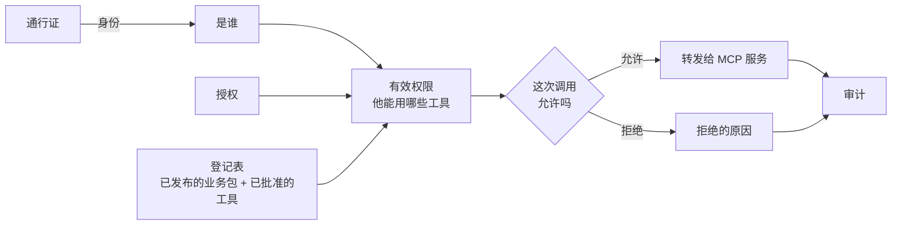

# 数据定义:原理与设计

各个模块能分开开发,靠的是先把它们之间传递的数据定下来。本文档定义平台里所有核心数据的结构。它们是整个平台最底下的一层:所有模块都依赖它们,它们不依赖任何模块。

**最小版本:记住这条链。**



相关文档:[架构总览](架构总览.md)、[MCP 接入与工具库](16-MCP接入与工具库-原理与设计.md)、[业务包与 Skill](11-业务包与Skill-原理与设计.md)、[权限管理](12-权限管理-原理与设计.md)、[网关核心](15-网关核心-原理与设计.md)。

结构用 JSON 表示,只列关键字段。

## 0. 三条通用的规定

| 规定 | 内容 | 原因 |
| --- | --- | --- |
| 都带版本号 | 每一种结构都有 `schema` 字段 | 以后升级时,新旧两种可以同时存在,不用所有模块同一天改 |
| 只加不改 | 升级时只增加字段。已有字段不改名、不改含义、不删除 | 旧的模块读到新数据不会出错 |
| 认人只用一个标识 | 全平台用 `subject`(员工标识)认人 | 姓名会重、邮箱会变 |

## 1. 数据都存在哪

| 数据 | 存在哪 | 谁写 |
| --- | --- | --- |
| MCP 服务登记、工具库 | 平台数据库 | MCP 接入模块(文档 16) |
| 业务包、Skill、考题 | 平台数据库,带版本 | 业务包管理模块(文档 11) |
| 用户、用户组、授权、修改记录 | 平台数据库 | 权限管理模块(文档 12) |
| 登记表 | 平台数据库,带版本;网关内存里有一份 | 业务包发布、工具批准时生成 |
| 有效权限 | 权限模块计算,网关内存里缓存 | 权限管理模块 |
| 审计 | 平台数据库或日志平台,只增不删 | 网关 |
| 数据源账号、Git 密钥、MCP 服务的访问凭据 | 密钥管理 | 平台管理员 |

**没有任何东西依赖 Git 里的文件。** 业务包和 Skill 在管理后台里配置;后台提供导出和导入,用于备份和在测试、生产之间搬运。

## 2. MCP 服务登记

一个 MCP 服务注册到平台后,就是一条登记。**注册即授权平台调用它。**

```json
{
  "schema": 1,
  "id": "member-service",
  "name": "会员服务",
  "endpoint": "http://member-mcp.internal/mcp",
  "credential_ref": "secret/mcp/member-service",
  "maintained_by": "business",
  "owner": "基础服务组",
  "contact": "负责人联系方式",
  "tool_prefix": "member",
  "sensitivity": "normal",
  "status": "online",
  "sdk_version": "0.3.1"
}
```

| 字段 | 含义 |
| --- | --- |
| `endpoint` | 服务的地址。在 K8s 里登记的是服务地址,不是某个实例的地址 |
| `credential_ref` | 平台访问它用的凭据在密钥管理里的位置。凭据本身不在这里 |
| `maintained_by` | `business` 业务自己运行;`platform` 平台代接 |
| `tool_prefix` | 这个服务所有工具名的前缀,全平台唯一 |
| `sensitivity` | `normal` 普通;`sensitive` 敏感。注册时由负责人填写,授权时起作用(第 6 节) |
| `status` | `online` 在线;`offline` 下线;`disabled` 被平台停用 |

## 3. 工具

工具是 MCP 服务里的一个能力。平台从服务那里“列出工具”得到它们,进入工具库。

```json
{
  "schema": 1,
  "name": "member_get_order",
  "mcp_service": "member-service",
  "title": "查询订单",
  "description": "按订单号查询支付状态、金额和支付时间。排查“付了钱没到账”时先用它",
  "params": { "order_id": { "type": "string", "required": true, "description": "订单号" } },
  "access": "read",
  "status": "approved",
  "definition_digest": "sha256:7f3a…",
  "approved_digest": "sha256:7f3a…"
}
```

| 字段 | 含义 |
| --- | --- |
| `name` | 全平台唯一,以所属服务的前缀开头。**工具的身份是名字,不是由哪个服务实现** |
| `access` | `read` 只读;`write` 会改数据。一期只允许 `read` |
| `status` | `pending` 待批准;`approved` 已批准;`changed` 已变更;`removed` 已下线 |
| `definition_digest` | 当前看到的定义(说明、参数、级别)的摘要 |
| `approved_digest` | 批准时的定义摘要。两者不同,说明定义变了 |

状态规则见文档 16 第 4 节。

## 4. 业务包

业务包是平台的组织单位:一个业务对外提供的工具和知识的组合。

```json
{
  "schema": 1,
  "id": "membership",
  "name": "用户、会员、权益",
  "description": "用户账号、会员订阅、权益发放相关的问题排查和业务逻辑解答",
  "owner": "基础服务组",
  "status": "online",
  "draft_version": 8,
  "published_version": 7
}
```

业务包的每一个发布版本,是一份完整的快照:

```json
{
  "schema": 1,
  "pack": "membership",
  "version": 7,
  "published_at": "2026-11-16T10:00:00Z",
  "published_by": "E10086",
  "tools": [
    { "name": "member_get_order", "digest": "sha256:7f3a…" },
    { "name": "ent_list_by_user", "digest": "sha256:91c2…" }
  ],
  "skills": ["membership/overview", "membership/entitlement-missing"],
  "repos": [ { "service": "member-service", "repository": "git@git.example.com:base/member-service.git", "path": "/", "exclude": ["config/secrets/"] } ],
  "evals": ["membership/case-001", "membership/case-002"]
}
```

| 字段 | 含义 |
| --- | --- |
| `status` | `online` 已上线;`trial` 试用(二期);`disabled` 停用 |
| `draft_version` / `published_version` | 编辑的永远是草稿;同事用的永远是已发布的版本 |
| 版本里的 `tools[].digest` | 发布时每个工具的定义摘要。保证同一个版本号对应确定的工具定义,评估和审计能对上 |

一个工具可以被多个业务包选用;一个业务包可以选用多个 MCP 服务的工具。

## 5. Skill

Skill 属于某一个业务包,随业务包一起发布。格式和 Claude Skill 的 `SKILL.md` 兼容。

```json
{
  "schema": 1,
  "id": "membership/entitlement-missing",
  "pack": "membership",
  "name": "付费后权益未到账",
  "when": "用户付了钱,但会员没有开通或权益没有加上。常见说法:“付了钱没开通”“权益没到账”",
  "body": "Markdown 正文:需要的信息、排查思路、查到什么程度才能下结论",
  "attachments": { "status-codes.md": "附件内容" },
  "uses_tools": ["member_get_order", "ent_list_by_user", "log_search"]
}
```

| 字段 | 含义 |
| --- | --- |
| `when` | “什么时候用”。进入 Skill 目录,决定它会不会被取用 |
| `attachments` | 附件:表结构、状态码等,需要时才读 |
| `uses_tools` | 这份 Skill 用到的工具。只能是本包或公共包里的工具,发布时检查 |

## 6. 授权

只有平台管理员能授权。授权的单位是业务包。

```json
{
  "schema": 1,
  "id": "grant-0012",
  "subject_type": "group",
  "subject": "customer-service",
  "pack": "membership",
  "level": "read",
  "exclude_mcp": ["member-service"],
  "include_sensitive_mcp": [],
  "exclude_tools": [],
  "expires_at": null,
  "reason": "客诉答疑",
  "created_by": "E00001",
  "created_at": "2026-11-16T09:00:00Z"
}
```

| 字段 | 含义 |
| --- | --- |
| `subject_type` | `group` 用户组;`user` 个人;`app` 应用(例如评估脚本) |
| `level` | `read` 只读;`write` 读写。一期只有 `read` |
| `exclude_mcp` | 这条授权排除的普通 MCP 服务。默认为空,即全部包含 |
| `include_sensitive_mcp` | 这条授权明确包含的敏感 MCP 服务。默认为空,即都不包含 |
| `exclude_tools` | 排除到单个工具。字段留好,一期不开放 |

## 7. 登记表

登记表是网关运行时用的快照:所有**已上线业务包的已发布版本**,加上它们用到的**已批准的工具**和所属的 MCP 服务。

```json
{
  "schema": 1,
  "version": 153,
  "built_at": "2026-11-16T10:00:05Z",
  "packs": { "membership": { "version": 7, "tools": ["member_get_order", "ent_list_by_user"], "skills": ["membership/entitlement-missing"] } },
  "tools": { "member_get_order": { "mcp_service": "member-service", "access": "read", "title": "…", "description": "…", "params": {} } },
  "mcp_services": { "member-service": { "endpoint": "…", "sensitivity": "normal", "status": "online" } },
  "skills": { "membership/entitlement-missing": { "pack": "membership", "name": "…", "when": "…", "uses_tools": ["…"] } }
}
```

| 规定 | 内容 |
| --- | --- |
| 什么时候生成新版本 | 业务包发布或回滚、工具被批准或下线、MCP 服务停用时 |
| 整张替换 | 网关要么用旧版,要么用新版,不会一半新一半旧 |
| 回滚 | 把“当前版本”指回上一个 |

## 8. 身份

登录授权模块提供。给一张通行证,返回这是谁。

```json
{ "schema": 1, "valid": true, "kind": "user", "subject": "E10086", "name": "张三", "department": "客服部", "expires_at": "2026-11-16T11:00:00Z" }
```

```json
{ "schema": 1, "valid": false, "reason": "expired" }
```

| 字段 | 含义 |
| --- | --- |
| `kind` | `user` 真人;`app` 应用 |
| `reason` | `missing` 没带;`expired` 过期;`invalid` 无效;`revoked` 已撤销 |

身份只来自验证过的通行证,绝不从工具参数里取。这里只回答“你是谁”,不判断权限。

## 9. 有效权限

权限模块根据授权、登记表、账号状态算出来,网关缓存使用。

```json
{
  "schema": 1,
  "subject": "E10086",
  "computed_at": "2026-11-16T10:01:00Z",
  "registry_version": 153,
  "tools": {
    "user_get_profile": { "level": "read", "via": "grant-0012" }
  },
  "skills": ["membership/overview"],
  "denied": {
    "member_get_order": "excluded",
    "ent_list_by_user": "sensitive_not_included"
  }
}
```

| 字段 | 含义 |
| --- | --- |
| `tools` | 这个人能用的工具、级别、经由哪条授权 |
| `skills` | 他的 Skill 目录:只含至少有一个工具他能用的 Skill |
| `denied` | 在他有权限的业务包里、但对他不可用的工具及原因。用于给出准确的拒绝提示 |

授权、登记表、账号状态任一变化,相关人的有效权限标记过期,下次调用时重新计算。最晚一分钟生效。

拒绝的原因:

| 原因 | 含义 |
| --- | --- |
| `user_disabled` | 账号已停用 |
| `no_grant` | 没有任何授权包含这个工具 |
| `excluded` | 有授权,但这条授权排除了它所在的 MCP |
| `sensitive_not_included` | 它所在的 MCP 是敏感的,授权里没有勾选 |
| `level_insufficient` | 工具需要读写,授权只有只读 |
| `unavailable` | 工具未批准、已下线,或 MCP 服务不在线 |

## 10. 转发

网关在权限通过后,把调用转发给实现这个工具的 MCP 服务。按 MCP 协议,附带两样平台的信息:

| 附带的信息 | 用途 |
| --- | --- |
| `request_id` | 贯穿网关、MCP 服务、数据源和审计 |
| 调用者身份(员工标识) | 供 MCP 服务记日志。业务需要时可以自己再做一层判断 |

MCP 服务返回的结果,按平台的约定带一个状态。SDK 和通用查询服务会自动按这个约定返回:

| 状态 | 含义 | 模型应该怎么做 |
| --- | --- | --- |
| `ok` | 查到了 | 使用结果 |
| `empty` | 查询成功,确实没有数据 | 这是事实,可以据此推理 |
| `bad_param` | 参数不对 | 按提示改参数重试 |
| `error` | 执行失败:超时、数据源不可用、被限流、被熔断 | **不能当成“没有数据”** |

把 `error` 和 `empty` 混在一起是最危险的错误:模型会把“查询失败”理解成“没有这条记录”,得出一个看起来很有道理的错误结论。

## 11. 审计

网关对每一次调用写一条,允许的和拒绝的都写。

```json
{
  "schema": 1,
  "request_id": "req_9f2c",
  "time": "2026-11-16T10:21:07Z",
  "subject": "E10086",
  "kind": "user",
  "tool": "member_get_order",
  "mcp_service": "member-service",
  "pack": "membership",
  "via_grant": "grant-0012",
  "params_digest": { "order_id": "O2026…0001" },
  "purpose": "用户反馈付费后权益没到账",
  "decision": "allow",
  "deny_reason": "",
  "status": "ok",
  "rows": 1,
  "duration_ms": 42,
  "registry_version": 153,
  "gateway_instance": "gateway-7c9d-x2k"
}
```

| 规定 | 内容 |
| --- | --- |
| 允许、拒绝、失败、超时都记 | 没有通过登录的请求也记,主体写“未知” |
| 只增加,不修改,不删除 | 查询和删除的权限单独控制 |
| 不记完整结果、不记凭据 | 只记行数和状态;参数只记摘要 |
| 先记开始,再转发 | 审计写不进去时不转发,返回“平台暂不可用”并告警 |
| `purpose` | 查询目的。通用规范要求模型在调用业务数据工具时附带一句,尽力而为,用于事后追查 |

## 12. 串起来看一次调用

以“张三查一笔订单”为例:

| 步骤 | 用到的数据 | 发生了什么 |
| --- | --- | --- |
| 1 | 身份 | 网关验证通行证,得到 `subject = E10086` |
| 2 | 有效权限 | 网关查他的有效权限:`member_get_order` 是否在 `tools` 里 |
| 3 | 审计 | 写一条“开始” |
| 4 | 登记表 | 查到工具由 `member-service` 实现,取地址 |
| 5 | 转发 | 带着 `request_id` 和调用者身份,用平台的凭据转发 |
| 6 | 审计 | 补上结果:状态、行数、耗时 |

## 13. 待确认

- [ ] SSO 里哪个字段可以作为稳定不变的员工标识?能否带回部门?
- [ ] 审计保留多久?存在平台数据库还是公司的日志平台?

## 14. 自测

- [ ] 工具的身份为什么是名字,而不是由哪个服务实现?(第 3 节)
- [ ] 业务包的发布版本为什么要记下每个工具的定义摘要?(第 4 节)
- [ ] 授权里“排除普通 MCP”和“包含敏感 MCP”为什么默认值相反?(第 6 节)
- [ ] 登记表和有效权限各是什么?谁用它们?(第 7、9 节)
- [ ] `empty` 和 `error` 混在一起会导致什么?(第 10 节)
- [ ] 审计为什么要“先记开始,再转发”?(第 11 节)
