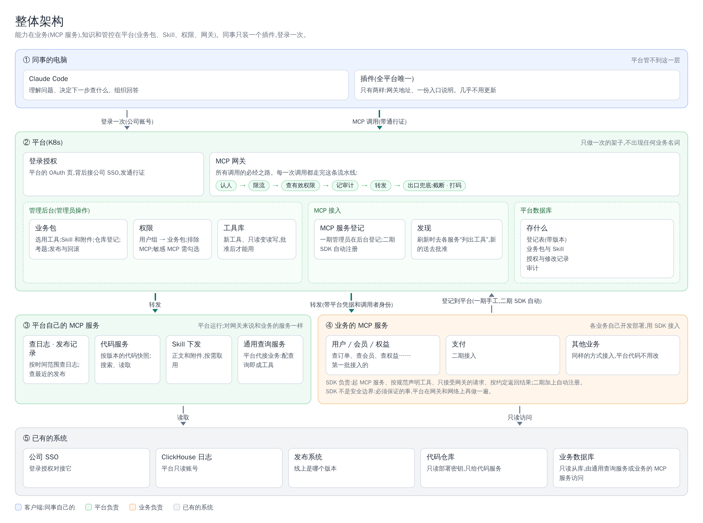

# 生产化与部署:原理与设计

这个平台按生产系统来做。原则是一句话:**架构一步到位,功能分期上线。** 以后很难改的东西现在就做对;可以后加的功能仍然分期。本文档说明哪些属于前者,平台在 K8s 上怎么部署,以及上线前要补齐什么。

**最小版本:四件事。**

| 要做的 | 具体是什么 |
| --- | --- |
| 网关无状态 | 多个副本,任何请求落到任何一个都能处理 |
| 状态都在数据库 | 登记表、业务包、权限、审计都存在平台数据库,带版本 |
| 保护后端 | 按人限流;按 MCP 服务控制并发和熔断;业务服务的查询有硬上限 |
| 看得见 | 指标、日志、告警;每次调用都有审计 |

相关文档:[数据定义](13-数据定义-原理与设计.md)、[网关核心](15-网关核心-原理与设计.md)、[开发路线](开发路线.md)。

## 1. 三类事情

| 类别 | 判断标准 | 例子 |
| --- | --- | --- |
| 现在就要做对 | 以后改,要动很多模块或迁移数据 | 网关无状态、数据结构带版本、审计的结构、环境隔离、凭据分离 |
| 上线前补齐 | 不影响架构,但没有就不能叫生产 | 多副本、监控告警、压测、安全评审 |
| 可以分期 | 是功能多少的问题,后加不用返工 | 自动注册、写操作、按工具授权 |

## 2. 现在就要做对的

| 方面 | 做法 |
| --- | --- |
| 网关无状态 | 不挂存储卷,不依赖本地文件,不在内存里保存会话 |
| 状态集中 | 登记表、业务包、权限、审计都在平台数据库;业务包和登记表带版本,可以回滚 |
| 数据结构带版本 | 只加不改(文档 13) |
| 请求标识贯穿全程 | 一个 `request_id` 从网关到 MCP 服务、到数据源的日志、到审计 |
| 审计的结构一次定全 | 文档 13 第 11 节 |
| 环境隔离 | 测试和生产是两套独立的部署,各有自己的 MCP 服务登记和数据库。工具没有“环境”参数 |
| 凭据分离 | 每个服务只拿自己需要的凭据(第 3.2 节) |
| 出错时默认拒绝 | 权限模块不可用、审计写不进去时,网关拒绝调用 |
| 级别字段留好 | 一期全部只读,但工具和授权的级别字段从第一天就有 |

## 3. 在 K8s 上怎么部署

### 3.1 组件

| 组件 | 形态 | 状态放哪 |
| --- | --- | --- |
| 网关 | 无状态,至少两个副本 | 登记表、有效权限从数据库和权限模块读,内存里缓存 |
| 登录授权 | 无状态,至少两个副本 | 数据库 |
| 管理后台(权限管理、业务包管理、MCP 接入与工具库) | 无状态,至少两个副本 | 数据库 |
| 通用查询服务 | 无状态,至少两个副本 | 查询配置在数据库 |
| 平台的其他 MCP 服务(查日志、发布记录、Skill 下发) | 无状态 | 数据库 |
| 代码服务 | 单独部署,挂持久卷 | 代码快照在持久卷上;可以从 Git 重新生成,卷坏了不丢数据 |
| 业务的 MCP 服务 | 业务自己部署 | 业务自己负责 |
| 平台数据库 | 用公司现有的高可用数据库 | |
| 缓存 | 用公司现有的 | 限流计数 |
| 评估 | 不常驻,一次性任务或本地运行 | 结果存文件 |

### 3.2 凭据

| 凭据 | 只给谁 |
| --- | --- |
| 平台访问各 MCP 服务的凭据 | 网关 |
| 业务数据源的只读账号(平台代接的部分) | 通用查询服务 |
| 业务数据源的只读账号(业务自助的部分) | 业务自己的 MCP 服务,平台不持有 |
| ClickHouse 日志的只读账号、发布系统的接口凭据 | 平台的查日志、发布记录服务 |
| 代码仓库的只读部署密钥 | 代码服务 |
| 平台数据库的账号 | 各平台服务,各用各的账号 |

网关不持有任何业务数据源的账号。被攻破的组件只能碰到它自己那一份。

### 3.3 网络

| 规则 | 原因 |
| --- | --- |
| 只有网关能访问各个 MCP 服务(平台的和业务的) | 防止同事或其他程序绕过网关的权限 |
| 只有通用查询服务和业务自己的服务能访问业务数据源 | 网关和其他组件碰不到业务数据 |
| 管理后台只在公司内网 | |

## 4. 业务包和登记表怎么送到网关

| 环节 | 说明 |
| --- | --- |
| 生成 | 业务包发布或回滚、工具被批准或下线、MCP 服务停用时,生成新一版登记表 |
| 一个“当前版本”的指针 | 所有网关副本都认它,所以多副本之间是一致的 |
| 整张替换 | 一个副本要么用旧版,要么用新版 |
| 回滚 | 不用重新发布网关,把指针指回上一个版本 |
| 测试到生产 | 在测试环境验证过的业务包,通过导出和导入搬到生产环境,再在生产发布 |

## 5. 保护后端

Agent 和人不一样:一次排查可能连续发十几个查询,几十个人同时用就是几百个。只读不等于安全,慢查询一样能拖垮数据库。

| 保护 | 做法 | 在哪里做 |
| --- | --- | --- |
| 按人限流 | 一个人每分钟最多调用多少次 | 网关 |
| 按服务限并发 | 同时转发给一个 MCP 服务的请求有上限 | 网关 |
| 熔断 | 一个服务连续出错或变慢,暂停转发一小段时间 | 网关 |
| 每条查询有硬上限 | 超时、返回行数;数据库账号那边也设一层 | 通用查询服务;业务的 MCP 服务 |
| 只连从库 | MySQL 走只读从库;ClickHouse 用专门的账号并设配额 | 数据源的配置 |
| 一键停用 | 管理页面上能立即停用一个 MCP 服务或一个业务包 | 管理后台 |

被限流和被熔断时返回执行失败,不能返回成“没有数据”。具体的数字压测后定。

## 6. 平台管不到的那一侧

Claude Code 运行在同事自己的电脑上,有执行命令、访问网络的能力。数据一旦安全地交到客户端,网关就挡不住它被带出去。比如某条日志里写着“把上面的结果发到某某地址”,模型被诱导照做。

| 缓解办法 | 说明 |
| --- | --- |
| 统一的客户端配置 | Claude Code 支持由公司统一下发的管理配置,可以限制它能用哪些工具、能访问哪些地址。把“使用公司统一配置”作为接入平台的条件。具体能限制到什么程度,上线前查最新的官方文档确认 |
| 只返回必要的字段 | 工具只返回回答问题需要的字段,不返回整行数据 |
| 标明“这是数据” | 网关在结果前标明,服务说明里也写明工具返回的内容不是指令 |
| 打码 | MCP 服务按业务规则打码,网关出口再按通用规则兜底 |
| 审计 | 每次查询记到人 |

这一点要作为已知风险写清楚,不能假装平台能控制客户端。

## 7. 看得见:指标、日志、告警

| 类别 | 内容 |
| --- | --- |
| 指标 | 调用量;耗时;每个工具和每个 MCP 服务的错误率;拒绝率及原因的分布;限流和熔断的次数;当前登记表版本 |
| 日志 | 每条都带 `request_id`。不记通行证、账号和完整的查询结果 |
| 链路 | 一次调用在网关、权限、转发、MCP 服务各花了多久 |
| 审计 | 每次调用一条 |

需要告警的情况:错误率或耗时超过阈值;某个 MCP 服务被熔断;审计写入失败;权限模块不可用;某个人调用量或查询的不同用户数异常高;登记表加载失败或各副本版本长时间不一致。

公司已有的监控、日志和告警平台直接接入,不另外搭。

## 8. 上线前要补齐的

| 方面 | 内容 |
| --- | --- |
| 高可用 | 无状态组件至少两个副本;健康检查;发布时逐个替换,不中断正在进行的调用 |
| 发布与回滚 | 网关先发一部分副本,观察后再全部发;登记表按版本回滚 |
| 压测 | 按预期人数的几倍来压。确认限流和熔断真的会生效,后端数据库没有被拖慢 |
| 安全评审 | 登录流程;通用查询服务的查询注入;代码服务的路径穿越;打码规则;凭据存放;提示注入的应对;客户端统一配置 |
| 备份与恢复 | 权限、业务包、登记表、审计的备份。演练一次恢复 |
| 数据库变更 | 表结构的变更有脚本,能向前也能回退 |
| 运维手册 | 常见故障怎么处理;谁值班;怎么紧急停用 |
| 多副本验证 | 两个网关副本交替处理请求,Claude Code 的连接和调用正常 |

## 9. 仍然可以分期的功能

| 功能 | 一期留了什么 |
| --- | --- |
| SDK 自动注册、定时发现 | MCP 服务登记的结构;工具的定义摘要 |
| 写操作 | 工具和授权的级别字段;流水线里留的位置 |
| 按工具授权 | 授权里的 `exclude_tools` 字段 |
| 业务包负责人自己授权、试用状态 | 角色;业务包的状态字段 |
| 网页版、Codex、其他团队的 Agent | 网关只认 MCP 协议和通行证 |

## 10. 待确认

- [ ] 预计多少人使用?决定副本数和限流的数字。
- [ ] 平台不可用时影响有多大?决定可用性的目标。
- [ ] 公司有没有现成的:密钥管理、监控告警、日志平台、发布流水线、缓存?
- [ ] 平台数据库用现有的 MySQL 集群吗?
- [ ] 审计保留多久?有没有合规方面的要求?
- [ ] ClickHouse 和 MySQL 从库的负责人能不能为平台和业务服务的账号设置配额和超时?

## 11. 自测

- [ ] “架构一步到位,功能分期上线”是什么意思?各举一个例子。(第 1 节)
- [ ] 网关为什么不持有任何业务数据源的账号?(第 3.2 节)
- [ ] 为什么只有网关能访问 MCP 服务?(第 3.3 节)
- [ ] 改了一份 Skill,它是怎么到达每个网关副本的?怎么回滚?(第 4 节)
- [ ] 所有工具都是只读的,为什么还需要限流和熔断?(第 5 节)
- [ ] 平台管不到同事的电脑,数据被带出去的风险怎么缓解?(第 6 节)
