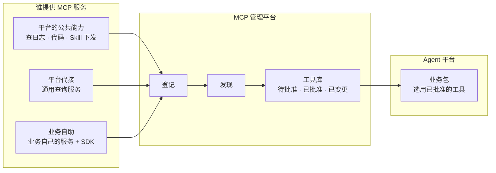
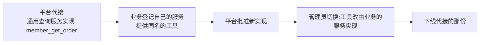
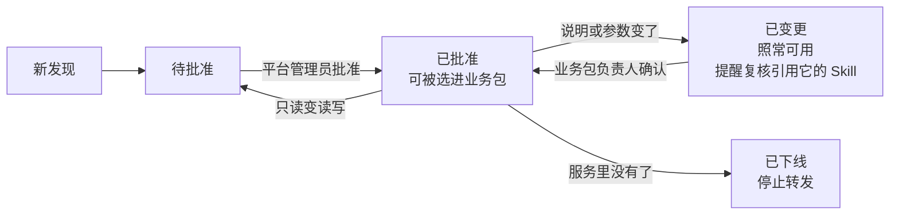

# MCP 接入与工具库:原理与设计

平台上所有的工具都来自 MCP 服务。本文档讲 MCP 服务怎么接到平台上、工具怎么进入工具库、谁来批准,以及平台怎么帮业务“代接”。这部分是整个系统的“MCP 管理平台”这一层。

**最小版本:一期做这四样。**

| 要做的 | 具体是什么 |
| --- | --- |
| 登记 | 管理员在后台登记一个 MCP 服务的地址、负责人、敏感级别 |
| 发现 | 后台点“刷新”,平台按 MCP 协议去“列出工具”,结果进入工具库 |
| 批准 | 新工具待批准,平台管理员批准后才能被选进业务包 |
| 通用查询服务 | 平台代接用:在后台填查询语句就生成工具,不用写代码 |

相关文档:[数据定义](13-数据定义-原理与设计.md) 第 2、3、10 节、[业务包与 Skill](11-业务包与Skill-原理与设计.md)、[权限管理](12-权限管理-原理与设计.md)、[网关核心](15-网关核心-原理与设计.md)。

## 1. 它在整体里的位置



| 层 | 管什么 | 不管什么 |
| --- | --- | --- |
| MCP 管理平台 | MCP 服务的登记、发现、工具库、批准、转发 | Skill、考题、业务包、谁能用 |
| Agent 平台 | 业务包、Skill、考题、按业务包授权 | 工具怎么实现、在哪里运行 |

一期两层部署在一起,共用一个管理后台,但代码和接口分开。以后别的入口(网页版、其他团队的 Agent)要用工具,可以直接用 MCP 管理平台这一层。

## 2. 三种提供方

| 提供方 | 谁运行 | 怎么做 | 适合 |
| --- | --- | --- | --- |
| 平台的公共能力 | 平台 | 平台自己开发的 MCP 服务 | 查日志、发布记录、代码查询、Skill 下发 |
| 平台代接 | 平台 | 通用查询服务:在后台配查询,生成工具(第 6 节) | 业务还没有自己的 MCP 服务;查询简单 |
| 业务自助 | 业务方 | 业务用 SDK 写自己的 MCP 服务并登记(第 7 节) | 业务有能力维护;逻辑复杂、只有业务自己清楚 |

**注册到平台,就等于授权平台调用。** 业务的 MCP 服务只认平台,不认同事个人;谁能用,全部由平台的权限管理决定(文档 12)。

### 2.1 工具名和实现分开

工具的身份是名字,不是由哪个服务实现。`member_get_order` 属于会员业务,今天可以由平台代接的通用查询服务实现,明天可以由会员服务自己实现。业务包、Skill、权限都只认工具名。

这让“先代接、后自助”成为可能:



同一个工具名同一时间只指向一个已批准的实现。切换是管理员在后台的一次操作,可以切回去。业务包和 Skill 都不用改。

## 3. 登记与发现

### 3.1 登记

登记一个 MCP 服务要填:

| 项 | 说明 |
| --- | --- |
| 名称、地址 | 在 K8s 里登记服务地址,不登记某个实例 |
| 负责人、联系方式 | 出了问题找谁 |
| 维护方 | 业务自己,或平台代接 |
| 工具名前缀 | 全平台唯一。这个服务的所有工具名必须以它开头 |
| 敏感级别 | 普通或敏感。敏感的服务在授权时默认不包含(文档 12) |
| 访问凭据 | 平台调用它时用的凭据,存在密钥管理里 |

一期由平台管理员在后台手工登记。二期由 SDK 在服务启动时自动注册,并定时心跳。

### 3.2 发现

平台按 MCP 协议去调这个服务的“列出工具”,得到每个工具的名称、说明、参数和级别,和工具库里已有的比对。

| 时机 | 一期 | 二期 |
| --- | --- | --- |
| 什么时候发现 | 登记后、管理员点“刷新”时 | 另外定时发现;收到服务的“工具变了”通知时 |
| 滚动发布时 | 不处理 | 按“服务 + 版本”分别记录,避免新旧实例交替时反复判定为变化 |

工具清单以服务**实际提供的**为准,由平台去拉,而不是让服务自己报上来。

## 4. 工具库与批准

### 4.1 工具的状态



| 变化 | 处理 | 谁来定 |
| --- | --- | --- |
| 新出现的工具 | 待批准,批准前不能被选用 | 平台管理员 |
| 从只读变成读写 | 变回待批准,批准前按原定义不可用 | 平台管理员 |
| 说明或参数变了 | 照常可用;找出引用它的 Skill,标记“需要复核”,通知业务包负责人;下次发布前要重跑考题 | 业务包负责人 |
| 工具没了 | 停止转发;引用它的业务包标记需要处理 | 自动 |

一期,“已变更”的自动比对可以先不做:三个服务都由你维护,改了你自己知道。数据结构里的 `definition_digest` 和 `approved_digest` 先留好。

### 4.2 批准时看什么

- 名称是否以服务的前缀开头;
- 说明里有没有写清“做什么”和“什么时候用”;
- 级别是否如实:声称只读的工具,是否真的只读。平台无法完全验证业务服务的内部实现,所以这一条靠评审和对负责人的要求;
- 说明里有没有诱导模型的文字。工具说明会直接给模型看,被写成诱导性的内容是一种已知的攻击方式。

### 4.3 二期:测试环境先批准

正式的做法是把批准挪到上线之前:业务先在测试环境发布,变化在测试环境审核;批准结果随版本带到生产,生产环境只核对“发现的定义和批准过的是否一致”,不一致才暂停并告警。这样正常发布不会中断,也符合“定义变了要重新审核”的安全要求。

## 5. 对业务 MCP 服务的要求

不管是业务自助还是平台代接,接入平台的 MCP 服务都要满足:

| 要求 | 原因 |
| --- | --- |
| 只接受网关的请求 | 网络上限制只有网关能访问;服务自己也校验凭据。否则同事可以绕过平台的权限 |
| 工具名以登记的前缀开头 | 不同业务不会重名 |
| 数据库用只读账号(一期) | 只读不能只靠工具的声明 |
| 按约定返回四种状态 | 区分“没有数据”和“查询失败”(文档 13 第 10 节) |
| 带上 `request_id` 记日志 | 能和平台的审计对上 |
| 每次查询有超时和返回行数上限 | 保护业务自己的数据库 |
| 查询必须带具体的标识 | 不提供“列出所有用户”这类工具,降低批量拿数据的风险 |

## 6. 通用查询服务(平台代接)

一个由平台运行的 MCP 服务。管理员在后台为某个业务填写查询,它就生成对应的工具,不用写代码。

```yaml
# 在后台填写的内容,示意
- name: member_get_order
  title: 查询订单
  description: 按订单号查询支付状态、金额和支付时间。排查“付了钱没到账”时先用它
  access: read
  params:
    order_id: { type: string, required: true, description: 订单号 }
  type: sql
  datasource: member_mysql_ro
  query: |
    SELECT order_id, user_id, status, amount, paid_at
    FROM orders WHERE order_id = :order_id LIMIT 1
  mask: [user_phone]
  limits: { timeout_ms: 3000, max_rows: 20 }
```

| 规定 | 内容 |
| --- | --- |
| 两种类型 | `sql`:查只读从库;`http`:调内部的查询接口,只允许 GET |
| 参数只能作为值 | 参数填进查询时不能改变语句的结构 |
| 必须有上限 | 超时、返回行数;日志类查询必须带时间范围 |
| 脱敏 | `mask` 里的字段在返回前打码 |
| 账号 | 数据源的只读账号只在通用查询服务里 |
| 归属 | 它为哪个业务生成的工具,就以哪个业务的前缀命名,登记时维护方写“平台代接” |

它对网关来说只是一个普通的 MCP 服务。网关始终只做“转发”这一件事。

## 7. 接入 SDK

业务自助接入时用的库。一期先做 Go 版本,包装官方的 MCP Go SDK。

```go
mcp.Tool("member_get_order").
    Desc("按订单号查支付状态。排查'付了钱没到账'时先用它").
    Access(mcp.Read).
    Param("order_id", mcp.String, "订单号").
    Handle(func(ctx mcp.Ctx, p mcp.Params) mcp.Result {
        order, err := db.GetOrder(ctx, p.String("order_id"))
        if err != nil { return mcp.Error(err) }
        if order == nil { return mcp.Empty() }
        return mcp.OK(order)
    })
```

| SDK 做 | 一期 | 二期 |
| --- | --- | --- |
| 起一个 MCP 服务 | 做 | |
| 按平台规范声明工具:前缀、什么时候用、级别 | 做 | |
| 只接受网关的请求 | 做 | |
| 按约定返回四种状态,传递 `request_id` | 做 | |
| 超时、打码等常用工具函数 | 做 | |
| 启动时自动注册、心跳、退出时注销 | | 做 |

三条原则:

1. **先有协议,SDK 只是协议的一种实现。** 用别的语言的服务,照协议自己实现也能接入。
2. **SDK 不是安全边界。** 它跑在业务的进程里,可以不用、可以改。凡是必须保证的事,平台在网关和网络上再做一遍。
3. **SDK 要薄。** 规则放在平台,SDK 只做协议的包装;它越厚,每改一次就要所有业务升级一次。

## 8. 一期做到哪里

| 部分 | 一期 | 二期 |
| --- | --- | --- |
| 登记 | 后台手工登记 | SDK 自动注册、心跳;或对接公司的注册中心 |
| 发现 | 手动刷新 | 定时发现;按“服务 + 版本”记录 |
| 工具库 | 待批准、已批准;管理员一人批准 | 已变更的自动比对和复核提醒;测试环境先批准 |
| 提供方 | 平台公共能力;通用查询服务代接三个服务的大部分工具;权益服务用 SDK 自助,验证这条路 | 更多业务自助接入;代接迁移到自助 |
| SDK | Go,薄的一层 | 自动注册;其他语言 |

## 9. 可以参考的开源项目

| 项目 | 参考什么 |
| --- | --- |
| Nacos 3.x 的 AI 注册中心 | MCP 注册、Skill 仓库、生命周期管理;把现有接口零代码转成 MCP(配合 Higress) |
| Obot | MCP 目录、按组的访问策略、Skill 集中管理并下发到本地 |
| 官方 MCP Registry | 注册接口的规范和 `server.json` 格式。官方说明它不是为私有部署设计的 |
| 官方 MCP Go SDK | SDK 直接包装它 |

一期选择自研,原因见 [架构总览](架构总览.md) 第 7 节。

## 10. 待确认

- [ ] 业务服务主要用什么语言?决定 SDK 之后还要做哪个。
- [ ] 公司有没有在用的注册中心(Nacos、Consul 等)?二期自动注册时可以直接对接。
- [ ] 网关和业务 MCP 服务之间,有没有现成的服务间双向证书或服务网格?没有的话由平台签发凭据。

## 11. 自测

- [ ] MCP 管理平台和 Agent 平台各管什么?(第 1 节)
- [ ] 三种提供方各适合什么?“注册即授权平台调用”是什么意思?(第 2 节)
- [ ] 为什么工具名和实现要分开?代接怎么迁移到自助?(第 2.1 节)
- [ ] 工具清单为什么由平台去拉,而不是让服务自己报上来?(第 3.2 节)
- [ ] 哪些变化要平台批准,哪些只需要业务包负责人复核?(第 4.1 节)
- [ ] 为什么说 SDK 不是安全边界?(第 7 节)
