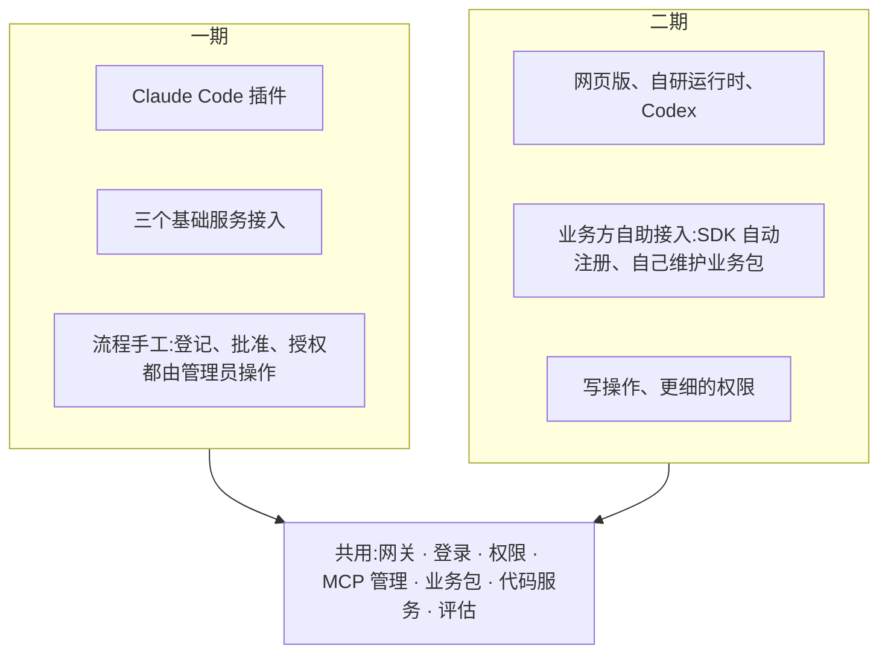

# 一期二期规划

一期的形态是 Claude Code 插件:同事装上平台唯一的插件,用公司账号登录一次,就能排查用户、会员、权益三个服务的问题,并询问它们的业务逻辑。一期按生产系统来做:**架构和数据结构一步到位,流程先手工,功能分期上线。**

总纲见 [架构总览](架构总览.md),模块和顺序见 [开发路线](开发路线.md)。

## 1. 两期的分工

| | 一期 | 二期 |
| --- | --- | --- |
| 使用方式 | Claude Code 插件 | 增加网页版、Codex |
| 接入的业务 | 用户、会员、权益 | 其他业务 |
| 谁来操作 | 你一个人:平台管理员、业务包负责人、MCP 服务负责人 | 业务方各自负责自己的服务和业务包 |
| 操作 | 全部只读 | 增加受控的写操作 |
| 原则 | 以后难改的现在做对 | 在一期的架子上加功能,不改架构 |

## 2. 一期范围

### 2.1 做什么

| 部分 | 一期内容 | 设计 |
| --- | --- | --- |
| 插件和登录 | 一个插件,一个网关地址;OAuth 授权页接公司 SSO | 文档 09 |
| 网关 | 认人、限流、查有效权限、审计、转发、出口兜底;并发控制和熔断;按人生成服务说明 | 文档 15 |
| 权限 | 用户组 → 业务包;普通 MCP 可排除、敏感 MCP 需勾选;有效权限;管理页面含反查和判断解释 | 文档 12 |
| MCP 接入 | 后台手工登记;手动刷新发现;工具库;管理员批准 | 文档 16 |
| 通用查询服务 | 平台代接三个服务的大部分工具 | 文档 16 第 6 节 |
| 接入 SDK | Go 版本,薄的一层;权益服务用它自助接入,验证这条路 | 文档 16 第 7 节 |
| 业务包 | 后台编辑:选工具、Skill(带附件)、代码仓库登记、考题;自动检查;发布、回滚、停用 | 文档 11 |
| Skill 下发 | 服务器上按需取;阶段 0 做和插件方式的对比 | 文档 11 第 6 节 |
| 业务包内容 | 公共包;基础业务包(用户、会员、权益) | 文档 11 |
| 代码 | 三个仓库按版本快照,搜索和读取 | 文档 10 |
| 评估 | 批量提问脚本;人工判卷 | 文档 02 |
| 生产化 | K8s 多副本;指标、日志、告警;测试和生产两套部署 | 文档 14 |
| 数据保护 | 查询必须带具体标识;按人统计查询的不同用户数并告警;审计记查询目的 | 文档 12 第 9 节 |

### 2.2 不做什么

| 不做 | 一期的做法 | 归属 |
| --- | --- | --- |
| 网页版、自研运行时 | 同事用 Claude Code;运行时就是 Claude Code | 二期已确定 |
| Codex | 只支持 Claude Code。Skill 用通用格式,为之后留余地 | 二期已确定 |
| SDK 自动注册、心跳、注册中心、定时发现 | 后台手工登记,手动刷新 | 二期已确定 |
| 业务方自己维护业务包、自己接入 | 由你代为维护 | 二期已确定 |
| 工具变更的自动比对和复核提醒;测试环境先批准 | 三个服务都是你的,手工处理 | 二期候选 |
| 业务包的试用状态、评审流程 | 你一个人编辑,直接发布 | 二期候选 |
| 写操作 | 全部只读。级别字段已留好 | 二期候选 |
| 排除到单个工具;按数据行控制;权限申请和审批 | 按 MCP 排除;第 2.1 节的数据保护;找管理员 | 二期候选 |
| 让模型自己写查询语句 | 查询都是配置好的、参数化的 | 不做 |
| 代码搜索引擎、向量库 | 在代码快照上做文本搜索 | 二期候选 |
| 自动判分 | 人工判卷 | 二期候选 |

这些不做的,在数据结构上都留了位置。二期加回来是补功能,不是改架构。

## 3. 一期的里程碑

| 里程碑 | 内容 | 对应开发路线 | 完成标志 |
| --- | --- | --- | --- |
| M0 验证 | 阶段 0 的验证;申请只读账号和部署密钥;开始记题目表 | 阶段 0 | 结果表填完;登录试验通过;三个真实案例能手工串起整条链路 |
| M1 架子通 | 网关、插件、登录、MCP 接入、通用查询服务、权限、业务包管理、平台的 MCP 服务 | 模块 1 至 8;合流点一、二 | 一个样例业务包,不改网关代码就能在 Claude Code 里按 Skill 查到数据;排除后查不到 |
| M2 业务通 | SDK;三个服务接入;两个业务包的内容;代码服务 | 模块 9、10、11;合流点三 | “付费后权益未到账”能给出带证据的结论;本机没有仓库也能回答业务逻辑问题 |
| M3 评估与改进 | 评估脚本;每周一轮“看错题、改一样、重跑” | 模块 12 | 一条命令跑完全部考题;至少三轮改进记录 |
| M4 上线与试用 | 上线前清单;请两三位同事试用一到两周 | 整体流程 | 清单逐项完成;同事自己装好并用起来;收到真实反馈 |
| M5 一期评审 | 汇总数据和意见,确定二期范围 | | 一份一期总结和二期范围 |

部署、指标和告警不单独成为里程碑,从 M1 开始和模块一起做。

## 4. 一期评审

| 输入 | 内容 |
| --- | --- |
| 你的意见 | 学习手册里每个模块的“我的意见” |
| 评估数据 | 各类问题的结果;错题原因的分类及占比 |
| 使用数据 | 同事的反馈;网关的调用统计;哪些 Skill 被用得多 |

评审时逐项回答:

- 哪类问题答得好,哪类答得差?差的主要原因是缺工具、缺 Skill、缺资料,还是推理错误?
- 同事实际问的问题,和一期设定的两类问题一致吗?
- 有多少同事想用但用不了(没有 Claude Code、不习惯命令行)?这决定网页版的优先级。
- Skill 放在服务器上,模型主动去取的比例够不够?
- 接一个新业务,是不是真的不用改平台代码?
- 权限的排除用得多不多?有没有需要更细的场景?

## 5. 二期已确定的方向

| 方向 | 是什么 | 一期为它留了什么 |
| --- | --- | --- |
| 网页版与自研运行时 | 对话页面、Agent 服务、平台上的运行时,给不使用 Claude Code 的同事 | 网关只认 MCP 协议和通行证;代码、Skill、工具都在云端 |
| 业务方自助接入 | 业务用 SDK 写服务,自动注册;自己维护业务包;从平台代接迁到自助 | 工具名和实现分开;角色和负责人字段;SDK 的协议 |
| 自动注册与发现 | SDK 启动时注册、心跳;定时发现;按版本记录 | MCP 服务登记的结构;工具的定义摘要 |
| Codex | 同一个网关、同一份内容 | Skill 用通用格式 |

早期网页版的设计在 `参考` 目录里。

## 6. 二期候选

以下不是承诺,排序和取舍在一期评审时决定。

| 方向 | 候选内容 | 什么数据支持做它 |
| --- | --- | --- |
| 写操作 | 补发权益、重新投递消息等,执行前由同事确认 | 排查结论稳定可靠,同事希望一步到位 |
| 权限深化 | 排除到单个工具;按数据行控制;申请和审批;业务包负责人自己授权 | 业务方接入后需要更细地区分 |
| 工具变更治理 | 自动比对;复核提醒;测试环境先批准 | 业务方多了,变更频繁 |
| Skill 下发 | 发布到插件里 | 阶段 0 或试用数据显示服务器方式不够好 |
| 代码查询深化 | 搜索引擎;语义检索;自动版本解析 | 仓库变多;错题里“找不到代码”占比高 |
| 评估深化 | 自动判分;留出集;发布前必须通过 | 题目积累到几十道以上 |
| 更多问题类型 | 整体异常排查;监控工具 | 同事实际在问 |

## 7. 文档怎么用

| 文档 | 角色 |
| --- | --- |
| [架构总览](架构总览.md) | 总纲和设计决定清单。说法不一致时以它为准 |
| 本文档 | 两期各做什么、里程碑、评审方式 |
| [开发路线](开发路线.md) | 十二个模块、约定、顺序、阶段 0 |
| 文档 02、09 至 16 | 各模块的设计 |
| [一期学习手册](一期学习手册.md) | 按模块的学习顺序、评审要点和意见记录 |
| `参考` 目录 | 早期的设计和二期才用到的专题 |
