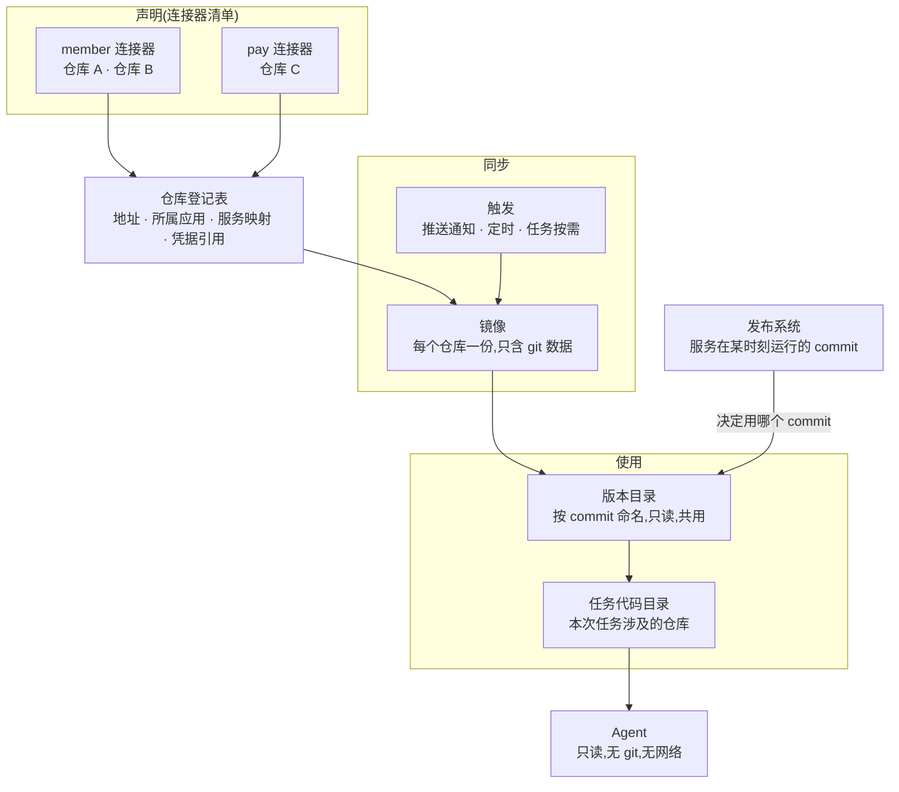

# 代码仓库管理:原理与设计

> 说明:本文档中的“连接器”,在后来的设计里改名为“业务包”,含义相同:一个业务交给平台的那一包东西(工具、排查说明、代码仓库登记、考题)。格式以 [11-业务包接入协议](../11-业务包与Skill-原理与设计.md) 为准。

每个业务在连接器清单里声明自己的仓库,平台为每个仓库维护一份镜像并持续同步。任务开始时,平台按“当时线上运行的版本”为这次任务拼出一个只读的代码目录。业务方只需要声明,不需要关心同步和缓存;Agent 只看到一个准备好的目录,不接触 git。

相关文档:[总体设计](01-总体设计.md)第 9 节是本文档的概要,[连接器接入规范](04-连接器接入规范-原理与设计.md)定义清单,[评估系统](../02-评估系统-原理与设计.md)依赖固定的代码版本。

## 1. 基本理念

| 理念 | 含义 | 对设计的影响 |
| --- | --- | --- |
| 声明式 | 业务方说明“有哪些仓库、对应哪些服务”,不说明怎么同步 | 仓库信息写在连接器清单里;同步、缓存、清理全部由平台完成 |
| 同步和使用分开 | 把仓库更新到最新,和某次任务用哪个版本,是两件事 | 镜像持续同步;任务使用的版本由线上运行情况决定,不是“最新” |
| 分析的是线上运行的代码 | 主干上的代码可能还没发布,也可能已经和线上不同 | 版本从发布系统查询;查不到才退回主干,并明确告知 |
| 按版本缓存,不可变 | 同一个 commit 的内容永远不变 | 目录以 commit 命名,创建后只读,多个任务共用 |
| Agent 不接触 git | Agent 的职责是读代码,不是管理仓库 | 目录由平台在任务开始前准备好;Agent 没有 git 凭据,也没有网络 |
| 权限跟随应用 | 谁能看一个仓库,取决于他对这个应用有没有权限 | 任务的代码目录里只放发起人有权看的仓库 |

## 2. 整体结构



三层各自的职责:

| 层 | 内容 | 更新频率 |
| --- | --- | --- |
| 镜像 | 每个仓库一份完整的 git 数据,不检出文件 | 持续同步 |
| 版本目录 | 某个仓库在某个 commit 的文件,只读 | 创建后不变 |
| 任务代码目录 | 一次任务用到的各仓库版本目录的组合 | 每个任务一个 |

## 3. 仓库的声明

业务方在连接器清单里声明仓库。一个业务可以有一个或多个仓库,一个仓库里也可以有多个服务。

```yaml
repos:
  - name: member-service
    url: git@git.example.com:member/member-service.git
    default_branch: main
    services:                      # 这个仓库对应哪些线上服务
      - service: member-api
        path: .                    # 服务代码在仓库中的位置
    overview: docs/agent-overview.md   # 给 Agent 看的仓库说明

  - name: member-common
    url: git@git.example.com:member/member-common.git
    default_branch: main
    kind: library                  # 公共库,不单独部署
    version_from: member-service   # 版本跟随使用它的服务(见第 5.3 节)

  - name: platform-monorepo
    url: git@git.example.com:platform/monorepo.git
    default_branch: main
    services:
      - service: entitlement-api
        path: services/entitlement
      - service: entitlement-worker
        path: services/entitlement-worker
    include:                       # 大仓库只取需要的目录
      - services/entitlement
      - services/entitlement-worker
      - libs/common
```

| 字段 | 作用 |
| --- | --- |
| `url`、`default_branch` | 从哪里同步 |
| `services` | 仓库与线上服务的对应关系。平台靠它从“某个服务出了问题”找到“看哪个仓库的哪个目录”,也靠它向发布系统查询版本 |
| `kind` | 区分可部署的服务和公共库 |
| `version_from` | 公共库没有自己的线上版本,说明它的版本跟随谁 |
| `include` | 大仓库只检出相关目录 |
| `overview` | 仓库里给 Agent 看的说明文件的位置 |

凭据不写在清单里。接入时业务方为平台开通一个只读的访问凭据,存入平台的密钥管理,清单只通过仓库名关联。

### 3.1 接入一个仓库实际需要什么

| 需要的东西 | 谁提供 | 用途 | 是否必需 |
| --- | --- | --- | --- |
| 仓库的 SSH 地址 | 业务方,写在清单里 | 平台从这里克隆和同步 | 必需 |
| 只读访问凭据 | 平台生成密钥对,业务方在仓库设置中启用公钥(Deploy Key) | 平台有权读取这个仓库 | 必需 |
| 仓库与线上服务的对应关系 | 业务方,写在清单里 | 从“某个服务出问题”找到“看哪个仓库” | 必需 |
| 线上运行的 commit | 发布系统 | 分析线上版本而不是主干最新 | 强烈建议;没有时退回主干并注明 |
| 推送通知(Webhook) | 业务方在仓库设置中配置,指向平台的接收地址 | 有新提交时及时同步 | 可选;没有时靠定时和按需同步 |

前两项解决“能不能拉到代码”,后三项解决“看哪个仓库、用哪个版本、何时更新”。只有前两项时平台已经可以工作,但只能分析主干最新代码。

Deploy Key 的配置:

1. 平台生成一对密钥,例如 `ssh-keygen -t ed25519 -C "agent-platform-readonly" -f ./agent_deploy_key -N ""`。
2. 公钥(`.pub` 文件的内容)由业务方添加到仓库的部署公钥设置中。部署公钥只有读权限。
3. 私钥存入平台的密钥管理,只有同步服务可以读取。它不进入代码仓库、不进入提示词,Agent 无法访问。
4. 验证:`GIT_SSH_COMMAND='ssh -i ./agent_deploy_key -o IdentitiesOnly=yes' git ls-remote <SSH 地址>`,能列出分支即表示可用。

注意事项:

- 不使用个人的 SSH 密钥。个人密钥通常带写权限,并且会随人员变动失效。
- 按连接器各用一把密钥。代码托管平台支持把同一把公钥在多个仓库上启用时,一个业务的多个仓库共用一把;不同业务不共用,便于单独撤销。
- 运行同步服务的机器要能访问代码托管平台的 SSH 端口。跨地域部署时先验证网络。
- 首次连接时固定代码托管平台的主机指纹,不使用跳过主机校验的配置。
- 子模块和公共库所在的仓库也要启用这把公钥,否则这些部分拉取不到。
- 密钥定期轮换;轮换时先启用新公钥,确认可用后再移除旧的。

## 4. 同步

### 4.1 镜像

每个仓库在平台上有一份镜像:只含 git 数据,不检出文件。镜像的作用是让“取某个 commit 的文件”不需要每次都访问代码托管平台。

### 4.2 三种触发方式

| 触发 | 时机 | 作用 |
| --- | --- | --- |
| 推送通知 | 代码托管平台在有新提交或新标签时通知平台 | 及时,绝大多数更新靠它 |
| 定时 | 每隔固定时间同步一次 | 兜底,防止通知丢失 |
| 任务按需 | 任务需要的 commit 在镜像里找不到时,立即同步一次 | 保证正确性:即使前两种都没赶上,任务也能拿到需要的版本 |

三种方式并存。前两种保证镜像通常是新的,第三种保证需要时一定是对的。

### 4.3 同步失败

| 情况 | 处理 |
| --- | --- |
| 同步失败,但需要的 commit 镜像里已有 | 正常使用,不受影响 |
| 同步失败,需要的 commit 不在镜像里 | 使用镜像里最近的版本,在任务信息中明确说明“代码可能不是线上版本”,并要求 Agent 在结论中注明 |
| 持续失败 | 通知连接器负责人(常见原因是凭据过期、仓库迁移) |

同步失败不应该让排查任务失败:日志和监控仍然可查,只是代码分析的可信度降低,而这一点要让 Agent 和用户都知道。

### 4.4 仓库的变动

| 变动 | 处理 |
| --- | --- |
| 强制推送、分支被删 | 镜像保留曾经被任务或评估使用过的 commit,不随上游删除 |
| 仓库改名或迁移 | 业务方更新清单中的地址;镜像数据可沿用 |
| 仓库拆分或合并 | 更新清单中的仓库列表和服务映射;旧仓库的镜像保留到相关评估案例不再需要为止 |
| 仓库下线 | 清单中移除;镜像按保留期清理 |

## 5. 版本的确定

### 5.1 原则

用哪个版本,由“问题发生时线上在运行什么”决定:

| 场景 | 使用的版本 |
| --- | --- |
| 排查当前的问题 | 当前线上运行的 commit |
| 排查过去某个时间的问题 | 那个时间线上运行的 commit |
| 灰度发布期间 | 新旧两个 commit 都准备,并说明各自的流量比例 |
| 接入答疑、代码生成 | 默认分支的最新 commit |
| 评估 | 案例中记录的 commit |

### 5.2 版本从哪里来

平台通过清单里的服务映射,向发布系统查询“某个服务在某个时刻运行的 commit”。这个查询是代码管理和发布系统之间唯一的接口。

查不到时依次退回:服务自己暴露的版本信息、镜像标签中的 commit、默认分支最新。每退一步都在任务信息里说明版本的来源和可信程度。

### 5.3 公共库和多仓库的一致性

一个服务依赖的公共库,线上用的是哪个版本?不能简单取公共库的最新提交。

| 依赖方式 | 版本如何确定 |
| --- | --- |
| 依赖文件中锁定了版本(多数情况) | 从服务仓库该 commit 的依赖锁定文件中读出公共库的版本,再映射到公共库的 commit 或标签 |
| git 子模块 | 服务仓库的 commit 已经记录了子模块的 commit,直接使用 |
| 同一个大仓库内 | 天然一致,同一个 commit |
| 无法确定 | 使用服务发布时间点公共库默认分支的 commit,并在任务信息中标明是推断 |

这样拼出来的任务代码目录,是线上那一刻实际运行的代码组合,而不是各仓库各自的最新。

## 6. 任务代码目录

### 6.1 目录的样子

```
/workspace/task-8f3a/code/
  INDEX.md                         本次任务的仓库清单(平台生成)
  member-service/                  -> 版本目录 member-service@a3f2c1
  member-common/                   -> 版本目录 member-common@7b90de
  platform-monorepo/               -> 版本目录 platform-monorepo@c41d05(只含声明的目录)
```

`INDEX.md` 由平台在任务开始时生成,是 Agent 进入代码的入口:

```
本次任务可读取的代码

| 目录 | 仓库 | 版本 | 对应服务 | 版本来源 |
| member-service/ | member-service | a3f2c1 (v1.9.0) | member-api | 发布系统,14:05 发布 |
| member-common/ | member-common | 7b90de (v2.3.1) | 公共库 | member-service 的依赖锁定文件 |
| platform-monorepo/ | platform-monorepo | c41d05 | entitlement-api, entitlement-worker | 发布系统,昨日 20:10 发布 |

各仓库的说明见其 docs/agent-overview.md。
```

### 6.2 放哪些仓库进来

| 来源 | 说明 |
| --- | --- |
| 任务涉及的应用 | 该应用连接器声明的全部仓库 |
| 声明的依赖 | 连接器清单中声明的依赖连接器的仓库 |
| 排查中途追加 | Agent 发现问题跨到另一个业务时,通过工具申请加入该业务的仓库 |

每一项都要过权限检查:发起人对该仓库所属的应用没有权限,仓库就不会出现在目录里。追加同理。

### 6.3 为什么是只读共用

- 版本目录按 commit 命名,内容不会变,多个任务同时使用不冲突。
- 创建一个任务代码目录只是建立几个指向版本目录的链接,几乎没有开销。
- Agent 没有写权限,不可能污染其他任务看到的代码。

将来让 Agent 修改代码或运行测试时,这一条要改:每个任务需要自己独立可写的副本,或在容器中运行。

## 7. 给 Agent 看的仓库说明

Agent 面对一个陌生的仓库,需要知道从哪里看起。每个仓库提供一份说明文件,内容是:

- 这个仓库是做什么的,对应哪些服务。
- 目录结构和关键入口(请求从哪里进来,核心逻辑在哪里)。
- 与其他服务的调用关系。
- 常见的排查起点(某类报错通常在哪个模块产生)。

说明文件放在仓库里,和代码一起维护、一起随版本走。这样说明和代码不会脱节,也由最了解代码的人维护。它与连接器的领域层 Skill 的分工是:说明文件讲“代码在哪里”,Skill 讲“问题怎么查”。

没有说明文件的仓库仍然可以接入,Agent 靠搜索和阅读自行摸索,只是效率低一些。评估中的工具调用次数能反映出这个差距。

## 8. 大仓库和特殊情况

| 情况 | 处理 |
| --- | --- |
| 仓库很大 | 镜像使用部分克隆,只在需要时取文件内容;版本目录只检出清单中 `include` 的目录 |
| 大仓库里只关心一部分 | `include` 声明;Agent 看到的就是裁剪后的目录 |
| 依赖包、构建产物、大型二进制 | 默认排除常见的依赖和产物目录,清单可以追加排除规则 |
| git 子模块 | 按服务仓库记录的 commit 一并检出 |
| 大文件存储 | 不拉取实际内容,保留占位 |
| 自动生成的代码 | 保留,但在说明文件中注明哪些是生成的 |
| 仓库中的密钥和配置 | 扫描版本目录,匹配到疑似密钥的文件不放入任务代码目录,并通知负责人 |

## 9. 存储与清理

| 数据 | 保留策略 |
| --- | --- |
| 镜像 | 仓库在清单中存在期间一直保留 |
| 版本目录 | 当前线上版本始终保留;其余在一段时间没有被使用后删除,需要时可从镜像重建 |
| 被评估案例引用的 commit | 在镜像中打上保留标记,不被 git 的垃圾回收清除;版本目录可以删,需要时重建 |
| 任务代码目录 | 任务结束后删除(只是链接) |

提前准备:发布系统每次发布后通知平台,平台提前建好新版本的版本目录。这样发布之后的第一次排查不需要等待检出,而发布之后正是最容易出问题的时候。

多实例部署时,镜像和版本目录放在各实例都能访问的共享存储上,或者每个实例维护自己的缓存、从同一个镜像服务按需获取。前者简单,后者在仓库很多时更节省。

## 10. 权限与安全

| 项目 | 设计 |
| --- | --- |
| 平台访问仓库 | 只读凭据,每个连接器独立,存在平台的密钥管理中,可单独吊销 |
| 用户能看哪些仓库 | 由应用成员关系决定,与工具权限使用同一套判断 |
| Agent | 只读文件系统访问,限定在任务代码目录内;无 git,无凭据,无网络 |
| 代码内容进入模型 | 与其他数据相同的合规判断;对代码外发有额外限制的仓库,在清单中标记,平台据此限制可用的模型服务或不提供代码 |
| 审计 | 记录每个任务加载了哪些仓库的哪个版本 |
| 代码中的指令 | 注释和文档里可能含有诱导性文字,与其他读入内容同等对待 |

## 11. 与其他部分的关系

| 部分 | 关系 |
| --- | --- |
| 连接器清单 | 仓库在这里声明,与工具、Skill 一起经过发布流程进入注册表 |
| 应用档案 | 服务与仓库的映射从清单同步到应用档案,供其他部分查询 |
| 发布系统 | 提供“服务在某时刻运行的 commit”,以及发布事件通知 |
| 任务信息注入 | 版本、发布时间、版本来源写入任务信息;两轮之间版本变化时在轮次信息中指出 |
| 评估 | 案例记录各仓库的 commit;评估时按记录准备代码目录,保证可复现 |
| 运行时 | 所有运行时拿到的都是同一个准备好的目录路径 |
| 本地使用 | 本地的 Claude Code 用的是开发者自己检出的代码。平台可以提供一个工具,返回各服务线上运行的 commit,供开发者自行切换 |

## 12. 分步实现与验收

| 步骤 | 范围 | 验收 |
| --- | --- | --- |
| R1 | 清单中的仓库声明;镜像;任务按需同步;按 commit 的版本目录;任务代码目录与 `INDEX.md` | 三个基础服务的仓库可按指定 commit 准备出只读目录;评估案例可按记录的 commit 复现 |
| R2 | 向发布系统查询版本;退回路径与版本来源说明;灰度时准备两个版本 | 当前问题和历史问题都能拿到对应时刻的版本;查不到时 Agent 的结论中有相应说明 |
| R3 | 推送通知和定时同步;发布后提前准备;同步失败的处理与通知 | 发布后首次排查无需等待检出;同步失败时任务仍可进行 |
| R4 | 多仓库:依赖声明、公共库版本推导、子模块 | 任务代码目录中的公共库版本与线上实际使用的一致 |
| R5 | 大仓库:部分克隆、`include`、排除规则;密钥扫描 | 大仓库的准备时间和占用空间在可接受范围 |
| R6 | 权限过滤;中途追加仓库;清理与保留标记 | 无权限的仓库不出现在目录中;评估引用的 commit 在上游被删后仍可用 |

## 13. 理解检查

- [ ] 为什么把“同步仓库”和“任务用哪个版本”分成两件事?(第 1、4、5 节)
- [ ] 三种同步触发方式各自解决什么问题?只留一种行不行?(第 4.2 节)
- [ ] 仓库同步失败了,排查任务应该失败吗?(第 4.3 节)
- [ ] 一个服务依赖一个公共库,排查时公共库该用哪个版本?(第 5.3 节)
- [ ] 多个任务共用同一个版本目录,为什么不会互相影响?什么情况下这个设计要改?(第 6.3 节)
- [ ] 仓库说明文件为什么放在业务仓库里,而不是放在平台上?(第 7 节)
- [ ] 上游仓库强制推送后旧的 commit 没了,以前的评估案例还能跑吗?(第 4.4、9 节)
