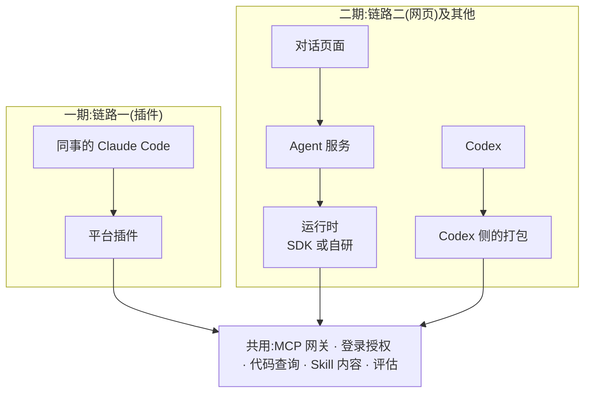

# 一期二期规划

> **这是早期版本,仅供参考。** 它按当时的前提写成,和现在的设计有多处不同。现在的设计以上一级目录的 [架构总览](../架构总览.md) 为准。

一期的形态是 Claude Code 插件:同事在自己的 Claude Code 里安装平台的插件,就能提问和排查三个基础服务的问题。平台做四样东西:服务器上的 MCP 网关、接公司 SSO 的登录授权页、三个基础服务的代码查询、云端的排查说明。插件只有一个,里面只有网关地址和一份入口说明。网页版、自研运行时、Codex 支持都放在二期。

本文档是实现计划的唯一依据。这条链路的完整设计见 [插件形态:原理与设计](../09-插件形态-原理与设计.md) 和 [代码查询:原理与设计](../10-代码查询-原理与设计.md),框架见 [架构总览](../架构总览.md),一期各部分的学习和评审见 [一期学习手册](../一期学习手册.md)。

## 1. 两期的分工

| | 一期 | 二期 |
| --- | --- | --- |
| 使用方式 | Claude Code 插件 | 增加网页版、Codex |
| 平台要做的 | MCP 网关、登录授权页、代码查询、插件内容、评估 | 另外加上对话页面、Agent 服务、运行时 |
| 判断标准 | 能用,结构正确,每一部分你都理解 | 由一期的数据和你的意见决定 |
| 原则 | 每个组件做最简单但结构正确的版本 | 在一期的基础上增加,不推倒重来 |

一期做的网关和插件内容,二期的所有东西都会继续使用。二期是在旁边加新的入口,不是重做。

## 2. 一期范围

### 2.1 做什么

| 部分 | 一期内容 |
| --- | --- |
| 使用方式 | 同事在 Claude Code 中安装平台插件后直接提问 |
| 问题类型 | 规则解释与接入(“某某业务逻辑是什么”);针对具体用户的排查(“我付费了,权益为什么没加上”) |
| 覆盖业务 | 用户、会员、权益三个服务 |
| MCP 网关 | 一个地址;按每个人已启用的业务包返回工具和排查说明;工具:日志查询(ClickHouse)、业务数据只读查询(MySQL 从库)、缓存读取(Redis)、最近的发布记录、代码查询(确定版本、搜索、读取)、反馈提交;登录校验;审计记到人;结果大小限制;脱敏 |
| 插件 | 只有一个:`agent-platform`,含网关地址和入口说明。放在一个内部 Git 仓库里作为插件市场 |
| 接入协议 | 一个业务按固定格式交一个目录:清单、工具、排查说明、代码仓库、考题。网关按目录加载,自带自动检查。用户、会员、权益按这套协议接入,由平台代接(文档 11) |
| 排查说明 | 存在云端的内容仓库里,按业务包组织(公共、基础业务),通过网关的工具按需取用;改了立即生效 |
| 登录 | 平台提供登录授权页,背后接公司已有的 SSO。同事第一次使用时在浏览器里登录一次。|
| 权限 | 管理员在管理页面上配置哪个用户组可以用哪个业务包;网关每次调用都检查;修改有记录(文档 12) |
| 代码 | 用户、会员、权益三个仓库的代码放在平台的服务器上,按版本保存,通过网关搜索和读取;每个仓库里放一份导航。同事自己的业务代码仍由 Claude Code 直接读本地 |
| 评估 | 考题;用命令行方式批量向装了插件的 Claude Code 提问;人工判断 |
| 反馈 | 网关上的一个反馈工具,同事主动提交问题、结论、是否解决 |
| 安全 | 全部只读;数据源账号只在网关;所有不能被绕过的要求由网关强制 |

### 2.2 不做什么

| 不做 | 一期的替代做法 | 归属 |
| --- | --- | --- |
| 网页版:对话页面、Agent 服务、运行时接口、SDK 运行时的适配 | 同事使用 Claude Code 自己的界面 | 二期已确定 |
| 自研运行时、选择 Agent | 运行时就是同事本地的 Claude Code | 二期已确定 |
| Codex 支持 | 只支持 Claude Code。Skill 正文不写只有 Claude Code 才认识的内容,为之后留余地 | 二期已确定 |
| 业务方接入自己的业务包 | 只有平台维护的两个业务包:公共、基础业务 | 二期已确定 |
| 按工具的授权;权限的申请和审批;各业务自己的管理员 | 按业务包授权给用户组,由平台管理员在页面上操作 | 二期候选 |
| 代理业务方自己的 MCP 服务 | 工具用声明式配置或平台内置代码,由网关执行。协议里已为业务自带 MCP 定好格式 | 二期已确定(随业务方接入) |
| 代码搜索引擎、向量库、服务器上的代码分析 Agent | 在代码快照上直接做文本搜索 | 二期候选 |
| 整体异常排查(“失败率为什么升高”) | 可以尝试,不作为验收内容 | 二期候选 |
| 检索与记忆、截图上传、模型网关 | 不涉及 | 二期候选 |
| 自动判分、评估数据冻结 | 人工判断,直接查线上数据 | 二期候选 |
| 任何写操作 | 不涉及 | 二期候选 |

## 3. 一期的里程碑

| 里程碑 | 内容 | 完成标志 | 对应学习单元 |
| --- | --- | --- | --- |
| M0 准备 | 用现有的 Claude Code 加 Skill 手工问 5 个常见问题并记录;整理常见问题,写出标准答案;开始记录每一个真实提问;申请 ClickHouse、MySQL 从库、Redis 的只读账号和三个仓库的只读部署密钥;确认 SSO 的接入方式和源码的开放范围;写出服务地图初稿 | 一张题目表;各数据源的只读访问已开通;SSO 和源码范围两个问题有了答案 | 1、2、4 |
| M1 打通 | 网关骨架:一个地址、一个日志查询工具、审计,先用临时令牌。然后接上登录授权页和公司 SSO,停用临时令牌。插件 `agent-platform`:连接配置和入口说明。插件仓库 | 在一台干净的电脑上装好插件,浏览器登录一次后可以直接提问并查到日志;未登录和不在名单里的请求被网关拒绝 | 3、12、8 |
| M2 业务能力 | 内容仓库和取排查说明的两个工具;基础业务包的服务地图、排查说明、表结构资料。网关增加业务数据、缓存、发布记录的工具。代码查询:仓库登记、同步、快照、三个工具;每个仓库的导航 | “付费后权益未到账”能沿链路给出带证据的结论;信息不够时会先问;本机没有基础服务的代码,业务逻辑类问题也能指出代码位置,并带版本和行号 | 3、4、10 |
| M3 评估与改进 | 评估脚本:用命令行方式批量提问,生成结果表。之后每周做一次“看错题、改一样、重跑” | 一条命令跑完全部考题;有至少三轮改进的记录 | 1、11 |
| M4 试用 | 反馈工具;给试用的同事建组和授权;账号停用后的失效;安装说明;请两三位同事试用一到两周 | 同事按说明自己装好并用起来;收到真实的反馈 | 8、12 |
| M5 一期评审 | 汇总数据;你逐个单元提出意见;确定二期范围 | 一份一期总结和二期范围 | 全部 |

学习单元 2(Agent 循环)在一期只学习、不实现。Claude Code 内部就是这样一个循环,学懂它有助于看明白 Claude Code 在排查时每一步在做什么。

每个里程碑结束时做三件事:重跑评估并保存结果;在学习手册对应的单元里完成评审清单;记下你的疑问和意见。

## 4. 一期评审

一期结束时,二期的范围由三类输入决定。

| 输入 | 内容 |
| --- | --- |
| 你的意见 | 学习手册每个单元末尾的“我的意见”;对整体设计和使用体验的意见 |
| 评估数据 | 各类问题的结果;错题原因的分类及占比 |
| 使用数据 | 同事提交的反馈;网关的调用统计(哪些工具用得多、哪些常出错);同事提出的需求 |

评审时逐项回答:

- 哪类问题答得好,哪类答得差?差的主要原因是缺工具、缺说明、缺资料,还是推理错误?
- 同事实际问的问题,和一期设定的两类问题一致吗?
- 有多少同事想用但用不了(没有 Claude Code、不习惯命令行)?这决定网页版的优先级。
- 安装和登录的过程是否顺畅?
- 代码查询够不够快?有没有“关键词反复搜不到”的情况?
- 为二期预留的位置是否都保持住了?

二期范围等于:第 5 节已确定的几项,加上本节得出的改进项,加上第 6 节候选清单中被数据支持的项。

## 5. 二期已确定的方向

### 5.1 网页版与自研运行时

| 项目 | 内容 |
| --- | --- |
| 是什么 | 第二条调用链:对话页面、Agent 服务、平台上的运行时。运行时先用 Claude Agent SDK,再加入自研运行时,页面上可以选择 |
| 为谁做 | 不使用 Claude Code 的同事;以及你对运行时实现的学习 |
| 与一期的关系 | 使用同一个 MCP 网关和同一份 Skill 内容 |
| 一期为它做的准备 | 网关不假设调用方是 Claude Code:只认 MCP 协议和登录凭据。代码查询做在网关后面,网页版的运行时可以直接使用。Skill 正文不写只有 Claude Code 才认识的内容。工具名保持稳定 |
| 方案细节 | [架构总览](../架构总览.md)第 1 至 5 节;文档 03(自研运行时);文档 06(多轮会话);文档 01 第 4.5、4.6 节 |

### 5.2 业务方接入与使用方选择

| 项目 | 内容 |
| --- | --- |
| 是什么 | 业务方在云端登记自己的业务包(工具、排查说明、代码仓库);同事自己决定启用哪些业务 |
| 在插件形态下 | 业务包是云端的登记,不是插件。同事的插件不用动。没启用的业务包,它的工具、说明、仓库对这个人都不存在,业务之间互不干扰 |
| 需要新做的 | 启用和停用业务包的入口;网关转发给业务方自己的 MCP 服务,新工具经平台批准后才开放;按业务的授权;内容的规范和检查;上线前的评估 |
| 一期为它做的准备 | 网关按“每个人已启用的业务包”返回内容,一期这份记录里固定是公共和基础业务;内容按业务包目录组织;工具名带业务前缀;公共的规则不混入业务包 |
| 方案细节 | 文档 09 第 4 节;文档 04 第 2.2、6、7 节 |

### 5.3 Codex 支持

| 项目 | 内容 |
| --- | --- |
| 是什么 | 同一份内容,打包成 Codex 可用的形式 |
| 一期为它做的准备 | 网关走标准的 MCP 协议;Skill 使用通用的 `SKILL.md` 格式 |
| 待核实 | Codex 的插件、Skill、MCP 的具体配置方式 |
| 方案细节 | 文档 09 第 9 节 |

## 6. 二期候选

以下不是承诺。排序和取舍在一期评审时决定。

| 方向 | 候选内容 | 什么数据支持做它 | 细节在 |
| --- | --- | --- | --- |
| 权限深化 | 按工具授权;权限的申请和审批;各业务自己的管理员 | 业务方接入后,需要更细地区分谁能查什么 | 文档 12 第 10 节 |
| 代码查询深化 | 搜索引擎;符号导航;语义检索;历史和灰度版本的自动解析 | 仓库变多或搜索变慢;错题里“找不到代码”占比高 | 文档 10 第 10 节 |
| 平台化 | 注册表与发布流程;工具和 Skill 的生命周期;个人和团队范围的插件 | 插件和工具数量增长 | 文档 04、05 |
| 更多问题类型 | 整体异常排查;监控工具;报警自动触发排查 | 同事实际在问这类问题 | 文档 01 第 10 节 |
| 评估深化 | 自动判分与校准;评估数据冻结;留出集;发布门禁 | 题目积累到几十道以上;人工判断成为负担 | 文档 02 第二部分 |
| 检索与记忆 | 排查经验的检索;受控的记忆 | 错题中“找不到资料”占比高;同类问题反复出现 | 文档 01 第 4.8 节 |
| 网页版的后续 | 轮次边界压缩;多模态;模型网关;对比视图;链路视图 | 网页版上线之后的使用情况 | 文档 06、07,架构总览 |
| 子 Agent 与多 Agent、其他实验 | 沙箱;其他框架的运行时;检查点恢复 | 学习目的,各限时完成 | 文档 01 第 4.8 节 |
| 受控写操作 | 重新处理消息、补发权益等,带人工确认 | 排查结论稳定可靠,且同事希望一步到位 | 文档 01 第 11.4 节 |

## 7. 文档的使用

| 文档 | 角色 |
| --- | --- |
| 本文档 | 计划:两期各做什么、里程碑、评审方式 |
| [09-插件形态](../09-插件形态-原理与设计.md) | 一期主线的完整设计,含登录与权限 |
| [10-代码查询](../10-代码查询-原理与设计.md) | 一期的代码查询 |
| [一期学习手册](../一期学习手册.md) | 一期每个部分的原理、实现要点、评审清单,以及你的意见记录 |
| [架构总览](../架构总览.md) | 两条调用链、分层、信任边界、技术选型、为二期预留的位置 |
| [00-从这里开始](../00-从这里开始.md) | 五个基本概念、已确认的前提、问题类型 |
| 01 至 08 | 各专题的详细设计。一期只需要学习手册中指明的章节,其余主要服务于二期 |
