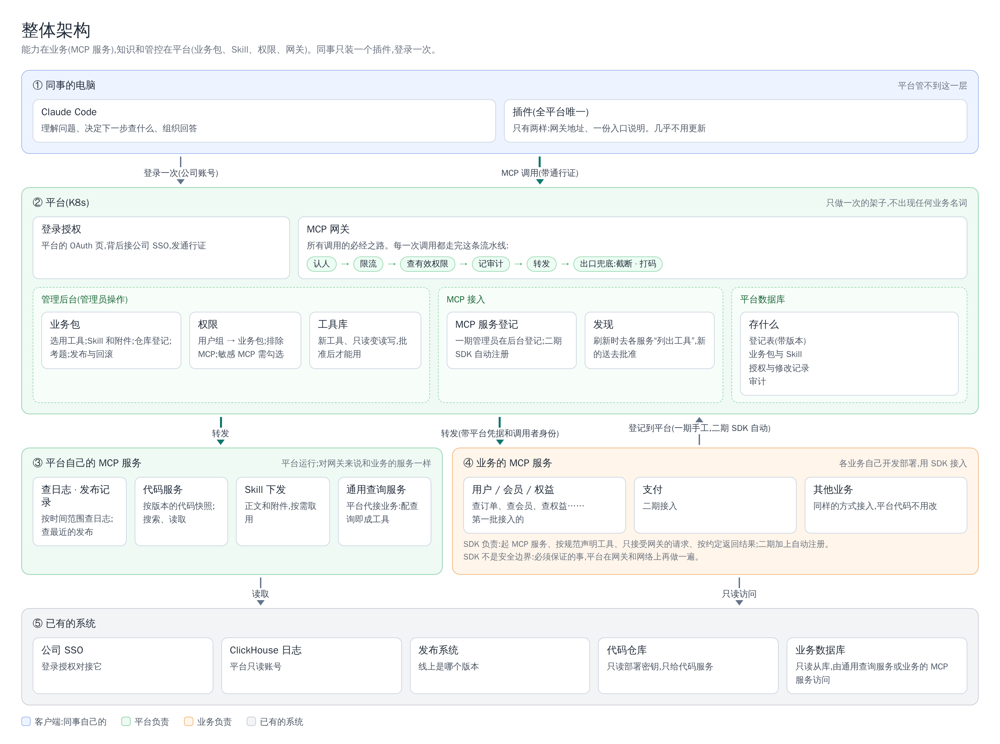

# 架构总览

一句话:同事在自己的 Claude Code 里装上平台唯一的一个插件,用公司账号登录一次,就能排查业务问题、询问业务逻辑。插件只是一张名片,能力都在云端:各业务提供 MCP 服务,平台把它们的工具和业务写的 Skill 组合成业务包,按权限提供给同事。

**能力在业务(MCP 服务),知识和管控在平台(业务包、Skill、权限、网关)。**

本文档是整套设计的总纲。第 5 节的“设计决定清单”是唯一的依据:其他文档的说法与它不一致时,以它为准。

## 1. 整体结构



| 层 | 有什么 | 归谁 |
| --- | --- | --- |
| ① 同事的电脑 | Claude Code;唯一的插件 | 同事自己。平台管不到这一层 |
| ② 平台 | 登录授权;网关;管理后台(权限、业务包、工具库);平台数据库 | 平台,只做一次 |
| ③ 平台自己的 MCP 服务 | 查日志和发布记录;代码服务;Skill 下发;通用查询服务(代接业务) | 平台 |
| ④ 业务的 MCP 服务 | 用户、会员、权益……,各业务自己开发部署 | 业务 |
| ⑤ 已有的系统 | 公司 SSO、ClickHouse、发布系统、代码仓库、业务数据库 | 已有 |

## 2. 两个平台,一套部署

| | MCP 管理平台 | Agent 平台 |
| --- | --- | --- |
| 管什么 | MCP 服务的登记、发现、工具库、批准;网关的认人和转发 | 业务包、Skill、考题;按业务包授权;插件;评估 |
| 不管什么 | Skill、业务包、谁能用 | 工具怎么实现、在哪运行 |
| 以后谁能用 | 任何需要调用工具的入口:网页版、Codex、其他团队的 Agent | 本平台 |

一期两者部署在一起,共用一个管理后台,但代码和接口分开。以后 MCP 管理平台可以单独给别的团队用。

## 3. 核心概念

| 概念 | 是什么 | 详见 |
| --- | --- | --- |
| 插件 | 全平台唯一。只有网关地址和一份入口说明 | 文档 09 |
| MCP 服务 | 一个运行着的程序,里面有若干工具。由业务自己运行,或由平台代接 | 文档 16 |
| 工具 | 一个查询。身份是名字,和由哪个服务实现分开。有级别:只读或读写 | 文档 16、13 |
| 工具库 | 所有发现到的工具。批准后才能被选进业务包 | 文档 16 |
| 业务包 | 一个业务对外提供的组合:选用的工具、Skill、代码仓库登记、考题。带版本,是授权、启用、发布的单位 | 文档 11 |
| Skill | 写给模型看的排查说明,可带附件。业务在平台上写,属于某个业务包 | 文档 11 |
| 登记表 | 已上线业务包的已发布版本,加上它们用到的已批准工具。网关运行时用它 | 文档 13 |
| 授权 | 用户组 → 业务包,带级别和 MCP 范围。人的权限只配在这里 | 文档 12 |
| 有效权限 | 由授权算出的、某个人能用哪些工具和 Skill。网关每次调用时查它 | 文档 12、13 |
| 通行证 | 登录后发给 Claude Code 的凭据,短期有效,自动续期 | 文档 09 |

三者的关系:**MCP 服务提供“能做什么”,Skill 讲“怎么做”,业务包把一个业务的工具和 Skill 组合起来。**

## 4. 信任边界

| 区域 | 里面有什么 | 平台能控制吗 |
| --- | --- | --- |
| 同事的电脑 | Claude Code、插件、通行证 | 不能。同事可以改插件,模型可能被数据里的文字诱导 |
| 平台 | 网关、登录、管理后台、平台的 MCP 服务、平台数据库 | 能 |
| 业务的 MCP 服务 | 业务自己的代码和数据库账号 | 部分:平台决定谁能调用它,但它内部的实现靠评审和要求 |
| 数据源 | 业务数据库、日志、代码仓库 | 只能经 MCP 服务访问 |

由此得出五条规则:

1. 一切不能被绕过的要求(登录、权限、限流、审计、出口兜底)都在网关强制,不依赖插件里的说明。
2. 网关不持有任何业务数据源的账号;每个服务只拿自己需要的凭据。
3. 身份只来自验证过的通行证,不来自工具的参数。
4. 只有网关能访问各个 MCP 服务。
5. 工具返回的内容是数据,不是指令。服务说明里明确告诉模型这一点。

## 5. 设计决定清单

| # | 决定 | 详见 |
| --- | --- | --- |
| 1 | 一期的形态是 Claude Code 插件。网页版、自研运行时、Codex 在二期 | 一期二期规划 |
| 2 | 全平台只有一个插件、一个网关地址。同事登录一次 | 文档 09 |
| 3 | 分成 MCP 管理平台和 Agent 平台两层,一期部署在一起,接口分开 | 本文第 2 节 |
| 4 | 所有工具都来自 MCP 服务。提供方有三种:平台的公共能力、平台代接(通用查询服务)、业务自助(SDK)。网关只做转发 | 文档 16 |
| 5 | MCP 服务注册到平台,即授权平台调用它。业务的 MCP 服务只认网关 | 文档 16 |
| 6 | 工具的身份是名字,和由谁实现分开。业务可以先由平台代接,以后迁到自助,上层不用改 | 文档 16 |
| 7 | 新工具、只读变读写,要平台管理员批准;说明或参数变了,不中断,提醒复核引用它的 Skill | 文档 16 |
| 8 | 业务包在管理后台里配置,由业务包负责人维护:选用工具、Skill、代码仓库登记、考题。带版本:草稿、发布、回滚、停用 | 文档 11 |
| 9 | Skill 在平台上配置,资料作为 Skill 的附件。默认在服务器上按需取,保留随时切换到“发布到插件里”的能力 | 文档 11 |
| 10 | 人的权限只在平台一处:平台管理员把业务包授权给用户组。普通 MCP 默认包含、可以排除;敏感 MCP 默认不包含、要明确勾选。多条授权取并集 | 文档 12 |
| 11 | 一期所有工具只读。读写级别的字段从一期留好 | 文档 12、13 |
| 12 | 模型不能自己写查询语句。平台代接的查询都是配置好的、参数化的 | 文档 16 |
| 13 | 登录:平台的 OAuth 授权页,背后接公司 SSO,用成熟的组件搭 | 文档 09 |
| 14 | 代码:平台的代码服务按版本保存代码,只能读业务包登记过的仓库 | 文档 10 |
| 15 | 测试和生产是两套独立的部署。工具没有“环境”参数 | 文档 14 |
| 16 | 部署在 K8s 上。网关无状态、多副本;只有代码服务需要持久存储 | 文档 14 |
| 17 | 出错时默认拒绝:权限模块或审计不可用时,不放行 | 文档 15 |
| 18 | 平台看不到同事的对话,只看得到工具调用和同事主动提交的反馈 | 文档 09 |
| 19 | 评估走和同事相同的路径:用命令行方式向装了插件的 Claude Code 提问;评估脚本作为“应用”被授权 | 文档 02 |
| 20 | 按生产系统来做:架构一步到位,功能分期上线 | 文档 14 |
| 21 | 自研为主。MCP 协议用官方 SDK,OAuth 用成熟组件,开源的 MCP 管理平台作为参考 | 本文第 7 节 |

## 6. 技术选型

| 部分 | 选择 |
| --- | --- |
| 平台的服务(网关、管理后台、通用查询服务、平台的 MCP 服务、代码服务) | Go |
| MCP 协议 | 官方的 MCP Go SDK;接入 SDK 包装它 |
| 登录授权 | 成熟的 OAuth 服务端组件,前面接平台自己的登录页和公司 SSO |
| 管理后台的页面 | React、TypeScript、Tailwind CSS、shadcn/ui |
| 评估脚本 | Python |
| 平台数据库、缓存 | 公司现有的 |
| 部署 | K8s |
| 模型和运行时 | 同事自己的 Claude Code。平台一期不接模型 |

## 7. 自研还是用现成的

市面上已经有开源的 MCP 管理平台和注册中心,和本设计的下半部分很接近:

| 项目 | 和本设计的对应 |
| --- | --- |
| Nacos 3.x 的 AI 注册中心(配合 Higress) | MCP 注册、Skill 仓库、生命周期;现有接口零代码转成 MCP |
| Obot | MCP 网关、目录、按组的访问策略、Skill 集中管理并下发到本地 |
| agentgateway、IBM ContextForge | MCP 网关和代理 |

选择自研为主的原因:

1. **核心价值在它们没有的那一层。** 业务包、Skill 和工具的组合、考题和评估,都要自己做。
2. **权限只有一处,设计才干净。** 在现成平台上加业务包,会出现两套权限需要同步。
3. **规模小。** 一期三个服务,用 AI 写的工作量可控。
4. **学习目标。** 自己做一遍网关、权限、注册、评估,对 Agent 工程的理解更完整。

不自己写的:MCP 协议(官方 SDK)、OAuth(成熟组件)、数据库和缓存(公司现有)。

开源项目作为参照:遇到拿不准的设计,看它们是怎么做的。如果以后试用发现某个项目能直接接上公司 SSO,并且能用我们的业务包授权驱动它的访问策略,可以考虑把它作为网关和注册这一层的底座。

## 8. 已知风险

| 风险 | 缓解 | 详见 |
| --- | --- | --- |
| 平台管不到同事的电脑,数据可能被诱导带出去 | 统一的 Claude Code 管理配置;只返回必要字段;打码;审计 | 文档 14 第 6 节 |
| 有权限的人能查任意用户的数据 | 查询必须带具体标识;按人统计查询的不同用户数并告警;审计记查询目的 | 文档 12 第 9 节 |
| 业务 MCP 服务的“只读”无法完全验证 | 批准时评审;要求只读账号;只有网关能访问 | 文档 16 第 5 节 |
| Skill 放在服务器上,模型可能不主动去取 | 阶段 0 对比测试;可切换到插件方式 | 文档 11 第 6 节 |
| 插件对接自建 OAuth 页的细节未经验证 | 阶段 0 第 1 项登录试验 | 文档 09 第 5.3 节 |

## 9. 代码仓库

| 仓库 | 放什么 |
| --- | --- |
| 平台代码 | 网关、登录授权、管理后台、通用查询服务、平台的 MCP 服务、代码服务、评估脚本、部署配置 |
| 接入 SDK | Go 版本的 SDK,业务依赖它 |
| 插件 | 唯一的插件和它的市场清单 |
| 业务的服务 | 各业务自己的代码和 MCP 服务 |

```
agent-platform/            平台代码
  gateway/                 网关
  auth/                    登录授权
  admin/                   管理后台:权限、业务包、MCP 接入与工具库
  query-service/           通用查询服务(平台代接)
  platform-mcp/            平台自己的 MCP 服务:查日志、发布记录、Skill 下发
  code-service/            代码服务
  evals/                   评估脚本
  deploy/                  部署配置

agent-mcp-sdk-go/          接入 SDK

agent-plugins/             插件
  .claude-plugin/marketplace.json
  plugins/agent-platform/
```

业务包和 Skill 存在平台数据库里,不在任何代码仓库里。

## 10. 文档地图

| 用途 | 文档 |
| --- | --- |
| 入口 | [从这里开始](00-从这里开始.md) |
| 计划 | [一期二期规划](一期二期规划.md)、[开发路线](开发路线.md) |
| 学习 | [一期学习手册](一期学习手册.md) |
| 共同基础 | [13-数据定义](13-数据定义-原理与设计.md) |
| 网关 | [15-网关核心](15-网关核心-原理与设计.md) |
| 插件和登录 | [09-插件形态](09-插件形态-原理与设计.md) |
| 权限 | [12-权限管理](12-权限管理-原理与设计.md) |
| MCP 接入、工具库、通用查询服务、SDK | [16-MCP 接入与工具库](16-MCP接入与工具库-原理与设计.md) |
| 业务包和 Skill | [11-业务包与 Skill](11-业务包与Skill-原理与设计.md) |
| 代码 | [10-代码查询](10-代码查询-原理与设计.md) |
| 评估 | [02-评估系统](02-评估系统-原理与设计.md) |
| 部署和上线 | [14-生产化与部署](14-生产化与部署-原理与设计.md) |

`参考` 目录里是早期的设计和二期才用到的专题,按网页版的前提写成,与本文档不一致时以本文档为准。

## 11. 二期

二期的方向和一期为它们留的位置,见 [一期二期规划](一期二期规划.md) 第 5、6 节。
