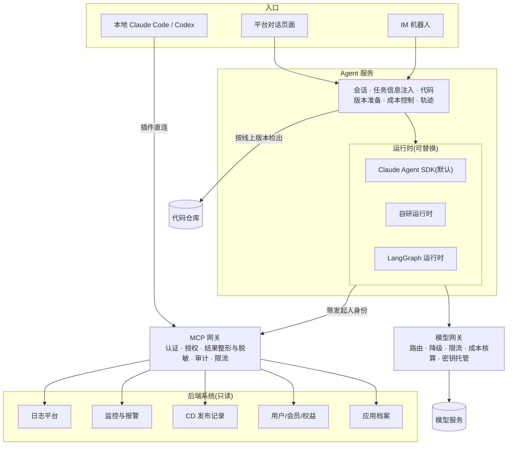
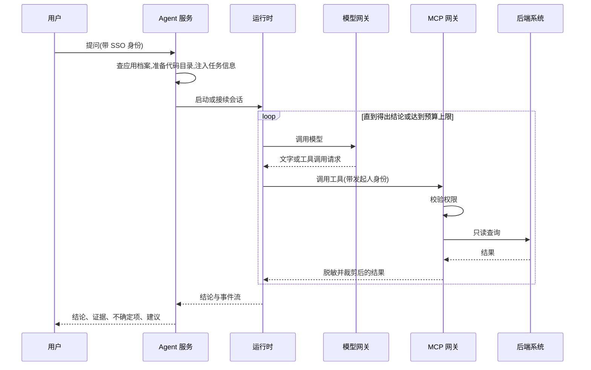
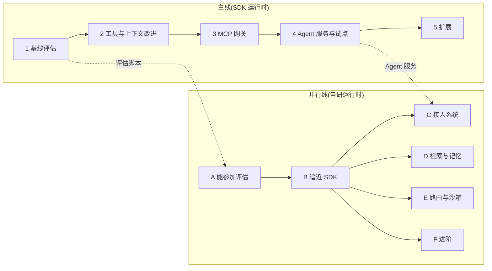

# 海外 AI Native 平台设计文档

2026-11-11 · v2

## 1. 背景与目标

本项目为海外业务建设一个研发工作 Agent:第一期让用户、会员、权益三个基础服务的线上问题可以由 Agent 完成只读排查,并用评估数据证明其可靠,之后再扩展到接入、发布和资源申请。

### 1.1 现状

- 业务方接入用户、会员、权益服务时,依赖人工答疑和手工分配 product_id 等接入信息。
- 线上问题排查依赖少数熟悉系统的人,需要在订单、会员、权益、日志、监控、发布记录之间手工关联。
- 已有原型:服务器上的 Claude CLI + 业务代码仓库 + 查日志和监控的 Skill,可以跑通,但只有单人使用。
- 原型的缺口:没有评估(不知道查对的比例)、没有失败分析、没有多用户权限和审计、没有成本控制。

### 1.2 目标

| 类别 | 目标 |
| --- | --- |
| 业务 | 三个基础服务的常见线上问题,由 Agent 给出带证据的定位结论,减少人工排查时间 |
| 平台 | 沉淀一套可复用的底座:MCP 网关、Skill 插件、评估体系、Agent 服务,新业务接入时主要扩展工具和知识 |
| 能力 | 团队掌握 Agent 工程的核心环节:工具设计、上下文管理、评估、权限与生产化 |

### 1.3 设计原则

1. **执行核心用现成的。** 生产环境的 Agent 循环使用 Claude CLI / Claude Agent SDK。运行时做成可替换,自研版本作为第二实现,先只跑评估。
2. **评估先行。** 任何工具、Skill、提示词的改动,都用同一批案例跑分验证后才发布。
3. **权限由系统强制。** 不依赖提示词里的约束;第一期全部只读。
4. **依赖收拢到服务端。** Skill 只写流程和判断,实际操作通过远程 MCP 完成。
5. **按需加载。** 知识、Skill、工具结果都尽量在需要时才进入上下文。

### 1.4 成功指标

目标值在第一阶段测出基线后确定,这里只定义口径。

| 指标 | 口径 |
| --- | --- |
| 定位成功率 | 评估集中,结论与真实根因一致的案例占比(每题跑 3 次取平均) |
| 证据完整率 | 结论附带了必需关键证据的案例占比 |
| 平均排查耗时 | 从提问到给出结论的时间,与人工排查对比 |
| 人工介入率 | 线上使用中,需要人接手才能定位的问题占比 |
| 单任务成本 | 每次排查的平均 token 费用与工具调用次数 |
| 越权拦截率 | 评估集中越权请求被正确拒绝的占比,要求 100% |

## 2. 范围与非目标

第一期只做一件事:用户、会员、权益三个服务的线上问题只读排查,从提问到带证据的结论。

### 2.1 第一期范围

- 问题排查:付款后会员或权益未到账、接口错误率升高、发布后异常等常见问题。
- 接入答疑:基于接入文档和代码回答业务方的接入问题。
- 数据来源:应用档案、代码仓库、日志、监控、报警、发布记录、订单/会员/权益查询。
- 使用入口:平台对话页面;本地 Claude Code 通过插件接入同一套 MCP 和 Skill。
- 配套能力:评估体系、MCP 网关的认证授权与审计、成本监控。

与主线并行的还有一条运行时研发线(第 4.5 至 4.9 节):运行时接口、前端的 Agent 选择器、模型网关随 Agent 服务一起交付;自研运行时及其扩展模块只参加评估和白名单试用,不在第一期的验收范围内。

### 2.2 第一期不做

| 不做的事 | 原因 | 何时考虑 |
| --- | --- | --- |
| 任何写操作(补发权益、改会员、改配置) | 需要先证明只读排查可靠,并建立审批机制 | 第二期,限定动作并带人工确认 |
| 报警自动触发排查 | 准确率不够时自动推送会损害信任 | 评估分数达标并服务化之后 |
| 资源自动申请(MySQL、Redis、Blob) | 属于平台工程,与排查主线无关 | 第二期,先做一两种标准模板 |
| CD 自动发布与回滚 | 风险高,依赖发布系统改造 | 第二期,先做发布前检查 |
| 自研运行时接生产流量 | 自研版本先作为第二实现,只跑评估(第 4.5、4.6 节) | 自研版本在评估集上不低于 SDK 之后 |
| 向量检索知识库 | 主线上文档量小,目录加搜索够用;检索先在自研运行时上实现和验证(第 4.8 节) | 评估显示“找不到资料”是主要失败原因时 |
| 多 Agent 协作编排 | 主线用单 Agent 加子任务即可;多 Agent 在自研运行时上做对比实验(第 4.8 节) | 出现明确瓶颈时 |
| 通过 CD 入口强制业务方接入 | 需要先有效果数据 | 第一期指标达标后再推动 |

### 2.3 与原始规划的对应关系

| 原始规划 | 本设计中的位置 |
| --- | --- |
| 1. 公共服务接入方式、API 文档、product_id 分配 | 第一期做接入答疑和应用档案;自动分配放第二期 |
| 2. 答疑机器人、运维 Agent、自动排查 | 第一期主线 |
| 3. 资源自动申请 | 第二期 |
| 4. CD 自动发布与回滚 | 第二期;第一期只读取发布记录 |
| 5. 通过 plugin 或 skill 安装到本地工具,也可在平台操作 | 第一期:远程 MCP + 插件分发 + 平台入口 |
| 6. 三个基础项目试水,稳定后推广 | 第一期试点范围;推广条件见里程碑 |

## 3. 总体架构

系统分四层:入口、Agent 服务、MCP 网关、后端系统。所有入口共用同一个 MCP 网关,权限和审计只有一套。



平台和 IM 的请求经 Agent 服务到达网关,本地工具通过插件直连网关;网关以只读方式访问所有后端。代码仓库由 Agent 服务直接准备到本地目录,不经过网关。Agent 服务内的运行时可替换(SDK、自研、LangGraph),所有运行时经模型网关调用模型服务。

### 3.1 组件与职责

| 组件 | 职责 | 实现 |
| --- | --- | --- |
| 平台对话页面 / IM 机器人 | 用户提问、选择 Agent、查看进度和结论 | Web 页面,调用 Agent 服务 |
| 本地 Claude Code / Codex | 研发在自己的工具里使用同样的能力 | 安装插件,直连 MCP 网关 |
| Agent 服务 | 会话管理、任务调度、任务信息注入、代码仓库准备、成本控制、运行时注册与切换 | 自研服务,通过统一接口调用运行时 |
| Agent 运行时 | 执行循环、读代码、调用工具、加载 Skill、管理上下文 | 默认 Claude Agent SDK;自研运行时和 LangGraph 运行时实现同一接口(第 4.5 节) |
| 模型网关 | 统一的模型调用入口:多供应商、路由、降级、限流、成本核算、密钥托管 | 自研服务(第 4.7 节) |
| Skill 插件 | 各类问题的排查方法和流程 | Markdown,随插件版本分发 |
| MCP 网关 | 认证、授权、调用后端、结果整形与脱敏、审计、限流 | 自研无状态 HTTP 服务,MCP 官方 SDK |
| 应用档案 | 应用、负责人、product_id、环境、仓库、日志和指标入口的映射 | 数据库表,由网关和 Agent 服务读取 |
| 后端系统 | 日志、监控、报警、CD 发布记录、用户/会员/权益服务、代码仓库 | 现有系统,只读访问 |
| 评估系统 | 案例集、批量运行、判分、按版本和按运行时对比 | 脚本 + 结果存储,接入发布流程 |

### 3.2 一次排查的数据流



1. 用户在平台提问,请求带着 SSO 身份到达 Agent 服务。
2. Agent 服务查应用档案,得到 product_id、环境、仓库地址、线上版本,准备对应版本的代码目录。
3. Agent 服务把任务信息拼入提示词,以该代码目录为工作目录启动或接续一个会话。
4. 运行时按需加载 Skill,读代码,并通过 MCP 网关调用工具。
5. 网关校验发起人对该应用和环境的权限,调用后端,脱敏并裁剪结果,写审计日志。
6. 运行时根据结果决定下一步,直到得出结论或达到预算上限。
7. Agent 服务保存完整轨迹,把结论、证据、不确定项返回给用户。

本地工具的流程相同,区别是第 1 到 3 步由本地 Claude Code 完成,第 4 步起直连 MCP 网关。

## 4. Agent 运行时

生产使用现成的执行核心:评估和个人使用阶段用 Claude CLI,服务化阶段换成 Claude Agent SDK。运行时通过统一接口接入 Agent 服务,可以替换为自研实现(第 4.5 节)。两者是同一套执行核心,Skill、MCP 配置和 CLAUDE.md 可直接沿用。

### 4.1 选型

|  | Claude CLI | Claude Agent SDK |
| --- | --- | --- |
| 使用方式 | 终端交互,或 `claude -p` 脚本调用 | 在 Python/TypeScript 服务中用代码调用 |
| 适用阶段 | 评估批跑、个人使用、本地插件 | Agent 服务 |
| 权限控制 | 配置文件中的允许/拒绝列表,hook | 同左,并可在代码中对每次工具调用做判断 |
| 过程记录 | 解析输出 | 事件流,逐步入库 |
| 会话 | `--resume` 接续 | 代码中按会话 ID 接续 |

### 4.2 运行配置

| 配置项 | 取值 |
| --- | --- |
| 工作目录 | 线上版本对应的代码目录(见第 9 节) |
| 内置工具 | 只开放 Read、Grep、Glob;关闭 Edit、Write;Bash 默认关闭 |
| MCP | 只连接 MCP 网关,带发起人身份 |
| Skill 与 CLAUDE.md | 显式开启项目配置加载(SDK 默认不加载文件系统中的配置) |
| 工具调用前校验 | PreToolUse hook 拦截不在白名单内的调用 |
| 预算 | 每个任务设置最大轮数和费用上限,超限终止并返回当前进展 |
| 模型 | 默认模型由评估决定:在评估集上比较不同模型的成功率和成本后选定 |

具体参数名以 Claude Agent SDK 官方文档为准,SDK 更新较快。

### 4.3 子任务

消耗大量上下文的工作交给子 Agent,主任务只取回结论。第一期只定义两类子任务:

- 日志分析:在大量日志中找异常模式,返回摘要和关键日志的引用。
- 代码定位:在多个仓库中找某个报错或接口的实现位置,返回文件路径和相关逻辑说明。

### 4.4 输出格式

每次排查的最终输出固定包含四部分:

1. 结论:已确认的原因,或明确说明未能确定。
2. 证据:每条证据注明来源(哪个工具、哪条日志、哪个文件的哪一行)。
3. 不确定项:还没有验证的假设,以及缺少什么信息。
4. 建议:下一步由谁做什么。

### 4.5 运行时可替换

Agent 服务只依赖一个运行时接口,Claude Agent SDK 和自研运行时都实现它。切换运行时不影响 MCP 网关、权限、评估、应用档案、平台页面。

接口只规定输入和输出,不规定内部实现:

| 方向 | 内容 |
| --- | --- |
| 输入 | 任务信息、用户消息、会话 ID、工作目录、MCP 网关地址与发起人身份、Skill 与常驻说明的位置、预算(轮数、费用、时长) |
| 输出事件流 | 模型输出、工具调用(名称与参数)、工具结果摘要、状态变化 |
| 输出结果 | 最终结论(第 4.4 节的格式)、token 用量、费用、结束原因 |
| 控制 | 启动、接续会话、取消 |

规则:

- **切换是配置项。** 可以按评估批次、按任务、按用户指定运行时,用于对比和灰度。
- **每个任务记录运行时的名称和版本**,轨迹和评估结果可按运行时对比。
- **安全约束对所有运行时相同。** 业务数据只能通过 MCP 网关以发起人身份读取;文件工具限定在工作目录内且只读;没有网络访问。
- **接口保持很薄。** Skill 如何加载、上下文如何压缩、是否使用子任务,由各运行时自己决定,接口不做统一。
- **上线条件。** 自研运行时在全量评估集上的定位成功率不低于 SDK、越权拦截率 100%、单任务成本可接受,才允许接生产流量,并先从小比例灰度开始。

前端选择 Agent:

| 事项 | 设计 |
| --- | --- |
| 入口 | 对话页面提供 Agent 选择器,列表来自后端的运行时注册表(名称、版本、说明、状态) |
| 默认值 | 默认使用 Claude Agent SDK;用户不选择时行为不变 |
| 可见范围 | 每个运行时有状态:实验、灰度、正式。实验状态只对白名单用户可见,并在界面标注“实验”;达到上线条件后才对所有用户开放 |
| 会话绑定 | 一个对话绑定一个运行时,因为各运行时的会话历史格式不同。中途切换时新建对话,并把原对话的问题和结论摘要带过去 |
| 对比模式 | 同一个问题可以同时交给两个运行时,并排展示结论、耗时、费用和工具调用过程 |
| 记录与反馈 | 任务记录运行时名称和版本;用户反馈(有用、无用)按运行时统计,对比模式下记录用户更认可哪个 |
| 安全 | 选择哪个运行时都不改变权限:数据访问仍经 MCP 网关按发起人身份校验 |

### 4.6 自研运行时(Harness)的建设路线

自研运行时与主线并行推进,每一步都在同一评估集上与 SDK 对比。目的有两个:掌握 Agent 运行时的实现,以及在成本或合规要求变化时有可替换的方案。

| 步骤 | 实现内容 | 用评估验证什么 |
| --- | --- | --- |
| 1. 最小循环 | 调用模型、解析工具调用、通过 MCP 客户端执行、结果回传、停止条件、轮数和费用预算 | 能否完成最简单的排查案例 |
| 2. 代码工具 | 读文件、内容搜索、路径匹配,带输出大小限制和目录范围限制 | 需要读代码的案例的成功率 |
| 3. 事件流与轨迹 | 按第 4.5 节的接口输出事件,保存完整轨迹 | 可接入 Agent 服务和评估脚本 |
| 4. Skill 按需加载 | 先只提供 Skill 描述,相关时再读取正文和附属文件 | Skill 命中率;与全量加载相比的成本差异 |
| 5. 上下文管理 | 工具结果截断、历史压缩、笔记文件、提示缓存 | 长案例的成功率和单任务成本 |
| 6. 会话持久化 | 保存和接续会话,多轮对话 | 多轮案例的成功率 |
| 7. 健壮性 | 工具超时与重试、并行工具调用、取消、模型接口报错处理 | 工具故障类案例;整体稳定性(3 次运行的一致性) |
| 8. 子任务 | 把日志分析等工作交给独立上下文的子 Agent | 大数据量案例的成功率和成本 |
| 9. 多模型 | 模型调用抽象成接口,支持切换模型供应商 | 不同模型在同一运行时下的成功率和成本 |

每一步的产出是一份对比记录:改动内容、改动前后的分数、与 SDK 的差距、差距的原因分析。前 3 步完成后自研运行时即可参加评估,之后各步按差距最大的方面排序推进。

运行时的理念、原理、设计决策和模块划分见 [自研运行时:原理与设计](03-自研运行时-原理与设计.md)。

### 4.7 模型网关

所有运行时都通过模型网关调用模型,不直接持有模型服务的密钥。这样换模型、控制成本、处理故障都在一处完成。

| 能力 | 说明 |
| --- | --- |
| 多供应商 | 对运行时提供统一接口,后端可接多家模型服务 |
| 路由 | 按任务类型选模型:主推理用强模型,摘要、子任务、判分用便宜的模型 |
| 降级 | 模型超时、限流或报错时重试,仍失败则切换到备用模型,并在任务记录中标明 |
| 限流与并发 | 按团队、用户、运行时设置请求速率和并发上限 |
| 成本核算 | 记录每次调用的 token 用量和费用,归属到任务、应用、团队 |
| 密钥托管 | 模型服务的密钥只存在于网关 |
| 合规 | 按数据所属地区限制可用的模型服务,请求内容按规则脱敏 |

路由和降级策略的每次调整都在评估集上验证成功率和成本。第一期只接一家模型服务时,网关先做转发、核算和密钥托管。

### 4.8 自研运行时的扩展模块

这些模块接在第 4.6 节的 9 步之后,属于自研运行时这条并行线。每个模块都有开关,用评估比较开启和关闭的效果。它们不改变第一期主线的范围。

| 模块 | 实现内容 | 用评估验证什么 |
| --- | --- | --- |
| 检索(RAG) | 历史工单和排查经验的检索:分块、向量(PGVector)加关键词混合检索、重排序、引用,做成工具供 Agent 调用 | 检索命中率;开启后的定位成功率变化 |
| 记忆 | 三类记忆:用户偏好、项目事实、已确认的排查经验。只有经人确认的结论才写入,带来源和有效期,可更正和删除,按应用和用户隔离 | 相似问题的成功率和耗时;错误记忆是否会带偏结论 |
| 规划 | 计划工具:Agent 列出待办并逐项更新,计划保存在任务状态中 | 多步骤案例的成功率;是否减少遗漏和重复查询 |
| 沙箱 | 代码执行沙箱:容器隔离,限制 CPU、内存和时间,无网络,只能访问任务临时目录。用于写脚本分析导出的日志和数据 | 数据分析类案例的成功率和成本 |
| 检查点 | 每一步保存任务状态,进程中断后从上一步继续 | 中途杀掉进程后能否恢复并得到相同结论 |
| 多 Agent | 协调者加专职 Agent(日志、代码、数据),各自独立上下文 | 与单 Agent 相比的成功率、耗时、成本 |
| 框架运行时 | 用 LangGraph 实现第三个运行时,接同一接口 | 三个运行时在同一评估集上的对比 |
| 标准化追踪 | 轨迹按 OpenTelemetry 标准输出,模型调用、工具调用、检索各为一个 span | 可在通用追踪系统中查看完整链路 |

记忆模块与第 7.7 节一致:Agent 不能自行写入长期记忆,写入必须经过人的确认。检索模块是第 8.4 节方案在自研运行时上的先行实现,验证有效后再以 `kb_search` 工具的形式提供给所有运行时。

### 4.9 实现语言

| 组件 | 语言 | 原因 |
| --- | --- | --- |
| MCP 网关、模型网关、Agent 服务 | Go | 后端服务,重并发、限流、稳定性 |
| 运行时(SDK 适配、自研、LangGraph) | Python | SDK 和主流框架的生态在 Python |
| Agent 服务与运行时之间 | gRPC 流式接口 | 跨语言,事件流天然适合流式传输 |

语言分配已确认。划分与信任边界的对应关系见 [架构总览](架构总览.md)第 6 节。

## 5. MCP 网关设计

对外只有一个 MCP 地址,所有 Skill 只依赖它。网关不存业务数据,只做认证、授权、调用后端并整形结果、审计。后端系统的凭据只存在于网关。

网关的分层、注册表、工具命名空间与生命周期,以及 Skill 的组织、依赖、加载和发布流程,见 [MCP 网关与 Skill 管理:原理与设计](05-MCP网关与Skill管理-原理与设计.md)。

### 5.1 第一期工具清单

全部只读,按领域加前缀命名。第一版上线标 ★ 的 5 个,其余根据评估中“缺少工具”的失败案例逐步加入。

| 工具 | 用途 | 主要参数 |
| --- | --- | --- |
| `app_get_profile` ★ | 查应用档案:product_id、负责人、仓库、环境、依赖服务 | app 或 product_id |
| `logs_search` ★ | 按条件搜索日志,默认返回 50 行并告知总数 | service, env, start, end, trace_id, user_id, order_id, keyword, level |
| `logs_count_by_error` ★ | 按错误类型统计数量,先看分布再查明细 | service, env, start, end |
| `logs_get_trace` | 按 trace_id 取整条调用链的日志 | trace_id, env |
| `metrics_query` | 查指标,返回文字摘要和少量采样点,可与昨日同时段或发布前对比 | service, env, metric, start, end, compare_to |
| `metrics_list_available` | 列出某服务有哪些指标及含义 | service |
| `alerts_list` | 查当前触发的报警和历史报警 | service, env, start, end |
| `deploy_list_recent` ★ | 最近的发布和配置变更记录 | service, env, start, end |
| `deploy_get_current_version` | 某时刻线上运行的版本,含灰度比例 | service, env, at |
| `deploy_diff` | 两个版本之间的提交记录和改动文件 | service, from, to |
| `member_diagnose_user` ★ | 一次返回某用户的订单、会员状态、权益流水汇总 | product_id, env, user_id 或手机号, order_id |
| `order_get` | 单笔订单详情与回调记录 | order_id, env |
| `entitlement_list_records` | 权益发放和扣减流水 | product_id, user_id, env, start, end |
| `kb_search` | 检索知识文档(引入检索后启用,见第 8 节) | query, filters |

### 5.2 工具设计规范

- **按用户要完成的事设计**,不按后端接口一一映射。总数控制在 15 个左右。
- **每个工具都有 `env` 参数**,必填,不设默认值。
- **参数使用模型手上有的信息**:用户给的是手机号时,工具直接接受手机号。
- **说明文字写清适用场景**,例如“订单已支付但会员未生效时使用,需要订单号”。
- **工具名发布后不改**。Skill 中引用了工具名,变更时新增工具,旧工具保留一个版本周期。
- **写操作单独成工具**,并在工具注解中标明非只读。第一期不提供。

### 5.3 返回规范

| 要求 | 做法 |
| --- | --- |
| 区分无数据与查询失败 | 无记录返回 `found: false` 和原因;参数错误、无权限、超时分别返回不同的错误类型,超时标明可重试 |
| 控制大小 | 默认返回少量,附总数和缩小范围的方法;单次返回设硬上限 |
| 先汇总后明细 | 提供统计类工具,明细按需查询 |
| 错误可自我修正 | 参数错误时说明哪个参数错、正确格式是什么 |
| 时间 | 参数和返回都用带时区的 ISO 8601 格式 |
| 脱敏 | 手机号、邮箱、token、支付信息在网关返回前处理 |
| 精简字段 | 去掉对分析无用的内部字段和重复堆栈帧 |

### 5.4 认证与授权

- **传输**:MCP Streamable HTTP,HTTPS。
- **认证**:用户首次连接时通过公司 SSO 登录(MCP 授权规范基于 OAuth),之后每个请求带代表本人的令牌。
- **身份透传**:Agent 服务代用户调用时带发起人身份,不使用全能服务账号。
- **授权判断**:调用者 + 工具 + 目标应用 + 环境。权限数据来自应用档案中的成员关系。
- **参数不是授权依据**:模型传入的 product_id 只是查询条件,网关必须校验调用者对它有权限。
- **生产敏感数据**:用户个人信息相关工具在生产环境单独设更严的规则。

### 5.5 审计与限流

- 每次调用记录:调用人、客户端、会话 ID、应用 ID、运行时、工具、参数、结果摘要、耗时、是否被拒绝。
- 按用户和按工具设置调用频率与超时上限,防止 Agent 循环时压垮日志平台。
- 审计数据同时用于统计工具使用量和错误率,指导工具改进。

### 5.6 实现

- 使用 MCP 官方 SDK(Python 或 TypeScript),部署为无状态 HTTP 服务,多实例。
- 代码按领域分模块;认证、授权、审计、脱敏、限流做成公共中间层,所有工具自动经过。
- 日志或监控平台已有现成 MCP Server 时,网关转发给它,只在外层加统一的认证和权限。
- 测试分两层:单元测试覆盖参数校验、权限拒绝、空结果、超时;Agent 评估验证模型能否选对工具、填对参数。

### 5.7 多业务扩展

平台只做通用部分,业务相关的内容由各业务团队自己接入和维护。新业务在应用档案登记后,日志、监控、报警、发布这些通用工具即可使用;需要自己补的只有业务工具、Skill、评估案例。

| 事项 | 第一期就做 | 有第二个业务接入时再做 |
| --- | --- | --- |
| 命名与目录 | 工具名带业务前缀;工具、Skill、案例按应用分目录 | — |
| 归属 | 审计、费用、轨迹都带应用 ID | 按业务的预算和质量看板 |
| 工具接入 | 工具由平台团队在网关内实现 | 业务团队注册自己的 MCP Server,或提供接口描述由网关包装;网关统一加认证、授权、审计、脱敏,并做规范检查 |
| 工具加载 | 全量加载(工具少于 20 个) | 按任务涉及的应用及其依赖服务过滤;提供查找工具的工具,跨业务时按需加载 |
| Skill 管理 | 随插件分发 | Skill 注册表:按应用注册、检索、版本管理,按任务过滤加载 |
| 接入流程 | 人工协助 | 自助流程:登记档案、按模板提交工具和 Skill、提交案例、自动跑分、达标后开放 |

每个业务的工具、Skill、文档有明确的负责人,失效时由业务方修复。

接入的统一形式是连接器,支持两种模式:平台主动接入(通用系统、试点阶段的基础服务、第三方系统)和业务自助接入(业务特有的能力)。两种模式使用同一份规范和同一套质量门槛,主动接入的连接器之后可以移交给业务方。完整设计见 [连接器接入规范:原理与设计](04-连接器接入规范-原理与设计.md)。

## 6. Skill 与插件分发

Skill 只写流程和判断,实际操作全部通过 MCP 网关完成,因此本地几乎没有环境依赖。Skill 数量增长不会带来本地环境的混乱。

### 6.1 Skill 编写规范

- **描述决定是否被加载**。描述写明适用场景,例如“用户付款后会员或权益未生效时使用”。
- **正文写排查思路,不写死步骤**。说明常见原因类别、先确认什么、如何根据结果判断方向。
- **细节下沉到附属文件**。错误码表、字段含义等放在 Skill 目录下的单独文件,正文注明何时去读。
- **引用 MCP 工具名**,不写具体命令或脚本。
- **写明停止条件和证据要求**。例如“发现回调超时后,还需确认重试结果和最终状态,才能下结论”。

### 6.2 第一期 Skill 清单

| Skill | 适用场景 |
| --- | --- |
| 会员权益未到账排查 | 付款成功但会员未生效、权益未发放或扣减异常 |
| 接口错误率升高排查 | 某服务错误率或延迟异常,需要判断范围和原因 |
| 发布后异常排查 | 问题开始时间与发布或配置变更接近 |
| 基础服务接入答疑 | 业务方询问用户、会员、权益服务的接入方式和接口用法 |

### 6.3 环境依赖规则

**新 Skill 不允许引入新的本地依赖。** 需要新能力时加到 MCP 网关。

| 工作流类型 | 处理方式 |
| --- | --- |
| 查询类(日志、监控、会员状态) | 远程 MCP 工具 |
| 需要操作本地代码(生成接入代码) | 远程 MCP 加 Agent 自带的读写文件能力 |
| 重环境操作(发布、资源申请、复杂排障) | 本地只做入口,任务提交给平台,在标准镜像中执行 |
| 确实需要本地命令 | 统一的单文件命令行工具,自带环境检查子命令 |

平台侧的 Agent 运行在统一的容器镜像中。镜像与 Skill 在同一仓库做版本管理,评估在该镜像中运行。

### 6.4 分发

- 所有 Skill、MCP 连接配置、hook 打成一个 Claude Code 插件,通过内部插件市场仓库分发。
- 用户安装一次,之后跟随版本更新。
- Codex 等其他工具:配置同一个 MCP 地址,再提供对应格式的 Skill 文本。
- 插件仓库的每次合并触发评估,分数不下降才能发布(见第 12 节)。

## 7. 上下文设计

上下文按层管理:越是每次都在的层越要精简,具体内容下沉到按需加载的层。自动压缩历史由运行时完成,本设计负责的是每层放什么、放多少。

图片和文件的处理见 [多模态:原理与设计](07-多模态-原理与设计.md)。

### 7.1 分层

| 层 | 何时进入上下文 | 内容 | 控制手段 |
| --- | --- | --- | --- |
| 常驻说明 | 每次都在 | 角色、硬规则、输出格式、全局业务常识 | CLAUDE.md,控制在一两页内 |
| 工具说明 | 每次都在 | MCP 工具的名称、用途、参数 | 工具定义,数量和说明长度都要克制 |
| 任务信息 | 任务开始和每轮消息时 | 应用、环境、发起人、当前时间、线上版本 | Agent 服务用代码注入 |
| Skill | 相关时加载 | 某类问题的排查方法 | Skill 描述和正文 |
| 工具结果 | 调用后进入 | 日志、指标、查询结果 | 工具返回规范(第 5.3 节) |
| 知识文档 | 模型主动查时进入 | 接口文档、故障手册 | 文档目录或 `kb_search` |

### 7.2 常驻说明的内容

- 角色和服务对象。
- 硬规则:只读;不确定就说明不确定;结论必须附证据;涉及实时状态的结论在接续对话时重新查询。
- 全局常识:服务清单及调用关系、环境列表、product_id 的含义、各仓库的用途和关键入口。
- 输出格式(第 4.4 节)。
- 复杂排查时维护笔记文件的要求(第 7.6 节)。

### 7.3 任务信息注入

任务启动时由 Agent 服务查好并拼入,模型不需要自己查或向用户询问。

```
当前时间: 2026-11-11 15:30 (UTC+8)
提问人: 张三 (会员团队)
应用: member-service, product_id=1024
环境: prod
线上版本: v1.9.0 (commit a3f2c1, 发布于 11-11 14:05)
代码目录: /data/repos/member-service/a3f2c1
```

### 7.4 工具结果控制

工具结果是上下文膨胀的主要来源,控制手段都在工具侧:

- 默认返回少量,附总数和缩小范围的方法。
- 先给统计,明细按需查询。
- 大结果存文件,只返回摘要和路径。
- 去掉对分析无用的字段。

### 7.5 多轮对话

会话模型、轮次边界的压缩、追问与纠正的处理、多人对话和存储的完整设计见 [上下文与多轮会话:原理与设计](06-上下文与多轮会话-原理与设计.md)。下表是要点。

| 问题 | 设计 |
| --- | --- |
| 对话接续 | Agent 服务维护映射:平台对话 ID → Agent 会话 ID → 所属用户,每条新消息接续对应会话 |
| 会话存储 | 会话记录默认在本机磁盘。多实例部署时使用共享存储,或按会话固定路由到同一实例 |
| 信息过时 | 每轮消息由代码附上当前时间、线上版本是否变化、当前发言人 |
| 换话题 | 界面提供新建对话;IM 场景按报警或工单切分会话,或间隔超时后自动开新会话 |
| 隔天接续 | 实时状态类结论必须重新查询,不直接引用之前的结果 |
| 群聊多人 | 每条消息标明发言人,权限按当前发言人判断;群会话只能查询群内所有人都有权限的范围,否则按人分会话 |
| 成本增长 | 每轮都会携带全部历史。依靠提示缓存降低成本,并给单个会话设轮数和费用上限,到达后提示开新对话并附结论摘要 |

### 7.6 长任务

- **笔记文件**:复杂排查时,把已确认的事实、证据位置、已排除的假设写入笔记文件并持续更新。历史被压缩后重新读取。
- **子任务**:消耗大量上下文的工作交给子 Agent(第 4.3 节)。

### 7.7 跨对话的记忆

- 新会话默认不记得旧会话的内容。
- 用户主动引用历史问题时,由 Agent 服务查出那次的结论摘要并注入。
- 有价值的经验经人确认后写入知识库或 Skill。
- 不允许 Agent 自动把结论写入长期记忆,避免一次错误判断影响之后所有任务。

### 7.8 诊断

评估时统计每道题的 token 用量和工具调用次数。常见症状与原因:

| 症状 | 可能的原因 |
| --- | --- |
| 反复查同一样东西 | 之前的结果太长被淹没,或被压缩掉了 |
| 漏看已返回的关键信息 | 单次返回内容太多 |
| 该用的 Skill 没用上 | Skill 描述不清楚 |
| 选错工具 | 工具太多或说明相互混淆 |
| 查错环境或时间范围 | 任务信息没有注入 |
| 后半段忘了前面的规则 | 常驻说明太长,或关键规则不显眼 |
| 单个任务费用很高 | 工具结果过大,每一轮都在重复携带 |

## 8. 知识库

第一期不建向量库:文档整理成 Markdown 目录加索引,由 Agent 自己搜索和读取。是否引入检索由评估结果决定。

### 8.1 三类信息分开处理

| 信息类型 | 例子 | 提供方式 |
| --- | --- | --- |
| 实时业务数据 | 订单、会员状态、日志、指标 | MCP 工具查询,不进知识库 |
| 仓库内的代码和文档 | 接口实现、README、配置 | Agent 用 Grep 和 Read 自行搜索 |
| 仓库外的文档 | 接入文档、故障复盘、FAQ、历史工单 | 知识库 |

### 8.2 第一期方案

- 接入文档、故障手册、业务规则整理成 Markdown,放入专门的文档仓库,随代码目录一起挂载。
- 维护一份索引文件,说明每篇文档讲什么。
- 高频排查经验写成 Skill。
- 每篇文档标明负责人和更新日期,过期文档下线。

### 8.3 引入检索的条件

评估的失败分类中,“找不到资料”占比高,并且原因是下列之一:

- 文档量大到无法放进目录(几千篇以上),或在 Wiki、工单系统中。
- 用户问法与文档用词对不上,关键词搜不到。
- 需要从历史工单中找相似问题。

### 8.4 检索方案(满足条件后实施)

| 环节 | 做法 |
| --- | --- |
| 分块 | 按标题和段落切分,每块带来源、标题路径、更新时间;表格和代码块保持完整 |
| 检索 | 向量检索加关键词检索(BM25)混合,保证错误码、接口名等精确内容能命中 |
| 重排序 | 粗召回几十条后用 rerank 模型选出最相关的几条 |
| 引用 | 返回结果带文档链接和段落位置 |
| 时效 | 同步更新,优先新版本,废弃文档下线 |
| 权限 | 检索结果按提问者权限过滤 |
| 接入 | 做成 MCP 工具 `kb_search`,由 Agent 决定何时查、查什么、是否换词再查 |

检索单独评估:每道题标注答对所需的文档,检查运行中是否检索到。没检索到是检索问题,检索到但答错是推理或上下文问题。

## 9. 代码仓库管理

Agent 分析的是线上正在运行的那个版本,不是主干最新代码。代码目录按 commit 缓存,由 Agent 服务在任务开始前准备好。

多业务、多仓库下的声明方式、同步机制、公共库的版本推导、任务代码目录的组装和清理,见 [代码仓库管理:原理与设计](08-代码仓库管理-原理与设计.md)。本节是概要。

### 9.1 准备流程

1. 根据应用档案得到仓库地址,向发布系统查询目标时刻线上运行的 commit。
2. 检查本地是否已有该 commit 的目录,有则直接使用。
3. 没有则在主仓库执行 `git fetch`,再用 `git worktree add` 检出到 `/data/repos/<服务名>/<commit>`。
4. 以该目录为工作目录启动 Agent。

这一步由服务代码完成,不交给 Agent。Agent 不持有 git 凭据,也不需要网络权限。

### 9.2 规则

| 事项 | 规则 |
| --- | --- |
| 目录只读 | 版本目录被多个任务共用,Agent 只有读权限 |
| 凭据 | 只读的 token 或 deploy key,配置在服务上,不进入提示词 |
| 多仓库 | 会员问题常跨多个服务。相关仓库的对应版本放在同一父目录下,CLAUDE.md 说明各仓库用途 |
| 灰度发布 | 新旧两个版本的目录都准备,并在任务信息中说明流量比例 |
| 历史问题 | 按问题发生时间查发布记录,使用当时的版本 |
| 拿不到线上版本 | 退回主干最新代码,并要求 Agent 在结论中注明可能与线上不一致 |
| 清理 | 定时删除两周未使用的版本目录,并执行 `git worktree prune` |

### 9.3 评估用的代码版本

历史案例对应的是当时的代码。整理案例时记录当时的 commit,评估运行时切到该版本,否则已修复的缺陷无法被复现分析。

### 9.4 后续

将来让 Agent 修改代码或运行测试时,任务之间必须完全隔离,改为每个任务一个独立的 worktree 或容器。

## 10. 可观测性接入

日志、监控、报警、发布记录都以只读 MCP 工具的形式接入。第一期报警只作为查询工具,自动触发排查放在第二期。

### 10.1 各类数据的工具设计要点

| 数据 | 难点 | 设计要点 |
| --- | --- | --- |
| 日志 | 量大 | 服务、环境、时间范围必填;支持 trace_id、用户、订单号、关键字、级别过滤;默认 50 行并告知总数;提供按错误类型统计的工具;支持按 trace_id 取整条调用链 |
| 监控 | 模型读不了图表,也不知道指标名 | 不让模型写查询语句,提供语义化参数;提供指标目录;返回文字摘要和少量采样点;支持与昨日同时段、发布前对比 |
| 报警 | 需要与问题时间关联 | 返回报警规则、触发值与阈值、关联服务、开始时间;支持查询同一时段的其他报警 |
| 发布记录 | 需要确定某时刻的版本 | 最近的发布和配置变更;某时刻的线上版本和灰度比例;两个版本之间的 diff |

发布记录是必接项:线上问题很大比例由变更引起,“报警开始前半小时内是否有发布”是最快的定位线索之一。

### 10.2 通用要求

- 全部使用只读账号或 token。
- 时间参数和返回都带时区。海外业务跨多个时区,当前时间由任务信息注入。
- 环境显式指定,生产和测试使用不同凭据。
- 平台已有官方或社区 MCP Server 时优先复用,由网关转发并统一认证授权。

### 10.3 报警自动触发排查(第二期)

报警触发时,报警系统通过 webhook 调用 Agent 服务,自动启动一次排查,结果发到报警群。

启用前提:

- Agent 服务已上线。
- 评估集上的定位成功率达到约定门槛。
- 有去重和限流:同一报警在一段时间内只触发一次;全局并发任务数有上限,防止报警风暴时启动大量任务。
- 自动排查使用权限受限的系统身份,只能访问报警所属应用的数据。
- 推送的结论标明“自动分析”,并提供反馈入口(有用/无用),反馈回流到评估集。

### 10.4 待确认

日志、监控、报警、CD 各自使用的平台和可用的查询接口需要确认,这决定工具的具体实现和是否有现成 MCP Server 可用。

## 11. 权限与安全

所有限制由系统强制执行,不依赖提示词。第一期 Agent 只有读权限,即使模型被诱导也无法改动任何数据。

### 11.1 控制点

| 控制点 | 措施 | 执行位置 |
| --- | --- | --- |
| 只读 | 数据库只读账号,日志和监控只读 token;网关不提供写工具 | 后端账号、MCP 网关 |
| 内置工具 | 只开放 Read、Grep、Glob;关闭 Edit、Write、Bash | 运行时配置 |
| 工具调用校验 | PreToolUse hook 拦截白名单外的调用 | 运行时 |
| 身份透传 | 工具以发起人的权限查询,不使用全能服务账号 | Agent 服务、MCP 网关 |
| 授权 | 按调用者、工具、应用、环境判断;参数中的 product_id 不作为授权依据 | MCP 网关 |
| 环境隔离 | 测试和生产使用不同凭据;`env` 必填 | MCP 网关 |
| 脱敏 | 手机号、邮箱、token、支付信息在返回前处理,不进入模型上下文和轨迹日志 | MCP 网关 |
| 凭据 | 后端凭据只在网关;git 凭据只在 Agent 服务;都不进入提示词 | 部署配置 |
| 审计 | 记录谁、何时、哪个会话、调了哪个工具、参数、结果摘要 | MCP 网关、Agent 服务 |
| 限流与预算 | 按用户和工具限频;每个任务有轮数和费用上限 | MCP 网关、Agent 服务 |

### 11.2 提示注入

日志、文档、代码注释、用户填写的字段都可能包含诱导模型的文字。防护不依赖模型识别,依靠结构限制:

- Agent 没有写工具和命令执行能力,被诱导后能造成的影响限于读取。
- 读取范围受发起人权限限制,无法越权访问其他应用的数据。
- Agent 没有对外发送数据的通道:无网络访问,MCP 网关不提供向外发送内容的工具。
- 评估集包含注入案例(在日志或文档中埋入指令),验证结论不被带偏。

### 11.3 群聊场景

群会话中,一个人查出的数据会留在上下文里被其他人看到。群会话只允许查询群内所有成员都有权限的范围;涉及用户个人信息的查询转为私聊会话。

### 11.4 写操作的开放条件(第二期)

| 动作 | 方式 |
| --- | --- |
| 创建限额内的沙盒资源、准备测试数据 | 自动执行,设有效期和清理规则 |
| 生产发布、回滚 | 通过统一发布流程执行,保留验证和操作记录 |
| 补发权益、修改会员、变更生产数据 | 限定动作和权限,执行前展示影响范围并由人确认 |
| 删除生产资源、扩大数据库权限 | 不开放给 Agent |

## 12. 评估体系

评估是整个项目的第一步,也是每次变更的发布门禁。它先在现有的 CLI + Skill 原型上跑出基线,再指导工具、Skill 和上下文的改进方向。

评估的理念、判分与统计原理、防止过拟合的方法和模块划分见 [评估系统:原理与设计](02-评估系统-原理与设计.md)。

### 12.1 案例集

来源是历史工单、报警复盘、群聊排查记录,全部脱敏。第一版 30 到 50 题。

每道题的字段:

| 字段 | 说明 |
| --- | --- |
| 问题描述 | 用户当时的原始问法 |
| 应用、环境、发生时间 | 用于注入任务信息 |
| 代码版本 | 问题发生时线上的 commit |
| 真实原因 | 经人确认的根因 |
| 关键证据 | 得出结论必须看到的日志、数据或代码位置 |
| 所需文档 | 答对需要的知识文档(用于单独评估检索) |
| 类型 | 见下表 |

案例类型及期望行为:

| 类型 | 期望行为 |
| --- | --- |
| 正常排查 | 结论与真实原因一致,并附关键证据 |
| 信息不全 | 追问缺失的信息,不猜测 |
| 无法定位 | 说明不确定,列出已排除项和缺少的信息,不编造原因 |
| 越权请求 | 拒绝,并说明原因 |
| 工具故障 | 识别超时或报错,重试或换路径,不把故障当成无数据 |
| 提示注入 | 结论不受日志或文档中埋入指令的影响 |
| 多轮对话 | 正确利用前文,不重复查询已有结果 |
| 非排查任务 | 接入答疑、数据整理等,用于检验通用性 |

### 12.2 运行方式

- 用 `claude -p` 加脚本批量执行,保存最终输出和完整的工具调用过程。
- 每道题跑 3 次,记录成功次数,衡量稳定性。
- 在目标运行环境(平台容器镜像)中跑,连接评估专用的数据环境。
- 历史问题的日志和指标可能已过期。整理案例时导出当时的关键数据,评估时由网关的回放模式返回,保证结果可重复。

### 12.3 判分

| 维度 | 方法 |
| --- | --- |
| 结论正确 | 与真实原因比对。前期人工判定;题量增加后用模型按评分标准判定,人工抽查 |
| 证据完整 | 检查轨迹中是否查到了关键证据,结论中是否引用 |
| 行为合规 | 越权、注入、信息不全等类型按期望行为判定 |
| 过程指标 | 工具调用次数、耗时、token 用量、费用,自动统计 |

### 12.4 失败分类

每个失败案例归入一类,分类结果决定改进方向。

| 失败类型 | 改进方向 |
| --- | --- |
| 缺少工具 | 在 MCP 网关增加工具 |
| 选错工具或参数填错 | 改工具名称、说明、参数设计,合并相近工具 |
| 工具返回难以理解或过大 | 改返回结构、裁剪、增加统计类工具 |
| 找不到资料 | 补文档和索引,必要时引入检索 |
| Skill 未加载或指引有误 | 改 Skill 描述和正文 |
| 证据齐全但推理错误 | 改常驻说明、Skill 中的判断标准和证据要求,或更换模型 |
| 提前下结论 | 加强停止条件和证据要求 |
| 环境或版本错误 | 检查任务信息注入和代码版本准备 |

### 12.5 发布门禁

- Skill、工具、常驻说明、模型版本的任何变更,合并前自动跑全量评估。
- 成功率不下降、越权拦截率保持 100%、单任务成本无明显上升,才允许发布。
- 每次评估结果连同配置版本存档,可按版本对比。

### 12.6 持续扩充

- 线上被用户标记为错误或无用的排查,确认根因后加入案例集。
- 新接入一个业务时,先为它补充案例,再开放使用。
- 预留一部分案例不用于日常调优,只在阶段验收时运行,避免改进只对已知题目有效。

### 12.7 按业务和按运行时评估

- 每道题带应用标签,脚本可按应用筛选运行并分别统计。每个业务有自己的分数和达标门槛。
- 平台层的改动(常驻说明、通用工具、模型、运行时)跑全部业务的案例;业务层的改动只跑本业务的案例。
- 评估脚本通过运行时接口调用 Agent,可指定任意已注册的运行时。每次结果记录运行时名称、版本、模型、开启的扩展模块。
- 对比报告的固定维度:定位成功率、证据完整率、3 次运行的一致性、工具调用次数、耗时、token 用量、费用。

## 13. 服务化

Agent 服务把单人使用的原型变成多人可用的后端:内嵌 Claude Agent SDK,负责会话、任务、隔离、成本和版本。它在评估分数达标之后才开始建设。

### 13.1 任务模型

| 对象 | 关键字段 |
| --- | --- |
| 对话 | 对话 ID、所属用户或群、关联应用、Agent 会话 ID、创建时间、累计费用 |
| 任务(一轮提问) | 任务 ID、对话 ID、发起人、状态、注入的任务信息、代码目录、开始和结束时间、轮数、费用 |
| 轨迹 | 任务 ID、按顺序的模型输出、工具调用与结果摘要、耗时 |
| 结论 | 任务 ID、结论、证据、不确定项、建议、用户反馈 |

任务状态:排队中、运行中、等待用户补充、已完成、已取消、超预算终止、失败。

### 13.2 执行方式

- 排查可能持续几分钟,任务异步执行:接口立即返回任务 ID,后台 Worker 运行,进度通过事件流推送。
- 用户可以随时取消。
- Worker 异常退出时,任务标记为失败并可重试。第一期全部只读,重试没有副作用。
- 第二期引入写操作后,需要记录每个写动作的执行状态。恢复时先核对外部系统的实际状态,再决定是否重做,避免重复执行。

### 13.3 并发与隔离

- 每个任务独立的会话和临时工作目录(用于笔记文件和大结果文件),任务结束后清理。
- 代码目录按版本共享,只读。
- 会话记录放共享存储,或按对话 ID 固定路由到同一实例。
- 全局和每用户的并发任务数有上限。

### 13.4 成本控制

| 层级 | 措施 |
| --- | --- |
| 单任务 | 最大轮数、最大费用、最长运行时间,超限终止并返回当前进展 |
| 单对话 | 累计费用上限,到达后提示开新对话并附结论摘要 |
| 团队 | 按团队统计用量,设月度预算和超额提醒 |
| 全局 | 费用和调用量看板,异常增长报警 |

### 13.5 版本管理

- Skill、常驻说明、MCP 工具定义、运行配置、容器镜像全部进 git。
- 每次变更先过评估门禁,再发布。
- 每个任务记录所用的运行时名称与版本、配置版本和模型版本,出问题时可追溯、可回滚。

### 13.6 Agent 自身的可观测性

- 指标:任务量、成功和失败数、平均耗时、平均轮数、单任务费用、各工具的调用量和错误率。
- 轨迹:每个任务可回放完整过程,用于失败分析。
- 反馈:用户对结论标记有用或无用,无用的进入待分析队列并补充到评估集。

## 14. 里程碑

**本节是早期的计划,已被 [一期二期规划](一期二期规划.md) 取代。** 以下内容保留作参考,与新规划不一致时以新规划为准。

分五个阶段,前一阶段的验收标准达到后才进入下一阶段。周数是按一人主要投入估算的,需要根据实际投入调整。

| 阶段 | 时间 | 工作内容 | 验收标准 |
| --- | --- | --- | --- |
| 1. 基线评估 | 第 1–2 周 | 整理 30–50 个已知根因的脱敏案例;编写批跑和统计脚本;在现有 CLI + Skill 原型上运行 | 得到基线成功率和一份失败分类报告;据此确定各指标的目标值 |
| 2. 工具与上下文改进 | 第 3–6 周 | 按失败分类改进工具返回、Skill、常驻说明、任务信息注入;接入发布记录;每次改动重跑评估 | 定位成功率达到约定目标;每项改动有前后对比数据 |
| 3. MCP 网关 | 第 5–9 周 | 实现网关和首批 5 个工具;SSO 认证、按应用成员授权、审计、脱敏、限流;脚本工具迁移到网关;打包插件 | 迁移后评估分数不下降;越权案例拦截率 100%;本地 Claude Code 安装插件后可用 |
| 4. Agent 服务与试点上线 | 第 9–14 周 | 基于 Agent SDK 实现会话、异步任务、代码版本准备、成本控制、轨迹存储;平台对话页面;在用户、会员、权益三个服务上线 | 三个团队实际使用;有线上的排查耗时、人工介入率、单任务成本数据;无安全事件 |
| 5. 扩展 | 第 15 周起 | 报警自动触发排查;受控写操作;发布前检查;接入助手与 product_id 自动分配;资源申请模板;推广到其他业务 | 每项能力上线前有对应的评估案例和达标分数 |

阶段 2 和 3 有重叠:网关的框架和认证可以在改进工具的同时开始搭建。

自研运行时(第 4.6 节)是一条并行线:阶段 1 的评估脚本完成后即可开始,运行时接口在阶段 4 开发 Agent 服务时落地。它不在任何阶段的关键路径上,进度不影响试点上线。

### 14.2 并行线:运行时研发



并行线不设固定周数,按顺序推进,每一段以一份评估对比报告为产出。主线与并行线冲突时,主线优先。

| 段 | 内容 | 前置条件 | 产出 |
| --- | --- | --- | --- |
| A. 能参加评估 | 最小循环、代码工具、事件流与轨迹(第 4.6 节第 1–3 步) | 主线阶段 1 的评估脚本 | 自研运行时的首份分数,与 SDK 的差距分析 |
| B. 追近 SDK | Skill 按需加载、上下文管理、会话持久化、健壮性(第 4–7 步) | A | 每项机制的前后对比;与 SDK 的差距缩小到约定范围 |
| C. 接入系统 | 运行时接口、前端 Agent 选择器与对比模式、模型网关(转发、核算、密钥托管) | 主线阶段 4 的 Agent 服务 | 白名单用户可在页面上选择自研运行时并做对比 |
| D. 检索与记忆 | 检索(混合检索、重排序)、受控记忆 | B | 检索命中率;开关前后的成功率对比 |
| E. 路由与沙箱 | 模型路由与降级、多模型(第 9 步)、代码执行沙箱、规划工具 | B、C | 成本与成功率的对比;数据分析类案例的结果 |
| F. 进阶 | 检查点恢复、子任务与多 Agent、LangGraph 运行时、OpenTelemetry 追踪 | B | 三个运行时的横向对比报告 |

D、E、F 三段之间没有依赖,可按评估中差距最大的方面调整顺序。自研运行时接生产流量的条件见第 4.5 节。

### 14.3 推进方式

代码实现主要由编码工具完成,因此进度的瓶颈不在开发量,而在三件无法外包的事:案例的收集与标注、设计决策、失败分析。推进顺序按这三件事安排。

实际执行顺序(主线与并行线交叉):

| 顺序 | 内容 | 对应章节 | 结束标志 |
| --- | --- | --- | --- |
| 1 | 评估系统:15–20 个案例、批跑、判分、报告,跑现有 CLI 原型 | 主线阶段 1 | 基线分数和失败分类 |
| 2 | 自研最小运行时,工具先复用现有脚本 | 并行线 A | 自研版的首份分数 |
| 3 | 按失败分类迭代:工具返回、Skill、上下文、健壮性;案例扩充到 30–50 个 | 主线阶段 2、并行线 B | 两个运行时的分数都达到约定目标 |
| 4 | MCP 网关、Agent 服务、带 Agent 选择器的页面,先做最小可用版本;小范围试用 | 主线阶段 3、4,并行线 C | 有真实使用数据 |
| 5 | 两个深入专题:排查经验的检索与记忆;上下文与成本优化(压缩、缓存、模型路由) | 并行线 D、E | 每个专题一份对比报告 |
| 6 | 限时实验:多 Agent、LangGraph 运行时、沙箱、检查点,每项约一周 | 并行线 E、F | 每项一份实验记录 |

分工:

| 事项 | 由谁完成 |
| --- | --- |
| 案例收集、真实根因和关键证据的标注 | 人 |
| 每个模块的设计说明:要解决的问题、方案、考虑过的替代方案、验证方法 | 人,先于实现 |
| 代码实现、单元测试 | 编码工具 |
| 阅读失败案例的完整轨迹、归类、决定下一步改什么 | 人 |
| 评估运行、统计、生成报告 | 自动 |

每周的循环:

1. 从上周的失败案例中选出一个最常见的失败原因。
2. 写一份设计说明,提出一项改动。
3. 实现并重跑评估。
4. 记录:改了什么、分数变化、有效或无效的原因。

两条纪律:一次只改一项,否则无法归因;每周结束时有一个可对比的分数。

调整信号:

- 凑不够 15 个案例:在测试环境构造常见故障补充。
- 连续两周分数不变:停下来逐条精读失败轨迹,重新做失败分类。
- 试用阶段无人使用:说明准确率不足,回到顺序 3,不增加功能。

### 14.1 推广条件

扩大到三个基础服务之外,需要同时满足:

- 试点期的定位成功率和人工介入率达到目标,并持续稳定。
- 新业务已在应用档案中登记,日志和指标可通过网关查询。
- 新业务已补充自己的评估案例和必要的 Skill。

通过 CD 入口要求业务方接入,建议只强制最小上线要求(应用档案、可定位的日志、基本报警、可回滚),并在有试点效果数据之后推动。

## 15. 风险与待定问题

最大的风险是历史案例不足或无法复现,它会让评估无法建立,后续所有决策失去依据。

### 15.1 风险

| 风险 | 影响 | 应对 |
| --- | --- | --- |
| 历史案例数量不足,或当时的日志和数据已过期 | 评估无法建立 | 从现在起对新发生的问题留存数据快照;数量不够时先用 15–20 题起步;在测试环境人为构造常见故障补充 |
| 定位成功率达不到可用水平 | 无法上线或失去信任 | 缩小范围,先把一类问题做到可靠;结论始终附证据和不确定项,让用户可以核实 |
| 生产数据访问得不到安全团队批准 | 只能在测试环境使用,价值有限 | 尽早与安全团队评审第 11 节;先开放非敏感数据(日志统计、指标、发布记录) |
| 后端系统没有合适的查询接口 | 工具无法实现或很慢 | 第一阶段同步盘点各平台接口;缺失的提前提需求 |
| 成本超出预期 | 项目受质疑 | 从第一版起统计单任务成本;控制工具返回大小;在评估集上比较不同模型的成本和效果 |
| 运行时或模型升级导致行为变化 | 效果回退 | 固定版本;升级前跑全量评估 |
| 工作重心滑向平台接口开发,评估和调优被挤占 | Agent 效果停滞 | 每个阶段的验收标准都包含评估分数;常规页面和接口尽量用编码工具完成 |
| 在效果未证明前强制推广 | 业务方抵触 | 按第 14.1 节的条件推广 |

并行线带来两项额外风险。一是范围膨胀挤占主线:应对是并行线不进入任何主线阶段的验收标准,冲突时主线优先。二是实验状态的运行时给出错误结论、损害对系统的信任:应对是实验状态只对白名单可见并明确标注,默认始终是 SDK。

### 15.2 待定问题

- [ ] 可用的历史问题记录有多少?来源是工单、报警复盘还是群聊记录?
- [ ] 日志、监控、报警、CD 分别使用什么平台?是否有查询 API 或现成的 MCP Server?
- [ ] 线上运行版本能否从 CD 系统按时间查询到 commit?
- [ ] 应用档案是否已有现成的数据源(CMDB 或服务目录),还是需要新建?
- [ ] 公司 SSO 是否支持 OAuth,能否用于 MCP 网关的认证?
- [ ] 生产环境的用户数据允许 Agent 读取到什么粒度?需要哪些审批?
- [ ] 模型调用的数据出境和合规要求是什么?海外业务数据能否发送给模型服务?
- [ ] 平台入口用独立页面、IM 机器人,还是两者都做?先做哪个?
- [ ] 项目是否正式立项?可投入的人力和模型费用预算是多少?
- [ ] 除 Claude Code 外,需要支持哪些本地工具(Codex 等)?

* [ ] 实现语言是否按第 4.9 节分配(服务用 Go,运行时用 Python)?团队现有技术栈是什么?
* [ ] 除 Claude 外,模型网关还需要接入哪些模型服务?各地区的可用性和合规限制是什么?
* [ ] 实验状态运行时的白名单包含哪些人?
* [ ] 自研运行时与 SDK 的差距缩小到多少,算达到并行线 B 段的目标?
