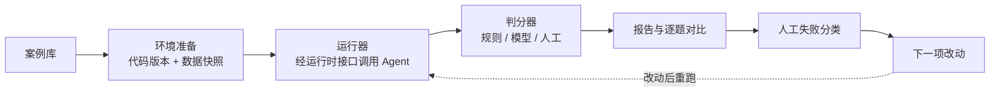

# 评估系统:原理与设计

评估系统回答一个问题:这次改动让 Agent 变好了还是变差了。没有它,对工具、Skill、上下文、运行时的所有优化都只能凭感觉。它是推进顺序里的第一步,也是之后每一项设计决策的依据。

相关文档:[总体设计](01-总体设计.md)、[自研运行时:原理与设计](03-自研运行时-原理与设计.md)。

## 1. 基本理念

| 理念 | 含义 | 对设计的影响 |
| --- | --- | --- |
| 评估的对象是整个系统 | Agent 的表现由模型、运行时、工具、Skill、上下文共同决定 | 任何一项变化都要重跑;每次结果记录完整的配置 |
| 看结果,也看过程 | 结论对但证据不足,是侥幸 | 结论和证据分开判分;保存完整轨迹 |
| 输出是不确定的 | 同一道题运行两次,结果可能不同 | 每题运行多次,看成功率而不是单次对错 |
| 案例来自真实问题 | 人为构造的案例只覆盖你想得到的情况 | 以历史问题为主,构造案例只用于补充缺失的类型 |
| 评估集会被“学会” | 反复针对同一批题调优,分数会高于真实水平 | 保留一部分案例不参与日常调优 |
| 判分标准先于运行确定 | 看到结果后再定标准,会不自觉地迁就结果 | 每道题在整理时就写好期望,之后不随运行结果修改 |
| 失败比分数重要 | 分数说明好不好,失败案例说明该改什么 | 报告以失败清单和失败分类为核心 |

## 2. 四个组成部分

1. **案例。** 一道题包含输入、运行环境、期望。
2. **运行器。** 准备环境,通过运行时接口调用 Agent,保存输出和轨迹。
3. **判分器。** 把输出和轨迹与期望比对,给出各维度的判定。
4. **报告。** 汇总分数,与基线逐题对比,列出失败案例。

四个部分相互独立:换运行时不影响判分器,改判分标准可以对已保存的输出重新判分而不必重跑。

## 3. 案例设计的原理

### 3.1 一道题的构成

| 部分 | 内容 | 作用 |
| --- | --- | --- |
| 输入 | 用户的原始问法;应用、环境、发生时间 | Agent 看到的内容。问法保持原样,不润色、不补全 |
| 环境 | 问题发生时的代码版本;当时的数据快照 | 保证每次运行面对同样的世界 |
| 期望 | 真实根因;得出结论必须看到的关键证据;期望行为(排查、追问、拒绝、说明无法确定) | 判分依据 |
| 标签 | 应用、案例类型、难度、是否留出 | 分组统计和筛选运行 |

### 3.2 可复现性:数据快照与回放

评估必须在固定的环境中运行。如果两次运行之间数据变了,分数的变化就无法归因于你的改动。线上的日志和指标会过期,业务数据会变化,所以不能直接查线上。

设计:

- 整理案例时,把排查这个问题可能用到的工具结果导出成快照:相关时段的日志、指标、发布记录、订单和会员状态。
- 评估时工具层切换到回放模式:工具名和参数命中快照时返回快照内容。
- 未命中快照时返回“无数据”,并在轨迹中标记。这说明 Agent 走了一条快照没覆盖的路径,需要人判断是补充快照还是这条路径本身不合理。

代价:回放限制了 Agent 的探索范围。快照只覆盖一条路径时,换一种合理查法的 Agent 会被误判为失败。所以快照要按时间段和服务范围导出,而不是只导出当时查过的那几条。另一种做法是维护一个数据长期保留的评估环境,工具照常查询;它更真实,但建设成本高,作为后续选项。

本项目的做法:日志存放在 ClickHouse 中,所以不采用按参数匹配的回放,而是冻结数据。整理案例时,把相关服务在相关时段的日志从线上表复制到一个专门的评估库中;评估时日志工具连接评估库。数据是真实可查询的,Agent 用任何合理的方式查询都能得到结果,结果也不随线上数据过期而变化。只有无法复制的数据源才使用回放。

起步阶段更简单:案例是用户常问的问题,且数量不多时,直接查询线上数据,由人工判断回答。等出现“同一道题因为数据变了而结果不同”的情况,再建立评估库。

### 3.3 覆盖与难度

案例类型见总体设计第 12.1 节。正常排查类占多数,其余每种类型至少有两三道题,否则该类型的分数没有意义。

正常排查类按难度分三层,报告中分别统计:

| 难度 | 特征 |
| --- | --- |
| 单点 | 查一个系统就能定位,例如日志里有明确报错 |
| 关联 | 需要把两三个系统的信息对起来,例如报错时间与发布记录 |
| 推理 | 需要读代码才能解释现象,或表象与根因相距较远 |

### 3.4 案例入库前的检查

- 真实根因经过当事人或复盘记录确认,不是猜测。
- 关键证据确实存在于快照或代码中。
- 一个熟悉系统的人只用给定的输入和工具能解出来。解不出来的题不能用来衡量 Agent。
- 已脱敏。

## 4. 判分的原理

### 4.1 三种判分器

| 方法 | 适用 | 优点 | 风险 |
| --- | --- | --- | --- |
| 规则(代码) | 是否调用了某工具、是否拒绝、输出是否包含四部分、是否在预算内 | 确定、即时、无费用 | 只能检查形式,无法判断结论的对错 |
| 模型 | 结论与真实根因是否一致、证据是否支持结论 | 可大批量运行 | 判分模型本身会出错,必须校准 |
| 人工 | 校准模型判分、处理有争议的案例 | 最可信 | 慢,无法每次都做 |

能用规则判的不用模型,能用模型判的不用人。

### 4.2 模型判分的设计

- **输入。** 问题、真实根因、关键证据清单、Agent 的最终输出。不提供完整轨迹,避免判分模型被过程细节带偏;过程由规则判分器检查。
- **输出。** 结构化的判定:一致、部分一致、不一致,附理由。
- **评分标准写明边界。** 例如“指出了正确的故障环节但原因不对”算部分一致;“列出多个可能原因且未表明倾向”算不一致。
- **判分模型与被测模型分开配置。** 判分模型和评分标准的版本记入结果,更换后历史分数不可直接对比,需要重新判分。

### 4.3 校准

模型判分在被信任之前,必须与人工判分对照。

1. 人工判定二三十个 Agent 输出,覆盖各种判定结果。
2. 用模型判分器判同一批,计算与人工的一致率。
3. 逐条查看不一致的,修改评分标准的措辞,重复第 2 步。
4. 一致率达到约定水平后启用自动判分;之后每次评估抽查若干条。

### 4.4 维度分开记录

结论正确、证据完整、行为合规、过程效率四个维度各自记录,不合成总分。合成会掩盖问题:一次改动让结论正确率上升、成本翻倍,总分可能不变。

## 5. 统计的原理

这一节回答三个问题:需要多少题、每题跑几次、分数差多少才算真的变了。

- **每题跑多次。** 默认 3 次。报告两个数:平均通过率,以及 3 次全部通过的题数。后者衡量稳定性,一道时对时错的题在线上等于不可靠。
- **小样本的波动很大。** 30 道题、成功率七成左右时,单轮评估的统计波动约为正负 8 个百分点。两个版本只差一两道题时,不能下结论。
- **用逐题对比代替总分对比。** 在同一批题上比较两个版本,看哪些题从失败变成成功、哪些反过来。这比只看总分敏感,也能发现“总分不变但互有涨跌”的情况。
- **变差的题必须有解释。** 接受一项改动的条件:变好的题明显多于变差的,并且每道变差的题都读过轨迹、知道原因。否则重复运行或扩大题量。

题量的增长路线:

| 题量 | 能做什么 | 不能做什么 |
| --- | --- | --- |
| 15–20 | 找出主要的失败类型;看出大幅度的差异 | 比较相近的两个版本 |
| 30–50 | 判断一项改动是否有明显效果;按类型分组观察 | 分组后每组题少,组内结论仍不可靠 |
| 100 以上 | 比较相近的版本;按应用、类型、难度分组得出结论 | — |

## 6. 防止过拟合

反复针对同一批题调优,Agent 会变得擅长这批题,而不是擅长排查问题。

| 措施 | 做法 |
| --- | --- |
| 开发集与留出集 | 约四分之一的案例标为留出,不查看其失败细节,只在阶段验收时运行 |
| 观察两者的差距 | 留出集分数明显低于开发集,说明改进是针对题目的 |
| 改动针对失败类别 | 每项改动解决一类问题(例如“工具返回过大”),不针对某一道题 |
| 禁止泄题 | Skill 和提示词中不出现案例特有的用户 ID、订单号、具体数值。发布前用脚本检查 |
| 持续注入新案例 | 线上被标记为无用的排查、新发生的故障,确认根因后加入 |

## 7. 报告

每次评估产出一份报告,包含:

| 部分 | 内容 |
| --- | --- |
| 配置 | 运行时名称与版本、模型、Skill 版本、工具版本、开启的扩展模块、判分器版本 |
| 总览 | 四个维度各自的结果;平均通过率和稳定通过的题数 |
| 分组 | 按应用、案例类型、难度 |
| 逐题对比 | 与基线相比,哪些题变好、变差、不变 |
| 失败清单 | 每条附轨迹位置和失败分类(初始为待分类,由人填写) |
| 成本与耗时 | 分布而不只是平均值,特别标出最贵和最慢的几道题 |

失败分类的流程:人读轨迹,按总体设计第 12.4 节归类,统计各类占比,占比最大的一类就是下一项改动的目标。这一步不自动化,它是理解 Agent 行为的主要途径。

## 8. 模块划分

| 模块 | 职责 |
| --- | --- |
| 案例库 | 存放案例文件和快照,按应用分目录;校验案例格式 |
| 环境准备 | 切到案例指定的代码版本;加载该案例的快照 |
| 回放层 | 在工具层拦截调用,按工具名和参数匹配快照;记录未命中 |
| 运行器 | 通过运行时接口调用指定的 Agent;控制并发和重复次数;保存输出和轨迹 |
| 规则判分器 | 基于输出和轨迹的确定性检查 |
| 模型判分器 | 按评分标准判定结论和证据;输出结构化结果 |
| 结果存储 | 每次运行的配置、逐题结果、轨迹位置;支持对已有输出重新判分 |
| 报告与对比 | 生成第 7 节的报告;任选两次运行做逐题对比 |

## 9. 分步实现与验收

| 步骤 | 范围 | 验收 |
| --- | --- | --- |
| E1 | 案例格式、15–20 个案例、运行器(先调用现有 CLI)、人工判分表、基础报告 | 得到基线分数和第一份失败分类 |
| E2 | 规则判分器、模型判分器、校准 | 模型判分与人工判分的一致率达到约定水平 |
| E3 | 快照导出与回放层 | 同一配置间隔数日重跑,结果在波动范围内一致 |
| E4 | 接入运行时接口;逐题对比报告 | 可对任意两个运行时或两个版本出对比报告 |
| E5 | 留出集、泄题检查、接入发布门禁 | 变更合并前自动运行评估并给出是否放行 |

## 10. 理解检查

- [ ] 为什么结论正确和证据完整要分开判分?(第 1、4 节)
- [ ] 直接让 Agent 查线上数据来做评估,问题在哪里?回放又带来什么代价?(第 3.2 节)
- [ ] 用模型来判分,怎么知道它判得对?(第 4.3 节)
- [ ] 30 道题上,新版本比旧版本多对 2 道,能说新版本更好吗?该怎么做?(第 5 节)
- [ ] 总分没变,能说明改动没有影响吗?(第 5 节)
- [ ] 开发集分数一直涨、留出集不涨,说明什么?(第 6 节)
- [ ] 为什么失败分类要由人来做?(第 7 节)
