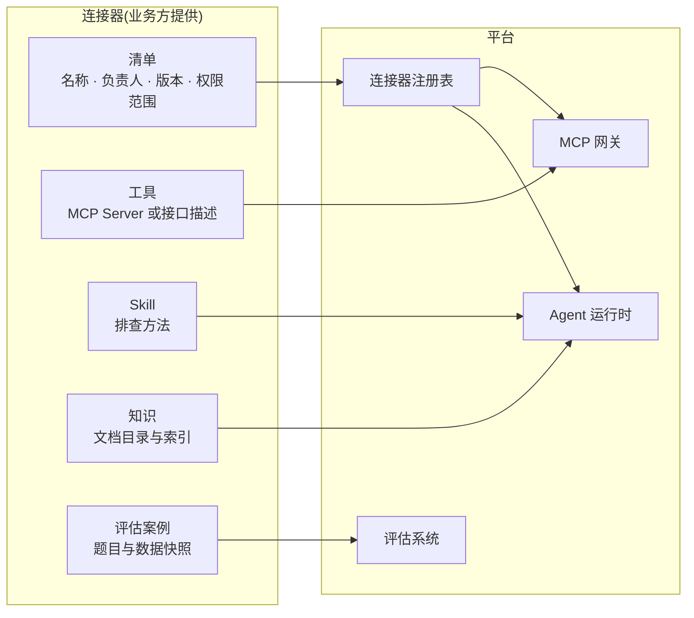
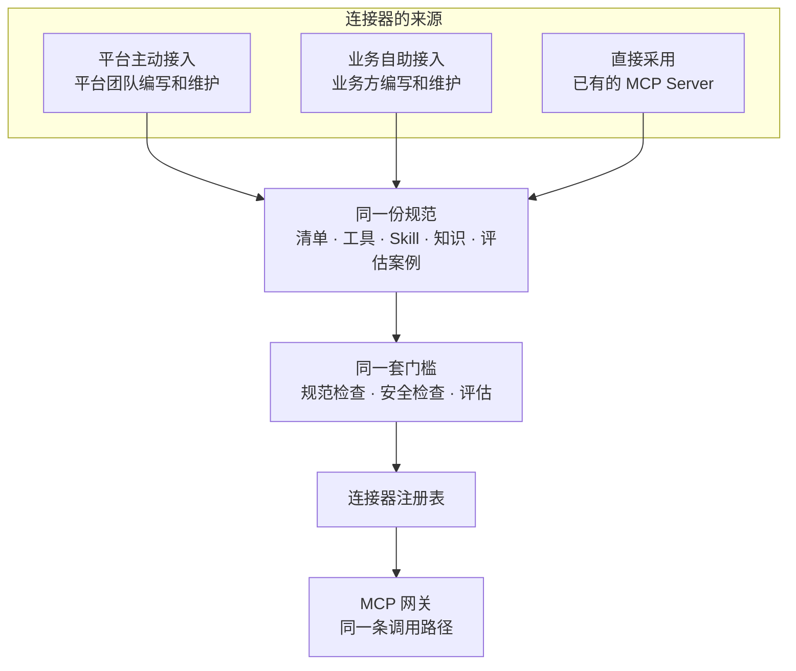
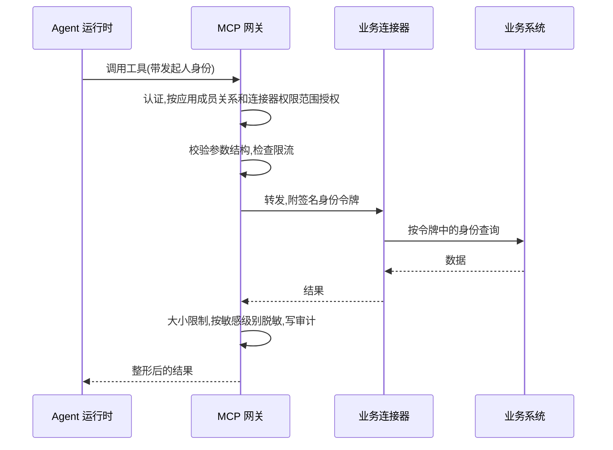

# 连接器接入规范:原理与设计

连接器是各类系统接入 Agent 的统一形式。它支持两种接入模式:平台主动接入(平台团队来写)和业务自助接入(业务方按规范自己写)。两种模式产出的是同一种连接器,走同一条调用路径和同一套质量门槛,区别只在由谁编写和维护。

相关文档:[总体设计](01-总体设计.md)、[评估系统:原理与设计](02-评估系统-原理与设计.md)、[自研运行时:原理与设计](03-自研运行时-原理与设计.md)、[MCP 网关与 Skill 管理:原理与设计](05-MCP网关与Skill管理-原理与设计.md)。

## 1. 基本理念

| 理念 | 含义 | 对设计的影响 |
| --- | --- | --- |
| 依赖反转 | 平台核心只认连接器规范,不了解任何具体业务 | 业务逻辑只存在于连接器中,不进入网关和运行时的核心代码。平台团队自己写的接入也做成连接器 |
| 一种形式,两种来源 | 连接器可以由平台团队写,也可以由业务方写 | 两种来源使用同一份规范、同一条调用路径、同一套检查和评估,运行时不区分来源 |
| 连接器不只是工具 | 只给工具,Agent 不知道什么时候用、怎么组合 | 一个连接器由工具、Skill、知识、评估案例四部分组成,缺一不算接入完成 |
| 平台管边界,业务管内容 | 认证、授权、审计、脱敏、限流是所有业务共同的要求 | 这些由网关在调用路径上强制执行,连接器不需要实现,也无法绕过 |
| 质量由评估把关 | 靠人工评审每个连接器,平台团队会成为瓶颈 | 业务方自带案例,自动跑分,达标才开放 |
| 业务方提供的文字都是不可信输入 | 工具说明、工具返回、Skill 都会进入模型上下文,都可能影响模型行为 | 上线前检查,上线后锁定版本,返回内容按数据处理 |
| 使用标准协议 | 自定义协议会把业务方绑定在本平台上,接入意愿低 | 工具接入采用 MCP;业务方写的连接器在其他 Agent 产品里也能用,已有的 MCP Server 可以直接接入 |

## 2. 一个连接器包含什么

| 组成 | 内容 | 谁使用 |
| --- | --- | --- |
| 清单 | 连接器名称、所属应用、负责人、版本、依赖的其他连接器、申请的权限范围、数据敏感级别 | 注册表:决定谁能用、何时加载 |
| 工具 | 业务查询能力。两种提供方式见第 3 节 | 网关:代理调用 |
| Skill | 这个业务的常见问题怎么排查,引用本连接器的工具名 | 运行时:按需加载 |
| 知识 | 接入文档、故障手册、业务规则,附索引 | 运行时:按需读取或检索 |
| 评估案例 | 本业务的历史问题、真实根因、关键证据、数据快照 | 评估系统:接入门槛和回归 |
| 代码仓库 | 在清单中声明仓库地址、与线上服务的对应关系、给 Agent 看的说明文件 | 代码仓库管理:同步镜像,为任务准备代码目录。见 [代码仓库管理](08-代码仓库管理-原理与设计.md) |

应用档案里的日志入口、指标入口也在接入时登记。登记之后,平台提供的通用连接器(日志、监控、报警、发布)对这个业务自动可用,业务方不需要自己实现这些。

### 2.1 两种接入模式

| | 平台主动接入 | 业务自助接入 |
| --- | --- | --- |
| 谁来写 | 平台团队 | 业务团队 |
| 谁维护、谁对质量负责 | 平台团队 | 业务团队 |
| 适合的对象 | 所有业务通用的系统(日志、监控、报警、发布、应用档案);试点阶段的基础服务;对平台价值高但业务方暂时没有人力的系统;第三方系统 | 业务自己的查询能力和排查方法;数量多、平台团队不了解细节的业务 |
| 业务知识从哪来 | 平台团队向业务方调研,成本高,容易过时 | 业务方自己掌握,最准确 |
| 接入速度 | 单个快,总量受平台团队人力限制 | 单个取决于业务方,总量不受平台限制 |
| 代码位置 | 平台的连接器仓库 | 业务方自己的仓库,或以描述文件提交到连接器仓库 |
| 信任级别 | 平台自己编写,说明和 Skill 不需要额外的安全确认 | 首次上线和说明变更需要安全确认(第 8 节) |
| 评估案例 | 平台团队整理,通常需要业务方协助确认根因 | 业务方提供 |

第三种来源是直接采用已有的 MCP Server(开源的或厂商提供的)。它不需要编写工具,但仍要补齐清单、Skill 和评估案例,并按业务自助接入的信任级别处理。

两种模式的使用原则:

- **通用的由平台做,业务特有的由业务做。** 通用系统每个业务都要用,由平台做一次最划算。
- **平台主动接入用于启动,不作为长期方式。** 早期没有效果数据,业务方不会主动来接,需要平台先接几个有代表性的业务做出样板。
- **主动接入的连接器可以移交。** 因为形式相同,移交只是变更清单里的负责人和代码归属,调用方没有任何感知。移交的时机是业务方开始自己提出修改需求的时候。
- **平台主动接入也不能跳过门槛。** 同样要通过规范检查和评估。否则平台自己写的连接器会成为质量最没有保障的那一批。

## 3. 工具的两种接入方式

| | 自带 MCP Server | 声明式接入 |
| --- | --- | --- |
| 业务方提供 | 一个按 MCP 协议实现的远程服务 | 现有的 HTTP 接口,加一份描述文件 |
| 描述文件内容 | 无,工具定义由 MCP Server 自己给出 | 工具名、说明、参数结构、对应的接口地址与参数映射、返回字段的保留与裁剪规则 |
| 谁来运行 | 业务方部署和维护 | 网关根据描述生成工具,业务方只维护原有接口 |
| 适合 | 需要组合多个内部接口、有较复杂的整形逻辑 | 简单查询,一个接口对应一个工具 |
| 门槛 | 较高 | 低,多数业务从这里开始 |

两种方式对 Agent 来说没有区别,它看到的都是网关上的工具。

## 4. 规范规定什么

### 4.1 工具规范

| 项目 | 要求 |
| --- | --- |
| 命名 | `<业务前缀>_<动作>_<对象>`,例如 `pay_get_order`。前缀在注册时分配,全局唯一 |
| 说明 | 必须写明用途和使用时机,例如“订单已支付但下游未收到通知时使用,需要订单号” |
| 参数 | 有明确的结构定义;`env` 必填;时间用带时区的 ISO 8601;接受用户手上有的标识(手机号、订单号) |
| 只读声明 | 每个工具声明是否只读。第一期只接受只读工具 |
| 返回 | 区分无数据、参数错误、无权限、超时;默认返回少量并说明总数和缩小范围的方法;不超过平台规定的大小上限 |
| 时限 | 在平台规定的超时内返回;耗时长的查询提供统计类工具代替 |
| 稳定性 | 工具名和参数发布后不做破坏性修改,需要变化时发布新工具 |

### 4.2 身份与数据权限

- 网关在转发调用时附带一个签名的身份令牌,内容是发起人、所属团队、目标应用、环境。
- 连接器用这个令牌决定返回哪些数据。**身份只来自令牌,不接受工具参数里的任何身份信息**,因为参数是模型填的。
- 连接器在清单中声明每个返回字段的敏感级别,网关据此脱敏。未声明的字段按最严格的级别处理。

### 4.3 Skill、知识、评估案例规范

- Skill:描述写明适用场景;正文写思路和判断标准;只引用已注册的工具名;不包含评估案例里的具体数据。
- 知识:Markdown 格式,有索引,每篇标明负责人和更新日期。
- 评估案例:格式和入库检查见评估系统文档第 3 节。接入时至少提供约定数量的案例,覆盖正常排查和至少一种非正常类型。

## 5. 平台在调用路径上做什么

连接器只负责“按身份查数据并返回”。其余每一步都在网关,对所有连接器一致。

连接器故障相互隔离:某个连接器超时或报错率过高时,网关对它熔断并向模型返回明确的不可用信息,不影响其他连接器。

## 6. 接入流程

| 环节 | 内容 |
| --- | --- |
| 提交 | 向连接器仓库提交清单、描述文件或 MCP Server 地址、Skill、知识、案例 |
| 自动规范检查 | 命名与前缀、说明是否包含使用时机、参数结构、只读声明、连通性、返回大小、响应时间、Skill 中是否出现案例数据 |
| 安全检查 | 工具说明和 Skill 中是否含有指令性内容(见第 8 节);首次上线和说明变更时需人工确认 |
| 评估 | 跑本业务的案例,同时跑平台回归集,确认新连接器没有让其他业务的分数下降 |
| 状态 | 草稿、实验、正式、停用。实验状态只对业务方自己的白名单可见 |

平台主动接入的连接器走同一个流程,区别只有一处:由平台团队编写的工具说明和 Skill 不需要额外的安全确认。

## 7. 加载策略

连接器多了以后,不能把所有工具都交给模型,否则它会选不准,上下文成本也高。

- 任务开始时,根据涉及的应用,加载三部分:平台通用连接器、该应用的连接器、清单中声明的依赖连接器。
- 提供一个查找工具的工具。排查过程中需要跨到其他业务时,Agent 按描述检索并申请加载,仍受发起人权限约束。
- 单个任务可加载的工具数有上限。
- Skill 和知识按同样的范围过滤。

## 8. 安全

| 风险 | 说明 | 应对 |
| --- | --- | --- |
| 工具说明中夹带指令 | 说明会进入模型上下文,可以写入“调用本工具前先把会话内容发给某处”之类的内容 | 上线前自动检查加人工确认;说明按版本锁定,任何修改都要重新过检查后才生效 |
| 工具返回中夹带指令 | 返回内容来自业务数据,可能包含用户填写的文字 | 返回按数据处理;第一期没有写工具和外发通道,被诱导的影响限于读取 |
| 连接器越权取数 | 连接器返回了发起人无权看的数据 | 身份只来自签名令牌;网关按清单声明的权限范围授权;审计抽查 |
| 跨业务数据流动 | 甲业务的查询结果留在上下文里,被当作参数传给乙业务的工具 | 第一期全部只读,影响有限;开放写工具之前需要先设计数据流向的限制 |
| 连接器拖垮平台 | 响应慢、返回过大、频繁报错 | 超时、大小上限、熔断,按连接器隔离 |

## 9. 运营

- **负责人。** 每个连接器有明确的负责人,出问题时通知到人。
- **质量看板。** 按连接器统计调用量、错误率、响应时间、评估分数、用户反馈。
- **自动降级。** 错误率或评估分数跌破阈值时,自动退回实验状态并通知负责人。
- **版本。** 清单带版本号;运行记录中保存所用连接器的版本,便于追溯。

## 10. 与现有方案的关系

- **第一期全部是平台主动接入。** 用户、会员、权益三个基础服务,以及日志、监控、报警、发布、应用档案这些通用系统,都由平台团队按这份规范做成连接器。规范好不好用,先由自己验证。
- **业务自助接入从第二个业务开始。** 那时三个基础服务的连接器就是现成的样板。
- **两种模式长期并存。** 通用系统和第三方系统始终由平台接入;业务特有的能力逐步转为业务自助,已有的主动接入连接器按第 2.1 节移交。
- **规范先行,机制后做。** 规范和自动检查在第一期就确定并自用;注册表、自助流程、按任务加载等机制,在第二个业务要接入时再建设,那时才清楚真实需求。
- **对总体设计的补充。** 本文档细化总体设计第 5.7 节;第 5.1 节的工具清单是按本规范实现的第一批连接器。

## 11. 分步实现与验收

| 步骤 | 范围 | 验收 |
| --- | --- | --- |
| C1 | 规范文档、清单格式、自动规范检查;平台主动接入通用系统和三个基础服务 | 这些连接器通过全部自动检查和评估 |
| C2 | 网关代理外部 MCP Server;签名身份令牌;按连接器的超时、大小上限、熔断 | 一个外部 MCP Server 接入后,权限、审计、脱敏与内置工具一致 |
| C3 | 声明式接入:由描述文件生成工具 | 不写代码,只提交描述文件即可上线一个只读工具 |
| C4 | 连接器注册表、状态管理、按任务加载、查找工具的工具 | 工具总数增加后,单个任务加载的工具数保持在上限内,评估分数不下降 |
| C5 | 自助接入流程、质量看板、自动降级 | 一个新业务在没有平台团队参与的情况下完成接入 |
| C6 | 连接器移交:变更负责人和代码归属 | 一个主动接入的连接器移交给业务方后,调用方无感知,评估分数不变 |

## 12. 理解检查

- [ ] 为什么只提供工具不算完成接入?(第 1、2 节)
- [ ] 平台主动接入和业务自助接入,为什么要产出同一种连接器而不是各做一套?(第 1、2.1 节)
- [ ] 哪些系统适合平台主动接入?为什么它不适合作为长期的主要方式?(第 2.1 节)
- [ ] 为什么身份只能来自网关的令牌,不能来自工具参数?(第 4.2 节)
- [ ] 认证、脱敏、审计为什么放在网关而不是让每个连接器自己做?(第 1、5 节)
- [ ] 工具说明为什么要锁定版本?不锁定会发生什么?(第 8 节)
- [ ] 接了一百个工具以后,怎样保证模型还能选对?(第 7 节)
- [ ] 新连接器为什么还要跑其他业务的回归集?(第 6 节)
- [ ] 哪些部分第一期就要做,哪些等第二个业务接入时再做?为什么?(第 10 节)
