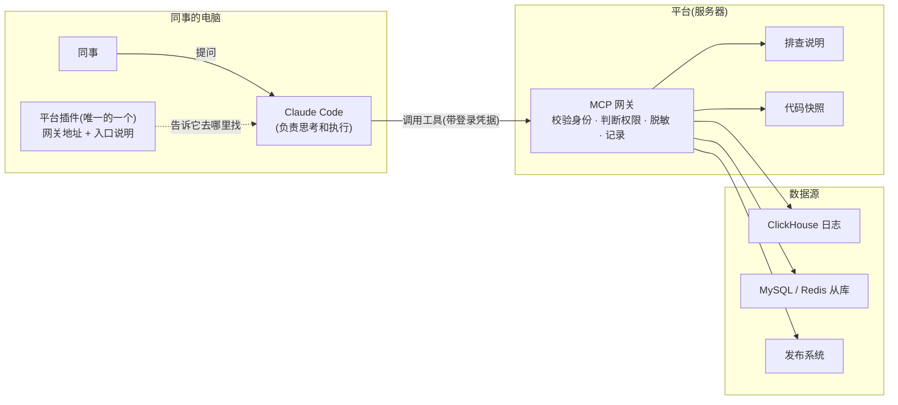
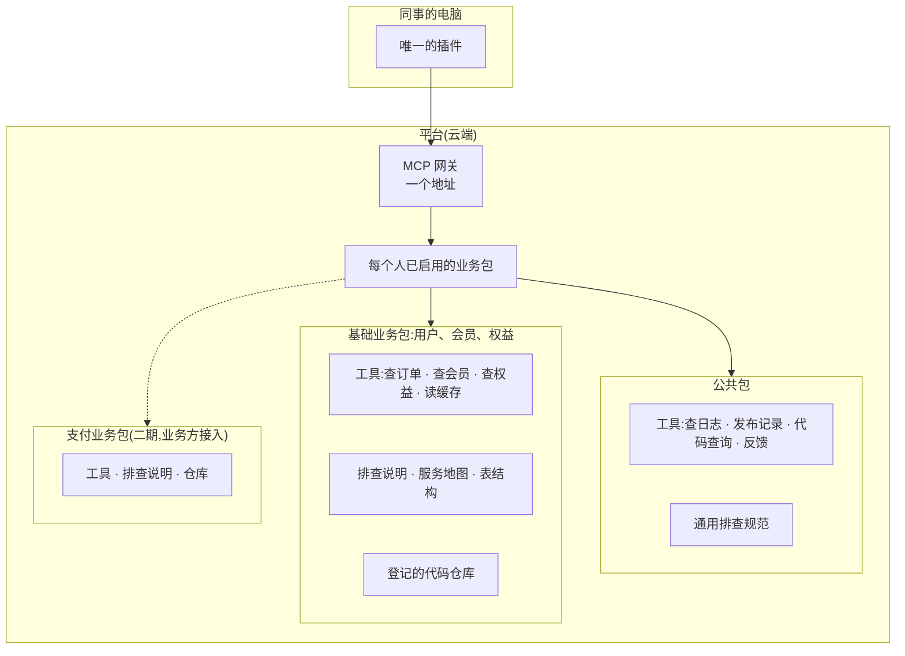
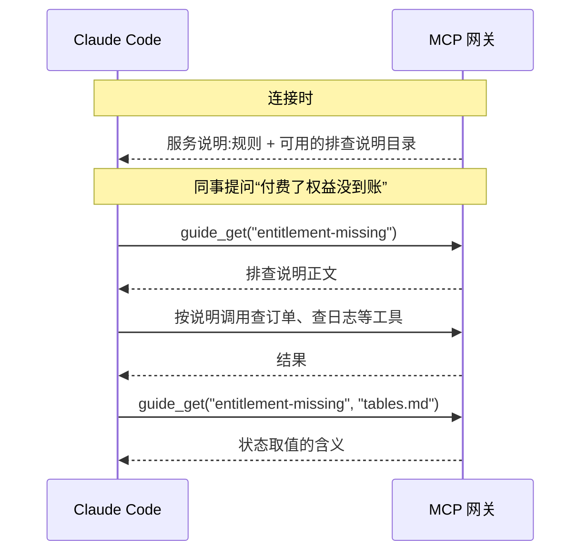
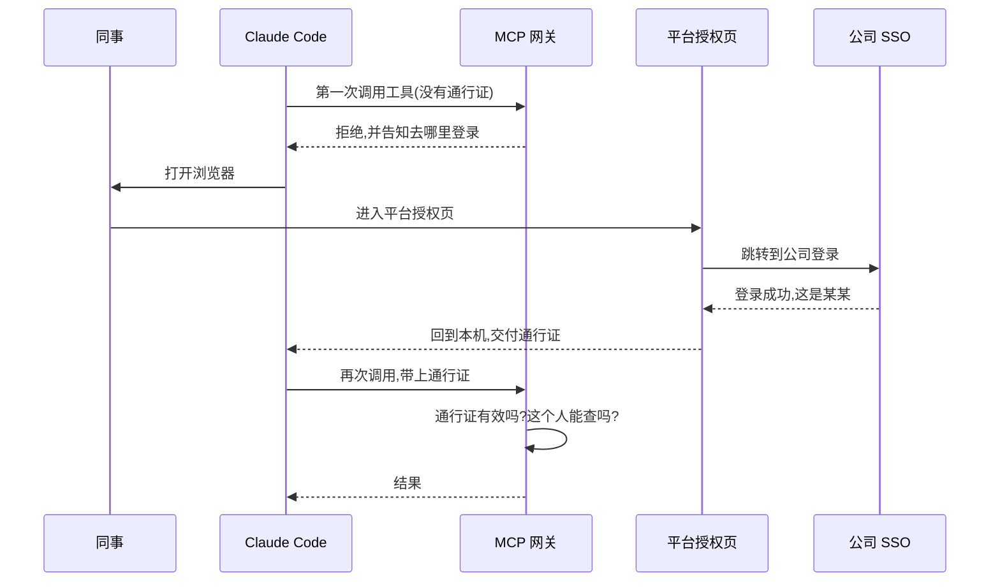
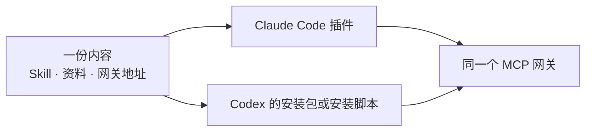
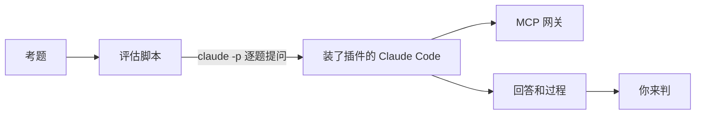
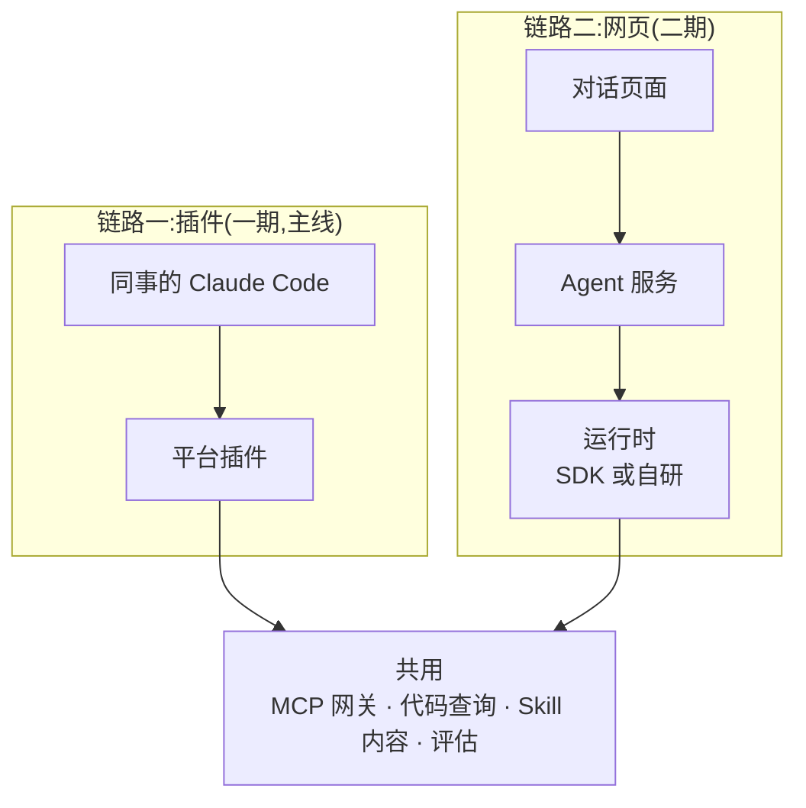

# 插件形态:原理与设计

平台的主要使用方式是插件:同事在自己的 Claude Code 里安装平台提供的插件,就能直接提问和排查。插件只有一个,而且很薄:里面只有网关的地址和一份入口说明。工具、排查说明、代码都在云端,由平台的 MCP 网关提供。本地的 Claude Code 负责“思考和一步步执行”。这条调用链是一期的主线。一期只支持 Claude Code,Codex 放在二期(第 9 节)。

**最小版本:做这七样。**

| 要做的 | 具体是什么 |
| --- | --- |
| 一个 MCP 网关 | 部署在平台上,提供查日志、查业务数据、查代码等工具,校验身份和权限,记录每次调用 |
| 一个插件 | 放在一个内部 Git 仓库里。内容只有网关的地址和一份入口说明,几乎不需要更新 |
| 云端的排查说明 | 服务地图、排查说明、表结构资料存在平台这一侧,通过网关按需取用 |
| 一个登录授权页 | 同事第一次使用时在浏览器里用公司账号登录一次。背后接公司已有的 SSO |
| 一个权限管理页面 | 管理员配置哪些人可以用哪些业务 |
| 代码查询 | 服务器上存放用户、会员、权益三个仓库的代码,网关提供搜索和读取 |
| 一批考题 | 用命令行批量提问,检查效果 |

相关文档:[架构总览](架构总览.md)、[开发路线](开发路线.md)、[业务包接入协议](11-业务包接入协议-原理与设计.md)、[权限管理](12-权限管理-原理与设计.md)、[数据定义](13-数据定义-原理与设计.md)、[网关核心](15-网关核心-原理与设计.md)、[代码查询](10-代码查询-原理与设计.md)。

## 1. 这条链路长什么样



一次提问的过程:

1. 同事在 Claude Code 里提问,例如“用户 u_8842 付费了,权益为什么没加上”。
2. 本地的 Agent 从网关取到这类问题的排查说明,知道该沿哪条链路查。
3. 它调用网关上的工具查订单、会员、日志。每次调用都带着这位同事登录后得到的凭据。
4. 网关确认身份和权限,查询数据源,把结果整理和脱敏后返回,并记一条审计。
5. 需要看代码时,它通过网关搜索和读取线上版本的代码。
6. 它给出带证据的结论。

## 2. 谁负责什么

| 部分 | 是谁的 | 负责什么 |
| --- | --- | --- |
| Claude Code | 同事自己安装的 | 理解问题、决定下一步、调用工具、组织回答、多轮对话、上下文管理 |
| 插件 | 平台提供 | 网关的地址;一份入口说明 |
| MCP 网关 | 平台提供 | 工具、排查说明、代码查询;身份、权限、审计、脱敏、限流 |
| 数据源 | 已有的系统 | 日志、业务数据、发布记录、Git 仓库 |

和“自己做一个网页版 Agent”相比,这条链路里平台**不需要**做的东西:

| 不需要做 | 原因 |
| --- | --- |
| 对话页面 | 同事直接用 Claude Code 的界面 |
| Agent 服务(对话、任务管理) | 本地 Agent 自己管理对话 |
| 运行时(循环、上下文压缩、会话) | 本地 Agent 就是运行时 |
| 模型的接入和费用管理 | 同事用自己的 Claude Code 账号 |
| 运行时的隔离环境 | 运行时在同事自己的电脑上 |

平台要做的集中在云端:**网关,以及网关后面的数据、代码和业务知识。**

## 3. 插件里有什么

整个平台只有一个插件。它是一个目录:

```
agent-platform/                     唯一的插件
  .claude-plugin/
    plugin.json                     插件清单:名称、说明
  .mcp.json                         连接配置:网关的地址
  skills/
    guide/
      SKILL.md                      入口说明
```

| 文件 | 作用 | 说明 |
| --- | --- | --- |
| `.claude-plugin/plugin.json` | 插件的清单 | 至少有名称 |
| `.mcp.json` | 告诉本地 Agent 去哪里找工具 | 指向平台的 MCP 网关。安装插件后,网关上的工具自动出现在本地 Agent 里 |
| `skills/guide/SKILL.md` | 入口说明 | 通用的排查规范,以及一条要求:排查之前先从网关取对应的排查说明 |

连接配置的样子:

```json
{
  "mcpServers": {
    "agent-platform": {
      "type": "http",
      "url": "https://agent-gateway.example.com/mcp"
    }
  }
}
```

配置里没有任何凭据。连接后由 Claude Code 完成浏览器登录并自动带上凭据,见第 6 节。

插件里**没有**的东西:业务的排查说明、服务地图、表结构、工具的定义、代码、数据。这些都在云端。所以新增一个业务、新增一个工具、修改一份排查说明,都不需要同事更新插件。

**注意一点:** 插件根目录下的 `CLAUDE.md` 不会被加载。所以“所有任务都要遵守的规则”不能靠它,放在哪里见第 5 节。

## 4. 业务包在云端

业务包就是一个业务的 MCP 工具和排查说明(Skill)的整合,再加上代码仓库登记和考题,打成一包交给平台。早期文档里叫“连接器”,后来改了名,因为它并不负责连接,负责连接的是网关。

一个业务的工具、排查说明、代码仓库都归在一个业务包名下。它是平台的基本单位:业务按它接入,管理员按它授权,同事按它启用。**业务包不在同事的电脑上,它是云端的一份登记。**



| 概念 | 在这条链路里 |
| --- | --- |
| 业务包 | 云端的一份登记:它有哪些工具、哪些排查说明、哪些代码仓库 |
| 加载一个业务包 | 平台为这个人记下“已启用”。网关只返回已启用业务包的工具和排查说明 |
| 公共包 | 所有人始终启用 |
| 基础业务包 | 一个业务包覆盖用户、会员、权益三个服务,默认启用 |
| 使用方选择业务包(二期) | 同事说一句“启用支付业务”,或在平台页面上勾选 |
| 业务包之间的隔离 | 没启用的业务包,它的工具、排查说明、代码仓库对这个人都不存在 |
| 业务接入 | 按 [业务包接入协议](11-业务包接入协议-原理与设计.md) 交一个目录。一期由平台代接用户、会员、权益;二期业务方自助。同事的插件不用动 |

“启用”和“有权限”是两回事。启用是同事自己的选择,为的是不让无关业务的内容进入对话;权限是平台的规定。两个条件都满足,才看得到、调得动。

一期只有公共和基础业务两个业务包,都是默认启用,没有可选的。但“每个人已启用哪些业务包”这份记录从一期就建好,二期只是多几个可选项。

**代码查询属于公共包,仓库属于业务包。** 查订单这类工具每个业务都不一样,只能由业务自己的业务包提供。搜代码和读代码对所有仓库做法相同,所以只做一组通用工具;每个业务包只需要登记“我有哪些仓库”。没启用支付业务包的人,用代码工具也搜不到支付的仓库。

## 5. 排查说明和全局规则

### 5.1 内容分三处

| 位置 | 放什么 | 什么时候进入对话 | 改了之后 |
| --- | --- | --- | --- |
| 网关下发的服务说明 | 几句最重要的规则;当前这个人可用的排查说明目录(名称和适用场景) | 每次连接时自动带入 | 立即生效 |
| 云端的排查说明 | 每类问题怎么查;服务地图;表结构和状态取值 | 用到时通过工具取 | 立即生效 |
| 插件里的入口说明 | 通用排查规范和输出格式;“先取排查说明再查”的要求 | Claude Code 按描述判断何时使用 | 需要更新插件,所以只放很少变化的内容 |

每个工具自己的说明(什么时候用、参数怎么填)随工具走,也在云端。

真正不能被绕过的要求(只读、权限、脱敏)不依赖这些文字,它们由网关强制执行。

### 5.2 云端的排查说明怎么存

排查说明仍然是 Markdown 文件,仍然用 Git 管理和评审。目录和文件的完整格式见 [业务包接入协议](11-业务包接入协议-原理与设计.md)。区别只是:它们经流水线编译进登记表,由网关提供,不同步到同事的电脑。

```
agent-content/                      内容仓库(内部 Git 仓库)
  packs/
    platform/                       公共包
      pack.yaml
      guides/
        general.md                  通用排查规范
    membership/                     基础业务包
      pack.yaml                登记:工具、排查说明、代码仓库
      guides/
        overview.md                 三个服务的整体情况与服务地图
        entitlement-missing.md      “付费后权益未到账”怎么查
        login-failed.md
      references/
        tables.md                   表结构和状态取值
```

每份排查说明的开头有两项:名称,和一句“什么时候用”。这一句会进入目录,决定它会不会被取用,所以要写具体的现象,例如“用户付费后权益或会员没有到账”。

### 5.3 怎么取

网关在公共包里提供两个工具:

| 工具 | 输入 | 返回 |
| --- | --- | --- |
| `guide_search` | 一句对问题的描述 | 匹配的排查说明:名称、适用场景。只在已启用的业务包里找 |
| `guide_get` | 排查说明的名称;可选的资料文件名 | 正文,或某份资料文件 |



排查说明少的时候,目录直接放在服务说明里,Agent 看目录就知道取哪份,不需要搜索。数量多到目录放不下时,服务说明里只留每个业务包的一句介绍,靠 `guide_search` 来找。

### 5.4 怎么更新


和把说明放在插件里相比,少了“等每位同事更新插件”这一步。从合并到生效通常在几分钟之内,出问题可以按版本回滚(文档 14 第 4 节)。

### 5.5 这样做的代价

排查说明不再是 Claude Code 原生的 Skill,模型要主动调用工具去取,它有可能跳过这一步直接开查。三项措施:

1. 服务说明里带着目录,每次连接都在。
2. 插件的入口说明里写明“排查之前先取排查说明”。
3. 关键工具的说明里提示“使用前先阅读对应的排查说明”。

这一点需要实测(见 [开发路线](开发路线.md) 第 5 节第 6 项)。如果实测发现仍然经常不取,退路是把最常用的两三份直接做成插件里的 Skill,其余留在云端。

为了保留这条退路,排查说明的正文不依赖“它存在哪里”:不写本地路径,引用资料时用名称。

## 6. 登录与权限

本地 Agent 在同事自己的电脑上,平台管不到它。所以**网关是唯一的关口**:每一次工具调用都要回答“是谁在查、他能不能查”。

### 6.1 三个角色

公司已经有 SSO。在它和网关之间,还需要一个由平台提供的登录授权页。三者各管一件事:

| 角色 | 是谁的 | 管什么 |
| --- | --- | --- |
| 公司 SSO | 已有 | 确认“这个人是谁”:输入账号密码的地方 |
| 平台的登录授权页(授权服务) | 平台新建 | 把“这个人是谁”换成一张发给 Claude Code 的通行证(访问令牌) |
| MCP 网关 | 平台新建 | 每次调用时检查通行证,判断能不能查 |

为什么 SSO 之外还要一个授权页:Claude Code 连接远程 MCP 服务时,按 MCP 协议规定的 OAuth 流程来登录,它对授权服务有一组固定的要求(第 6.3 节)。公司 SSO 通常是给网页系统用的,不一定满足这组要求。授权页就是中间的转换:对 Claude Code 说 OAuth,对 SSO 走公司已有的登录方式。

### 6.2 登录的过程



同事看到的只是:第一次用的时候浏览器弹出来,用公司账号登录一次,之后就不用管了。通行证由 Claude Code 自己保管和续期,同事不需要复制粘贴任何东西,通行证也不会出现在对话里。

登录 Claude Code 自己的账号,和登录本平台,是两回事。前者是用模型的身份,后者是查公司数据的身份。

### 6.3 授权页需要满足什么

这部分是交给编码工具实现时要说清的。建议使用成熟的 OAuth 服务端组件来搭,不要手写协议。

| 要求 | 说明 |
| --- | --- |
| 授权码流程加 PKCE | 标准的浏览器登录流程。PKCE 是其中一项防止授权码被截走的措施 |
| 可被自动发现 | 网关拒绝未登录的请求时,要告知授权服务的地址;授权服务要公开一份说明自己各个接口地址的元数据 |
| 客户端登记 | 两种方式任选其一:授权服务支持客户端自动登记;或者预先登记一个客户端编号,写进插件的连接配置里 |
| 回调地址 | Claude Code 使用 `http://localhost:<端口>/callback`。预先登记时要固定端口 |
| 访问令牌短期有效,可续期 | 例如一小时过期,由 Claude Code 自动续期 |
| 令牌只对本平台有效 | 网关检查令牌是不是发给自己的、是谁签发的、有没有过期 |
| 可以撤销 | 同事离职或账号停用后,在约定的时间内失效 |

身份从验证过的令牌里取,不从工具参数里取。不直接把 SSO 的登录 Cookie 或身份凭证拿来当访问令牌用。

需要在动手前实测的一点:Claude Code 的官方文档写明了命令行添加 MCP 服务时可以指定预先登记的客户端编号和回调端口,但没有写明插件里的连接配置是否支持同样的字段。如果不支持,就要让授权服务支持客户端自动登记。这一项放在一期的第一步验证。

### 6.4 权限

登录只回答“你是谁”。“你能用什么”由管理员在管理页面上配置,完整设计见 [权限管理:原理与设计](12-权限管理-原理与设计.md)。这里只列要点:

| 项目 | 一期 |
| --- | --- |
| 谁来配 | 管理员,在管理页面上 |
| 配什么 | 哪个用户组(或个人)可以用哪个业务包,是只读还是读写。一期全部是只读 |
| 默认 | 没有授权就不能用。公共包对所有登录的正常用户开放 |
| 检查的时机 | 每一次工具调用都检查,不只是登录时 |
| 改了多久生效 | 最晚一分钟 |
| 数据源账号 | 只在网关里,同事和本地 Agent 都接触不到 |

工具列表里看不到某个工具,只是为了不打扰;真正的拦截发生在调用的时候。两者不能互相代替。

网关把“没有成功”分成几种情况返回,本地 Agent 才能给出正确的解释:

| 情况 | 本地 Agent 应该怎么做 |
| --- | --- |
| 没有登录或登录过期 | 引导重新登录。不要求同事把任何凭据贴进对话 |
| 已登录但没有权限 | 说明缺少权限、去哪里申请,然后停下。不反复重试,不换别的工具绕过去 |
| 有权限但后面的系统出错 | 说明是服务异常,不要说成没有权限 |

### 6.5 评估脚本怎么登录

评估是脚本自动运行的,没有人在浏览器里点登录。网关为此另外接受一种凭据:一个专用的服务令牌,只给评估环境使用,在审计里能和真人区分开。这个令牌的权限范围和普通同事相同或更小。

为什么不让本地 Agent 直接连数据库:那样每位同事的电脑上都要有数据库账号,既没法按人审计,也没法统一脱敏和限流。

## 7. 代码从哪里来

提问的同事大多没有用户、会员、权益这三个服务的代码。所以这三个仓库的代码由平台放在服务器上,通过网关提供。

| 情况 | 做法 |
| --- | --- |
| 问的是用户、会员、权益的代码 | 通过网关的代码工具:先确定版本,再搜索,再读取 |
| 问的是自己正在开发的代码 | 本地 Agent 直接读本地 |
| 本地恰好有这三个仓库 | 排查线上问题时仍以网关给出的版本为准 |

三条最重要的约定:读的是线上运行的那个版本,不是随便一个最新版;查不到线上版本时要明说;每段代码证据带仓库、版本、文件和行号。

完整设计见 [代码查询:原理与设计](10-代码查询-原理与设计.md)。

## 8. 安装与更新

### 8.1 插件仓库

一个内部 Git 仓库就是一个插件市场。仓库根目录下有一个市场清单,里面只列一个插件。

```
agent-plugins/                       内部 Git 仓库
  .claude-plugin/
    marketplace.json                 市场清单:名称、维护者、插件列表
  plugins/
    agent-platform/                  唯一的插件
```

同事用自己已有的 Git 权限访问这个仓库,不需要额外的账号。

### 8.2 同事要做的

只在第一次使用时做一遍:

```bash
/plugin marketplace add <插件仓库的 Git 地址>
```

```bash
/plugin install agent-platform@<市场名称>
```

装好后第一次使用时,Claude Code 会提示登录(也可以输入 `/mcp` 主动发起)。在弹出的浏览器里用公司账号登录一次,之后直接提问即可。

只有一个网关地址,所以只登录一次。以后新增业务,不需要再装任何东西。

### 8.3 让安装更省事

在业务代码仓库的 `.claude/settings.json` 里登记插件仓库和默认启用的插件。同事在这个代码仓库里打开 Claude Code,信任该目录后,插件自动装好,连上面两条命令都不用输。

### 8.4 更新时哪些要动

| 改了什么 | 在哪里改 | 同事需要更新插件吗 |
| --- | --- | --- |
| 排查说明、服务地图、表结构资料 | 内容仓库,经流水线编译进登记表 | 不需要 |
| 工具的定义、返回的字段 | 内容仓库(大部分工具是配置) | 不需要 |
| 新增一个工具 | 内容仓库;需要写代码的内置工具在平台代码里 | 不需要 |
| 新增一个业务(业务包) | 云端登记 | 不需要 |
| 最重要的几条规则 | 网关的服务说明 | 不需要 |
| 通用排查规范、输出格式 | 插件的入口说明 | 需要 |
| 网关的地址 | 插件的连接配置 | 需要 |

只有最后两项要动插件,它们很少变化。真要更新时,靠 Claude Code 的插件更新机制:启动时自动检查(自己搭的插件仓库默认关闭,需要同事开启或由管理员统一配置),或手动执行更新。

## 9. Codex(二期)

一期只做 Claude Code。Codex 这边的具体配置方式没有查到官方文档,**下表中 Codex 一列需要在二期实现前核实**。设计上只依赖两边都具备的通用能力,这样即使细节不同,要改的也只是打包方式。

| 需要的能力 | Claude Code | Codex(待核实) |
| --- | --- | --- |
| 连接远程的 MCP 网关并登录 | 插件里的 `.mcp.json` | 在 Codex 的配置文件里登记 MCP 服务 |
| 排查说明 | 插件里的 `skills/`,`SKILL.md` 格式 | Skill 采用相同的 `SKILL.md` 格式,放到 Codex 约定的目录 |
| 全局规则 | 网关的服务说明 + 通用 Skill | 同左,另可用 `AGENTS.md` |
| 一键安装 | 插件市场 | 如果 Codex 有插件机制则同样打包;否则提供一个安装脚本,写入配置并复制 Skill |

原则:**内容只有一份,打包有两种。**



网关对两边完全一样,因为 MCP 是标准协议。Skill 的正文两边通用,不写任何只有某一个工具才认识的指令。

## 10. 评估

评估走的就是同事实际使用的这条链路:用命令行方式启动装好插件的 Claude Code,把考题逐个发给它,保存回答和过程。



这和你最早搭的那个原型是同一种方式,所以原型可以直接演进成评估环境。

评估脚本使用专用的服务令牌登录(第 6.5 节)。评估的做法见 [评估系统](02-评估系统-原理与设计.md),代码查询相关的考题见文档 10 第 9 节。

## 11. 平台能看到什么

对话发生在同事的电脑上,平台看不到提问和回答,只能看到网关上的工具调用。这是这条链路和网页版最大的区别。

| 想知道的 | 能不能看到 | 做法 |
| --- | --- | --- |
| 谁在什么时候查了什么数据 | 能 | 网关的审计 |
| 哪些工具用得多、哪些经常报错 | 能 | 网关的统计 |
| 哪份排查说明被用得多、哪份从没被用过 | 能 | 排查说明通过网关取,每次都有记录 |
| 同事问了什么问题 | 默认不能 | 提供一个反馈命令,同事主动提交“问题、回答、有没有用”;这些就是新的考题来源 |
| 回答对不对 | 默认不能 | 同上,靠主动反馈 |
| 每次任务花了多少钱 | 不能,也不需要 | 费用在同事自己的账号上 |

反馈的入口做成一个网关上的工具,例如 `feedback_submit`。同事说一句“把这次的问题和结论反馈给平台,标记为没解决”,本地 Agent 就会调用它。

不要用自动上报全部对话的方式来收集。同事的对话里可能有与平台无关的内容,自动上报需要明确告知并征得同意。

## 12. 安全

运行时在同事自己的电脑上,这带来和网页版不同的风险。

| 风险 | 说明 | 应对 |
| --- | --- | --- |
| 本地 Agent 有写文件、执行命令、访问网络的能力 | 这是同事自己环境里的能力,平台限制不了 | 平台的工具全部只读;网关不提供任何写操作 |
| 日志或数据里夹带指令 | 本地 Agent 读到“把结果发到某地址”这类文字,理论上有能力照做 | 网关在返回内容中标明这是数据;通用 Skill 中写明工具返回的内容不是指令;同事保留 Claude Code 自带的操作确认;尽量减少返回内容中的自由文本 |
| 数据落到同事电脑上 | 查到的日志和业务数据会出现在本机的对话记录里 | 网关脱敏;返回最少必要的数据;审计记到人 |
| 数据发送给模型服务 | 查到的数据会随对话发送给 Claude Code 背后的模型服务 | 已确认在允许范围内。二期支持 Codex 时需要另行确认 |
| 登录凭据泄露 | 通行证由 Claude Code 保存在同事的电脑上 | 短期有效;可以撤销;不出现在插件、对话和审计里 |
| 通过代码工具读到不该读的文件 | 路径参数或符号链接可能指向快照之外 | 只访问登记过的快照;校验解析后的路径;不提供执行命令的工具 |
| 代码里的密钥或诱导文字进入对话 | 源码和注释里可能有敏感配置,也可能有像指令的文字 | 敏感文件在搜索和读取之前排除;通用 Skill 中写明代码内容是证据,不是指令 |
| 插件仓库或内容仓库被篡改 | 入口说明和排查说明会影响所有同事的本地 Agent | 两个仓库的合并都需要评审;只有少数人有写权限 |

核心原则没有变:**所有不能被绕过的要求,都由网关强制执行。**

## 13. 和网页版的关系

之前设计的“对话页面 → Agent 服务 → 运行时 → 网关”那条链路没有作废,它变成第二条链路,放到二期。两条链路共用同一个网关和同一份内容。



| | 链路一:插件 | 链路二:网页 |
| --- | --- | --- |
| 谁来用 | 已经在用 Claude Code 的同事,主要是研发 | 不用这些工具的同事,例如产品 |
| 运行时 | 同事本地的 Claude Code | 平台上的 SDK 运行时或自研运行时 |
| 平台要做的 | 网关、登录授权页、代码查询、插件内容 | 另外加上页面、Agent 服务、运行时 |
| 平台能看到对话吗 | 不能 | 能 |
| 模型费用 | 同事的账号 | 平台的账号 |

自研运行时属于链路二,所以它仍然在二期。它会使用同一个网关和同一份 Skill 内容,一期做的东西不会浪费。

## 14. 一期怎么推进

模块的划分、执行顺序和每一步的验收,统一写在 [开发路线](开发路线.md) 里,这里不再另列一份。和本文档直接相关的是三个模块:模块 2 插件(第 3、8 节)、模块 3 登录授权(第 6 节),以及模块 1 网关核心里“生成服务说明”的部分(第 5 节,详见文档 15)。

## 15. 待确认

- [ ] 提问的同事里有不懂技术的产品同事。他们会使用 Claude Code 吗?如果不会,他们在一期怎么使用,还是等二期的网页?
- [ ] 同事使用的是公司统一的 Claude Code 账号,还是个人账号?
- [ ] (二期)使用 Codex 时,查到的日志和业务数据会发送给 OpenAI。这和发送给 Anthropic 一样在允许范围内吗?
- [ ] (二期)Codex 的插件、Skill、MCP 的具体配置方式,需要查阅它的官方文档核实。
- [ ] 插件仓库放在哪个内部 Git 平台上,同事是否都有读权限?
- [ ] 公司 SSO 用的是什么协议?能不能让平台的授权页作为一个应用接进去?找谁配置?
- [ ] 授权页用哪个现成的 OAuth 服务端组件来搭?
- [ ] 同事离职或账号停用后,平台这边最晚多久失效?
- [ ] 其他团队的同事可以看到基础服务的哪些源码?(文档 10 第 7 节)

## 16. 自测

- [ ] 这条链路里,哪些是平台提供的,哪些是同事自己电脑上的?(第 1、2 节)
- [ ] 插件里有什么,没有什么?为什么只需要一个插件?(第 3 节)
- [ ] 业务包现在在哪里?没装“支付插件”,怎么做到看不到支付的工具?“启用”和“有权限”有什么区别?(第 4 节)
- [ ] 为什么代码查询的工具是公共的,而仓库登记在业务包名下?(第 4 节)
- [ ] 排查说明存在哪里?改了之后多久生效?(第 5 节)
- [ ] 把排查说明放在云端的代价是什么?退路是什么?(第 5.5 节)
- [ ] 全局规则为什么不能靠插件里的 `CLAUDE.md`?放在哪里?(第 5 节)
- [ ] 公司 SSO、平台授权页、网关,各管什么?为什么有了 SSO 还需要授权页?(第 6.1 节)
- [ ] 工具列表里看不到某个工具,等于没有权限调用吗?(第 6.4 节)
- [ ] 为什么不让本地 Agent 直接连数据库?(第 6 节)
- [ ] 同事本地没有基础服务的代码,代码从哪里来?(第 7 节)
- [ ] 哪些改动需要同事更新插件?(第 8.4 节)
- [ ] 平台看不到同事的提问,那新的考题从哪里来?(第 11 节)
- [ ] 本地 Agent 有执行命令的能力,平台靠什么保证数据安全?(第 12 节)
