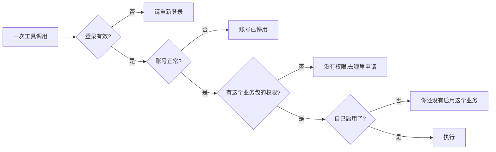
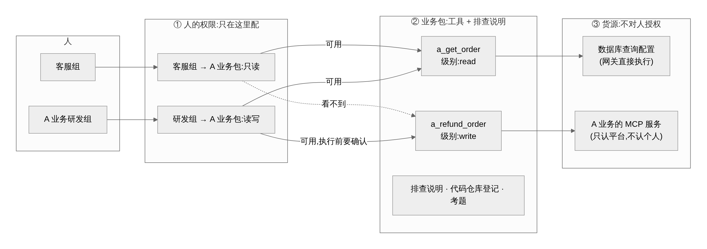
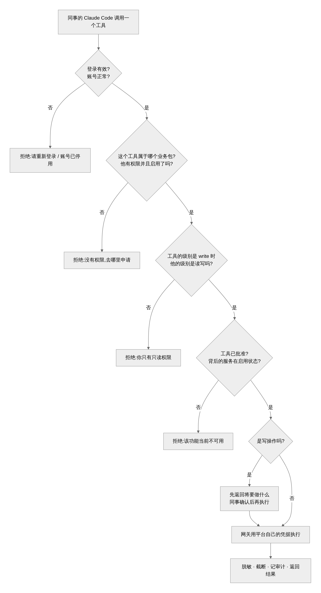
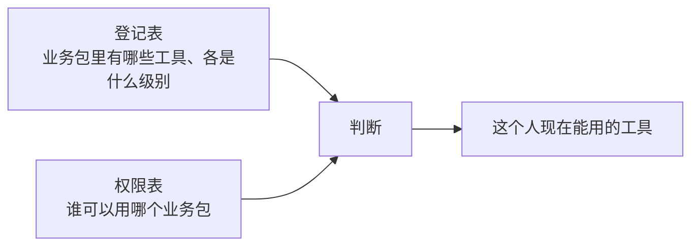
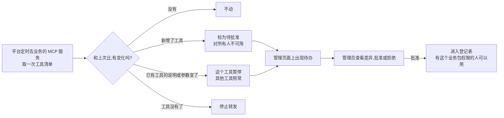
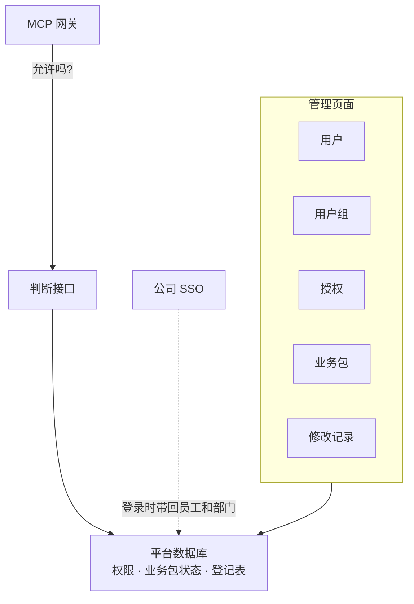

# 权限管理:原理与设计

登录解决“你是谁”,权限管理解决“你能用什么”。管理员在一个管理页面上配置哪些用户组可以用哪些业务包、是只读还是读写;网关每次调用工具时来这里问一句“允许吗”。

**最小版本:做这四样。**

| 要做的 | 具体是什么 |
| --- | --- |
| 几张数据表 | 用户、用户组、授权、业务包的状态、同事自己的启用记录、修改记录 |
| 一个判断接口 | 网关问:这个人、这个业务包、这个工具,允许吗?回答允许或拒绝,以及原因 |
| 一个管理页面 | 管理员在上面管用户、用户组、授权、业务包的状态,看修改记录 |
| 一条初始规则 | 第一个管理员是谁,写在部署配置里 |

相关文档:[数据定义](13-数据定义-原理与设计.md) 第 4 节(判断接口的输入输出)、[插件形态](09-插件形态-原理与设计.md) 第 6 节(登录)、[业务包接入协议](11-业务包接入协议-原理与设计.md)、[网关核心](15-网关核心-原理与设计.md)。

## 1. 三件容易混在一起的事

| | 回答的问题 | 谁决定 | 存在哪 |
| --- | --- | --- | --- |
| 登录 | 你是谁 | 公司 SSO | 登录授权(开发路线的模块 3) |
| 权限 | 你能用什么 | 管理员 | 本文档 |
| 启用 | 你想用什么 | 同事自己 | 本文档里的另一张表 |

一位同事最终能看到、能调用某个业务包的工具,要三个条件同时成立:登录有效;管理员给了权限;他自己启用了。

网关核心自己不保存任何权限。它只负责在执行前问一句,并按回答放行或拒绝。

### 1.1 人的权限只配一处

从同事到真正的数据,中间有三层关系。它们方向不同,各管一件事:

| 层 | 回答的问题 | 谁来定 | 性质 |
| --- | --- | --- | --- |
| ① 同事 → 业务包 | 这个人能用这个业务吗,什么级别 | 管理员,在管理页面上授权给用户组 | 人的权限。**只在这一层配** |
| ② 业务包 → 工具 | 这个业务包提供哪些工具,各是什么级别 | 写业务包的人在文件里声明,经评审 | 上架 |
| ③ 平台 → 数据源或 MCP 服务 | 平台能不能访问它 | 管理员登记数据源和凭据;二期批准业务 MCP 的工具 | 货源 |

数据源和 MCP 服务这一层不对人授权。业务的 MCP 服务只认平台,不认同事个人,并且只允许网关访问。这样永远不需要回答“业务包允许、MCP 服务不允许,听谁的”。

### 1.2 读写级别

每个工具声明自己的级别:只读(`read`)或会改数据(`write`)。授权时也选级别:只读或读写。工具是 `write` 时,这个人对该业务包的级别必须是读写。只读级别的人,工具列表里不出现写工具。

| 需求 | 用什么 |
| --- | --- |
| 同一块业务,有人只读、有人读写 | 级别 |
| 同一个服务里有两块不同的业务,要给不同的人(例如普通支付查询和风控) | 拆成两个业务包 |
| 只能看自己负责的数据 | 平台不做。确有需要时,由业务自己的 MCP 服务判断(二期) |

一期所有工具都是只读,所有授权都是只读级别。级别的字段从一期就有,二期开放写操作时不用改表结构。写操作除了级别还需要“执行前由同事确认”等保护,见第 10 节。

## 2. 管理的对象

| 对象 | 是什么 | 例子 |
| --- | --- | --- |
| 用户 | 一位员工。第一次登录时自动建立,信息来自 SSO | 张三,状态:正常 |
| 用户组 | 一批用户。授权主要给组,不给个人 | 基础服务组、客户端组、测试组、产品组 |
| 业务包 | 来自内容仓库,不在这里创建 | 公共、基础业务 |
| 授权 | 一条“谁可以用什么”的记录 | 测试组 → 基础业务包 |
| 启用 | 同事自己打开了哪些业务包 | 张三启用了:公共、基础业务 |
| 管理员 | 可以进管理页面改权限的人 | 你 |

为什么授权主要给组:一个人一个人地配,几十个人就管不过来,人员变动时也容易漏。给组授权后,人员变动只需要调整他在哪个组。

用户组从哪里来,有两种办法:

| 办法 | 做法 | 适合 |
| --- | --- | --- |
| 跟着 SSO 的部门走 | 登录时从 SSO 带回部门信息,自动归入对应的组 | SSO 能提供部门信息。入职、转岗、离职自动生效 |
| 在平台里手工建 | 管理员在页面上建组、加人 | SSO 不提供部门,或者需要跨部门的组 |

两种可以同时存在:部门组自动同步,另外再手工建几个特殊的组。

## 3. 判断的规则

1. **默认拒绝。** 没有任何授权记录,就是不能用。
2. **取最高的级别。** 一个人在几个组里,只要其中一个组有权限,他就有;级别取其中最高的。
3. **停用优先。** 账号停用、业务包停用,优先于任何授权。
4. **不设“明确禁止”这种记录。** 只有“给”和“不给”。这样永远不需要回答“一个组允许、另一个组禁止,听谁的”。
5. **写工具要读写级别。**
6. **每次调用都判断。** 工具列表只是为了不打扰。
7. **权限服务不可用时一律拒绝。**

粒度:

| 粒度 | 例子 | 一期 |
| --- | --- | --- |
| 业务包 | 测试组可以用基础业务包 | 做 |
| 级别 | 客服组只读,研发组读写 | 字段留好,全部是只读 |
| 工具 | 测试组能查订单,不能查支付流水 | 字段留好,页面先不开放 |
| 数据行 | 只能查自己负责的应用 | 不做 |

代码仓库跟着业务包走:有业务包的权限,才能通过代码工具查它名下的仓库。

公共包对所有登录的正常用户开放,不需要单独授权。

## 4. 数据表

| 表 | 主要字段 | 说明 |
| --- | --- | --- |
| 用户 | 员工标识、姓名、部门、状态、是否管理员、首次和最近登录时间 | 员工标识用 SSO 里稳定不变的那个,不用姓名或邮箱 |
| 用户组 | 组标识、名称、来源(SSO 同步或手工) | |
| 组成员 | 组、用户 | |
| 授权 | 授权对象(组或用户)、业务包、级别(只读或读写)、工具范围(空表示全部)、有效期、状态、创建人、原因 | 一期级别始终是只读,工具范围始终为空 |
| 业务包状态 | 业务包、状态(试用、已上线、停用)、试用时对哪些组开放 | 业务包的定义在登记表里;它开没开在这里 |
| 启用 | 用户、业务包 | 同事自己的选择 |
| 修改记录 | 谁、什么时候、做了什么、改之前、改之后、原因 | 只增加,不修改,不删除 |

业务包和工具的清单不存在这里,它们来自登记表(文档 13 第 2 节)。这里只引用业务包的标识。

## 5. 网关怎么用

网关核心和权限管理之间有两个接口,输入输出的完整定义见 [数据定义](13-数据定义-原理与设计.md) 第 4 节。

| 接口 | 什么时候问 | 输入 | 输出 |
| --- | --- | --- | --- |
| 这一次调用允许吗 | 每次调用工具 | 员工标识、业务包、工具名、工具的级别 | 允许;或拒绝,并给出原因和申请方式 |
| 这个人现在能用什么 | Claude Code 连接时 | 员工标识 | 他能用的业务包和各自的级别 |

拒绝的原因有六种:账号停用、业务包停用、业务包在试用中且不对他开放、没有权限、级别不够、没有启用。

三条要求:

- **列表只是为了不打扰,调用时必须再判断一次。**
- **改了权限要尽快生效。** 网关可以把判断结果缓存一小段时间,上限是一分钟。管理员撤销权限后,最晚一分钟失效。
- **权限管理不可用时,网关一律拒绝业务调用。**

## 6. 业务的能力变了,权限怎么跟上

业务会不断增加业务包和工具。权限管理不需要去“同步”它们,原因是:**权限表里不保存工具清单,只保存“谁可以用哪个业务包”。** 业务包里有哪些工具,永远以内容仓库的登记表为准。判断时把两边一对照就行。

所以各种变化的处理都很自然:

| 发生了什么 | 权限这边怎么变 | 管理员要做什么 |
| --- | --- | --- |
| 已有的业务包里新增了一个工具 | 按它的级别,自动落到有相应级别的人群里 | 不用做。把关在前面:新工具要经过评审合并才会进入登记表 |
| 新接入了一个业务包 | 它自动出现在管理页面的授权页里,没有任何授权,所以没有人能用 | 给相应的用户组授权 |
| 业务包里删掉了一个工具 | 登记表里没有了,自然调用不到 | 不用做 |
| 业务包被停用 | 所有人立即用不了。原有的授权记录保留,页面上标出“业务包已停用” | 不用做;恢复后授权照旧 |
| 工具的说明或参数改了 | 权限不变 | 不用做。改动本身经过评审 |

这里有一个分工:**“这个工具该不该存在”由接入时的评审把关,“这个人能不能用这个业务”由权限管理把关。** 两件事不混在一起,权限这边才能这么简单。

### 6.1 业务自带 MCP 时(二期)

业务自己运行 MCP 服务时,它可以不经过平台就在自己那边加工具。这时不能再“自动可用”,否则业务加一个工具,就等于给所有有权限的人悄悄放开了一项新能力。

| 规则 | 原因 |
| --- | --- |
| 新工具默认不可用,批准后才开放 | 平台没看过的能力不能直接给人用 |
| 工具的定义变了要重新批准,期间只暂停这一个工具 | 防止一个“查询”工具悄悄变成能“修改”的工具 |
| 平台只转发批准过的那一版清单里的工具 | 同事手工填一个没批准的工具名,也调不到 |
| 批准之后,权限沿用业务包的授权 | 管理员不用为每个工具再配一遍 |

取工具清单的时机:接入时取一次;之后定时取;管理员也可以在页面上手动刷新。

管理页面为此在二期增加一页“待批准的工具”:列出新增的和有变化的工具,显示改动前后的差异。

### 6.2 以后做到工具级授权时

二期如果需要“测试组能查订单,但不能查支付流水”,授权记录有两种写法,页面上让管理员选:

| 写法 | 新增工具时 |
| --- | --- |
| 跟随业务包的全部工具(默认) | 新工具批准后自动可用 |
| 只允许列出的这几个工具 | 新工具不会自动可用,要管理员加进来 |

一期的数据表里已经留了“工具范围”这个字段,空着表示第一种写法。

## 7. 管理页面

一期五个页面,够用即可。

| 页面 | 能做什么 |
| --- | --- |
| 用户 | 查看所有登录过的用户;搜索;停用和恢复;设为管理员;看某个人最终能用哪些业务包,以及是通过哪个组得到的 |
| 用户组 | 建组、改名、加人、移除人;SSO 同步来的组只能看,不能改成员 |
| 授权 | 以业务包为行:每个业务包授权给了哪些组和个人、什么级别;新增和撤销授权;填写原因;可设有效期 |
| 业务包 | 查看每个业务包有哪些工具和排查说明(只读,来自登记表);切换状态:试用、已上线、停用;查看当前的登记表版本,回滚到上一个版本 |
| 修改记录 | 按时间、按操作人、按对象查看每一次权限变更 |

几条设计要点:

- **管理页面也用公司 SSO 登录。** 只有“是否管理员”为是的用户能进。
- **第一个管理员写在部署配置里。** 之后由他在页面上指定其他管理员。
- **每一次修改都要填原因,并写入修改记录。** 包括管理员给自己加权限。
- **撤销某条授权时,页面提示这个人是否仍通过别的组拥有权限。** 否则管理员以为撤掉了,实际上没有。
- **“这个人最终能用什么”要能一眼看到。** 排查“他为什么用不了”或“他为什么能用”时最常用。
- **页面只在公司内网可以访问。**

界面技术沿用之前定的方向:React、TypeScript、Tailwind CSS、shadcn/ui。这是个表格加表单的后台,不需要更多东西。

## 8. 被拒绝时同事看到什么

网关把拒绝的原因返回给本地的 Claude Code,由它用大白话告诉同事:

| 原因 | 同事看到的意思 |
| --- | --- |
| 没有登录或登录过期 | 需要重新登录 |
| 账号停用 | 你的账号已停用,请联系管理员 |
| 没有权限 | 你没有“某某业务”的使用权限,可以找某某申请 |
| 级别不够 | 你对“某某业务”只有只读权限,这个操作需要读写权限 |
| 没有启用 | 你还没有启用“某某业务” |
| 业务包停用 | “某某业务”当前不可用 |

入口说明里要求:遇到“没有权限”就停下来说明,不反复重试,也不换别的工具绕过去。

一期申请权限的方式是找管理员。二期可以做成同事提交申请、管理员在页面上审批。

## 9. 和调用审计的区别

| | 修改记录 | 调用审计 |
| --- | --- | --- |
| 记什么 | 谁改了谁的权限 | 谁在什么时候调用了什么工具,被允许还是被拒绝 |
| 谁写 | 权限管理 | 网关核心 |
| 回答的问题 | 他的权限是谁给的、什么时候给的 | 他查了什么数据 |

两者都要有,都只增加不删除。调用审计的查询页面一期可以不做,先直接查表;需要时加到管理页面里。

## 10. 一期做到哪里

| 部分 | 一期 | 二期 |
| --- | --- | --- |
| 用户 | 登录时自动建立;停用和恢复 | 离职时由 SSO 通知自动停用 |
| 用户组 | 手工建组;SSO 能提供部门时自动同步 | |
| 授权粒度 | 业务包 | 工具 |
| 读写级别 | 字段留好,全部只读 | 开放写工具。同时补上写操作的保护:级别由平台在评审时认定;执行前由同事确认;审计记录改之前和改之后;一次只操作一条并有频率上限;重复执行的结果和执行一次相同 |
| 业务包状态 | 试用、已上线、停用;一键停用 | 按用户组逐步放开 |
| 启用 | 表建好;公共和基础业务默认启用 | 同事自己启用和停用 |
| 管理页面 | 五个页面 | 待批准的工具;调用审计查询;使用统计 |
| 申请权限 | 找管理员 | 页面上申请和审批 |
| 生效时间 | 最晚一分钟 | |
| 管理员 | 一种角色 | 区分平台管理员和各业务的管理员:业务负责人只能管自己业务包的授权 |

## 11. 在开发路线里的位置

它是 [开发路线](开发路线.md) 里的模块 4,排在模块 3 登录授权之后。

独立验收时不需要网关:直接调用判断接口。

| 验收项 |
| --- |
| 没有任何授权的用户,判断结果是拒绝,原因是没有权限 |
| 给他所在的组授权后,最晚一分钟,结果变成允许 |
| 他同时在两个组,撤销其中一个组的授权,结果仍是允许,并且撤销时页面给出了提示 |
| 停用账号后,结果是拒绝,原因是账号停用 |
| 非管理员打不开管理页面 |
| 以上每一步操作都能在修改记录里找到,包括操作人和原因 |

## 12. 待确认

- [ ] 公司 SSO 登录后能不能带回员工的部门或组?带回的员工标识是否稳定不变?
- [ ] 第一批要建哪几个用户组?各自可以用哪些业务包?
- [ ] 除了你,还有谁是管理员?
- [ ] 员工离职后,SSO 那边多久会让他无法登录?平台是否需要更快地停用?

## 13. 自测

- [ ] 登录、权限、启用,分别回答什么问题,各由谁决定?(第 1 节)
- [ ] 人的权限为什么只在“同事 → 业务包”这一层配?(第 1.1 节)
- [ ] 同一个业务,有人只读、有人读写,怎么配?什么情况该拆成两个业务包?(第 1.2 节)
- [ ] 为什么授权主要给组而不给个人?(第 2 节)
- [ ] 一个人在两个组里,一个组有权限、一个组没有,他能用吗?为什么不设“明确禁止”?(第 3 节)
- [ ] 工具列表里看得到某个工具,调用时还需要再判断吗?(第 5 节)
- [ ] 业务新增了一个工具,管理员需要重新配权限吗?为什么?(第 6 节)
- [ ] 业务自带 MCP 时,新工具为什么不能自动可用?(第 6.1 节)
- [ ] 管理员撤销了权限,多久生效?靠什么保证?(第 5 节)
- [ ] 修改记录和调用审计有什么区别?(第 9 节)
