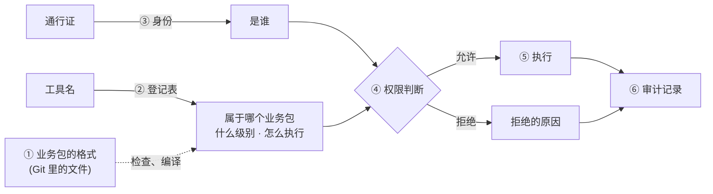

# 数据定义:原理与设计

九个模块能分开开发,靠的是先把它们之间传递的数据定下来。本文档定义六样:业务包的格式、登记表、身份、权限判断、执行的输入输出、审计记录。它们是整个平台最底下的一层,所有模块都依赖它们,它们不依赖任何模块。

**最小版本:记住这一条链。**



相关文档:[开发路线](开发路线.md) 第 3 节(七个约定)、[业务包接入协议](11-业务包接入协议-原理与设计.md)、[权限管理](12-权限管理-原理与设计.md)、[生产化与部署](14-生产化与部署-原理与设计.md)。

文件的格式用 YAML 表示,模块之间传递的数据用 JSON 表示。

## 0. 三条通用的规定

| 规定 | 内容 | 原因 |
| --- | --- | --- |
| 都带版本号 | 每一种数据结构都有 `schema` 或 `version` 字段 | 以后升级时,新旧两种可以同时存在,不用所有模块同一天改 |
| 只加不改 | 升级时只增加字段。已有字段不改名、不改含义、不删除 | 旧的模块读到新数据不会出错 |
| 认人只用一个标识 | 全平台用 `subject`(员工标识)认人 | 姓名会重、邮箱会变 |

## 1. 业务包的格式

业务包在 Git 里是一个文件夹,入口是 `pack.yaml`。完整说明见文档 11,这里给出定稿的字段。

```yaml
# packs/membership/pack.yaml
schema: 1                      # 格式的版本
id: membership                 # 唯一标识,小写字母和连字符
name: 用户、会员、权益
description: 用户账号、会员订阅、权益发放相关的问题排查和业务逻辑解答
owner: 基础服务组
contact: 负责人的联系方式
tool_prefix: member            # 本包所有工具名的前缀
default_enabled: true          # 对有权限的人是否默认启用

datasources: [member_mysql_ro, member_redis_ro]   # 只写名字

services:
  - id: member-service
    name: 会员服务
    repository: git@git.example.com:base/member-service.git
    path: /
    overview: docs/agent-overview.md
    deployment: member-service
    exclude: [config/secrets/]

tools:  [tools/orders.yaml, tools/membership.yaml]
guides: [guides/overview.md, guides/entitlement-missing.md]
evals:  [evals/cases.yaml]
```

工具定义,三种类型共用同一组基础字段:

```yaml
- name: member_get_order        # <前缀>_<动词>_<对象>
  title: 查询订单
  description: >                # 必须写清“做什么”和“什么时候用”
    按订单号查询一笔订单的支付状态、金额和支付时间。
    排查“付费后会员或权益没有到账”时首先使用。
  access: read                  # read 只读 / write 会改数据
  type: sql                     # sql / http / builtin
  params:
    - name: order_id
      type: string              # string / integer / boolean / datetime
      required: true
      description: 订单号,例如 O202611160001
  limits: { timeout_ms: 3000, max_rows: 20 }
  mask: [user_phone]            # 返回时要脱敏的字段

  # 以下按 type 三选一
  sql:
    datasource: member_mysql_ro
    query: |
      SELECT order_id, user_id, status, amount, paid_at
      FROM orders WHERE order_id = :order_id LIMIT 1
  # http:
  #   method: GET
  #   url: http://entitlement-service.internal/api/v1/users/{user_id}/entitlements
  #   fields: [entitlement_id, name, status, end_at]
  # builtin:
  #   handler: membership.diagnose_purchase
```

排查说明是 Markdown,开头带四个字段:

```yaml
---
id: entitlement-missing
title: 付费后权益未到账
when: 用户付了钱,但会员没有开通或权益没有加上。常见说法:“付了钱没开通”“权益没到账”
tools: [member_get_order, member_get_entitlement, log_search]
---
```

### 1.1 文件里放什么,不放什么

文件描述的是“这个业务包是什么”。运行中会变的东西不放在文件里。

| 内容 | 放哪里 | 原因 |
| --- | --- | --- |
| 工具定义、排查说明、仓库登记、考题 | 文件(Git) | 需要评审、历史和回滚 |
| 业务包上线、试用、停用 | 数据库,管理页面上操作 | 出问题要立即停用,不能等一次提交合并 |
| 谁能用、什么级别 | 数据库 | 管理员随时调整 |
| 同事自己启用了哪些 | 数据库 | 个人随时切换 |
| 数据源的账号、Git 的密钥 | 密钥管理 | 不能进 Git |
| 环境(测试、生产) | 部署 | 测试和生产是两套独立的部署,各自登记自己的数据源。工具没有“环境”这个参数 |

### 1.2 几条硬规定

- `access` 由写的人申报,评审时由平台确认。一期只允许 `read`,检查命令遇到 `write` 直接不通过。
- 查询语句只能是参数化的:参数只能作为值填进去,不能改变语句的结构。生产环境不提供“让模型自己写查询语句”的工具。
- `limits` 必填。日志类查询必须带时间范围。
- 工具名、服务标识全平台唯一。

## 2. 登记表

流水线把所有业务包检查、编译成一张登记表,写进数据库,带一个版本号。网关、执行框架、代码服务都只读它,不读文件。

```json
{
  "schema": 1,
  "version": "a1b2c3d",
  "built_at": "2026-11-16T10:00:00Z",
  "packs": {
    "membership": {
      "id": "membership",
      "name": "用户、会员、权益",
      "description": "……",
      "owner": "基础服务组",
      "default_enabled": true,
      "tools": ["member_get_order", "member_get_entitlement"],
      "guides": ["overview", "entitlement-missing"],
      "services": ["user-service", "member-service", "entitlement-service"]
    }
  },
  "tools": {
    "member_get_order": {
      "pack": "membership",
      "access": "read",
      "type": "sql",
      "title": "查询订单",
      "description": "……",
      "params": [],
      "limits": { "timeout_ms": 3000, "max_rows": 20 },
      "mask": ["user_phone"],
      "sql": { "datasource": "member_mysql_ro", "query": "……" }
    }
  },
  "guides": {
    "membership/entitlement-missing": {
      "pack": "membership",
      "title": "付费后权益未到账",
      "when": "……",
      "tools": ["member_get_order"],
      "body": "正文",
      "references": { "tables.md": "内容" }
    }
  },
  "services": {
    "member-service": {
      "pack": "membership",
      "repository": "……",
      "path": "/",
      "overview": "docs/agent-overview.md",
      "deployment": "member-service",
      "exclude": ["config/secrets/"]
    }
  }
}
```

| 规定 | 内容 |
| --- | --- |
| 按名字直接查 | 工具名全平台唯一,所以拿到工具名就能查到它属于哪个业务包、是什么级别、怎么执行 |
| 整张替换 | 登记表不做局部修改。内容更新后生成新的一版,各个网关实例整体切换 |
| 版本号就是内容仓库的提交号 | 能从一条审计追溯到当时的内容 |
| 保留历史版本 | 回滚就是把“当前版本”指回上一个 |
| 不含状态 | 业务包是否上线不在登记表里,在权限管理的数据库里(第 4 节) |

## 3. 身份

登录授权模块提供。网关在每次请求时调用:给一张通行证,返回这是谁。

验证成功:

```json
{
  "schema": 1,
  "valid": true,
  "kind": "user",
  "subject": "E10086",
  "name": "张三",
  "department": "基础服务组",
  "expires_at": "2026-11-16T11:00:00Z"
}
```

验证失败:

```json
{ "schema": 1, "valid": false, "reason": "expired" }
```

| 字段 | 含义 |
| --- | --- |
| `kind` | `user` 是真人;`service` 是评估这类自动程序 |
| `subject` | 员工标识。用 SSO 里稳定不变的那个 |
| `reason` | `missing` 没带、`expired` 过期、`invalid` 无效、`revoked` 已撤销 |

| 规定 | 内容 |
| --- | --- |
| 身份只来自验证过的通行证 | 绝不从工具的参数里取 |
| 这里只回答“你是谁” | 账号是否停用、有没有权限,都不在这里判断 |
| 通行证只对本平台有效 | 验证时检查它是不是发给本平台的 |

## 4. 权限判断

权限管理模块提供两个接口。

### 4.1 这一次调用允许吗

每次调用工具时问。

输入:

```json
{
  "schema": 1,
  "subject": "E10086",
  "pack": "membership",
  "tool": "member_get_order",
  "access": "read"
}
```

允许:

```json
{ "schema": 1, "allow": true, "level": "read" }
```

拒绝:

```json
{
  "schema": 1,
  "allow": false,
  "reason": "no_grant",
  "message": "你没有“用户、会员、权益”的使用权限",
  "apply_to": "基础服务组的负责人"
}
```

| `reason` | 含义 |
| --- | --- |
| `user_disabled` | 账号已停用 |
| `pack_disabled` | 业务包已停用 |
| `pack_trial` | 业务包在试用中,不对这个人开放 |
| `no_grant` | 没有这个业务包的权限 |
| `level_insufficient` | 有只读权限,但这个工具需要读写 |
| `not_enabled` | 有权限,但自己没有启用这个业务包 |

### 4.2 这个人现在能用什么

Claude Code 连接时问,用来生成工具列表和服务说明。

输入:

```json
{ "schema": 1, "subject": "E10086" }
```

输出:

```json
{
  "schema": 1,
  "packs": [
    { "pack": "platform", "level": "read" },
    { "pack": "membership", "level": "read" }
  ]
}
```

### 4.3 判断的规则

1. 默认拒绝,有授权才允许。
2. 一个人在多个组里,取其中最高的级别。
3. 账号停用、业务包停用,优先于任何授权。
4. 不设“明确禁止”这种记录。
5. 工具的 `access` 是 `write` 时,这个人对该业务包的级别必须是读写。
6. 判断结果最多缓存一分钟。
7. 权限服务不可用时,网关一律拒绝,不放行。

## 5. 执行的输入输出

工具执行框架提供。网关在权限通过之后调用。

输入:

```json
{
  "schema": 1,
  "request_id": "req_9f2c",
  "subject": "E10086",
  "tool": "member_get_order",
  "params": { "order_id": "O202611160001" }
}
```

输出:

```json
{
  "schema": 1,
  "status": "ok",
  "data": [ { "order_id": "O202611160001", "status": "PAID", "amount": 9900 } ],
  "truncated": false,
  "total": 1,
  "hint": "",
  "duration_ms": 42,
  "masked_fields": ["user_phone"]
}
```

`status` 有四种,必须分清:

| 取值 | 含义 | 模型应该怎么做 |
| --- | --- | --- |
| `ok` | 查到了 | 使用结果 |
| `empty` | 查询成功,确实没有数据 | 这是一个事实,可以据此推理 |
| `bad_param` | 参数不对 | 按 `hint` 改参数重试 |
| `error` | 执行失败:超时、数据源连不上、被限流、被熔断 | 不能当成“没有数据”。`hint` 里说明原因 |

把 `error` 和 `empty` 混在一起是最危险的错误:模型会把“查询失败”理解成“没有这条记录”,然后得出一个看起来很有道理的错误结论。

| 字段 | 含义 |
| --- | --- |
| `request_id` | 网关生成,贯穿网关、执行、代码服务、数据源和审计 |
| `truncated`、`total` | 结果超过上限时被截断,同时告诉模型一共有多少 |
| `hint` | 被截断或出错时,给模型的下一步建议,例如“请缩小时间范围” |

### 5.1 内置工具怎么挂进来

每个内置工具是一个函数,输入和输出与上面完全相同,按 `handler` 的名字登记到执行框架里。代码服务的三个工具、取排查说明的两个工具、提交反馈的一个工具,都按这个方式挂。

内置工具只管自己的本职。超时、限流、脱敏、截断、审计,都由执行框架和网关统一处理。

## 6. 审计记录

网关对每一次调用写一条,允许的和拒绝的都写。

```json
{
  "schema": 1,
  "request_id": "req_9f2c",
  "time": "2026-11-16T10:21:07Z",
  "subject": "E10086",
  "kind": "user",
  "pack": "membership",
  "tool": "member_get_order",
  "access": "read",
  "params_digest": { "order_id": "O2026…0001" },
  "decision": "allow",
  "deny_reason": "",
  "status": "ok",
  "rows": 1,
  "truncated": false,
  "duration_ms": 42,
  "registry_version": "a1b2c3d",
  "gateway_instance": "gateway-7c9d-x2k"
}
```

| 规定 | 内容 |
| --- | --- |
| 允许、拒绝、失败、超时都记 | 没有通过登录的请求也记,主体写“未知” |
| 只增加,不修改,不删除 | 查询和删除的权限单独控制 |
| 不记完整的结果 | 只记行数和状态。参数只记摘要,敏感的值打码 |
| 不记任何凭据 | 通行证、数据源账号都不出现 |
| 先记开始,再执行 | 审计写不进去时不执行,返回“平台暂不可用”并告警 |
| 带登记表版本 | 事后能知道那次调用用的是哪一版内容 |

## 7. 六样东西怎么串起来

以“张三查一笔订单”为例:

| 步骤 | 用到哪个定义 | 发生了什么 |
| --- | --- | --- |
| 1 | ③ 身份 | 网关拿通行证去验证,得到 `subject = E10086` |
| 2 | ② 登记表 | 网关用工具名 `member_get_order` 查表,得到它属于 `membership`,级别是 `read`,类型是 `sql` |
| 3 | ④ 权限判断 | 网关拿 `subject`、`pack`、`access` 去问,得到允许 |
| 4 | ⑥ 审计 | 写一条“开始” |
| 5 | ⑤ 执行 | 执行框架按登记表里的定义去查,返回 `status = ok` |
| 6 | ⑥ 审计 | 补上结果:行数、耗时、状态 |
| 7 | | 结果返回给张三的 Claude Code |

## 8. 待确认

- [ ] SSO 里哪个字段可以作为稳定不变的员工标识?
- [ ] 审计要保留多久?存在哪里?
- [ ] 登记表存在现有的 MySQL 里,还是另外的存储?

## 9. 自测

- [ ] 为什么每种数据结构都要带版本号?(第 0 节)
- [ ] 业务包是否上线,为什么不写在 `pack.yaml` 里?(第 1.1 节)
- [ ] 工具为什么没有“环境”这个参数?测试和生产怎么区分?(第 1.1 节)
- [ ] 登记表为什么整张替换,而不是改其中一条?(第 2 节)
- [ ] 身份接口为什么不判断“账号是否停用”?(第 3 节)
- [ ] `empty` 和 `error` 混在一起会导致什么?(第 5 节)
- [ ] 审计为什么要“先记开始,再执行”?(第 6 节)
