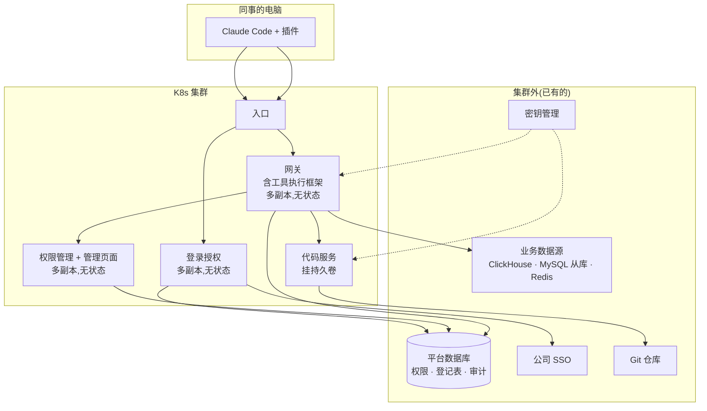

# 生产化与部署:原理与设计

这个平台要按生产系统来做。原则是一句话:**架构一步到位,功能分期上线。** 以后很难改的东西现在就做对;可以后加的功能仍然分期。本文档说明哪些属于前者,平台在 K8s 上怎么部署,以及上线前要补齐什么。

**最小版本:四件事。**

| 要做的 | 具体是什么 |
| --- | --- |
| 网关无状态 | 多个副本,任何请求落到任何一个都能处理 |
| 登记表入库 | 业务包在流水线里检查、编译,写进数据库,带版本号 |
| 保护数据源 | 每条查询有硬上限;按人、按工具限流;数据源出问题时熔断 |
| 看得见 | 指标、日志、告警;每次调用都有审计 |

相关文档:[数据定义](13-数据定义-原理与设计.md)、[开发路线](开发路线.md)、[一期二期规划](一期二期规划.md)。

## 1. 三类事情

| 类别 | 判断标准 | 例子 |
| --- | --- | --- |
| 现在就要做对 | 以后改,要动很多模块或迁移数据 | 网关无状态、数据定义带版本、审计的结构、环境隔离 |
| 上线前补齐 | 不影响架构,但没有就不能叫生产 | 多副本、监控告警、压测、安全评审 |
| 可以分期 | 是功能多少的问题,后加不用返工 | 按工具授权、业务自带 MCP、写操作 |

## 2. 现在就要做对的

| 方面 | 做法 |
| --- | --- |
| 网关无状态 | 不挂存储卷,不依赖本地文件,不在内存里保存会话。可以随时增减副本 |
| 登记表入库并带版本 | 见第 4 节 |
| 数据定义带版本 | 六种数据结构都有版本字段,只加不改(文档 13) |
| 请求标识贯穿全程 | 一个 `request_id` 从网关到执行、到代码服务、到数据源的查询注释、到审计 |
| 审计的结构一次定全 | 文档 13 第 6 节。只增不改 |
| 环境隔离 | 测试和生产是两套独立的部署,各有自己的数据源登记和数据库。工具没有“环境”参数 |
| 凭据分离 | 数据源账号、Git 密钥放密钥管理。每个服务只拿自己需要的 |
| 出错时默认拒绝 | 权限服务不可用、审计写不进去时,网关拒绝业务调用 |
| 代码服务独立部署 | 只有它需要持久存储 |
| 查询只用配置好的 | 生产环境不提供“让模型自己写查询语句”的工具 |
| 读写级别的字段留好 | 一期全部只读,但工具定义和授权记录里的级别字段从第一天就有 |

## 3. 在 K8s 上怎么部署

| 组件 | 形态 | 状态放哪 | 说明 |
| --- | --- | --- | --- |
| 网关(含工具执行框架) | 无状态,至少两个副本 | 登记表从数据库读;权限判断结果在内存里缓存最多一分钟 | 可以按负载自动增减副本 |
| 登录授权 | 无状态,至少两个副本 | 数据库 | |
| 权限管理和管理页面 | 无状态,至少两个副本 | 数据库 | 管理页面只在内网可访问 |
| 代码服务 | 单独部署,挂持久卷 | 代码快照在持久卷上 | 快照可以从 Git 重新生成,所以卷坏了不丢数据,只是要重新准备 |
| 仓库同步 | 代码服务里的后台任务 | 同上 | |
| 评估 | 不常驻。本地运行,或一个一次性任务 | 结果存文件 | |
| 平台数据库 | 用公司现有的高可用数据库 | | 不自己在集群里搭 |

凭据怎么分:

| 凭据 | 只给谁 |
| --- | --- |
| 业务数据源的只读账号 | 网关 |
| 仓库的只读部署密钥 | 代码服务 |
| 平台数据库的账号 | 网关、登录授权、权限管理,各用各的账号 |
| 业务包的内容 | 不含任何凭据 |

网关里没有 Git 密钥,代码服务里没有业务数据库账号。

网络上的限制:

| 规则 | 原因 |
| --- | --- |
| 只有网关能访问业务数据源 | 其他组件被攻破也碰不到业务数据 |
| 只有网关能访问代码服务 | 代码只能经过登录和权限检查后读到 |
| 只有网关能访问业务自带的 MCP 服务(二期) | 防止绕过网关 |
| 管理页面只在内网 | |

## 4. 登记表怎么送到网关

业务包在 Git 里是文件夹,但网关运行时不依赖文件夹。

| 环节 | 说明 |
| --- | --- |
| 检查和编译在流水线里做 | 网关里不放检查逻辑,不拉 Git,不带 Git 凭据 |
| 一个“当前版本”的指针 | 所有网关副本都认它,所以多副本之间是一致的 |
| 切换是整张替换 | 一个副本要么用旧版,要么用新版,不会出现一半新一半旧 |
| 回滚不用重新发布 | 把指针指回上一个版本 |
| 管理页面直接读它 | 展示每个业务包有哪些工具和说明 |

所以原来的“业务包加载与检查”模块分成两半:检查和编译是流水线里的一个命令;加载是网关里从数据库读一张表。

业务包的三种状态由管理员在管理页面上切换,存在数据库里,不经过上面这条流水线:

| 状态 | 含义 |
| --- | --- |
| 试用 | 只对指定的用户组开放。新业务包和大的改动先走这一步 |
| 已上线 | 按授权对同事开放 |
| 停用 | 对所有人立即不可用。出问题时一键操作 |

## 5. 保护线上的数据源

这是最容易被忽视的一项。Agent 和人不一样:一次排查可能连续发十几个查询,几十个人同时用就是几百个。只读不等于安全,慢查询一样能拖垮数据库。

| 保护 | 做法 | 在哪里做 |
| --- | --- | --- |
| 只连从库 | MySQL 走只读从库;ClickHouse 用专门的账号并设配额 | 数据源的登记 |
| 每条查询有硬上限 | 超时、返回行数。数据库那边也设一层,两边都限制 | 工具执行框架;数据库账号 |
| 按人限流 | 一个人每分钟最多调用多少次 | 网关 |
| 按工具限并发 | 一个工具同时最多多少个在执行 | 工具执行框架 |
| 按数据源限并发 | 一个数据源同时最多多少个查询 | 工具执行框架 |
| 熔断 | 一个数据源连续出错或变慢时,暂停对它的调用一小段时间,直接返回“服务异常” | 工具执行框架 |
| 一键停用 | 管理页面上能立即停用一个工具或一个业务包 | 权限管理 |

被限流和被熔断时,返回的状态是 `error`,并在提示里说明原因。不能返回成“没有数据”。

限流和熔断的具体数字,要在压测之后定。

## 6. 看得见:指标、日志、告警

| 类别 | 内容 |
| --- | --- |
| 指标 | 调用量;耗时;每个工具的错误率;拒绝率及原因的分布;被限流和被熔断的次数;当前的登记表版本 |
| 日志 | 每条都带 `request_id`。不记通行证、账号和完整的查询结果 |
| 链路 | 一次调用在网关、权限判断、执行、数据源各花了多久 |
| 审计 | 每次调用一条,见文档 13 第 6 节 |

需要告警的情况:

| 情况 | 说明 |
| --- | --- |
| 错误率或耗时超过阈值 | |
| 某个数据源被熔断 | 可能是数据源出了问题,也可能是有人在滥用 |
| 审计写入失败 | 此时网关在拒绝请求 |
| 权限服务不可用 | 同上 |
| 某个人的调用量异常高 | |
| 登记表加载失败,或各副本的版本不一致 | |

公司已有的监控、日志和告警平台直接接入,不另外搭。

## 7. 上线前要补齐的

| 方面 | 内容 |
| --- | --- |
| 高可用 | 无状态的组件至少两个副本;有健康检查;发布时逐个替换,不中断正在进行的调用 |
| 发布与回滚 | 网关先发一部分副本,观察后再全部发;登记表按版本回滚;新业务包先走试用状态 |
| 压测 | 按预期人数的几倍来压。确认限流和熔断真的会生效,数据源没有被拖慢 |
| 安全评审 | 登录流程;查询注入;代码服务的路径穿越;脱敏规则;凭据的存放;提示注入的应对 |
| 备份与恢复 | 权限数据、审计、登记表的备份。演练一次恢复 |
| 数据库变更 | 表结构的变更有脚本,能向前也能回退 |
| 运维手册 | 常见故障怎么处理;谁值班;怎么紧急停用 |
| 多副本验证 | 起两个网关副本,确认 Claude Code 的连接和调用正常,不要求同一个会话始终落在同一个副本上 |

最后一项需要实测,和阶段 0 的登录试验一起做。

## 8. 仍然可以分期的功能

这些后加不需要返工,因为字段和位置已经留好:

| 功能 | 一期留了什么 |
| --- | --- |
| 写操作 | 工具的 `access` 字段;授权记录的级别字段 |
| 按工具授权 | 授权记录的“工具范围”字段 |
| 业务自带 MCP | 业务包格式里的登记方式;工具有“待批准”的概念 |
| 权限的申请和审批;各业务自己的管理员 | 修改记录;用户的角色字段 |
| 代码搜索引擎、语义检索 | 代码服务里搜索是独立的一部分 |
| 网页版、自研运行时、Codex | 网关只认 MCP 协议和通行证,不假设调用方是谁 |

## 9. 对模块的影响

[开发路线](开发路线.md) 的九个模块不变,有四处调整:

| 模块 | 调整 |
| --- | --- |
| 5 业务包加载与检查 | 分成两半:检查和编译在流水线里;加载在网关里,从数据库读 |
| 6 工具执行框架 | 增加限流、并发控制、熔断 |
| 8 代码服务 | 确定为独立部署的服务,网关通过内部接口调用 |
| 新增一项横向的工作 | 部署、流水线、指标和告警。它不是业务模块,但要有人负责,从模块 1 开始就一起做 |

开发时用的临时令牌只允许出现在开发环境。

## 10. 待确认

- [ ] 预计多少人使用?这决定副本数和限流的数字。
- [ ] 平台不可用时影响有多大?同事可以回去手工查,还是会卡住线上问题的处理?这决定可用性的目标。
- [ ] 公司有没有现成的:密钥管理、监控告警、日志平台、发布流水线?
- [ ] 平台数据库用现有的 MySQL 集群吗?
- [ ] 审计保留多久?有没有合规方面的要求?
- [ ] ClickHouse 和 MySQL 从库的负责人能不能为平台的账号设置配额和超时?

## 11. 自测

- [ ] “架构一步到位,功能分期上线”是什么意思?各举一个例子。(第 1 节)
- [ ] 网关为什么要做成无状态的?登记表和权限缓存放在哪里?(第 2、3 节)
- [ ] 为什么只有代码服务需要持久卷?卷坏了会丢数据吗?(第 3 节)
- [ ] 改了一份排查说明,它是怎么到达每个网关副本的?怎么回滚?(第 4 节)
- [ ] 所有工具都是只读的,为什么还需要限流和熔断?(第 5 节)
- [ ] 被熔断时返回“没有数据”会有什么后果?(第 5 节)
- [ ] 哪些情况需要告警?(第 6 节)
