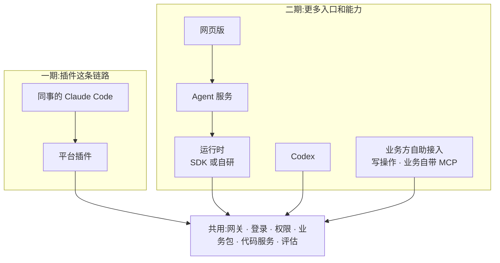

# 一期二期规划

一期的形态是 Claude Code 插件:同事装上平台唯一的插件,用公司账号登录一次,就能排查用户、会员、权益三个服务的问题,并询问它们的业务逻辑。一期按生产系统来做:架构一步到位,功能分期上线。网页版、自研运行时、Codex 放在二期。

总纲见 [架构总览](架构总览.md),模块和执行顺序见 [开发路线](开发路线.md)。

## 1. 两期的分工

| | 一期 | 二期 |
| --- | --- | --- |
| 使用方式 | Claude Code 插件 | 增加网页版、Codex |
| 平台做的 | 网关、登录、权限管理、业务包机制、代码服务、评估 | 另外加上对话页面、Agent 服务、运行时 |
| 接入的业务 | 用户、会员、权益(平台代接) | 其他业务,业务方自助接入 |
| 操作 | 全部只读 | 增加受控的写操作 |
| 原则 | 架构按生产来,以后难改的现在做对 | 在一期的架子上增加,不推倒重来 |

## 2. 一期范围

### 2.1 做什么

| 部分 | 一期内容 | 设计 |
| --- | --- | --- |
| 使用方式 | 一个插件,一个网关地址,登录一次 | 文档 09 |
| 问题类型 | 规则解释与接入(“某某业务逻辑是什么”);针对具体用户的排查(“我付费了,权益为什么没加上”) | 入口文档第 4 节 |
| 网关核心 | 一条流水线:认人、限流、找工具、问权限、审计、执行、整理结果;按人生成工具列表和服务说明 | 文档 15 |
| 登录 | 平台的 OAuth 页,背后接公司 SSO | 文档 09 第 6 节 |
| 权限 | 管理页面;管理员把业务包授权给用户组;每次调用都检查;修改有记录 | 文档 12 |
| 业务包机制 | 接入协议;检查和编译的命令;登记表入库并带版本 | 文档 11、13、14 |
| 工具执行 | 三种类型:配置的数据库查询、配置的接口调用、平台内置。超时、上限、脱敏、限流、熔断 | 文档 11、14 |
| 业务包 | 两个:公共包(查日志、发布记录、取排查说明、代码查询、提交反馈)和基础业务包(用户、会员、权益的工具、排查说明、仓库登记、考题) | 文档 11 |
| 代码 | 三个仓库的代码按版本存在平台上,通过三个通用工具搜索和读取 | 文档 10 |
| 评估 | 考题;用命令行方式批量提问;人工判断 | 文档 02 |
| 生产化 | K8s 部署;网关无状态多副本;指标、日志、告警;测试和生产两套独立的部署 | 文档 14 |

### 2.2 不做什么

| 不做 | 一期的做法 | 归属 |
| --- | --- | --- |
| 网页版:对话页面、Agent 服务、运行时 | 同事使用 Claude Code 自己的界面 | 二期已确定 |
| 自研运行时、选择 Agent | 运行时就是同事本地的 Claude Code | 二期已确定 |
| Codex 支持 | 只支持 Claude Code。排查说明不写只有 Claude Code 才认识的内容 | 二期已确定 |
| 业务方自助接入;同事自己选择启用哪些业务 | 两个业务包由平台代接,对有权限的人默认启用 | 二期已确定 |
| 业务自带 MCP 服务的转发 | 工具全部由平台执行。协议里已定好格式 | 二期已确定 |
| 写操作 | 全部只读。读写级别的字段已留好 | 二期候选 |
| 按工具授权;权限的申请和审批;各业务自己的管理员 | 按业务包授权给用户组,由平台管理员操作 | 二期候选 |
| 让模型自己写查询语句 | 所有查询都是配置好的、参数化的 | 不做 |
| 代码搜索引擎、向量库、服务器上的代码分析 Agent | 在代码快照上做文本搜索 | 二期候选 |
| 整体异常排查(“失败率为什么升高”) | 可以尝试,不作为验收内容 | 二期候选 |
| 检索与记忆、截图上传、模型网关 | 不涉及 | 二期候选 |
| 自动判分 | 人工判断 | 二期候选 |

## 3. 一期的里程碑

里程碑和 [开发路线](开发路线.md) 的模块、合流点一一对应。具体每个模块做什么、怎么验收,以开发路线为准。

| 里程碑 | 内容 | 对应开发路线 | 完成标志 |
| --- | --- | --- | --- |
| M0 验证 | 阶段 0 的六项验证;申请只读账号和部署密钥;开始记题目表 | 阶段 0 | 结果表填完;登录试验通过;三个真实案例能手工串起整条链路 |
| M1 架子通 | 网关核心、插件、登录授权、权限管理、业务包的检查编译和加载、工具执行框架 | 模块 1 至 6;合流点一、二 | 一个样例业务包,不改网关代码,登录后能在 Claude Code 里查到真实日志;在管理页面上撤销权限后查不到 |
| M2 业务通 | 公共包和基础业务包的内容;代码服务 | 模块 7、8;合流点三 | “付费后权益未到账”能沿链路给出带证据的结论;本机没有仓库也能回答业务逻辑问题,代码证据带版本和行号 |
| M3 评估与改进 | 评估脚本;每周一轮“看错题、改一样、重跑” | 模块 9 | 一条命令跑完全部考题;至少三轮改进记录 |
| M4 上线准备与试用 | 文档 14 第 7 节的上线前清单;请两三位同事试用一到两周 | 整体流程 | 清单逐项完成;同事自己装好并用起来;收到真实反馈 |
| M5 一期评审 | 汇总数据和意见,确定二期范围 | | 一份一期总结和二期范围 |

部署、流水线、指标和告警不单独成为一个里程碑,从 M1 开始和模块一起做。

## 4. 一期评审

二期的范围由三类输入决定:

| 输入 | 内容 |
| --- | --- |
| 你的意见 | 学习手册里每个模块的“我的意见”;对整体设计和使用体验的意见 |
| 评估数据 | 各类问题的结果;错题原因的分类及占比 |
| 使用数据 | 同事提交的反馈;网关的调用统计;同事提出的需求 |

评审时逐项回答:

- 哪类问题答得好,哪类答得差?差的主要原因是缺工具、缺说明、缺资料,还是推理错误?
- 同事实际问的问题,和一期设定的两类问题一致吗?
- 有多少同事想用但用不了(没有 Claude Code、不习惯命令行)?这决定网页版的优先级。
- 排查说明放在云端,模型主动去取的比例够不够?
- 代码查询够不够快?有没有“关键词反复搜不到”的情况?
- 再接一个新业务,是不是真的不用改平台代码?

## 5. 二期已确定的方向

| 方向 | 是什么 | 一期为它留了什么 |
| --- | --- | --- |
| 网页版与自研运行时 | 第二条调用链:对话页面、Agent 服务、平台上的运行时。为不使用 Claude Code 的同事,以及对运行时实现的学习 | 网关只认 MCP 协议和通行证,不假设调用方是谁;代码查询和排查说明都在云端,不依赖同事的电脑 |
| 业务方自助接入 | 业务团队自己写业务包,提交给平台检查;同事自己决定启用哪些 | 接入协议和检查命令;“启用”这张表;业务包的试用状态 |
| 业务自带 MCP | 业务自己运行 MCP 服务,网关转发;新工具经批准才开放 | 协议里的登记格式;执行框架可以增加一种执行方式 |
| Codex 支持 | 同一个网关和同一份内容,给 Codex 用 | 网关走标准的 MCP 协议;排查说明不依赖 Claude Code |

网页版的早期设计在 `参考` 目录里。

## 6. 二期候选

以下不是承诺。排序和取舍在一期评审时决定。

| 方向 | 候选内容 | 什么数据支持做它 |
| --- | --- | --- |
| 写操作 | 补发权益、重新投递消息等,执行前由同事确认 | 排查结论稳定可靠,且同事希望一步到位 |
| 权限深化 | 按工具授权;申请和审批;各业务自己的管理员 | 业务方接入后,需要更细地区分谁能做什么 |
| 代码查询深化 | 搜索引擎;符号导航;语义检索;历史和灰度版本的自动解析 | 仓库变多或搜索变慢;错题里“找不到代码”占比高 |
| 更多问题类型 | 整体异常排查;监控工具;报警自动触发排查 | 同事实际在问这类问题 |
| 评估深化 | 自动判分与校准;留出集;把评估作为合并的条件 | 题目积累到几十道以上;人工判断成为负担 |
| 检索与记忆 | 排查经验的检索;受控的记忆 | 错题中“找不到资料”占比高;同类问题反复出现 |

## 7. 文档怎么用

| 文档 | 角色 |
| --- | --- |
| [架构总览](架构总览.md) | 总纲和设计决定清单。说法不一致时以它为准 |
| 本文档 | 两期各做什么、里程碑、评审方式 |
| [开发路线](开发路线.md) | 九个模块、七个约定、执行顺序、阶段 0 的验证清单 |
| 文档 09 至 15、文档 02 | 各模块的设计。对应关系见架构总览第 8 节 |
| [一期学习手册](一期学习手册.md) | 按模块的学习顺序、评审要点和意见记录 |
| `参考` 目录 | 早期的设计和二期才用到的专题 |
