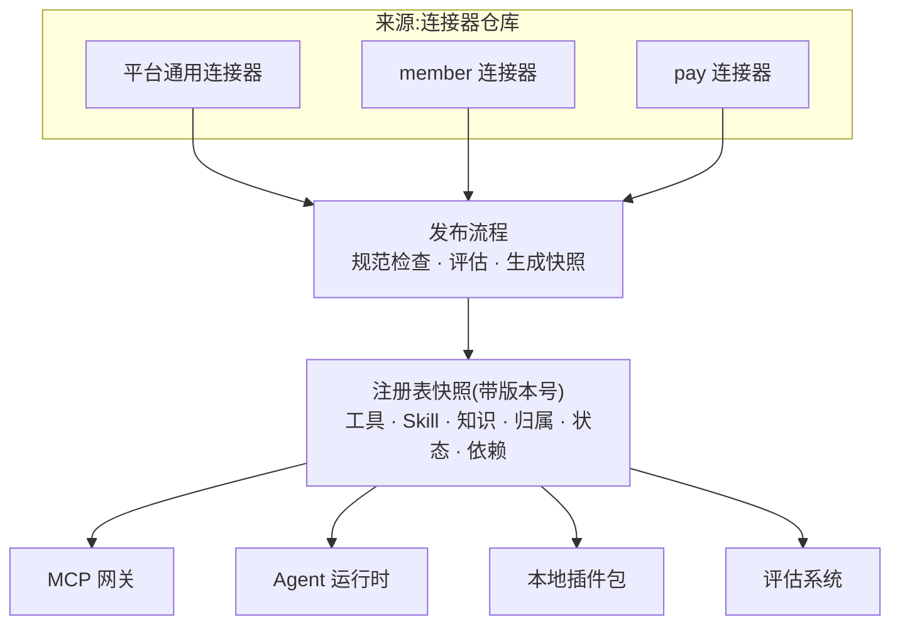
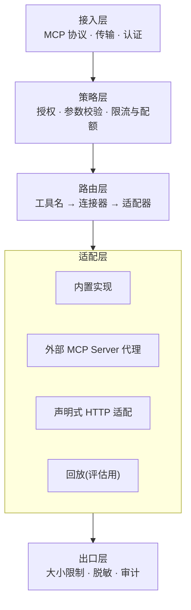

# MCP 网关与 Skill 管理:原理与设计

> 说明:本文档中的“连接器”,在后来的设计里改名为“业务包”,含义相同:一个业务交给平台的那一包东西(工具、排查说明、代码仓库登记、考题)。格式以 [11-业务包接入协议](../11-业务包接入协议-原理与设计.md) 为准。

工具和 Skill 变乱,原因通常不是数量多,而是没有归属、没有唯一来源、没有生命周期。本设计用一个注册表作为唯一来源,所有工具和 Skill 都归属于某个连接器,经过同一个发布流程进入网关和运行时。

相关文档:[总体设计](01-总体设计.md)、[连接器接入规范](04-连接器接入规范-原理与设计.md)、[自研运行时](03-自研运行时-原理与设计.md)、[评估系统](../02-评估系统-原理与设计.md)。

## 1. 为什么会乱,以及对应的办法

| 乱的表现 | 根本原因 | 对应的设计 |
| --- | --- | --- |
| 同一件事有好几个工具,名字相近,模型选不准 | 没有命名规则,新增时没人检查是否重复 | 命名空间加受限的动词表;发布前自动检查相似工具(第 3.3 节) |
| 不知道某个工具或 Skill 是谁的、还有没有人用 | 没有归属,没有使用统计 | 一切归属于连接器,连接器有负责人;按工具和 Skill 统计使用量(第 2、6 节) |
| Skill 里引用的工具已经改名或下线 | Skill 和工具之间的依赖没有记录 | Skill 声明依赖的工具,发布时校验;工具下线前列出受影响的 Skill(第 4.3 节) |
| 平台上、本地插件里、文档里的版本不一致 | 多处各自维护 | 一个来源,发布时生成快照,所有渠道使用同一个快照(第 5 节) |
| 工具越加越多,上下文越来越大,效果变差 | 全量加载,只增不减 | 按任务过滤加载;有生命周期和下线机制(第 3.4、3.5、4.4 节) |
| 改了一个 Skill,不知道有没有把别的弄坏 | 变更没有经过评估 | 所有变更走同一个发布流程,评估是必经环节(第 5 节) |
| 网关代码里混着各业务的逻辑 | 业务逻辑和平台逻辑没有分开 | 网关核心不含业务代码,业务逻辑只在连接器里(第 3.1 节) |
| 同样的内容在工具说明、Skill、常驻说明里各写一遍 | 没有规定什么内容放在哪里 | 内容归位规则(第 4.1 节) |

## 2. 统一的模型:注册表是唯一来源



三条规则:

1. **一切归属于连接器。** 不存在不属于任何连接器的工具或 Skill。连接器有负责人,所以每个工具和 Skill 都能找到人。
2. **注册表是唯一来源。** 网关有哪些工具、运行时能加载哪些 Skill、本地插件里打包了什么,都从同一个注册表快照生成。不允许在网关或运行时里单独添加。
3. **只有发布流程能改注册表。** 没有后台页面的直接编辑入口。每次变更都经过检查和评估,都有版本号,都能回退。

注册表里每一项记录的内容:

| 字段 | 工具 | Skill |
| --- | --- | --- |
| 标识 | 工具名(含业务前缀) | Skill 名(含业务前缀) |
| 归属 | 连接器、负责人 | 连接器、负责人 |
| 状态 | 草稿、实验、正式、废弃、已下线 | 同左 |
| 版本 | 定义内容的版本与校验值 | 内容的版本与校验值 |
| 依赖 | 后端系统、所需权限范围 | 依赖的工具列表 |
| 属性 | 是否只读、返回字段的敏感级别、超时与大小上限 | 适用的应用、对应的案例类型 |
| 运营数据 | 调用量、错误率、最近使用时间 | 加载次数、命中率、最近使用时间 |

## 3. MCP 网关的设计

### 3.1 分层



| 层 | 职责 | 不做什么 |
| --- | --- | --- |
| 接入层 | 实现 MCP 协议;认证,得到调用者身份 | 不关心调用的是哪个工具 |
| 策略层 | 判断调用者能否对目标应用和环境使用这个工具;校验参数结构;限流 | 不了解工具的业务含义 |
| 路由层 | 根据注册表,把工具名映射到连接器和适配器 | 不包含任何 if 某业务 then 的分支 |
| 适配层 | 真正执行:调用内置实现、转发给外部 MCP Server、按描述文件调用 HTTP 接口,或在评估时返回快照 | 不做权限判断,不做脱敏 |
| 出口层 | 按上限截断并标注;按字段敏感级别脱敏;写审计 | 不改变结果的业务含义 |

核心约束:**接入、策略、路由、出口四层是平台代码,不出现任何业务名词;业务逻辑只存在于适配层后面的连接器里。** 判断标准很简单:新增一个业务,这四层的代码一行都不用改。

### 3.2 控制面与数据面

| | 控制面 | 数据面 |
| --- | --- | --- |
| 做什么 | 管理注册表:接收变更、检查、评估、生成并发布快照 | 处理每一次工具调用 |
| 变化频率 | 低,每次发布变一次 | 高,每个请求 |
| 状态 | 有状态(注册表、版本历史) | 无状态,多实例 |
| 故障影响 | 不能发布新变更,已有调用不受影响 | 调用失败 |

网关实例启动时加载一个注册表快照,之后按快照处理请求。发布新快照时所有实例切换到新版本;出问题时切回上一个快照。这样任何时刻所有实例的工具集合是一致的,也都能说清“当前是哪个版本”。

### 3.3 工具的命名空间

- **格式。** `<业务前缀>_<动词>_<对象>`,例如 `member_get_status`、`logs_search`。
- **前缀注册。** 前缀在连接器注册时分配,全局唯一。平台通用连接器使用功能前缀(`logs`、`metrics`、`deploy`、`alerts`、`app`)。
- **动词表受限。** 只允许一小组动词,含义固定:

| 动词 | 含义 |
| --- | --- |
| `get` | 按唯一标识取一条 |
| `list` | 按条件列出多条,有分页 |
| `search` | 按关键字或模糊条件查找 |
| `count` | 统计数量或分布 |
| `diagnose` | 面向一个问题,汇总多个来源的信息 |
| `diff` | 比较两个版本或两个时间点 |

- **重复检查。** 发布前自动比较新工具与同一连接器内已有工具的名称、说明和参数,相似度高时要求说明区别,或合并。
- **一个连接器可以包含多个服务的工具。** 例如基础业务连接器包含用户、会员、权益三个服务,工具前缀取到服务这一级(`user_`、`member_`、`entitlement_`),这些前缀都登记在该连接器名下。连接器内部按服务分组存放工具和 Skill。
- **数量上限。** 上限按组计算:一个服务的工具数有上限,到了上限说明该合并。连接器整体的工具数只作为加载时的参考,不作硬性限制。

### 3.4 每个会话看到的工具集合

网关不把全部工具返回给每个会话。返回的集合由三个条件相交得到:

| 条件 | 来源 |
| --- | --- |
| 调用者有权限的 | 应用成员关系 |
| 当前任务相关的 | 任务涉及的应用,加上该连接器声明的依赖,加上平台通用连接器 |
| 状态允许的 | 正式状态对所有人;实验状态只对白名单 |

另外提供一个始终可见的 `tools_search` 工具。排查过程中需要用到其他业务的工具时,Agent 用它按描述查找并申请加载,加载仍受权限约束。

### 3.5 工具的生命周期


| 状态变化 | 条件 |
| --- | --- |
| 草稿到实验 | 通过规范检查 |
| 实验到正式 | 通过评估;安全检查通过 |
| 正式到废弃 | 负责人发起,或长期无人使用被标记。废弃期间工具说明里注明替代工具 |
| 废弃到下线 | 过了约定的保留期,并且没有 Skill 再依赖它 |
| 自动退回实验 | 错误率或评估分数跌破阈值 |

变更分两类:增加可选参数、补充说明属于兼容变更,提升版本号即可;删除参数、改变返回结构、改变含义属于破坏性变更,必须发布成新工具,旧工具进入废弃。

### 3.6 网关不做的事

- 不决定调用哪个工具,那是模型的事。
- 不存储业务数据。
- 不包含业务逻辑。
- 不提供绕过发布流程添加工具的入口。

## 4. Skill 管理的设计

### 4.1 内容归位:什么内容放在哪里

同一条信息只写在一个地方。写之前先判断它属于哪一类:

| 内容 | 放在哪里 | 判断标准 |
| --- | --- | --- |
| 这个工具做什么、什么时候用、参数怎么填 | 工具说明 | 只和这一个工具有关 |
| 遇到某类问题怎么排查、先查什么后查什么、怎样才算查清 | Skill | 涉及多个工具的配合,或需要判断 |
| 所有任务都要遵守的规则、输出格式、全局业务常识 | 常驻说明 | 每个任务都用得上 |
| 接口文档、错误码表、业务规则的细节 | 知识文档或 Skill 的附属文件 | 篇幅长,只在特定情况下需要 |
| 当前任务的应用、环境、时间、版本 | 任务信息,由代码注入 | 每个任务不同 |

常见的错位:把排查流程写进工具说明(工具说明变长,每次都占上下文);把某个业务的规则写进常驻说明(其他业务的任务也被迫带着)。

### 4.2 Skill 的结构与分层

每个 Skill 是一个目录:

| 文件 | 内容 |
| --- | --- |
| `SKILL.md` 头部 | 名称、描述(适用场景)、所属连接器、负责人、版本、依赖的工具、状态 |
| `SKILL.md` 正文 | 常见原因类别、排查思路、判断标准、停止条件和证据要求 |
| `references/` | 错误码表、字段含义等细节,正文注明何时读取 |

Skill 分三层,每层回答不同的问题:

| 层 | 归属 | 回答的问题 | 例子 |
| --- | --- | --- | --- |
| 平台层 | 平台通用连接器 | 排查问题的通用方法 | 如何判断问题是否由发布引起 |
| 领域层 | 某个业务连接器 | 这个业务的整体情况 | 会员服务的状态流转和上下游关系 |
| 场景层 | 某个业务连接器 | 某一类具体问题怎么查 | 付款成功但会员未生效 |

规则:**一类问题只对应一个场景层 Skill。** 发布前自动比较新 Skill 的描述与已有 Skill 的描述,重叠度高时要求合并或写明分工。两个 Skill 都自称适用同一类问题,模型就会选不准。

### 4.3 Skill 与工具的依赖

- Skill 在头部声明它依赖的工具名。
- 发布时校验:声明的工具存在且状态为正式;正文中出现的工具名都在声明里。
- 工具要废弃时,注册表列出所有依赖它的 Skill,通知这些 Skill 的负责人。
- Skill 只能依赖本连接器的工具、平台通用工具、以及清单中声明的依赖连接器的工具。

### 4.4 Skill 的加载

- 任务开始时,按任务涉及的应用过滤,把相关 Skill 的名称和描述写进系统提示。平台层 Skill 始终在列。
- 描述清单的条数有上限。超出时改为两级:先列出各领域的一行说明,模型选定领域后再读取该领域的 Skill 清单。
- 正文和附属文件由模型用读文件工具按需读取,运行时不主动加载。

### 4.5 Skill 的质量与生命周期

状态与工具相同:草稿、实验、正式、废弃、已下线。

每个 Skill 持续跟踪四个数:

| 指标 | 含义 | 说明什么 |
| --- | --- | --- |
| 命中率 | 该用它的案例中,实际读取了正文的比例 | 描述写得好不好 |
| 加载后的成功率 | 读取了正文的任务中,结论正确的比例 | 正文有没有用 |
| 最近使用时间 | 线上最后一次被加载的时间 | 是否还有人需要 |
| 最近更新时间 | 内容最后一次修改的时间 | 是否可能过时 |

评估案例标注“期望用到的 Skill”,命中率由此计算。长期未被使用、或长期未更新而对应的工具已经变过的 Skill,自动标记并通知负责人。

## 5. 仓库结构与发布流程

### 5.1 仓库结构

一个业务的所有东西放在一个目录里,目录就是连接器。

```
connectors/
  _platform/                 平台通用连接器
    logs/
    metrics/
    deploy/
    skills/
      release-related-issue/
  member/                    一个业务连接器
    connector.yaml           清单:负责人、前缀、权限范围、依赖
    tools/
      tools.yaml             工具定义(声明式)或指向 MCP Server
    skills/
      overview/              领域层
        SKILL.md
      entitlement-missing/   场景层
        SKILL.md
        references/
    knowledge/
      index.md
    evals/
      cases/
      snapshots/
  pay/
    ...
gateway/                     网关核心,不含业务代码
runtime/                     常驻说明、运行配置
registry/                    发布流程生成的快照,不手工编辑
```

好处:

- 想知道一个业务有什么,看一个目录。
- 目录级别的负责人设置,让每个业务的变更自动由该业务的人审核。
- 删除一个业务,删一个目录。
- 业务方自己仓库里的连接器,用同样的目录结构,发布时同步进来。

### 5.2 发布流程


| 环节 | 内容 |
| --- | --- |
| 规范检查 | 命名与前缀、动词表、说明完整性、参数结构、Skill 头部字段、Skill 与工具的依赖、内容归位(工具说明过长、常驻说明出现业务名词时告警)、重复与重叠检查 |
| 受影响范围分析 | 根据变更的文件,确定要跑哪些评估:改某个业务的 Skill 只跑该业务的案例;改平台通用连接器或常驻说明跑全部 |
| 评估 | 分数不下降、越权拦截率保持 100%、成本无明显上升 |
| 生成快照 | 把所有连接器的当前内容汇总成一个带版本号的注册表快照 |
| 发布 | 网关实例加载新快照;运行时挂载对应版本的 Skill 和知识目录;生成同版本的本地插件包 |
| 回退 | 切回上一个快照,三个渠道同时回退 |

每个任务的记录里保存当时的快照版本号。出问题时可以确切知道那次任务用的是哪一版工具和 Skill。

## 6. 运营视图

一张按连接器组织的看板,回答“现在是什么状况”:

| 视图 | 内容 |
| --- | --- |
| 连接器列表 | 负责人、状态、工具数、Skill 数、评估分数、最近发布时间 |
| 工具 | 调用量、错误率、响应时间、返回大小、最近使用时间;标出长期未使用的 |
| Skill | 命中率、加载后的成功率、最近使用和更新时间;标出可能过时的 |
| 依赖 | 哪些 Skill 依赖哪些工具;废弃工具的影响范围 |
| 变更历史 | 每个快照版本包含的变更和评估结果 |

## 7. 分步实现与验收

第一期只有平台自己的几个连接器,不需要一次建全。但目录结构、命名规则、“只通过发布流程变更”这三点从第一天就要遵守,之后补机制时不用返工。

| 步骤 | 范围 | 验收 |
| --- | --- | --- |
| G1 | 仓库目录结构;清单和 Skill 头部格式;命名规则;网关五层的骨架和内置适配器 | 新增一个工具时,接入、策略、路由、出口四层的代码不需要改动 |
| G2 | 规范检查脚本;发布流程接入评估;注册表快照的生成与加载 | 所有变更经流程发布;能说出线上当前的快照版本并回退到上一版 |
| G3 | Skill 与工具的依赖校验;内容归位检查;重复与重叠检查 | 引用不存在的工具、重复的工具、重叠的 Skill 在发布前被拦下 |
| G4 | 按会话过滤工具集合;`tools_search`;Skill 按应用过滤和两级清单 | 工具和 Skill 总数增长后,单个任务加载的数量保持在上限内,评估分数不下降 |
| G5 | 生命周期状态与自动降级;使用统计;运营看板 | 长期未使用的工具和可能过时的 Skill 被自动标出 |
| G6 | 外部 MCP Server 代理和声明式适配器;业务方仓库的同步 | 业务方自助接入的连接器与平台自己的走同一个流程 |

## 8. 理解检查

- [ ] 为什么要规定“只有发布流程能改注册表”,不提供一个方便的后台编辑页面?(第 2 节)
- [ ] 怎样判断网关核心里有没有混入业务逻辑?(第 3.1 节)
- [ ] 控制面出故障和数据面出故障,影响分别是什么?(第 3.2 节)
- [ ] 为什么要限制动词表?不限制会出现什么情况?(第 3.3 节)
- [ ] 一段“会员未到账先查回调再查对账”的内容,应该放在工具说明、Skill 还是常驻说明里?为什么?(第 4.1 节)
- [ ] 一个工具要下线,怎么知道会影响哪些 Skill?(第 4.3 节)
- [ ] 命中率低和加载后的成功率低,分别说明什么问题、该改哪里?(第 4.5 节)
- [ ] 平台、本地插件两处的 Skill 版本怎样保证一致?(第 5.2 节)
