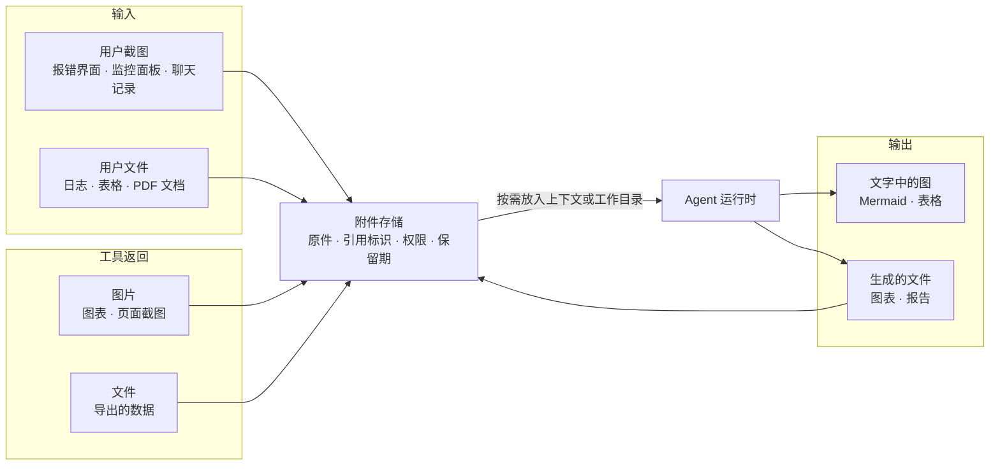
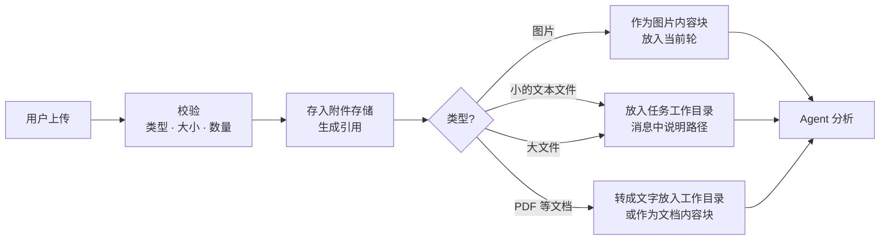

# 多模态:原理与设计

> 说明:本文档中的“连接器”,在后来的设计里改名为“业务包”,含义相同:一个业务交给平台的那一包东西(工具、排查说明、代码仓库登记、考题)。格式以 [11-业务包接入协议](../11-业务包接入协议-原理与设计.md) 为准。

多模态内容从三个方向进入系统:用户发来的截图和文件、工具返回的图片、Agent 产出的图表。设计的核心是把“内容本身”和“对内容的引用”分开:原始文件存在外部,上下文里只在需要的那一轮放入原件,其余时候只保留文字描述和引用。

相关文档:[上下文与多轮会话](06-上下文与多轮会话-原理与设计.md)、[自研运行时](03-自研运行时-原理与设计.md)、[连接器接入规范](04-连接器接入规范-原理与设计.md)、[MCP 网关与 Skill 管理](05-MCP网关与Skill管理-原理与设计.md)。

## 1. 基本理念

| 理念 | 含义 | 对设计的影响 |
| --- | --- | --- |
| 文件不等于上下文 | 用户上传了一个文件,不代表它要整个进入模型的上下文 | 文件先落到存储和任务工作目录,由 Agent 决定读哪部分、怎么读 |
| 原件只在需要时出现 | 图片占用的上下文远大于它的文字描述 | 图片只在被分析的那一轮以原件出现,之后替换成描述加引用 |
| 结构化数据优先于图片 | 模型从数字里读结论比从图里读更准,也更省 | 能拿到数据的地方不传图。监控工具返回数字摘要,不返回图表截图 |
| 能力因模型和运行时而异 | 不是每个模型都能看图,不是每个运行时都以同样方式接收图片 | 能力要声明,不满足时有明确的降级路径 |
| 图片里的文字也是不可信输入 | 截图里可以写着指令 | 与工具返回同等对待:是数据,不是指令 |
| 图片无法用规则脱敏 | 正则表达式处理不了截图里的手机号 | 图片的敏感数据控制要前移到来源和权限上 |
| 消息从一开始就是内容块 | 把消息定义成一段字符串,之后加图片要改所有接口 | 所有接口里的消息都是内容块的列表,即使第一期只有文字 |

## 2. 三个方向

| 方向 | 典型内容 | 第一期 |
| --- | --- | --- |
| 用户输入 | 报错截图、监控面板截图、日志文件、表格、PDF | 支持图片和文本类文件 |
| 工具返回 | 图表、页面截图、导出文件 | 不支持图片,工具只返回文字和结构化数据 |
| Agent 输出 | 流程图、数据图表、报告文件 | 支持文字中的 Mermaid 和表格 |
| 音频、视频 | 会议录音、录屏 | 不支持。需要时先在系统外转成文字 |

## 3. 用户输入

### 3.1 处理流程

### 3.2 各类输入的处理

| 类型 | 处理 | 原因 |
| --- | --- | --- |
| 截图 | 作为图片内容块放入当前轮的用户消息,模型直接看图 | 截图通常就是问题本身,需要模型完整地看到 |
| 小的文本文件(配置、短日志) | 放入任务工作目录,在消息中告知路径和大小,由 Agent 用读文件工具读取 | 与读代码的方式一致,不需要新机制 |
| 大文件(长日志、数据导出) | 同上,并说明行数。Agent 用搜索工具查找,或在沙箱中写脚本分析 | 整个放进上下文会挤掉其他内容,也不必要 |
| PDF、Office 文档 | 上传时转成 Markdown 放入工作目录;版式重要的 PDF 可作为文档内容块直接交给模型 | 文字版便于搜索和按需读取 |
| 多张图片 | 每条消息的图片数量有上限;超出时请用户说明重点 | 图片多了,模型对每张的关注下降,成本上升 |

规则:**只有图片以原件进入上下文,其余文件一律进工作目录。** 这样大部分多模态输入复用了已有的读文件和搜索能力。

### 3.3 截图里的信息要落成文字

模型看完截图后,应当把从图中读到的关键信息写成文字:报错文案、时间、订单号、图表上的数值和趋势。这一点写入常驻说明。原因有三个:

- 后续的工具调用需要这些值作为参数。
- 轮次结束后图片会被移出上下文,文字留得下来。
- 用户能看到 Agent 从图里读到了什么,读错了可以纠正。

## 4. 多轮对话中的图片

图片是上下文里最贵的内容之一,而且每一轮都会重复计费。按[上下文与多轮会话](06-上下文与多轮会话-原理与设计.md)第 5 节的原则处理:

| 时间点 | 图片在模型历史中的形态 |
| --- | --- |
| 上传的那一轮 | 原件(图片内容块) |
| 该轮结束后 | 一段文字:图片是什么、从中读到的关键信息、附件引用 |
| 后续轮次需要重新看图 | Agent 用取回工具凭引用把原件重新放入当前轮 |

展示记录里图片始终保留,用户在界面上看到的对话是完整的。

## 5. 工具返回的图片和文件

### 5.1 原则:优先要数据,不要图

监控面板的截图和它背后的时间序列,后者对模型更有用。所以[总体设计](01-总体设计.md)第 10 节规定监控工具返回文字摘要和采样点。这条原则继续有效:**一个工具如果能返回数据,就不允许它返回图片。**

确实只能以图片形式存在的内容(第三方系统的截图、设计稿、无法取数的图表),才作为图片返回。

### 5.2 连接器规范的补充

| 项目 | 要求 |
| --- | --- |
| 声明 | 工具在清单中声明返回类型:文字、结构化数据、图片、文件。未声明的类型由网关丢弃 |
| 返回形式 | 图片和文件不直接内联在结果里,由网关存入附件存储,返回一段文字说明加引用 |
| 是否进入上下文 | 默认不进入。Agent 判断需要看图时,凭引用取回 |
| 大小与数量 | 单个大小和每次调用的数量有上限 |
| 敏感级别 | 返回图片的工具必须声明其敏感级别,没有“自动脱敏”可依赖(第 7 节) |
| 第一期 | 不开放。连接器只返回文字和结构化数据 |

### 5.3 文件类返回

工具需要返回大量数据时(例如导出一周的明细),写入任务工作目录,结果中只给出摘要和路径。这在[运行时文档](03-自研运行时-原理与设计.md)第 4 节已有规定,多模态不改变它。

## 6. Agent 的输出

| 输出 | 做法 | 依赖 |
| --- | --- | --- |
| 流程图、时序图、关系图 | 在回答中直接写 Mermaid,由前端渲染 | 前端支持 Mermaid |
| 对比、清单 | Markdown 表格 | 无 |
| 数据图表 | 在沙箱中写脚本生成图片,存入附件存储,回答中引用 | 沙箱(扩展模块) |
| 报告文件 | 在沙箱或工作目录中生成 Markdown 或其他格式,存入附件存储,提供下载 | 附件存储 |

第一期只做前两项。它们是纯文字输出,不增加任何系统复杂度,对排查结论的表达已经够用。

输出的图同样遵循“结构化优先”:回答里给出图的同时,关键数字要以文字或表格出现。只有图没有数,用户无法核对,下一轮也无法引用。

## 7. 安全与合规

| 风险 | 说明 | 应对 |
| --- | --- | --- |
| 截图中的个人信息 | 用户截的后台页面可能含手机号、订单、支付信息,规则脱敏对图片无效 | 上传时提示不要包含无关的个人信息;图片的访问权限与上传者一致;图片不进入评估集和长期记忆,除非人工确认已脱敏;设置保留期限 |
| 图片中的指令 | 截图里写着“忽略之前的要求”之类的文字 | 图片内容按数据处理;第一期没有写工具和外发通道,影响限于读取 |
| 群对话中的图片 | 一个成员上传的截图,其他成员是否有权看到其中的数据 | 群对话中上传即视为对群内可见,上传前提示;敏感排查转为单独对话 |
| 数据出境 | 图片和文件会随请求发送给模型服务 | 与文字相同的合规判断,在模型网关按数据所属地区限制 |
| 上传的文件 | 文件内容不可信 | 文件只被读取和搜索,不被执行;需要执行分析脚本时在沙箱内进行 |
| 存储膨胀 | 图片和文件体积大 | 大小上限、保留期限、按对话清理 |

## 8. 能力声明与降级

不同模型、不同运行时对多模态的支持不同,要显式声明,不能假设。

| 层 | 声明什么 |
| --- | --- |
| 模型网关 | 每个模型是否支持图片输入、文档输入,以及大小和数量上限 |
| 运行时注册表 | 每个运行时能接收哪些内容块类型 |
| 前端 | 根据当前所选运行时和模型的能力,决定是否显示上传入口 |

降级路径,按顺序尝试:

1. 当前模型支持图片:直接放入。
2. 当前模型不支持、模型网关中有支持图片的模型:先用后者把图片转成详细的文字描述,再交给当前模型。回答中注明图片经过了转述。
3. 都不支持:明确告诉用户无法处理图片,请改用文字描述。不静默丢弃。

模型路由时同样要考虑:带图片的请求不能路由到不支持图片的便宜模型。

## 9. 对各部分设计的影响

| 部分 | 影响 |
| --- | --- |
| 运行时接口 | 用户消息和事件中的内容统一为内容块列表:文字块、图片块、文件引用块。接口从第一版起就这样定义 |
| Agent 服务 | 新增附件存储和上传接口;轮次信息中列出本轮的附件 |
| 自研运行时 | 模型客户端支持图片内容块;上下文管理在轮次边界把图片替换成描述加引用;取回工具支持图片 |
| Claude Agent SDK 适配 | 按官方文档,图片只能在流式输入模式下以内容块形式附带(base64 编码加媒体类型),单条消息模式不支持图片。适配层因此需要使用流式输入模式 |
| 模型网关 | 记录各模型的多模态能力;带图片的请求计入成本核算;路由时过滤掉不支持的模型 |
| MCP 网关与连接器 | 清单增加返回类型的声明;图片和文件经附件存储转为引用 |
| 会话存储 | 展示记录保留附件引用;模型历史中附件被替换后保留描述和引用 |
| 知识库 | 文档中的图在入库时生成文字说明,检索命中时返回文字和图片引用 |
| 评估 | 增加带截图的案例(第 10 节) |

## 10. 评估

| 案例类型 | 检查什么 |
| --- | --- |
| 报错截图 | 是否正确读出报错文案、时间、标识,并据此调用工具 |
| 监控面板截图 | 是否读出趋势和异常时间点;是否进一步用工具取数核实,而不是只凭截图下结论 |
| 截图与文字描述矛盾 | 是否指出矛盾并向用户确认 |
| 大日志文件 | 是否用搜索定位而不是整个读入;上下文占用是否合理 |
| 隔轮引用图片 | 后续轮次问到图片细节时,是凭描述回答、取回原件,还是凭印象编造 |
| 图片中的指令 | 结论是否被图片里的文字带偏 |
| 模型不支持图片时 | 是否按降级路径处理并如实告知 |

过程指标:带图片的轮次的输入量、图片在后续轮次是否仍占用上下文。

## 11. 分步实现与验收

| 步骤 | 范围 | 验收 |
| --- | --- | --- |
| M1 | 所有接口的消息定义为内容块列表;前端渲染 Mermaid 和表格 | 纯文字流程不受影响;回答中的 Mermaid 能正确显示 |
| M2 | 附件存储与上传;图片作为内容块进入当前轮;文本类文件进入工作目录 | 报错截图和大日志文件案例通过 |
| M3 | 轮次边界把图片替换成描述加引用;取回工具支持图片 | 隔轮引用图片案例通过;图片不在后续轮次重复占用上下文 |
| M4 | 能力声明与降级;模型路由考虑多模态能力 | 切换到不支持图片的模型时按降级路径处理 |
| M5 | PDF 等文档的转换;知识库中图片的文字说明 | 文档类输入可被搜索和引用 |
| M6 | 连接器返回图片;沙箱生成图表和报告文件 | 工具返回的图片经引用按需进入上下文;生成的图表可在回答中查看 |

## 12. 理解检查

- [ ] 用户上传了一个 50MB 的日志文件,应该怎么让 Agent 用上它?为什么不放进上下文?(第 1、3.2 节)
- [ ] 为什么要求 Agent 把从截图里读到的信息写成文字?(第 3.3 节)
- [ ] 第一轮上传的截图,第五轮时还在上下文里吗?用户问到图里的细节怎么办?(第 4 节)
- [ ] 监控工具为什么不直接返回图表截图?(第 5.1 节)
- [ ] 文字可以用规则脱敏,图片不行。设计上用什么来补?(第 7 节)
- [ ] 当前模型不能看图时,系统应该怎么做?最不应该怎么做?(第 8 节)
- [ ] 为什么第一期就要把消息定义成内容块列表,即使只有文字?(第 1、9 节)
