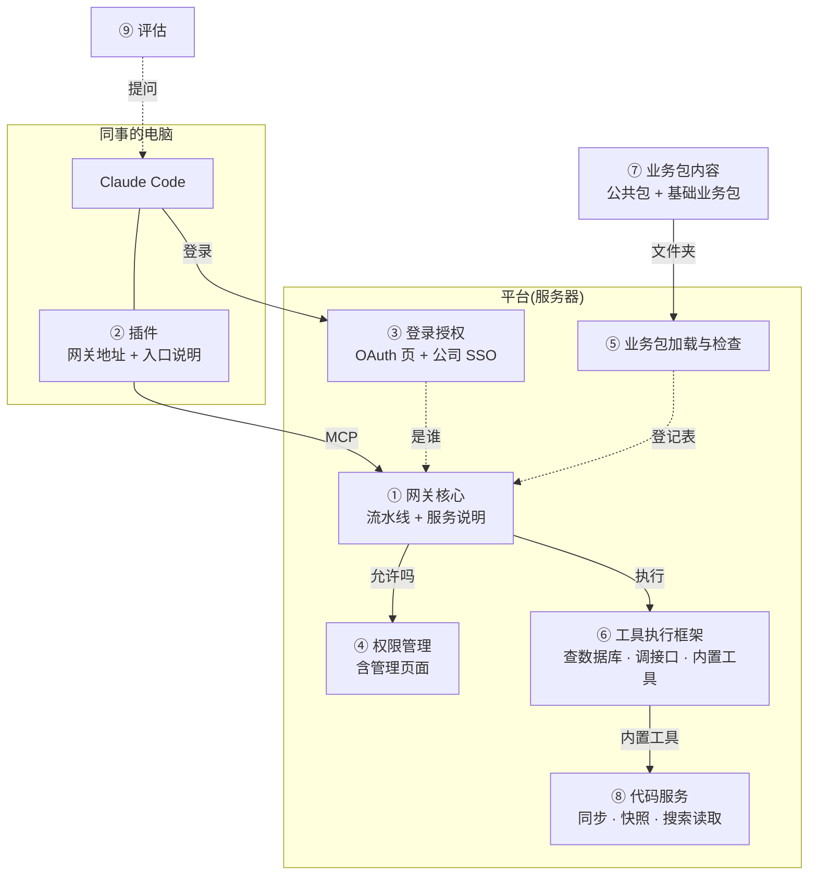

# 开发路线

本文档回答三个问题:插件这条链路拆成哪几个可以独立开发的模块;模块之间靠什么约定连接;按什么顺序做、在哪几个点上合起来跑整体流程。

总纲见 [架构总览](架构总览.md),范围见 [一期二期规划](一期二期规划.md),模块之间传递的数据见 [数据定义](13-数据定义-原理与设计.md)。

## 1. 先看全貌

一次调用的路径:Claude Code 通过插件找到网关 → 网关认出是谁(③)→ 问权限(④)→ 查登记表找到工具(⑤)→ 交给执行框架(⑥)→ 需要查代码时转给代码服务(⑧)→ 脱敏、记审计、返回。

## 2. 九个模块

编号就是执行顺序。

| # | 模块 | 是什么 | 交付物 | 类型 |
| --- | --- | --- | --- | --- |
| 1 | 网关核心 | 一次调用经过的流水线:认出是谁 → 问权限 → 找到工具 → 交给执行 → 记审计。连接时按人生成服务说明(规则加可用的排查说明目录) | 一个 MCP 服务 | 代码(Go) |
| 2 | 插件 | 全平台唯一的插件:网关地址、入口说明、安装说明 | 一个插件仓库 | 配置和文字 |
| 3 | 登录授权 | 平台的 OAuth 页,背后接公司 SSO;发通行证 | 一个授权服务 | 代码,尽量用现成组件 |
| 4 | 权限管理 | 用户、用户组、授权的数据表;一个判断接口;管理员用的管理页面 | 一个服务;一个后台页面 | 代码(Go 加前端) |
| 5 | 业务包的检查、编译和加载 | 分两半。检查和编译:流水线里的一个命令,读业务包的文件夹,检查是否合规,编译成登记表,写进数据库并带版本号。加载:网关从数据库读登记表,定时发现新版本 | 一个检查编译命令;网关里的加载器 | 代码(Go) |
| 6 | 工具执行框架 | 三种执行方式:查数据库、调接口、内置工具。所有工具共用的保护:参数校验、超时、行数上限、脱敏、结果状态、按工具和按数据源的并发控制、熔断。自带三个最简单的内置工具:取排查说明两个、提交反馈一个 | 执行框架;三个内置工具 | 代码(Go) |
| 7 | 业务包内容 | 两个业务包的文件夹。公共包:查日志、发布记录、通用排查规范。基础业务包:用户、会员、权益的工具、排查说明、仓库登记、考题 | 两个文件夹 | 配置和文字,需要业务知识 |
| 8 | 代码服务 | 独立部署的服务,平台里唯一需要持久存储的组件。仓库同步、按版本的快照、版本解析;搜索和读取的实现。对外是三个内置工具,挂在模块 6 上 | 一个服务 | 代码(Go) |
| 9 | 评估 | 批量提问的脚本、结果表、汇总 | 一个脚本 | 代码(Python) |

另有一项横向的工作,不属于任何一个模块,但从模块 1 开始就要一起做:部署配置、流水线、指标、日志和告警。见 [生产化与部署](14-生产化与部署-原理与设计.md)。

三类模块:

| 类别 | 模块 | 特点 |
| --- | --- | --- |
| 架子 | 1、3、4、5、6 | 只做一次。不出现任何业务名词 |
| 平台的内置能力 | 8 | 只做一次。只懂“代码”这一件事 |
| 内容 | 2、7 | 模块 2 几乎不变。模块 7 每接一个业务做一份;以后新服务接入,只做这样一个文件夹 |

### 2.1 几个容易混的边界

| 问题 | 答案 |
| --- | --- |
| 模块 6 和模块 8 重复吗 | 不重复。模块 6 是“怎么安全地把一个工具跑完”,不懂代码仓库。模块 8 是“代码从哪来、怎么搜、怎么读”,不管超时、脱敏、审计。模块 8 的三个工具只是挂在模块 6 的“内置工具”这个口子上 |
| 取排查说明为什么不是单独的模块 | 它只是从登记表里按名字取一段文字,没有自己的数据和后台。所以两个工具并入模块 6,“生成服务说明”并入模块 1 |
| 查日志、查订单这些工具在哪个模块 | 它们的定义在模块 7(业务包里的配置),执行在模块 6。大部分工具不需要写代码 |
| 模块 3 和模块 4 的区别 | 模块 3 回答“你是谁”,模块 4 回答“你能用什么” |
| 模块 5 和模块 7 的区别 | 模块 7 是业务交上来的文件夹,模块 5 是检查、编译这些文件夹并把结果送进网关的程序 |
| 业务包是文件夹,网关在 K8s 里怎么读 | 网关不读文件夹。流水线把文件夹编译成登记表写进数据库,网关只读数据库 |

### 2.2 每个工具归谁

| 工具 | 类型 | 定义写在哪 | 实现在哪 |
| --- | --- | --- | --- |
| 查日志 | 查数据库(配置) | 公共包 | 不写代码,模块 6 执行 |
| 发布记录 | 调接口(配置) | 公共包 | 不写代码,模块 6 执行 |
| 取排查说明(两个) | 内置 | 公共包 | 模块 6 自带 |
| 提交反馈 | 内置 | 公共包 | 模块 6 自带 |
| 代码:确定版本、搜索、读取 | 内置 | 公共包 | 模块 8 |
| 查订单、查会员、查权益、读缓存 | 查数据库或调接口(配置) | 基础业务包 | 不写代码,模块 6 执行 |
| 一笔购买的全链路诊断 | 内置 | 基础业务包 | 网关里按业务包分目录的一段代码 |

## 3. 模块之间的七个约定

模块能独立开发,靠的是先把它们之间的约定定下来。每个模块按约定开发,用假的对方来测试。

| # | 约定 | 谁提供 | 谁使用 | 内容 | 定义在 |
| --- | --- | --- | --- | --- | --- |
| ① | MCP 协议 | 模块 1 | Claude Code(经模块 2) | 列出工具、调用工具、服务说明 | 公开标准 |
| ② | 身份 | 模块 3 | 模块 1 | 给一张通行证,返回“这是谁”或“无效”。返回:员工标识、姓名、部门 | 文档 13 第 3 节 |
| ③ | 权限判断 | 模块 4 | 模块 1 | 给员工标识、业务包、工具名和工具的级别,返回允许,或拒绝及原因;以及“这个人现在可以用哪些业务包、什么级别” | 文档 13 第 4 节 |
| ④ | 登记表 | 模块 5 | 模块 1、6、8 | 有哪些业务包;每个业务包有哪些工具、排查说明、仓库。存在数据库里,带版本号 | 文档 13 第 2 节 |
| ⑤ | 执行 | 模块 6 | 模块 1 | 给工具定义和参数,返回结果。结果分四种:成功、没有数据、参数错误、执行失败;并说明是否被截断。内置工具按同样的输入输出挂进来 | 文档 13 第 5 节 |
| ⑥ | 业务包的格式 | 模块 7 | 模块 5 | 清单、工具、排查说明、仓库登记、考题的格式 | 文档 13 第 1 节;文档 11 |
| ⑦ | 命令行提问 | Claude Code | 模块 9 | 用 `claude -p` 提问,得到回答和完整过程 | 文档 02 |

这些约定的数据结构已经在 [数据定义](13-数据定义-原理与设计.md) 里定下,另外还定了审计记录的结构。每种结构都带版本号,升级时只加字段。

约定 ③ 和 ⑥ 里的“级别”:每个工具声明自己是只读(`read`)还是会改数据(`write`);授权时选只读或读写。一期所有工具都是只读,检查规则禁止出现 `write`,但字段从一期就留好。

每个模块独立测试时,用什么代替对方:

| 模块 | 用什么代替对方 |
| --- | --- |
| 1 网关核心 | 一个固定的假身份;一个永远回答“允许”的假权限判断;一张手写的登记表;一个只会原样返回的假工具 |
| 2 插件 | 模块 1 的假工具版本 |
| 3 登录授权 | 一个不带任何工具的空 MCP 服务 |
| 4 权限管理 | 不需要网关,直接调用判断接口;手工建几个测试用户 |
| 5 业务包的检查、编译和加载 | 几个样例文件夹:一个合规的,几个故意写错的;一个测试数据库 |
| 6 工具执行框架 | 一个测试数据库;一个假接口;几份样例排查说明 |
| 7 业务包内容 | 模块 5 的检查命令 |
| 8 代码服务 | 一个公开的小仓库 |
| 9 评估 | 不装平台插件的 Claude Code 加两道与平台无关的题 |

## 4. 执行顺序和三个合流点

| 顺序 | 模块 | 为什么排在这里 | 这个模块自己的验收 |
| --- | --- | --- | --- |
| 0 | 阶段 0 验证 | 先排除最大的不确定性(第 5 节) | 结果表填完 |
| 1 | 网关核心 | 其他所有模块都挂在它上面 | 用假身份调用假工具,返回正确;审计里有记录;没有身份的请求被拒绝 |
| 2 | 插件 | 很小,做完就能看到第一个效果 | 一台干净的电脑按说明装好 |
| | **合流点一:链路通** | | 在 Claude Code 里问一句话,它调用了网关上的假工具 |
| 3 | 登录授权 | 换掉假身份 | 浏览器登录一次后可用;未登录和登录过期的请求被拒绝 |
| 4 | 权限管理 | 换掉假的权限判断 | 没有授权的人被拒绝;在管理页面上给他的组授权后,最晚一分钟可用;每次修改都有记录 |
| 5 | 业务包的检查、编译和加载 | 换掉手写的登记表 | 合规的样例通过;每个故意写错的样例都被指出错在哪;编译出的登记表入库后,网关不重启就加载到;把当前版本指回上一个可以回滚 |
| 6 | 工具执行框架 | 换掉假工具 | 样例里的查询工具能查到测试库的数据;超时和超行数被拦下;脱敏生效;四种结果能区分;并发超限被限流,数据源连续出错被熔断;能按名称取到排查说明 |
| | **合流点二:架子通** | | 写一个只有一个查日志工具和一份排查说明的样例业务包。不改网关代码,登录后在 Claude Code 里能查到真实日志;在管理页面上撤销权限后,同一个人查不到了 |
| 7 | 业务包内容 | 架子好了才能装内容 | 两个业务包的文件夹通过检查命令 |
| | **合流点三:业务通** | | “付费后权益未到账”能沿链路给出带证据的结论;信息不够时先问 |
| 8 | 代码服务 | 独立性最强,放在后面不挡路 | 本机没有仓库也能搜到和读到指定版本的代码;读不到快照之外的文件 |
| 9 | 评估 | 之后所有的改进都靠它衡量 | 一条命令跑完全部考题,生成结果表 |
| | **整体流程** | | 至少三轮“看错题、改一样、重跑”;两三位同事试用;一期评审 |

**为什么不等全部做完再合。** 每个模块的独立性是保证的:有自己的验收,用假的对方测试。但合流分三次,不留到最后一次。原因是模块之间的约定写在纸上时总有没想到的地方,越晚发现改动越大。三个合流点各只需要半天,换来的是每一步都知道前面是对的。

**可以并行的部分。** 只有一个人时按上面的顺序做。有帮手,或者想让编码工具同时开几个任务时:

| 可以同时做 | 前提 |
| --- | --- |
| 模块 3、4、5、6、8 | 约定已在文档 13 里定下 |
| 模块 7 的文字部分:服务地图、排查说明、表结构说明、考题 | 文档 11 的格式已定。这部分从今天就可以开始写 |
| 模块 9 的考题表 | 无 |

**模块 7 里最花时间的是内容,不是代码。** 服务地图、状态字段的含义、排查思路,只有懂业务的人能写。建议和代码开发同时进行。

**检验架子的办法。** 合流点三之后,再用同样的格式接一个很小的假业务(一个工具、一份说明、一道题)。网关代码一行不改就能接上,说明架子是对的。

**和规划的对应。** 合流点一、二对应 [一期二期规划](一期二期规划.md) 的 M1,合流点三和模块 8 对应 M2,模块 9 和改进对应 M3,试用对应 M4,评审对应 M5。

## 5. 阶段 0:六项验证

这六项是整个方案里不确定性最大的地方。其中第 2、3、4、6 项不需要先写任何平台代码。

| # | 不确定的是什么 | 怎么测 | 记录什么 | 不通过怎么办 |
| --- | --- | --- | --- | --- |
| 1 | 登录:Claude Code 的插件能不能对接平台的 OAuth 页 | 一个不带任何工具的 MCP 服务,加上 OAuth 页。看能否弹出浏览器、登录成功、过期后自动续期。顺便试一次 `claude -p` 加服务令牌 | 每一步是否成功;客户端是怎么登记的;遇到的报错 | 调整客户端登记方式;最差情况下先用令牌 |
| 2 | 数据:三个服务的日志和数据能不能关联起来 | 取 3 个真实的“付费后权益未到账”,自己写 SQL 在 ClickHouse 和 MySQL 里把整条链路查出来 | 每一段靠什么字段关联;哪一段关联不上;各服务的日志表结构是否一致 | 人都串不起来,Agent 也做不到。先在服务里补日志字段 |
| 3 | 版本:能不能拿到线上运行的提交号 | 询问发布系统的负责人,或调用它的接口 | 能否按“服务 + 时间”查到提交号 | 先人工维护一张表 |
| 4 | 代码:只靠搜索和读取,能不能找到业务逻辑 | 分两步,见第 5.1 节 | 见第 5.1 节 | 加强导航;仍不行再考虑搜索引擎或语义检索 |
| 5 | 多副本:网关起两个副本时,Claude Code 的连接是否正常 | 把第 1 项的空 MCP 服务起两个副本,不做会话保持。看连接、调用是否正常;服务端通知“工具列表变了”时客户端是否刷新 | 是否需要会话保持;通知能否到达 | 网关做成每个请求都能独立处理;通知到不了时,以“下次连接生效”为保底 |
| 6 | 说明:排查说明放在云端,模型会不会主动去取 | 同样 10 种问法测两组:说明做成插件里的 Skill;说明要调用工具去取 | 两组各被用上几次;没用上的是哪种问法 | 改服务说明里的目录和入口说明;仍不行就把最常用的几份放回插件 |

### 5.1 代码查询的两步测试

**第一步,不写代码。** 把三个仓库克隆到本机,在 Claude Code 里问 10 个业务逻辑问题。本地读文件最快、最不受限,所以这一步的结果是效果的上限。如果这样都答不好,问题在导航和代码本身,不在工具。

然后做一组对照:同样的题,加上一份导航文件再问一遍。两次的差距就是导航的价值。

**第二步,写一个一次性的小工具。** 一个只有搜索和读取两个工具的 MCP 服务,直接在本机目录上做文本搜索,不做登录,不做版本。把本地仓库移走,同样 10 道题再问一遍。和第一步的差距就是“远程”的代价。

每道题记四样:

| 记录项 | 说明 |
| --- | --- |
| 答对了吗 | 对照事先写好的标准答案 |
| 找到关键代码了吗 | 回答里引用的位置对不对 |
| 搜索和读取各几次 | 次数多说明它在乱找 |
| 用了多久 | 从提问到给出回答 |

### 5.2 阶段 0 的结果表

| # | 验证项 | 结果 | 结论 | 对方案的影响 |
| --- | --- | --- | --- | --- |
| 1 | 登录 | | | |
| 2 | 数据关联 | | | |
| 3 | 线上版本 | | | |
| 4 | 代码查询 | | | |
| 5 | 多副本 | | | |
| 6 | 排查说明的取用 | | | |

做完后带着这张表回来,再定模块 1 的详细设计。

## 6. 每个模块内部的节奏

交给编码工具时,一次只给一个模块、它涉及的约定和对应的文档章节,并附上 [一期二期规划](一期二期规划.md) 第 2.2 节的“不做”清单。把整个方向一次交出去,范围会越写越大。

## 7. 各模块的设计文档

开发某个模块时,把这一行里的文档章节,连同 [数据定义](13-数据定义-原理与设计.md) 里它用到的部分,一起交给编码工具。

| 模块 | 设计在哪 | 状态 |
| --- | --- | --- |
| 数据定义(所有模块的基础) | 文档 13 | 已有 |
| 1 网关核心 | 文档 15 | 已有 |
| 2 插件 | 文档 09 第 3、8 节 | 已有;入口说明的正文和安装说明在开发时写 |
| 3 登录授权 | 文档 09 第 6 节;文档 13 第 3 节 | 已有,待阶段 0 的试验验证 |
| 4 权限管理 | 文档 12;文档 13 第 4 节 | 已有 |
| 5 业务包的检查、编译和加载 | 文档 11 第 2、3、8、9 节;文档 13 第 1、2 节;文档 14 第 4 节 | 已有 |
| 6 工具执行框架 | 文档 11 第 4 节;文档 13 第 5 节;文档 14 第 5 节 | 已有;限流和熔断的具体数字压测后定 |
| 7 业务包内容 | 文档 11(格式) | 格式已有;具体的工具清单和排查说明待写,需要你提供表结构和现有接口 |
| 8 代码服务 | 文档 10 | 已有 |
| 9 评估 | 文档 02 第一部分;文档 09 第 6.5、10 节 | 已有 |
| 部署、流水线、可观测 | 文档 14 | 已有;依赖第 10 节几个待确认的问题 |

还缺的只有一样:模块 7 里基础业务包的具体内容。

## 8. 最容易走偏的四个地方

| 走偏 | 后果 | 怎么避免 |
| --- | --- | --- |
| 跳过阶段 0 直接开发 | 日志串不起来或登录不通时,后面做的都要返工 | 阶段 0 的结果表填完再开始模块 1 |
| 不按约定各做各的 | 合流时对不上,两边都要改 | 模块之间只按文档 13 里的数据结构打交道。要改约定,先改文档 13 |
| 模块 1 做得太厚 | 迟迟到不了合流点一 | 第一版只要流水线和一个假工具。身份和权限先用假的,真的在模块 3、4 里做 |
| 做完模块 9 就直接给人用 | 系统能跑,但答得不好,同事用一次就不再用 | 试用之前至少完成三轮改进 |

## 9. 现在的位置

当前处在阶段 0。本周可以做的,按顺序:

1. 开始记题目表。
2. 申请 ClickHouse、MySQL 从库、Redis 的只读账号,以及三个仓库的只读部署密钥。
3. 验证第 2、3 项:手工串 3 个案例;询问发布系统。
4. 验证第 4 项的第一步和第 5、6 项:只需要本机的 Claude Code。
5. 验证第 1 项:登录试验。
6. 同时开始写模块 7 的文字部分:服务地图和表结构说明。
