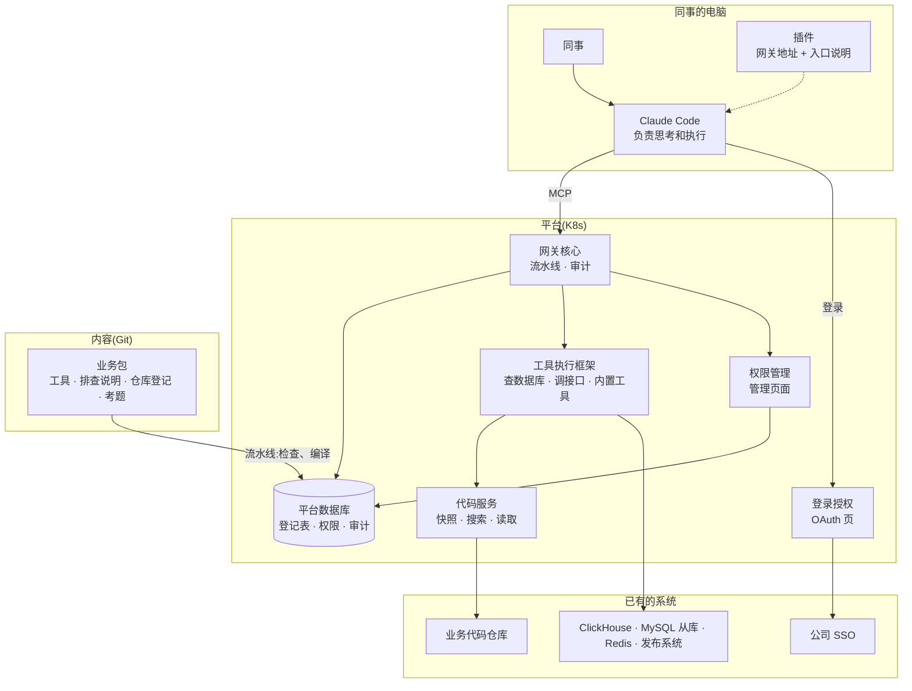

# 架构总览

一句话:同事在自己的 Claude Code 里装上平台唯一的一个插件,用公司账号登录一次,就能排查业务问题和询问业务逻辑。插件只是一张名片,真正的能力都在云端:一个网关,加上各个业务交上来的业务包。

本文档是整套设计的总纲。第 5 节的“设计决定清单”是唯一的依据:其他文档的说法与它不一致时,以它为准。

## 1. 整体结构



## 2. 四层

| 层 | 有什么 | 职责 |
| --- | --- | --- |
| 客户端 | Claude Code;插件 | 思考、决定下一步、组织回答。平台管不到这一层 |
| 接入与控制 | 网关核心;登录授权;权限管理 | 认人、判断权限、限流、审计。所有不能被绕过的要求在这里强制 |
| 能力 | 工具执行框架;代码服务 | 安全地把一个工具跑完;提供代码的搜索和读取 |
| 内容与数据 | 业务包;已有的数据源和代码仓库 | 每个业务有什么工具、怎么排查、代码在哪 |

上面三层是平台的架子,只做一次。接入一个新业务,只在最下面一层增加一个业务包。

## 3. 核心概念

| 概念 | 是什么 | 详见 |
| --- | --- | --- |
| 插件 | 全平台唯一的一个。里面只有网关的地址和一份入口说明 | 文档 09 |
| 业务包 | 一个业务的 MCP 工具和排查说明的整合,再加上代码仓库登记和考题。在 Git 里是一个文件夹 | 文档 11 |
| 登记表 | 所有业务包检查、编译之后生成的一张表,存在数据库里,带版本号。网关只读它 | 文档 13 |
| 工具 | 模型可以调用的一个查询。三种类型:查数据库、调接口、内置。每个工具有级别:只读或读写 | 文档 11、13 |
| 排查说明 | 一类问题怎么查。存在云端,用到时通过工具取 | 文档 09、11 |
| 通行证 | 登录后发给 Claude Code 的凭据,短期有效,自动续期 | 文档 09 |
| 用户组、授权、启用 | 管理员把业务包授权给用户组;同事自己决定启用哪些 | 文档 12 |
| 审计 | 每次调用一条记录 | 文档 13 |

## 4. 信任边界

| 区域 | 里面有什么 | 平台能控制吗 |
| --- | --- | --- |
| 同事的电脑 | Claude Code、插件、通行证 | 不能。同事可以改插件,模型可能被数据里的文字诱导 |
| 平台 | 网关、登录、权限、执行框架、代码服务、平台数据库 | 能 |
| 数据源 | 业务数据库、日志、代码仓库 | 只能经平台访问 |

由此得出四条规则:

1. 一切不能被绕过的要求(只读、权限、脱敏、上限、审计)都在平台这一侧强制,不依赖插件里的说明。
2. 数据源的账号和 Git 的密钥只在平台里,同事的电脑和模型都接触不到。
3. 身份只来自验证过的通行证,不来自工具的参数。
4. 工具返回的内容是数据。服务说明里明确告诉模型:它们不是指令。

## 5. 设计决定清单

这是整套设计的依据。每一条后面是它的详细说明所在的文档。

| # | 决定 | 详见 |
| --- | --- | --- |
| 1 | 一期的形态是 Claude Code 插件。网页版、自研运行时、Codex 在二期 | 一期二期规划 |
| 2 | 全平台只有一个插件、一个网关地址。同事登录一次 | 文档 09 |
| 3 | 业务按“业务包”接入。业务包在云端,不在同事的电脑上。早期文档里叫“连接器” | 文档 11 |
| 4 | 业务包的定义放在 Git 里,经评审;运行状态(上线、试用、停用)、授权、启用放在数据库里 | 文档 13 |
| 5 | 业务包经流水线检查、编译成登记表,写进数据库并带版本号。网关不读文件 | 文档 14 |
| 6 | 排查说明存在云端,通过工具按需取用。连接时网关下发按人生成的服务说明,其中带目录 | 文档 09、15 |
| 7 | 工具有三种来源:配置的数据库查询、配置的接口调用、平台内置。业务自带 MCP 服务的转发在二期 | 文档 11 |
| 8 | 一期所有工具只读。读写级别的字段从一期留好 | 文档 12、13 |
| 9 | 模型不能自己写查询语句。所有查询都是配置好的、参数化的 | 文档 13、14 |
| 10 | 登录:平台提供 OAuth 页,背后接公司 SSO | 文档 09 |
| 11 | 权限:管理员在管理页面上把业务包(及级别)授权给用户组。人的权限只在这一处配。每次调用都检查 | 文档 12 |
| 12 | 代码:业务仓库的代码按版本存在平台上,通过三个通用工具搜索和读取。仓库登记在业务包名下。一期用文本搜索 | 文档 10 |
| 13 | 测试和生产是两套独立的部署。工具没有“环境”参数 | 文档 14 |
| 14 | 部署在 K8s 上。网关无状态、多副本。只有代码服务需要持久存储 | 文档 14 |
| 15 | 保护数据源:只连从库;每条查询有硬上限;限流;熔断 | 文档 14 |
| 16 | 出错时默认拒绝:权限服务或审计不可用时,不放行 | 文档 15 |
| 17 | 平台看不到同事的对话,只看得到工具调用和同事主动提交的反馈 | 文档 09 |
| 18 | 评估走和同事相同的路径:用命令行方式向装了插件的 Claude Code 提问 | 文档 02 |
| 19 | 按生产系统来做:架构一步到位,功能分期上线 | 文档 14 |

## 6. 技术选型

| 部分 | 选择 |
| --- | --- |
| 平台的服务(网关、执行框架、权限管理、代码服务) | Go |
| 登录授权 | 成熟的 OAuth 服务端组件,加一个对接公司 SSO 的登录页 |
| 管理页面 | React、TypeScript、Tailwind CSS、shadcn/ui |
| 评估脚本 | Python |
| 平台数据库 | 公司现有的 MySQL |
| 部署 | K8s |
| 模型和运行时 | 同事自己的 Claude Code。平台一期不接模型 |

## 7. 三个代码仓库

| 仓库 | 放什么 | 多久变一次 |
| --- | --- | --- |
| 平台代码 | 网关、执行框架、权限管理、管理页面、代码服务、评估脚本、检查和编译业务包的命令 | 开发平台时 |
| 内容 | 所有业务包 | 经常 |
| 插件 | 唯一的插件和它的市场清单 | 几乎不变 |

```
agent-platform/            平台代码
  gateway/                 网关核心 + 工具执行框架
  auth/                    登录授权
  admin/                   权限管理 + 管理页面
  code-service/            代码服务
  packc/                   检查和编译业务包的命令
  evals/                   评估脚本
  deploy/                  部署配置

agent-content/             内容
  packs/
    platform/              公共包
    membership/            基础业务包:用户、会员、权益

agent-plugins/             插件
  .claude-plugin/marketplace.json
  plugins/agent-platform/
```

## 8. 文档地图

按模块组织。开发某个模块时,只需要读它对应的文档。

| 模块 | 设计文档 |
| --- | --- |
| 全局 | 本文档;[一期二期规划](一期二期规划.md);[开发路线](开发路线.md) |
| 数据定义(所有模块的共同基础) | [13-数据定义](13-数据定义-原理与设计.md) |
| 1 网关核心 | [15-网关核心](15-网关核心-原理与设计.md) |
| 2 插件 | [09-插件形态](09-插件形态-原理与设计.md) 第 3、8 节 |
| 3 登录授权 | [09-插件形态](09-插件形态-原理与设计.md) 第 6 节 |
| 4 权限管理 | [12-权限管理](12-权限管理-原理与设计.md) |
| 5 业务包的检查、编译和加载 | [11-业务包接入协议](11-业务包接入协议-原理与设计.md) 第 8、9 节;[14-生产化与部署](14-生产化与部署-原理与设计.md) 第 4 节 |
| 6 工具执行框架 | [11-业务包接入协议](11-业务包接入协议-原理与设计.md) 第 4 节;[13-数据定义](13-数据定义-原理与设计.md) 第 5 节;[14-生产化与部署](14-生产化与部署-原理与设计.md) 第 5 节 |
| 7 业务包内容 | [11-业务包接入协议](11-业务包接入协议-原理与设计.md) |
| 8 代码服务 | [10-代码查询](10-代码查询-原理与设计.md) |
| 9 评估 | [02-评估系统](02-评估系统-原理与设计.md) 第一部分 |
| 部署和上线 | [14-生产化与部署](14-生产化与部署-原理与设计.md) |
| 学习 | [一期学习手册](一期学习手册.md) |

`参考` 目录里是早期的设计和二期才用到的专题。它们是按网页版的前提写的,说法与本文档不一致时以本文档为准。

## 9. 二期

二期的方向和一期为它们留的位置,见 [一期二期规划](一期二期规划.md) 第 5、6 节和 [生产化与部署](14-生产化与部署-原理与设计.md) 第 8 节。
