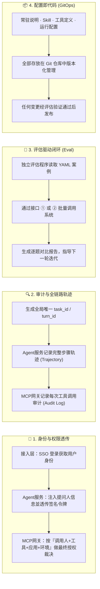
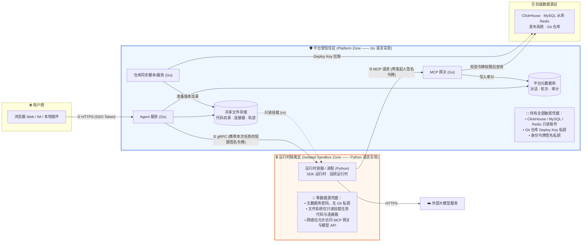
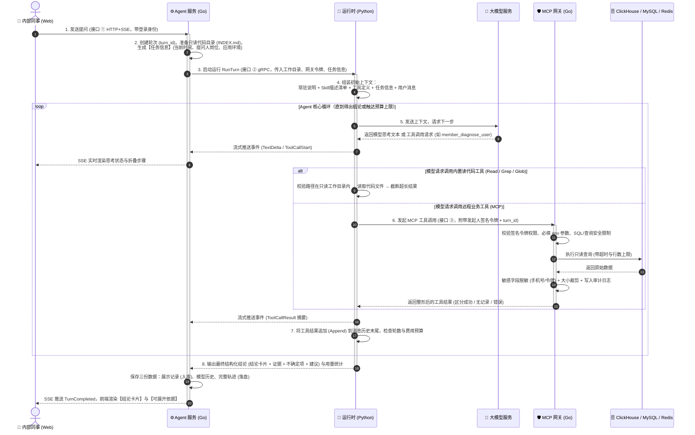
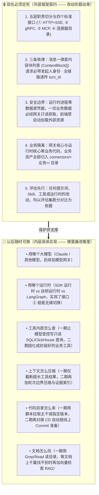

# 01 架构全景与核心心智模型

本文档用最清晰的图表建立整个平台的**全局架构认知**。
核心法则只有一句话：**将整个系统切分为“五层架构”，用“四个标准接口”咬合，并在“三个安全信任区”内按 Go 与 Python 划清边界。** 把这副骨架定死，每一层内部都可以先写一个 100 行代码的最简版本跑通全局，随后再逐层加厚。

---

## 1. 五层架构全景图

整个平台自上而下分为五层：**接入层、应用层、运行时层、能力层、数据源层**。层与层之间仅通过编号为 **①、②、③、④** 的四个标准契约交互。

```mermaid
flowchart TB
  subgraph L1["第一层：接入层 (Access Layer) —— 用户从哪里提问"]
    WEB["💻 平台对话页面 (Web SPA)<br/>流式对话 · 结论卡片 · 过程折叠 · Agent切换"]
    IM["🤖 IM 机器人 (二期)<br/>群聊答疑 · 报警自动推送"]
    LOCAL["⌨️ 本地 Claude Code (插件)<br/>研发本地 IDE / CLI 终端"]
  end

  subgraph L2["第二层：应用层 (Application Layer) —— 提问如何变成可追踪的任务"]
    AS["⚙️ Agent 服务 (Go)<br/>会话与轮次管理 · 任务信息注入 · 代码工作区组装 · 轨迹存储 · 并发与预算管控"]
  end

  subgraph L3["第三层：运行时层 (Runtime Layer / 隔离环境) —— 谁来驱动模型一步步完成任务"]
    RT_SDK["🐍 SDK 运行时 (Python)<br/>Claude Agent SDK 适配层（默认生产主力）"]
    RT_NAT["🐍 自研运行时 (Python)<br/>Native Harness（手写循环 · 策略实验 · 对照评估）"]
  end

  subgraph L4["第四层：能力层 (Capability Layer) —— Agent 能使用什么武器"]
    GW["🛡️ MCP 网关 (Go)<br/>统一工具入口 · SSO鉴权 · 参数校验 · 结果裁剪与脱敏 · 审计日志"]
    CONN["📦 连接器内容 (Connectors)<br/>常驻说明 · 服务地图 · 排查Skill · 库表字典 · 评估案例"]
    CODE["📂 任务代码目录 (Read-Only Workspace)<br/>多仓库只读挂载 · INDEX.md 版本清单"]
    LLM["🧠 模型服务 (LLM API)<br/>Claude 等大模型（二期可加模型网关）"]
  end

  subgraph L5["第五层：数据源层 (Data Source Layer) —— 事实从哪里来（全部只读）"]
    CH[("("📊 ClickHouse<br/>应用与调用链日志")")]
    MYSQL[("("🗄️ MySQL 只读从库<br/>订单 · 会员 · 权益表")")]
    REDIS[("("⚡ Redis 缓存<br/>按业务语义读取")")]
    CD[("("🚀 发布与监控系统<br/>发布记录 · 线上版本 · 指标")")]
    GIT[("("🦊 Git 代码仓库<br/>Deploy Key 只读拉取")")]
  end

  %% 接口连线
  WEB == "接口 ①：对话接口 (HTTP + SSE)<br/>带登录身份 Token + 内容块列表" ==> AS
  IM -. "接口 ①" .-> AS

  AS == "接口 ②：运行时接口 (gRPC Streaming)<br/>runtime.proto 唯一定义 · 事件流返回" ==> RT_SDK
  AS == "接口 ②" ==> RT_NAT

  RT_SDK == "接口 ③：MCP 工具协议 (Streamable HTTP)<br/>透传发起人签名身份令牌" ==> GW
  RT_NAT == "接口 ③" ==> GW
  LOCAL -. "接口 ③ (直连网关)" .-> GW

  CONN == "接口 ④：连接器目录规范<br/>只读挂载" ==> RT_SDK
  CONN == "接口 ④" ==> RT_NAT
  CODE == "只读挂载" ==> RT_SDK
  CODE == "只读挂载" ==> RT_NAT

  RT_SDK --> LLM
  RT_NAT --> LLM

  GW --> CH & MYSQL & REDIS & CD
  GIT -->|"脚本/同步服务拉取"| CODE
```

### 1.1 五层职责与“不做什么”边界表

在架构设计中，规定**“每一层绝对不做什么”**比规定“做什么”更重要——这是防止代码腐化和职责混杂的唯一手段：

| 层级 | 包含组件 | 核心职责（做什么） | 严禁越界（绝对不做什么） | 一期最小骨架形态（M1） |
| :--- | :--- | :--- | :--- | :--- |
| **1. 接入层** | Web 对话页面、（二期）IM 机器人、本地插件 | 收集用户输入、流式渲染事件、展示结论卡片与折叠步骤、收集点赞/点踩反馈 | **不写任何业务逻辑**；不拼接提示词；**不自动加载回答中的外部图片/外链** | 一个单页 React 应用，能发消息、流式展示 Markdown 和工具调用状态 |
| **2. 应用层** | `agent-service` (Go) | 管理对话与轮次；查询并注入任务背景信息；准备代码目录；调度运行时；保存展示记录与完整轨迹 | **不写任何与大模型交互的逻辑**；不决定排查步骤；**不直接连业务数据库或 ClickHouse** | 一个 Go 进程，几张 MySQL 表存对话，通过 gRPC 调 SDK 运行时 |
| **3. 运行时层** | `runtimes/sdk`、`runtimes/native` (Python) | 组装上下文、推进“模型 ↔ 工具”循环、按需加载 Skill、内置读代码文件工具、判断停止条件与预算 | **不管理多用户状态**；**不持有任何数据库或 Git 凭据**；不直接连任何业务数据源 | 先只包一层 Claude Agent SDK 适配，M3 再加入自研 Python 运行时 |
| **4. 能力层** | `gateway` (Go)、`connectors/`、代码目录、模型服务 | **网关**：认证、授权、调数据源、结果截断与脱敏、写审计日志。<br/>**连接器**：存放业务 Skill、库表说明与案例 | **网关核心层不写任何业务专属逻辑**（新增工具只改适配层）；连接器目录不含可执行服务代码 | 网关仅含 ClickHouse 日志查询 1 个工具（M1），M2 扩充到 MySQL/Redis/发布记录 |
| **5. 数据源层** | ClickHouse、MySQL 从库、Redis、发布系统、Git | 提供原始的线上事实数据与代码 | **在一期不接受任何写操作**（全部只读账号与只读密钥） | 开通只读账号的现有业务库与日志库 |

### 1.2 贯穿五层的四个“横切关注点”

有四件事不属于单独某一层，而是像钢筋一样贯穿整个系统：



---

## 2. 安全骨架：三个信任边界与 Go / Python 双语言切分

为什么我们要同时使用 **Go** 和 **Python** 两种后端语言？
答案不是为了炫技，而是因为**语言边界恰好与安全信任边界完美重合**。

### 2.1 三大信任区域（Trust Zones）隔离图

大模型最本质的安全风险在于：**它读入的日志、代码注释、用户字段里可能藏着恶意指令（Prompt Injection，提示词注入），诱导模型去越权查数据或把数据外发。**
如果把数据库账号密码放在运行模型的进程里，一旦模型被诱导，防线就会彻底崩溃。因此，我们在物理/容器层面将系统划分为三个区：



### 2.2 平台区（Go）vs 隔离区（Python）对照表

| 维度 | 平台受信任区（Platform Zone） | 运行时隔离区（Isolated Zone） |
| :--- | :--- | :--- |
| **实现语言** | **Go** | **Python** |
| **包含组件** | `agent-service`（Agent 服务）、`gateway`（MCP 网关）、`repo-sync`（仓库同步） | `runtimes/sdk`（Claude SDK 适配）、`runtimes/native`（自研运行时）、`evals`（评估器） |
| **为什么选这个语言？** | 高并发、强类型、无状态服务治理成熟、部署二进制极简，适合做网关、鉴权、流转发与任务编排 | Claude Agent SDK 官方仅提供 Python/TS，且后续实验 LangGraph、RAG、分词与评估脚本的生态全部在 Python |
| **持有的凭据** | **持有**所有后端数据源只读账号、Git 部署私钥、平台数据库读写凭据 | **不持有任何数据源凭据**，仅持有当次任务的短期签名身份令牌与大模型调用 Key |
| **网络与文件权限** | 可访问内部数据库、ClickHouse、Redis、Git 仓库 | **禁止直连任何数据库/缓存/Git**；只读挂载当次任务代码目录与连接器目录；只能出网访问 MCP 网关与模型 API |
| **安全铁律** | **绝不运行任何由模型动态生成或驱动的逻辑** | **即使模型被提示词注入完全控制，也拿不到数据库密码、改不了文件、读不到任务目录外的文件、越不过网关的权限检查** |

---

## 3. 一次提问的端到端生命旅程

让我们跟踪用户在网页上输入一句**“用户 138xxxx 付了款，为什么会员没生效？”**后，系统内部发生的完整 8 步时序：



### 附：本地 Claude Code 插件的极简路径

除了在平台网页上提问，研发同事还可以在自己电脑的终端（Claude Code CLI）安装平台分发的插件。此时路径更短：
- **本地 Claude Code 自己就是“运行时”**，直接读取开发者本地检出的代码仓库。
- 插件内包含从同一份注册表打包出来的 **Skill 说明文件**和 **MCP 网关地址配置**。
- 当需要查线上日志或会员数据时，本地 Claude Code 通过 **接口 ③（MCP 协议，带个人 SSO 令牌）** 直连平台 MCP 网关，复用完全相同的权限检查、脱敏和审计体系。

---

## 4. 架构演进哲学：什么是“现在必须定死”的，什么是“以后随时可换”的？

很多项目失败的原因是：**把精力花在了第一版根本不需要的复杂功能上，却在基础接口上偷工减料导致推倒重来。**
本架构严格区分**“外层不可变契约（第一天就做对）”**与**“内层可替换实现（先做最薄，按评估加厚）”**：



> [!TIP]
> **记住这三条从第一行代码起就要遵守的接口约定：**
> 1. **消息永远是内容块的数组（`ContentBlock[]`）**：哪怕一期只支持纯文本，接口里也写成 `[{"type": "text", "text": "..."}]`，绝不用单个 `string`。这样二期支持上传报错截图时，所有接口一行都不用改。
> 2. **每个请求都携带真实身份（`Identity`）**：哪怕一期开发时只有你一个人在测，也要把发起人 ID 和岗位从接入层一路透传到网关，绝不在代码里写死无身份调用。
> 3. **每个任务都有唯一追踪号（`task_id` / `turn_id`）**：从 Agent 服务 → 运行时 → MCP 网关，所有日志和审计记录都带上这个 ID，排查任何怪异行为只需 `grep` 一下这个 ID 即可串联全貌。

理解了全局架构后，接下来我们进入工程落地的核心：**[02-四大核心接口与数据契约规范.md](file:///Users/xuye/360/oversea/oversea_AI/docs/argon_polish/02-四大核心接口与数据契约规范.md)**，看看这四个接口、数据库表和代码目录在代码层面到底长什么样。
