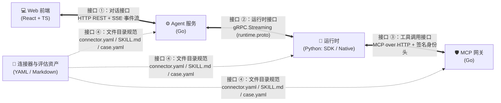
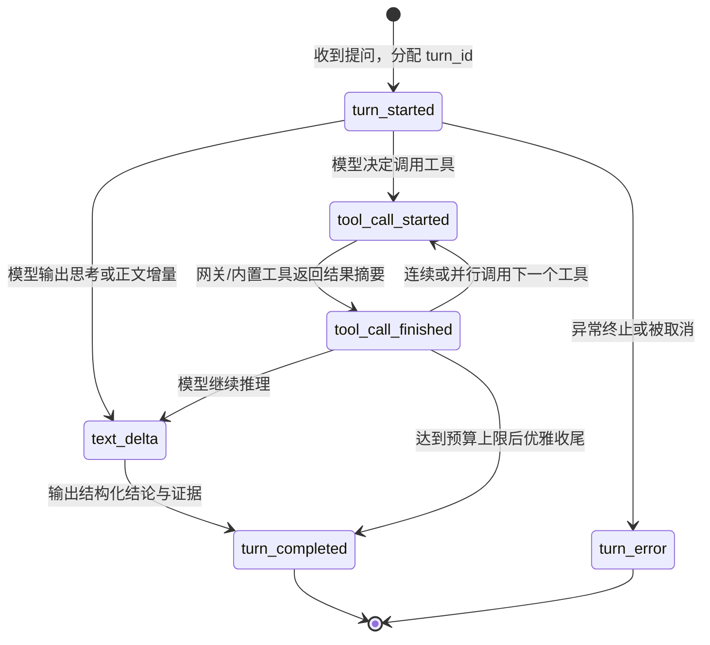
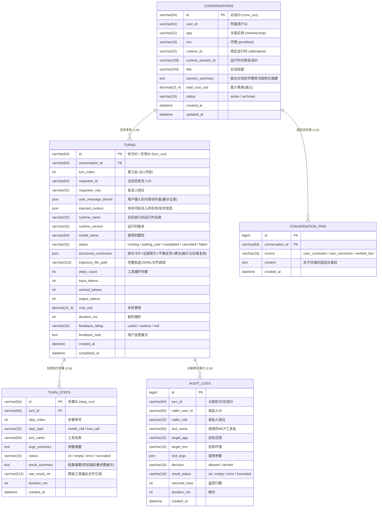

# 02 四大核心接口与数据契约规范（工程落地直接依据）

在 [01-架构全景与核心心智模型](file:///Users/xuye/360/oversea/oversea_AI/docs/argon_polish/01-架构全景与核心心智模型.md) 中，我们确立了系统的五层架构。要把架构变成可编译、可联调的代码，最关键的是把连接五层的**四个核心接口（① 对话接口、② 运行时接口、③ MCP 工具接口、④ 连接器与资产文件规范）**以及**平台数据库表结构**定清楚。

> [!IMPORTANT]
> **如何使用本文档？**
> 当你使用 Claude Code / Cursor / Antigravity 等 AI 编码工具开发具体模块时，**直接将本文档对应的章节连同需求一起发给 AI**。这能保证 Go 端、Python 端和 React 前端写出的代码一次性严丝合缝地对接上。

---

## 1. 四大核心接口全景定位



---

## 2. 接口 ①：对话接口（Web 前端 ↔ Agent 服务）

- **通信协议**：`HTTP/1.1` 或 `HTTP/2` REST JSON + **SSE（Server-Sent Events）单向事件流**。
- **认证方式**：请求 Header 携带登录态凭证（如 `Authorization: Bearer <sso_jwt_token>`），Agent 服务从中解析出 `user_id`、`user_name`、`role`（岗位：研发/测试/产品）与所属团队。

### 2.1 核心 REST 端点清单

| 方法与路径 | 用途 | 关键说明 |
| :--- | :--- | :--- |
| `GET /api/v1/runtimes` | 获取可用 Agent 运行时列表 | 返回 `sdk`（默认）、`native`（实验/白名单可见）及其状态 |
| `POST /api/v1/conversations` | 创建新对话 | 绑定目标应用（`app`，如 `membership`）、环境（`env`，如 `prod`）与选定的运行时（`runtime_id`） |
| `GET /api/v1/conversations` | 获取当前用户的历史对话列表 | 分页返回对话标题、时间、关联应用与运行时 |
| `GET /api/v1/conversations/{conv_id}` | 获取单个对话的完整展示记录 | 返回该对话下所有轮次（Turns）的用户消息、折叠步骤摘要与最终回答 |
| `POST /api/v1/conversations/{conv_id}/turns` | **发送消息（发起新一轮提问或追问）** | **立即返回 `turn_id`**（异步执行），随后前端订阅 SSE 流或直接在该响应升级为 `text/event-stream` |
| `GET /api/v1/conversations/{conv_id}/turns/{turn_id}/stream` | **订阅当前轮次的实时 SSE 事件流** | 实时推送思考进度、工具调用状态、流式文本与最终结构化结论 |
| `POST /api/v1/conversations/{conv_id}/turns/{turn_id}/cancel` | 取消正在运行的轮次 | 通知运行时停止循环，保存已查到的证据索引 |
| `POST /api/v1/turns/{turn_id}/feedback` | 提交用户反馈（有用 / 无用） | 记录 `rating`（`useful` / `useless`）与可选原因，无用案例自动进入待分析池 |

### 2.2 消息内容块（ContentBlock）统一格式

**铁律：无论输入还是输出，消息体永远是 `ContentBlock` 数组，绝不使用裸字符串。**

```json
// POST /api/v1/conversations/{conv_id}/turns 请求体示例
{
  "runtime_id": "sdk",
  "app": "membership",
  "env": "prod",
  "content": [
    {
      "type": "text",
      "text": "用户反馈刚付了款，但是会员权益没加上，订单号是 ORD20261113001"
    },
    {
      "type": "image_ref",
      "attachment_id": "att_9f8e7d",
      "mime_type": "image/png",
      "description": "（二期支持）用户提供的报错截图"
    }
  ]
}
```

### 2.3 SSE 事件流协议（前端渲染驱动）

参考业界 AG-UI 等 Agent-前端流式协议，SSE 流推送以下 6 种标准事件类型，前端据此驱动界面状态：



| SSE `event` 名称 | `data` JSON 核心字段 | 前端 UI 响应行为 |
| :--- | :--- | :--- |
| `turn_started` | `{"turn_id": "t_01", "runtime": "sdk", "model": "claude-sonnet"}` | 创建回答气泡，显示“正在准备环境与上下文…”状态指示器 |
| `text_delta` | `{"step_id": "s_01", "delta": "正在检查订单状态..."}` | 流式追加渲染 Markdown 文本 |
| `tool_call_started` | `{"step_id": "s_02", "tool_name": "member_diagnose_user", "args_summary": "order_id=ORD..."}` | 在折叠步骤区新增一行紧凑状态：`🔄 正在查询会员链路状态 (order_id=ORD...)` |
| `tool_call_finished` | `{"step_id": "s_02", "status": "ok", "duration_ms": 340, "result_summary": "订单已支付，会员未生效"}` | 将该步骤状态更新为 `✅ 查询会员链路状态 (340ms)`，点击可展开看摘要 |
| `turn_completed` | 见下方完整 JSON 示例（含**双层结论结构**与 token 费用统计） | 渲染顶部的**【结论卡片】**（给非技术同事看）和下方的**【可展开依据与代码/日志引用】** |
| `turn_error` | `{"code": "CANCELLED", "message": "用户已取消任务"}` | 显示中断状态提示与重试按钮 |

**`turn_completed` 事件载荷示例（体现“结论与依据分层”设计）**：

```json
{
  "turn_id": "t_01",
  "status": "completed",
  "stop_reason": "end_turn",
  "structured_output": {
    "conclusion_card": {
      "summary": "该用户的订单已支付成功，但因支付回调消息在队列中消费超时失败，导致会员状态未更新、权益未发放。",
      "root_cause_plain": "会员服务在 14:20 接收支付通知时连接下游超时，重试 3 次均失败后进入了死信队列。",
      "next_action": "请联系【会员服务值班研发】针对订单号 ORD20261113001 重新触发消费回调消息。"
    },
    "evidences": [
      {
        "source_type": "database",
        "tool_name": "member_diagnose_user",
        "detail": "orders 表显示 order_id=ORD20261113001 状态为 PAID (14:19:58)，但 member_status 表无对应有效记录"
      },
      {
        "source_type": "log",
        "tool_name": "logs_search",
        "detail": "[2026-11-13 14:20:03] ERROR trace_id=tr_88a1 member-api: process callback timeout after 3000ms"
      },
      {
        "source_type": "code",
        "repo": "member-service",
        "file_path": "internal/handler/payment_callback.go",
        "lines": "L85-L102",
        "detail": "回调处理超过 3 次失败后标记为 FAILED_DLQ，不再自动重试"
      }
    ],
    "uncertainties": [
      "尚未确认 14:20 前后数据库从库或网络是否出现短暂抖动"
    ],
    "suggestions": [
      "研发核实死信队列积压情况并执行消息重放"
    ]
  },
  "usage": {
    "steps_count": 4,
    "input_tokens": 12400,
    "cached_tokens": 9800,
    "output_tokens": 620,
    "cost_usd": 0.018,
    "duration_ms": 8450
  }
}
```

---

## 3. 接口 ②：运行时接口（Agent 服务 ↔ 运行时，gRPC `runtime.proto`）

这是整个系统中**唯一一处跨语言（Go ↔ Python）的接口**。
通过一份 `proto/runtime.proto` 文件生成 Go 客户端代码（给 `agent-service` 用）和 Python 服务端桩代码（给 `runtimes/sdk` 和 `runtimes/native` 用）。

> [!TIP]
> **为什么运行时接口保持“极薄”？**
> 接口 ② **只规定输入什么、输出什么事件流**，绝不规定运行时内部如何压缩上下文、如何加载 Skill。这样无论是封装 Claude Agent SDK、手写 Python 循环，还是二期接入 LangGraph，Agent 服务和前端都无需改动一行代码。

### 3.1 `proto/runtime.proto` 完整定义草案

```protobuf
syntax = "proto3";

package agent.runtime.v1;

option go_package = "oversea-ai/proto/runtime/v1;runtimev1";

// 运行时统一服务定义（SDK 运行时与自研运行时均实现此服务）
service AgentRuntimeService {
  // 启动或接续一轮对话，服务端流式返回执行过程中的事件与最终结论
  rpc RunTurn(RunTurnRequest) returns (stream RuntimeEvent);

  // 取消正在执行的轮次
  rpc CancelTurn(CancelTurnRequest) returns (CancelTurnResponse);
}

// 内容块：支持纯文本、图片引用、文件引用
message ContentBlock {
  string type = 1;           // "text" | "image_ref" | "file_ref"
  string text = 2;           // 当 type == "text" 时的文本内容
  string attachment_id = 3;  // 当 type 为附件时的唯一引用 ID
  string mime_type = 4;      // 如 "image/png"
  string file_path = 5;      // 放入任务工作目录的文件相对路径
}

// 由 Agent 服务用代码查好并注入的确定性上下文（不让模型去猜）
message InjectedTaskContext {
  string current_time_iso = 1;       // 如 "2026-11-13T14:30:00+08:00"
  string time_since_last_turn = 2;   // 如 "2h10m"（首轮为空）
  string requester_id = 3;           // 提问人 ID
  string requester_name = 4;         // 提问人姓名
  string requester_role = 5;         // 提问人岗位："product" | "qa" | "backend" | "client"
  string app = 6;                    // 目标应用，如 "membership"
  string env = 7;                    // 目标环境，如 "prod"
  string online_version_info = 8;    // 如 "v1.9.0 (commit a3f2c1, deployed at 14:05)"
  bool version_changed = 9;          // 距上一轮线上版本是否发生变化
  repeated string pinned_facts = 10; // 固定区内容：用户强调的约束与纠正
}

// 预算与安全限制（由运行时用代码强制执行）
message ExecutionBudget {
  int32 max_turns = 1;       // 单轮最大工具循环步数，如 15
  double max_budget_usd = 2; // 单轮最大允许费用（美元），如 0.50
  int32 timeout_seconds = 3; // 单轮整体超时秒数，如 180
}

message RunTurnRequest {
  string conversation_id = 1;        // 平台对话 ID
  string turn_id = 2;                // 本次轮次唯一标识（贯穿全链路日志）
  string runtime_session_id = 3;     // 运行时内部会话 ID（首轮为空，追问时传入以接续）
  repeated ContentBlock user_message = 4; // 用户本轮输入的内容块列表
  InjectedTaskContext task_context = 5;   // 代码注入的任务与轮次信息
  string workspace_code_dir = 6;     // 只读挂载的任务代码目录路径（含 INDEX.md）
  string connector_dir = 7;          // 只读挂载的连接器目录路径（含常驻说明与 Skill）
  string mcp_gateway_url = 8;        // MCP 网关地址
  string identity_token = 9;         // 平台签发的短期身份令牌（供网关鉴权）
  ExecutionBudget budget = 10;       // 预算上限
  string model_name = 11;            // 指定使用的模型名称
}

message RuntimeEvent {
  string turn_id = 1;
  string step_id = 2;
  int64 timestamp_ms = 3;

  oneof payload {
    TextDeltaEvent text_delta = 10;
    ToolCallStartEvent tool_start = 11;
    ToolCallResultEvent tool_result = 12;
    TurnCompletedEvent turn_completed = 13;
    TurnErrorEvent turn_error = 14;
  }
}

message TextDeltaEvent {
  string delta = 1;
}

message ToolCallStartEvent {
  string tool_call_id = 1;
  string tool_name = 2;      // 如 "logs_search" 或内置工具 "read_file"
  string arguments_json = 3; // 参数 JSON 字符串
}

message ToolCallResultEvent {
  string tool_call_id = 1;
  string tool_name = 2;
  string status = 3;         // "ok" | "empty" | "error" | "truncated"
  string result_summary = 4; // 供前端展示的简短摘要
  string full_result_ref = 5;// 原始工具结果在存储中的引用标识
  int64 duration_ms = 6;
}

message EvidenceItem {
  string source_type = 1;    // "log" | "database" | "cache" | "code" | "deploy"
  string tool_name = 2;
  string detail = 3;
  string fetched_at_iso = 4; // 取数时间（供后续轮次判断时效）
  string raw_ref = 5;        // 原始结果存储引用
}

message TurnCompletedEvent {
  string runtime_session_id = 1; // 返回给 Agent 服务保存，供下一轮接续
  string runtime_name = 2;       // "sdk" | "native"
  string runtime_version = 3;
  string stop_reason = 4;        // "end_turn" | "max_turns_reached" | "max_budget_reached" | "waiting_for_user"

  // 双层输出结构
  string conclusion_summary = 5; // 结论卡片：是什么情况
  string root_cause_plain = 6;   // 结论卡片：大白话原因
  string next_action = 7;        // 结论卡片：接下来找谁/怎么做
  string full_markdown = 8;      // 完整 Markdown 回答正文
  repeated EvidenceItem evidences = 9;     // 证据索引列表（同时用于轮次边界压缩）
  repeated string uncertainties = 10;      // 不确定项
  repeated string suggestions = 11;        // 建议项

  // 用量与成本
  int32 steps_count = 12;
  int64 input_tokens = 13;
  int64 cached_tokens = 14;
  int64 output_tokens = 15;
  double cost_usd = 16;
}

message TurnErrorEvent {
  string error_code = 1;
  string error_message = 2;
  bool recoverable = 3;
}

message CancelTurnRequest {
  string turn_id = 1;
}

message CancelTurnResponse {
  bool cancelled = 1;
}
```

---

## 4. 接口 ③：工具与网关接口（运行时 ↔ MCP 网关）

运行时通过标准的 **MCP（Model Context Protocol，基于 Streamable HTTP）** 调用 MCP 网关上的工具。为了满足企业级安全、防呆与上下文控制要求，我们在标准 MCP 协议之上强制约定三项工程规范：

### 4.1 身份与追踪 Header 透传规范

运行时向 MCP 网关发起的每一个 HTTP 请求，必须在 Header 中附带：
- `X-Agent-Identity-Token`: 由 `agent-service` 用平台私钥签发的短期 JWT 令牌，内含：`sub`（发起人 `user_id`）、`role`（岗位）、`app`（当前任务目标应用）、`env`（环境）、`exp`（过期时间，如 15 分钟）。**网关只认此签名令牌，绝不信任工具参数里由模型填写的任何用户身份信息。**
- `X-Agent-Turn-ID`: 当前轮次的 `turn_id`，网关将其写入审计日志表，实现全链路串联。

### 4.2 工具返回值的“三态区分结构”（极其关键！）

> [!WARNING]
> **新手最容易踩的坑**：不管查没查到数据、还是数据库连接超时，工具都返回一个空数组 `[]`。
> **后果**：模型看到 `[]`，会言之凿凿地告诉用户“该用户没有任何订单记录”，把“系统查询故障”误判为“业务无数据”！

因此，网关所有工具的返回值（封装在 MCP `CallToolResult.content` 的 JSON 中）必须严格区分以下**三种状态**：

````carousel
```json
// 状态 1：查询成功且有数据 (status = "ok")
{
  "status": "ok",
  "found": true,
  "total_count": 342,
  "returned_count": 50,
  "truncated": true,
  "truncation_hint": "共匹配 342 条日志，当前仅显示前 50 条。请补充 trace_id、order_id 或缩小 start/end 时间范围后重新查询。",
  "fetched_at": "2026-11-13T14:32:10+08:00",
  "data": [
    {
      "timestamp": "2026-11-13T14:20:03+08:00",
      "level": "ERROR",
      "service": "member-api",
      "trace_id": "tr_88a1",
      "message": "process payment callback timeout, order_id=ORD20261113001, phone=138****5678"
    }
  ]
}
```
<!-- slide -->
```json
// 状态 2：查询成功执行，但确实没有匹配的业务记录 (status = "empty")
{
  "status": "empty",
  "found": false,
  "total_count": 0,
  "returned_count": 0,
  "truncated": false,
  "fetched_at": "2026-11-13T14:32:15+08:00",
  "message": "在 prod 环境的 orders 表中未找到 order_id='ORD20261113001' 的记录。请确认订单号是否正确，或该订单是否属于其他环境(test)。",
  "data": []
}
```
<!-- slide -->
```json
// 状态 3：参数错误 / 权限拒绝 / 查询超时（可自愈错误，status = "error"）
{
  "status": "error",
  "error_type": "INVALID_ARGUMENT", // 或 "TIMEOUT" | "PERMISSION_DENIED" | "UPSTREAM_ERROR"
  "retryable": true,
  "message": "查询被网关拦截：SQL 查询必须包含明确的时间范围过滤条件 (created_at >= ... AND created_at <= ...) 且时间跨度不得超过 24 小时。",
  "self_correction_hint": "请在 WHERE 子句中补充 created_at 时间范围，并带上 LIMIT 50 后重试。"
}
```
````

---

## 5. 接口 ④：连接器、代码目录与评估资产文件规范

平台核心代码不包含任何业务逻辑，所有业务资产都以**标准化的文件目录（连接器 `connectors/<业务名>/`）**形式存在。以下是四类核心文件的标准写法：

### 5.1 连接器清单：`connectors/membership/connector.yaml`

```yaml
apiVersion: agent.platform/v1
kind: Connector
metadata:
  name: membership
  display_name: "海外用户、会员与权益基础服务"
  owner: "membership-team@example.com"
  version: "0.1.0"
  status: "active" # draft | experimental | active | deprecated

spec:
  prefix: "member" # 本连接器下所有工具与 Skill 的统一命名前缀
  apps:
    - app_id: "user-service"
      product_id: 1001
    - app_id: "member-service"
      product_id: 1024
    - app_id: "entitlement-service"
      product_id: 1025

  dependencies:
    - "_platform"  # 依赖平台通用连接器（日志、监控、发布记录）

  # 声明关联的代码仓库（供 repo-sync 拉取并组装任务代码目录）
  repos:
    - name: "user-service"
      url: "git@git.example.com:oversea/user-service.git"
      default_branch: "main"
      services:
        - service: "user-api"
          path: "."
      overview: "docs/agent-overview.md"
    - name: "member-service"
      url: "git@git.example.com:oversea/member-service.git"
      default_branch: "main"
      services:
        - service: "member-api"
          path: "."
      overview: "docs/agent-overview.md"
    - name: "entitlement-service"
      url: "git@git.example.com:oversea/entitlement-service.git"
      default_branch: "main"
      services:
        - service: "entitlement-api"
          path: "."
      overview: "docs/agent-overview.md"

  # 声明敏感字段脱敏规则（由 MCP 网关出口层强制执行）
  redaction_rules:
    - field_pattern: "phone|mobile"
      strategy: "mask_middle" # 138****5678
    - field_pattern: "email"
      strategy: "mask_email"  # a***@example.com
    - field_pattern: "password|token|secret|card_no"
      strategy: "drop"        # 彻底移除
```

### 5.2 排查技能文件：`connectors/membership/skills/entitlement-missing/SKILL.md`

```markdown
---
name: member_entitlement_missing
description: 当用户反馈“已付款/续费成功，但会员未生效或权益未到账/扣减异常”时使用此技能。
connector: membership
owner: membership-team@example.com
version: "1.0.0"
status: active
layer: scenario # platform | domain | scenario
depends_on_tools:
  - member_diagnose_user
  - logs_search
  - mysql_readonly_query
  - redis_get_user_cache
---

# 付费后会员或权益未到账排查指南

## 1. 前置检查（缺信息先追问，严禁猜测）
- 排查必须具备 **用户标识（`user_id` 或手机号）** 或 **订单号（`order_id`）**，以及目标环境（默认确认是否为 `prod`）。
- 若用户提问中未提供任何标识，**立即停止调用工具，向用户礼貌追问订单号或手机号**。

## 2. 跨服务业务链路与每段成功标志（服务地图）
一条完整的“购买到权益生效”链路依次经过以下 4 段，排查时须按顺序定位断在哪一段：

1. **段 A：订单支付状态（Orders 表）**
   - **检查方式**：优先调用 `member_diagnose_user` 或查询 `orders` 表。
   - **成功标志**：`pay_status = 2 (PAID)` 且存在 `paid_at` 时间戳。
   - **常见断点**：用户实际未支付成功、支付渠道未回调、查错了环境或账号。
2. **段 B：支付回调至会员服务（HTTP 回调 / MQ 消息）**
   - **检查方式**：按 `order_id` 在 `member-api` 搜索 `logs_search`（时间范围取 `paid_at` 前后 15 分钟）。
   - **成功标志**：存在 `payment callback handled successfully` 日志，且 `member_subscriptions` 表生成有效记录（`status = 1 (ACTIVE)`，`expire_at > 当前时间`）。
   - **常见断点**：回调超时、幂等键冲突被忽略、会员套餐配置 `sku_id` 映射缺失。
3. **段 C：会员生效触发权益发放（MQ 异步消息）**
   - **检查方式**：按 `trace_id` 或 `order_id` 在 `entitlement-api` 搜索日志，并查 `entitlement_records` 流水表。
   - **成功标志**：`entitlement_records` 存在关联该 `order_id` 的 `GRANT` 记录，且 `status = 1 (SUCCESS)`。
   - **常见断点**：MQ 消息积压或消费失败进死信队列、权益配额不足。
4. **段 D：数据库与 Redis 缓存一致性**
   - **检查方式**：若库表记录全部正常，调用 `redis_get_user_cache` 检查用户会员与权益缓存。
   - **成功标志**：缓存中的 `vip_level`、`expire_at` 与 MySQL 从库一致。
   - **常见断点**：缓存失效通知丢失，导致客户端读到旧缓存。

## 3. 停止条件与证据要求
- 找到明确断开的那一段后，还需确认**是否有重试记录及最终状态**，方可下结论。
- 最终结论必须附上**库表状态值**与**关键错误日志（含时间戳与 `trace_id`）**作为证据。
- 详细状态码与表字典请按需读取同目录下的 `references/schema-and-codes.md`。
```

### 5.3 任务代码目录清单：`/workspace/task-xxx/code/INDEX.md`

在每次任务启动前，由 `repo-sync` / `agent-service` 在任务代码目录根部自动生成：

```markdown
# 本次任务可读取的代码仓库清单

> 注意：以下目录均为只读。请优先阅读各仓库下的 `docs/agent-overview.md` 了解目录结构与核心入口。

| 本地目录 | 仓库名称 | 当前检出版本 (Commit) | 对应线上服务 | 版本来源与一致性说明 |
| :--- | :--- | :--- | :--- | :--- |
| `./user-service/` | user-service | `8c2d19a` (main) | `user-api` | 脚本同步主干最新（一期未接 CD，可能与线上存在时间差） |
| `./member-service/` | member-service | `a3f2c1b` (v1.9.0) | `member-api` | 线上运行版本（发布于 2026-11-13 14:05） |
| `./entitlement-service/` | entitlement-service | `f091e4c` (v1.4.2) | `entitlement-api` | 线上运行版本（发布于 2026-11-12 20:10） |
```

### 5.4 评估案例文件：`connectors/membership/evals/cases/user-001.yaml`

```yaml
id: user-001
type: 用户排查 # 规则解释 | 用户排查 | 整体异常 | 信息不全 | 越权请求 | 提示注入
difficulty: 关联 # 单点 | 关联 | 推理
app: membership
env: prod
holdout: false # false 表示日常开发集，true 表示留出集（日常调优不查看详情）

question: "我刚付了钱买会员，为啥会员权益还没加上？"

# 当 Agent 第一轮追问用户信息时，评估运行器在第二轮自动提供的模拟回复
follow_up_context:
  user_reply: "手机号是 13800005678，订单号是 ORD20261113001"

expected_behavior: "先追问用户标识，拿到订单号后沿链路排查并定位到回调超时"
expected_answer: |
  订单 ORD20261113001 已支付成功，但 member-api 在处理支付回调时连接下游超时，重试失败后未更新会员状态，导致后续权益未发放。

key_points:
  - 第一轮发现缺少用户标识或订单号，主动向用户追问，未盲目猜测
  - 确认订单 ORD20261113001 在 orders 表中状态为已支付 (PAID)
  - 定位到断点发生在会员服务处理支付回调阶段，而非权益服务本身
  - 引用了 member-api 中包含 trace_id 或 order_id 的超时错误日志作为证据
  - 顶层结论使用非技术语言清晰说明原因与下一步处理人
```

---

## 6. 平台核心存储模型（数据库表结构与文件布局）

平台自身状态轻量、清晰，使用团队现有的 **MySQL** 存储结构化元数据，使用**本地磁盘（后续可无缝换 S3/OSS 对象存储）**存储大体积轨迹与原始工具输出。

### 6.1 数据库 ER 关系图（保存“三份数据”中的结构化部分）



---

## 7. 平台 Monorepo 代码仓库结构规范

整个平台采用单一仓库（Monorepo）管理，目录结构与五层架构严格一一对应。**每个子目录都是一个职责单一、边界清晰的模块，可以单独交给 AI 编码工具实现与测试**：

```text
agent-platform/
├── proto/
│   └── runtime/v1/
│       └── runtime.proto            # 【接口 ② 唯一定义】生成 Go 与 Python gRPC 代码
├── apps/
│   ├── web/                         # 【第1层：接入层】React + TS + Vite + Tailwind + shadcn/ui
│   │   ├── src/
│   │   │   ├── components/
│   │   │   │   ├── ConclusionCard/  # 顶层大白话结论卡片组件
│   │   │   │   ├── StepTraceList/   # 默认折叠的排查步骤行组件
│   │   │   │   ├── EvidencePanel/   # 右侧滑出/展开的证据与代码引用面板
│   │   │   │   └── SafeMarkdown/    # 禁用外部图片自动加载的安全 Markdown/Mermaid 渲染器
│   │   │   └── api/                 # 对接【接口 ① HTTP+SSE】
│   └── agent-service/               # 【第2层：应用层 (Go)】
│       ├── cmd/server/main.go
│       └── internal/
│           ├── api/                 # 实现【接口 ① HTTP+SSE】
│           ├── turn/                # 对话、轮次状态机、任务信息注入、三份数据分流存储
│           ├── runtimeclient/       # 调用【接口 ② gRPC 客户端】
│           └── workspace/           # 准备任务代码目录与生成 INDEX.md
├── runtimes/                        # 【第3层：运行时层 (Python，运行于无凭据隔离容器)】
│   ├── sdk/                         # Claude Agent SDK 适配器，实现【接口 ② gRPC 服务端】
│   │   ├── server.py
│   │   └── adapter.py               # 将 SDK 消息流转为统一 RuntimeEvent
│   └── native/                      # 自研运行时 (Native Harness)，实现【接口 ② gRPC 服务端】
│       ├── server.py
│       ├── loop.py                  # 核心 while 循环（不含具体策略）
│       ├── llm_client.py            # 模型调用与重试
│       ├── tool_executor.py         # 内置读代码工具 (Read/Grep/Glob) + MCP 客户端管道
│       ├── context_manager.py       # 上下文组装、Skill描述扫描、结果截断与轮次压缩
│       └── budget_stopper.py        # 轮数/费用预算统计与停止判定（优雅收尾）
├── gateway/                         # 【第4层：能力层 MCP 网关 (Go)】实现【接口 ③】
│   ├── cmd/gateway/main.go
│   └── internal/
│       ├── ingress/                 # 第1层：MCP Streamable HTTP 接入与签名令牌认证
│       ├── policy/                  # 第2层：按应用/环境授权、必填 env 校验、查询限流
│       ├── router/                  # 第3层：工具名 -> 连接器适配器路由（零业务 if/else）
│       ├── adapters/                # 第4层：具体工具实现（ClickHouse / MySQL只读 / Redis语义 / 发布记录）
│       └── egress/                  # 第5层：结果行数/大小截断、敏感字段脱敏、写入 AUDIT_LOGS
├── connectors/                      # 【第4层：连接器内容 (接口 ④)】
│   ├── _platform/                   # 平台通用工具与通用排查 Skill
│   └── membership/                  # 用户、会员、权益三个基础服务的业务连接器
│       ├── connector.yaml           # 连接器清单
│       ├── skills/                  # 服务地图、会员未到账排查说明、表结构字典
│       ├── knowledge/               # 接入文档与 FAQ 索引
│       └── evals/cases/             # 评估案例 YAML 文件
├── repo-sync/                       # 【第4层：代码目录准备脚本/服务 (Go/Shell)】
├── runtime-config/                  # 全局常驻说明 (CLAUDE.md / system_prompt.md) 与运行参数
├── evals/                           # 【横切：评估程序 (Python)】
│   ├── runner.py                    # 批量读取 cases/*.yaml，调用接口 ① 或 ② 执行并存轨迹
│   └── report.py                    # 统计分类结果，生成任意两次运行的逐题对比报告
└── docs/
    ├── ai-native-design/            # 早期原始设计草稿
    └── argon_polish/                # 本套精炼完整版架构与实战文档
```

有了这套清晰的接口和目录契约，接下来我们深入系统内部，用图解法彻底搞懂最核心的运行机制：**[03-核心机制深度图解：运行时、上下文与多模态.md](file:///Users/xuye/360/oversea/oversea_AI/docs/argon_polish/03-核心机制深度图解：运行时、上下文与多模态.md)**。
