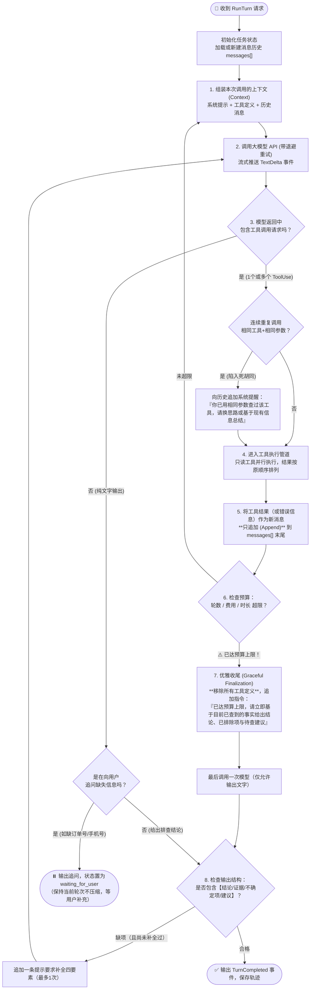
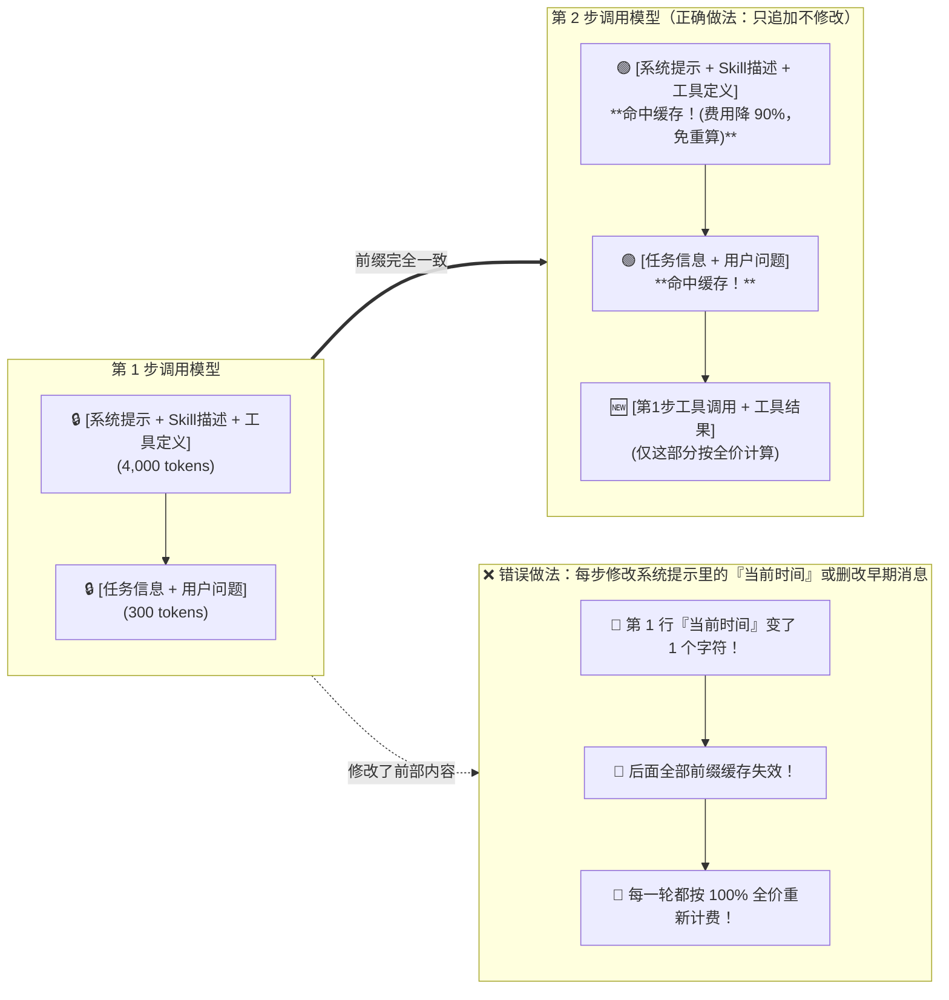
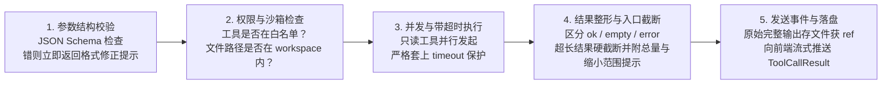
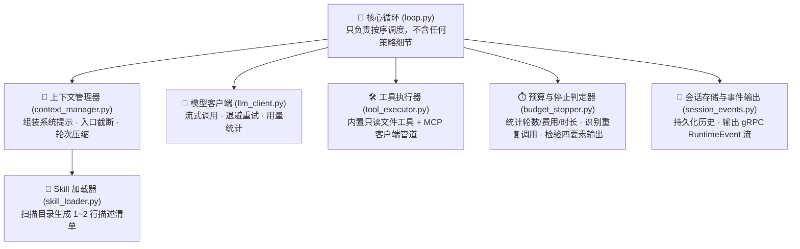
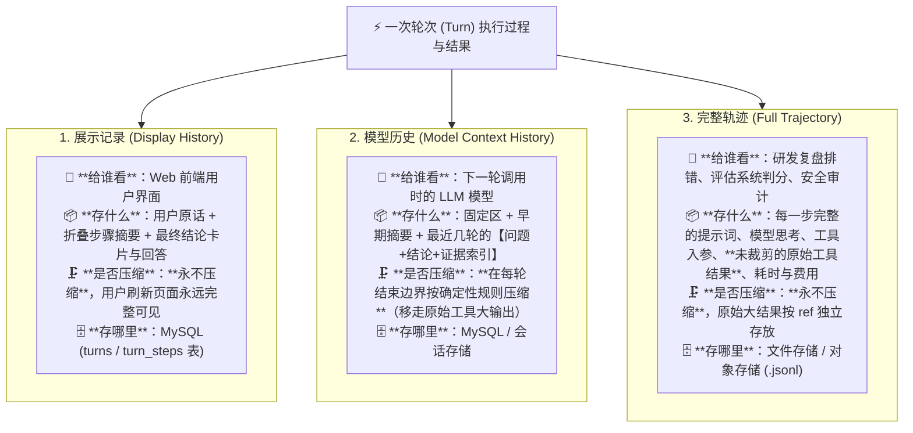
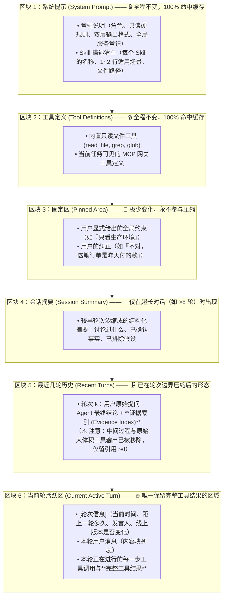
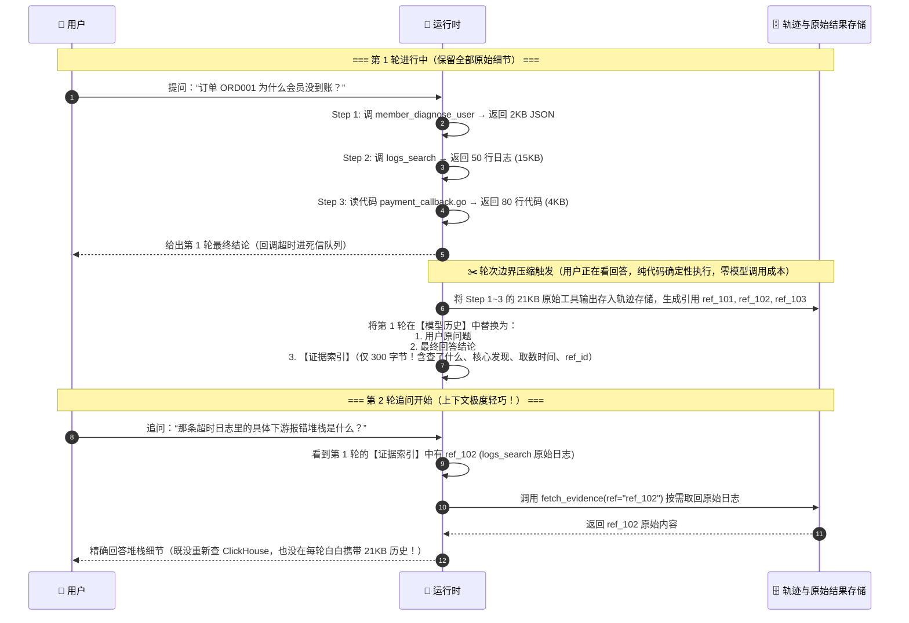
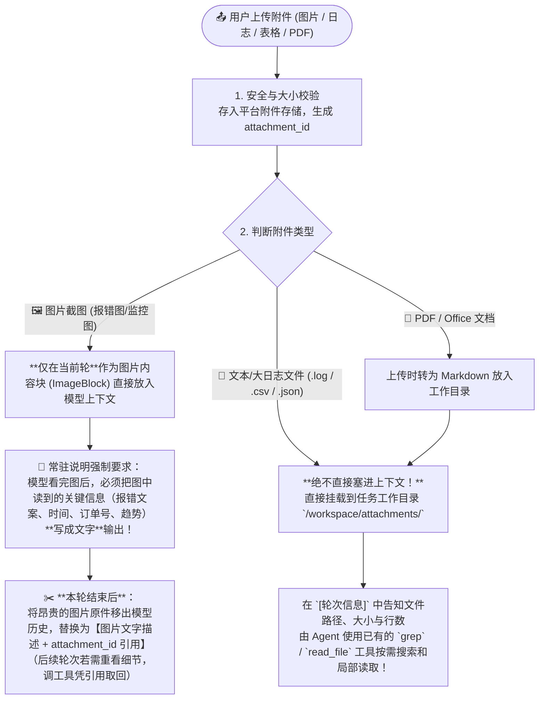

# 03 核心机制深度图解：运行时、上下文与多模态

本文档将原本散落在《03-自研运行时》《06-上下文与多轮会话》《07-多模态》三篇草稿中的核心机制串联起来，通过**可视化图解**讲透三个核心问题：
1. **运行时（Harness）内部到底是怎么转起来的？** 为什么无状态的模型能连续调工具，为什么历史记录“只追加、不修改”？
2. **多轮对话怎么做到“既不失忆、又不天价”？** 为什么要存三份数据，什么是“轮次边界压缩”与“证据索引”？
3. **当用户发来报错截图或 50MB 的大日志文件时，系统怎么处理才最聪明？**

---

## 1. 自研运行时（Harness）核心原理解剖

> **一句话定义运行时**：模型本身只是一个“根据眼前的文字预测下一段文字”的无状态函数；**运行时（Harness）就是包在模型外面的那层控制程序**——它决定给模型看什么（上下文）、替模型跑腿执行动作（工具管道）、盯着账单和步数（预算控制），并在该停的时候停下来。

### 1.1 Agent 核心循环与“优雅收尾”状态机

很多初学者写的 Agent 循环，一旦达到最大步数（比如循环了 15 次还没查完），就直接抛个异常 `MaxTurnsExceededError` 给用户，导致前面查了 14 步的辛苦成果全部白费。
**正确的工业级循环设计包含“预算触顶时的优雅收尾（Graceful Finalization）”**：

### 1.2 为什么消息历史必须“只追加、不修改”（KV Cache 缓存原理图解）

因为大模型是**完全无状态**的，它在第 5 步能记得第 1 步查过的订单状态，唯一的原因是**运行时在第 5 次调用模型时，把前 4 步的所有消息又原封不动地发了一遍**。

既然每一步都要重发前面的所有内容，岂不是越往后越慢、越往后越贵？
这就涉及到大模型服务底层的 **Prompt Caching（前缀 KV 缓存）** 机制：

> [!IMPORTANT]
> **三条直接由缓存原理推导出的黄金编码准则**：
> 1. **稳定的内容永远放最前面**：`系统提示` → `Skill 描述清单` → `工具定义` 放在最开头，整个对话期间一字不改。
> 2. **动态变化的信息永远追加在末尾**：每一轮的 `当前时间`、`线上版本是否变化` 等动态信息，不要塞进开头的系统提示里，而是作为 `[轮次信息]` 跟在用户最新消息旁边追加在末尾。
> 3. **工具报错也作为普通结果追加，绝不中断或回滚历史**：当模型填错参数导致 SQL 报错时，把错误原因和正确格式提示包装成一条 `ToolResult` 追加到末尾。模型在下一步看到错误后，会自动修正参数重试（自愈）。

### 1.3 工具执行管道（Tool Execution Pipeline）

无论是运行时内置的读文件工具（`read_file`、`grep`、`glob`），还是远端 MCP 网关的业务工具，在运行时内部都必须经过同一条五步管道：

### 1.4 自研运行时（Native Harness）的内部模块解耦

在编写 `runtimes/native/` 时，**严禁把上下文拼接、预算计算、MCP 调用全塞进一个几百行的 `while` 循环函数里**。必须按单向依赖拆分为以下独立模块（方便后续每次实验只替换其中一个策略）：

---

## 2. 上下文管理与多轮会话：既不失忆，又不天价

### 2.1 核心区分：会话（Session）≠ 上下文（Context），为什么要存“三份数据”？

很多系统只用一张表存对话消息，既拿它渲染前端页面，又拿它原样发给大模型。这会陷入两难死局：
- **如果不压缩**：第 1 轮查了 50 行日志，第 2 轮到第 10 轮每次调用模型都要把这 50 行日志再发一遍，Token 费用爆炸，且模型注意力被早期废话淹没。
- **如果直接删改消息**：前端用户一刷新页面，发现之前的对话内容或排查步骤没了！

**本系统的解决方案：将同一个对话的数据一分为三，各司其职**：

### 2.2 每次调用模型时，上下文的“六大区块”组装顺序

为了兼顾**前缀缓存命中率最高**与**关键约束永不丢失**，每次发给模型的上下文严格按从上到下（从最稳定到最活跃）的 6 个区块拼装：

### 2.3 轮次边界压缩（Turn-Boundary Compaction）与“证据索引”机制

为什么不在上下文快塞满（比如到了 150k tokens）时才用模型做摘要压缩，而是选择在**每一轮问答结束时（Turn Boundary）**用代码规则做压缩？

**一张表看懂“轮次边界压缩”留什么、移走什么**：

| 保留在模型历史（`Recent Turns`）中 | 移出模型历史，存入完整轨迹（`Trajectory Store`） |
| :--- | :--- |
| 1. 用户的原始提问消息 | 1. 轮次中间步骤的模型过渡思考文字 |
| 2. 最终回答（结论、证据说明、不确定项、建议） | 2. 工具调用的完整入参细节 |
| 3. **证据索引（Evidence Index）**： • 查了什么：`logs_search(member-api, prod, 14:00~15:00)` • 关键发现：`回调超时错误 312 次，14:20 起出现` • **取数时间**：`14:32`（用于跨轮判断数据是否过期） • **原始引用**：`ref_102`（可随时用 `fetch_evidence` 工具取回） | 3. **工具返回的全部原始内容**（几十行日志、长代码片段、大 JSON） |

> [!TIP]
> **一期与二期的务实分工**：
> - 在**一期（M1~M4）**：Claude Agent SDK 运行时直接使用其内置的 `resume` 会话接续与自动 `compact` 机制；自研运行时在一期只需实现**“工具结果入口截断”**与基础的消息历史保存接续，即可满足中短对话需求。
> - 在**二期**：当长对话成本或后段遗忘问题显现时，在自研运行时中完整启用上述**轮次边界压缩 + 证据索引 + 固定区**，并与 SDK 默认机制做评估对比。

### 2.4 多轮对话中的 4 类典型场景处理规则

| 场景 | 典型用户话术 | 系统的处理法则 |
| :--- | :--- | :--- |
| **1. 隔时追问（事实过期）** | （隔了 2 小时后）“研发说修好了，你再看看这个用户现在有权益了吗？” | 代码注入的 `[轮次信息]` 会标明 `距上一轮 2小时10分` 且上一轮证据取数时间为 `14:32`。常驻说明规定：**凡涉及会变化的实时状态（订单、会员、缓存、错误率），距取数时间超阈值必须重新调用工具查询，严禁直接背诵上一轮结论。** |
| **2. 信息不全（等待补充）** | 第一句只问：“有个用户反馈付了钱没拿到会员” | Agent 不盲猜，立即停止工具调用并向用户追问订单号或手机号；轮次状态进入 `waiting_user`。**注意：此时本轮尚未结束，不做轮次压缩**，用户回复手机号后在同一轮次内无缝继续。 |
| **3. 用户纠正（写入固定区）** | “不对，你查错人了，这个用户是昨天下午付的款” | 将用户的纠正写入该对话的**固定区（Pinned Area）**，永远保留在上下文前部；若用户的说法与数据库查出的铁证冲突，Agent 必须礼貌摆出数据指出冲突，而不是盲目顺从用户编造结论。 |
| **4. 切换运行时（交接棒）** | 第 1 轮用了 `SDK 运行时`，第 2 轮想切到 `自研运行时` 试试 | 两个运行时的底层会话格式不互通。切换时系统自动新建一个会话，并将原对话的**固定区 + 各轮结论与证据索引**作为初始背景注入新运行时，实现平滑交接。 |

---

## 3. 多模态处理机制：当用户发来截图或大文件（二期扩展，一期预留接口）

在日常排障中，同事经常直接甩一张**报错界面截图、监控面板截图**，或者上传一个 **50MB 的日志文件 / PDF 文档**。
虽然一期只开放纯文字输入，但因为我们在**接口 ① 和接口 ② 中已经把消息定义为 `ContentBlock[]` 列表**，二期接入多模态时无需修改任何接口骨架。

### 3.1 多模态核心法则：“文件进目录，原图仅活一轮，读图必落文字”

### 3.2 为什么这套多模态设计既省钱又准确？

1. **为什么大日志文件绝不塞进上下文，而是放进工作目录？**
   一个 20MB 的日志文件塞进上下文会瞬间撑爆 Token 上限。把它放进任务工作目录 `/workspace/attachments/app.log`，Agent 就能直接用现成的 `grep` 工具搜索报错关键字、用 `read_file` 读匹配行的上下文——**不增加任何新机制，就把多模态文件输入转化成了最擅长的文件检索问题。**
2. **为什么要求模型“看完截图必须把关键信息写成文字”？**
   - 后续调 `logs_search` 或 `member_diagnose_user` 需要把图里的订单号、报错时间作为字符串参数传进去；
   - 本轮一结束，占几千 Token 的原图就会被移出历史，写成文字才能留在结论和证据索引里；
   - 用户一眼能看出 Agent 有没有把图里的订单号看错（比如把 `0` 看成 `O`），看错了可以立刻纠正。
3. **为什么工具层面坚持“能返结构化数据，绝不返图表截图”？**
   模型从数字序列里读出峰值和时间点，比看一张监控折线图像素要准得多、便宜得多。因此平台规定：**监控、日志等工具一律返回数字摘要和采样点，严禁返回截图**；只有确实没有数据接口的第三方截图才允许走图片引用。
4. **当所选模型不支持看图时怎么降级？**
   前端根据运行时注册表声明的能力决定是否开放图片上传；若某模型不支持看图，可先由支持视觉的模型将图片转述为详细的结构化文字描述，并在回答中明确告知用户“图片已经过文字转述”，绝不静默丢弃用户的图片。

---

理解了运行时循环、上下文压缩与多模态这三大核心引擎机制后，我们接下来看支撑引擎运转的弹药库：**[04-能力底座深度图解：MCP网关、连接器、Skill与代码仓库.md](file:///Users/xuye/360/oversea/oversea_AI/docs/argon_polish/04-能力底座深度图解：MCP网关、连接器、Skill与代码仓库.md)**。
