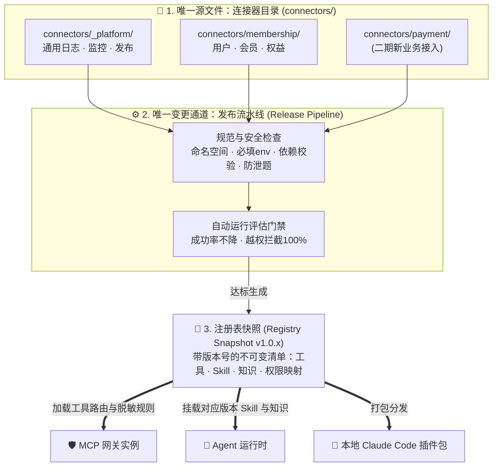
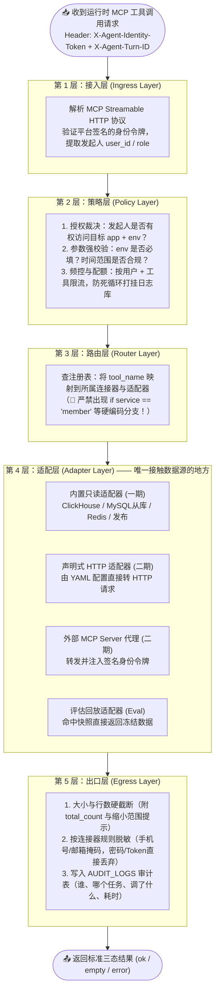
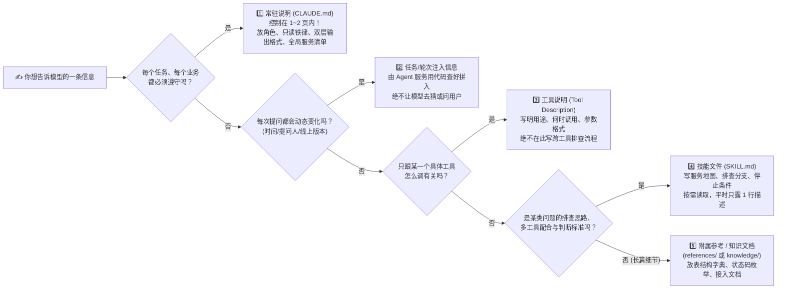
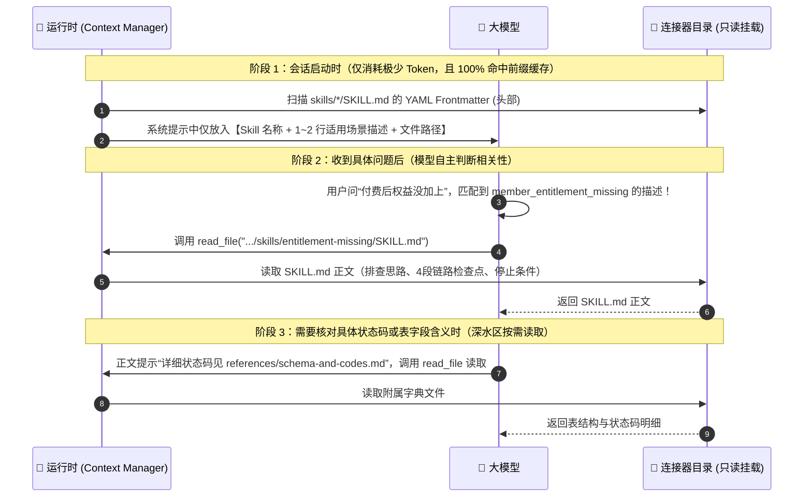
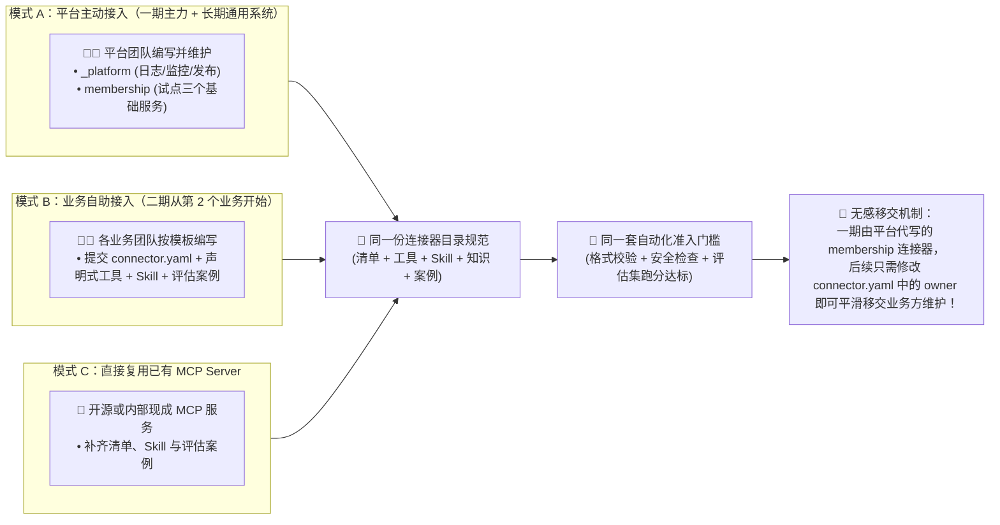
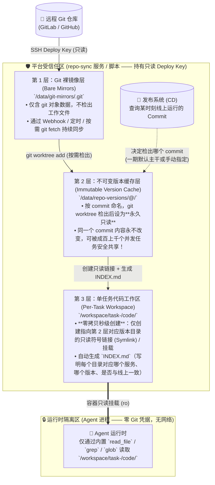

# 04 能力底座深度图解：MCP网关、连接器、Skill与代码仓库

在 [03-核心机制深度图解](file:///Users/xuye/360/oversea/oversea_AI/docs/argon_polish/03-核心机制深度图解：运行时、上下文与多模态.md) 中，我们拆解了运行时引擎是如何运转的。但一个空转的引擎解决不了任何业务问题——**决定 Agent 到底能不能查对线上问题的，是它手里的“工具（Tools）”、“排查说明书（Skills）”和“代码目录（Code Workspace）”**。

本文档将原草稿中《04-连接器接入规范》《05-MCP网关与Skill管理》《08-代码仓库管理》三篇专题整合，用图解法讲清能力层的四大支柱：
1. **MCP 网关五层架构**：如何保证网关核心“零业务代码”，同时守住权限、脱敏与审计大门？
2. **提示词与 Skill 管理法则**：哪句话该写在哪里？如何按需加载才不会把上下文撑爆？
3. **连接器（Connector）双模式演进**：如何用一套目录结构同时支撑一期的“平台主动接入”和二期的“业务自助接入”？
4. **代码仓库三层管理机制**：如何在不给 Agent 任何 Git 权限的前提下，让它读到与线上运行版本完全一致的多仓库代码？

---

## 1. 为什么工具和 Skill 多了会乱？三条治乱铁律

很多团队做 Agent，刚开始三五个工具跑得很顺；过了两个月加到 40 个工具、20 篇提示词，系统突然开始**选错工具、引用已废弃接口、网页端和本地插件表现不一致**。
为了从第一天起杜绝这种混乱，平台确立了**“单一事实来源（Single Source of Truth）”**架构：



> [!IMPORTANT]
> **治乱的三条铁律（从第一天起遵守）**：
> 1. **一切资产必归属于连接器**：不存在“游离”的工具或 Skill。每个连接器（如 `membership`）都有明确的负责人（Owner）。
> 2. **注册表快照是唯一来源**：MCP 网关暴露什么工具、运行时加载什么 Skill、本地插件打包什么配置，全部由同一份带版本号的注册表产出。
> 3. **严禁提供“后台直接改提示词/改工具”的散装入口**：所有修改必须改仓库里的文件，走评估验证后发布。出了问题一秒钟就能切回上一个快照版本。

---

## 2. MCP 网关设计：五层管道与工具设计精髓

### 2.1 网关内部五层架构（“零业务代码”原则）

MCP 网关用 Go 语言实现，对外暴露一个统一的 MCP 地址。其内部严格划分为五层，任何一次工具调用都像过安检一样依次穿过这五层：



**如何检验你的网关代码写得合不合格？**
看一条标准：**当你要新增一个工具时，第 1 层（接入）、第 2 层（策略）、第 3 层（路由）、第 5 层（出口）的 Go 代码是否一行都不用改？** 如果只需要在第 4 层（适配层）加一个函数并在配置文件里注册，说明架构是干净的。

### 2.2 一期四大类工具设计与安全护栏

在一期（M1~M2），我们围绕三个基础服务提供以下四类只读工具：

| 工具类别 | 一期实现形态 | 强制安全护栏（由网关代码强制，不靠模型自觉） | 二期演进方向 |
| :--- | :--- | :--- | :--- |
| **1. 日志查询 (`ClickHouse`)** | `logs_search` / `logs_count_by_error`（自用阶段可支持受控只读 SQL） | • 使用专用只读账号<br/>• 强制校验查询包含时间范围（如跨度 ≤ 24h）<br/>• 强制附加 `LIMIT`（默认 50 行）与最大执行时间（如 5s） | 全部收敛为语义化参数工具 + 按 `trace_id` 聚合全链路日志 |
| **2. 业务库查询 (`MySQL 从库`)** | `mysql_readonly_query` 及高频汇总工具 `member_diagnose_user` | • **物理隔离：只连只读从库（Read Replica）**<br/>• AST/语法级拦截：仅允许 `SELECT`，强制带索引条件或 `LIMIT`<br/>• 敏感列在数据库视图层或网关出口层直接脱敏 | 将高频排查 SQL 全部固化为像 `member_diagnose_user` 一样的链路级工具 |
| **3. 缓存读取 (`Redis`)** | `redis_get_user_cache` | • **从第一天起就严禁开放任意 Redis 命令！**<br/>• **严禁 `KEYS *` 或全量 `SCAN`**<br/>• 只提供按业务语义封装的读取（传入 `user_id`，内部拼好固定 Key 前缀去 `GET/HGETALL`） | 按连接器声明的 Key 模板自动生成只读缓存工具 |
| **4. 发布记录 (`CD 系统`)** | `deploy_list_recent` | • 只读 Token 访问发布系统 API<br/>• 必填 `service` 与 `env`，返回最近发布时间、版本号、Commit 与变更人 | 增加 `deploy_get_current_version`（含灰度比例）与版本间 `deploy_diff` |

### 2.3 工具命名空间规范与动态加载（防上下文膨胀）

- **命名格式**：`<连接器前缀>_<受限动词>_<对象>`。
- **受限动词表（只允许这 6 个动词）**：
  - `get`：按唯一标识精确取一条（如 `order_get`）
  - `list`：按条件列多条，带分页（如 `deploy_list_recent`）
  - `search`：按关键字、时间段模糊搜索（如 `logs_search`）
  - `count`：按维度统计数量或分布，先看分布再查明细（如 `logs_count_by_error`）
  - `diagnose`：面向一个业务问题，一次性汇总多段状态（如 `member_diagnose_user`）
  - `diff`：对比两个版本或两个时间段（如 `deploy_diff`）
- **工具数量增长后的按需过滤（二期）**：
  一期工具总数少于 15 个，直接全量放入上下文；二期当接入多个业务、工具破百时，网关只向当前会话返回 **“提问人有权限 ∩（当前目标应用 + 依赖应用 + 平台通用）”** 的工具子集，并额外提供一个始终可见的 `tools_search` 工具供跨业务按需申请加载。

---

## 3. 提示词工程与 Skill 管理：内容归位与三层按需加载

> **为什么 Agent 答得好不好，80% 取决于你写的文字（提示词与 Skill）？**
> 因为循环和网关只是管道，真正教会模型“你们公司的会员业务长什么样、遇到未到账先查哪张表、看到什么状态才算查清”的，全靠连接器里的文字。

### 3.1 黄金法则：五类信息的“内容归位表”（每条信息只写在一处！）

写任何说明文字前，先对照下表判断它该放哪，**严禁把同一段话在工具说明、Skill 和常驻说明里到处复制粘贴**：



### 3.2 Skill 的纵向三层划分与横向三阶段按需加载

#### （1）纵向分三层：避免两个 Skill 抢同一道题
| 层级 | 放在哪里 | 回答什么问题 | 典型例子 |
| :--- | :--- | :--- | :--- |
| **平台层 Skill** | `connectors/_platform/skills/` | 跨所有业务通用的排障方法论 | 《如何判断线上异常是否由近期发布或配置变更引起》 |
| **领域层 Skill** | `connectors/membership/skills/overview/` | 整个业务领域的全局架构与服务地图 | 《用户、会员、权益三服务调用链路、消息关系与核心表总览》 |
| **场景层 Skill** | `connectors/membership/skills/<具体场景>/` | **某一类具体高频问题**的排查指南（**铁律：一类问题只准有一个场景 Skill**） | 《付费后会员或权益未到账排查指南》 |

#### （2）横向分三阶段按需加载：花最少的 Token 办最大的事



> [!TIP]
> **如何衡量你的 Skill 写得好不好？看两个指标**：
> 1. **Skill 命中率（Hit Rate）**：在应该用该 Skill 的评估题中，模型实际去读了 `SKILL.md` 正文的比例。**如果命中率低，说明头部的 `description`（适用场景描述）写得太含糊！**
> 2. **加载后成功率（Post-Load Success Rate）**：模型读了 `SKILL.md` 正文后，最终查出正确根因的比例。**如果读了还是答错，说明正文里的排查思路、判断标准或引用的工具写得有问题！**

---

## 4. 连接器（Connector）双模式演进：从“平台包办”到“业务自助”

在一期，我们只覆盖用户、会员、权益三个基础服务；到了二期，支付、商品、营销等十几个业务团队都想接入。怎么做到**一期快、二期不返工**？

答案是：**从第一天起，平台自己写的三个基础服务接入，也严格按 `connectors/membership/` 标准连接器目录来写！**



---

## 5. 代码仓库管理：让 Agent 安全、精准地读懂线上代码

“某某业务逻辑是什么”答案在代码里；“为什么报这个错”也需要顺着日志里的文件名和行号去看代码。
但代码管理有三个棘手问题：
1. **安全问题**：绝不能把 Git 私钥给 Agent，也不能让 Agent 在目录里随便跑 `git checkout` 把别的任务搞乱。
2. **版本不一致问题**：Git 主干（`main`）上的最新代码可能刚提交还没发版，线上实际跑的是昨天发布的 `v1.9.0`。看错代码版本就会给出荒谬的结论。
3. **跨仓库与公共库问题**：会员业务跨 3 个仓库，还依赖一个公共库，怎么放到一起？

### 5.1 三层代码目录架构（镜像层 → 不可变版本层 → 任务工作区）

我们设计了一套极其轻巧的**三层目录结构**（一期先实现简化的脚本拉取 + 任务目录组装，二期接 CD 系统按线上 Commit 精确检出）：



### 5.2 每个业务仓库必备的“导游图”：`docs/agent-overview.md`

如果把一个几万行代码的陌生仓库直接扔给 Agent，它得调十几次 `glob` 和 `grep` 才能摸清门道，既慢又费钱。
因此，我们在**每个业务代码仓库内部**放一份跟代码一起维护的 `docs/agent-overview.md`（约 1~2 页）：

| 必填章节 | 写清楚什么内容 | 为什么放在业务仓库里而不是平台上？ |
| :--- | :--- | :--- |
| **1. 服务定位与入口** | 这个仓库对应线上哪个服务？HTTP 路由入口、RPC 入口、定时任务入口分别在哪个文件？ | 代码重构或新增接口时，研发在同一个 PR 里顺手更新说明，**保证说明与对应 Commit 的代码永远 100% 同步，绝不脱节** |
| **2. 核心目录结构** | `internal/handler`、`internal/service`、`internal/dao` 等关键目录各管什么？ | 让 Agent 一步定位到目标模块，少走弯路 |
| **3. 对外接口与消息消费** | 暴露了哪些核心接口？消费了哪些 MQ Topic（消费者代码在哪个文件）？ | 排查“上游发了消息但本服务没处理”时直接命中代码位置 |
| **4. 下游依赖与发出的消息** | 调用了哪些下游服务？往外发了哪些 MQ 消息？配置开关在哪读？ | 支撑跨服务链路顺藤摸瓜 |

### 5.3 只读部署密钥（Deploy Key）安全配置 4 步法

在一期准备代码目录（学习单元 10）时，**绝对不要把你个人的 SSH 私钥（`~/.ssh/id_rsa`）拷到服务器上**（个人私钥有写权限且人员变动会失效）。标准做法只需 4 步：

```bash
# 1. 在平台受信任区生成专用的只读 Ed25519 密钥对（无密码）
ssh-keygen -t ed25519 -C "oversea-agent-readonly" -f /etc/agent-platform/keys/membership_deploy_key -N ""

# 2. 将生成的公钥 (.pub) 内容交给仓库管理员，在 GitLab/GitHub 仓库设置中添加为【Deploy Key（不勾选写权限）】
cat /etc/agent-platform/keys/membership_deploy_key.pub

# 3. 固定 Git 服务器 Host Fingerprint 到 known_hosts（严禁使用 StrictHostKeyChecking=no）
ssh-keyscan -t ed25519 git.example.com >> /etc/agent-platform/keys/known_hosts

# 4. 验证只读拉取权限（私钥仅平台区 repo-sync 脚本可读，运行时容器绝不挂载此目录）
GIT_SSH_COMMAND='ssh -i /etc/agent-platform/keys/membership_deploy_key -o IdentitiesOnly=yes -o UserKnownHostsFile=/etc/agent-platform/keys/known_hosts' \
  git ls-remote git@git.example.com:oversea/member-service.git
```

---

搭建好了运行引擎（03）与能力底座（04），我们如何科学地衡量它聪不聪明、安不安全，并让它每周持续变强？请继续阅读：**[05-评估驱动开发（EDD）与安全防护体系.md](file:///Users/xuye/360/oversea/oversea_AI/docs/argon_polish/05-评估驱动开发（EDD）与安全防护体系.md)**。
