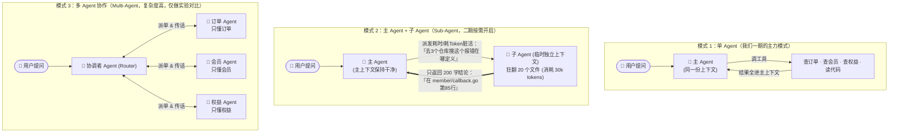
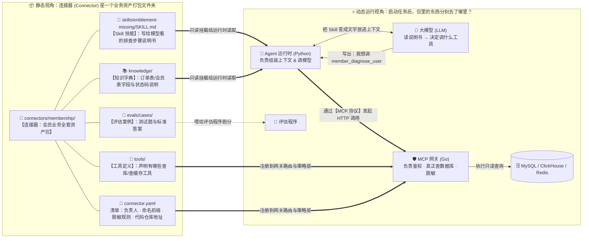

# 07 核心概念深度辨析：子Agent vs 多Agent、连接器 vs MCP vs Skill

在学习 Agent 架构时，最容易让人犯迷糊的就是这两组概念：
1. **第一组（怎么组织干活的人）**：「单 Agent」、「子 Agent (Sub-Agent)」、「多 Agent (Multi-Agent)」到底有什么区别？为什么我们排查跨服务问题（用户+会员+权益）**只用一个主 Agent**，不搞成每个服务一个 Agent？
2. **第二组（怎么组织干活的工具与说明书）**：「工具 (Tool)」、「MCP」、「MCP 网关」、「Skill（技能）」、「连接器 (Connector)」这五个词天天一起出现，它们到底谁包含谁、各自解决什么问题？

本文用**生活类比 + 架构图解 + 真实排障完整案例**，帮你一次性彻底搞通这两组核心概念。

---

## 第一部分：单 Agent vs 子 Agent vs 多 Agent

### 1. 用“医院看病 / 侦探破案”做最直白的类比

想象一个患者来看病（比如“付了钱但没拿到会员权益”）：

| 模式 | 生活类比 | 工程本质（上下文怎么分？） |
| :--- | :--- | :--- |
| **1. 单 Agent (Single Agent)** | **全科主治医生自己看病**。 医生自己问诊、自己看化验单、自己翻病历，从头跟到尾。 | **只有 1 个循环、1 份上下文**。 所有查到的日志、代码、数据库记录都塞在同一个上下文里。 |
| **2. 主 Agent + 子 Agent (Sub-Agent / 子任务)** | **主治医生派实习生去干“脏活累活”**。 主治医生需要从 5000 行杂乱日志里找一条报错，如果自己一行行看，脑容量（上下文）就爆了。于是他写张纸条让实习生（子 Agent）去翻这 5000 行日志，实习生翻完后**只把 3 行结论交回给主治医生**，实习生看过的 5000 行废话不进主治医生的脑子。 | **为了“省上下文（隔离噪音）”而生的临时工**。 主 Agent 把一个明确的小任务当成一次“工具调用”派给子 Agent → 子 Agent 在**独立的新上下文**里跑完循环 → **只把最终简短结论返回给主 Agent**，随即销毁。 |
| **3. 多 Agent (Multi-Agent)** | **多科室专家联合会诊 / 部门间开会甩锅**。 一个挂号分诊员（协调者 Coordinator），底下坐着“订单专家 Agent”、“会员专家 Agent”、“权益专家 Agent”，几个专家之间互相发消息讨论、移交任务。 | **为了“角色专业化分治”而生的多套系统**。 多个平级或树状的 Agent 各自有独立的系统提示词、独立的工具集、独立的上下文，彼此通过消息传递或交接协议协同。 |

---

### 2. 一张图看懂三者的上下文与调用结构差异

---

### 3. 核心灵魂拷问：为什么跨服务问题（订单→会员→权益）不用“多 Agent”？

很多刚接触 Agent 的同学会直觉地想：*“既然我们有用户、会员、权益三个微服务，那我是不是应该给每个微服务建一个专属 Agent，再搞一个总管 Agent 把它们串起来？”*

**答案是：千万不要！在一期用单 Agent（配服务地图 Skill + 链路汇总工具），无论准确率、速度还是成本都完胜多 Agent。** 原因有三点：

1. **多 Agent 最大的痛点是“传话失真（传声筒效应）”**：
   - 协调者把问题转给“会员 Agent”，“会员 Agent”看不到“订单 Agent”刚才查出来的原始微妙线索，两边来回传摘要，很容易漏掉关键关联字段（比如 `trace_id` 或毫秒级的时间差）。
   - 而**单 Agent** 把订单、会员、权益的几条关键记录放在同一个脑子（上下文）里对比，一眼就能看出“订单 14:19:58 支付成功，会员 14:20:03 报错超时”的因果关系。
2. **多 Agent 延迟翻倍、Token 费用翻倍**：
   - 每个 Agent 启动都要读一遍系统提示词和背景信息；协调者调完 A 调 B 再汇总，原本单 Agent 调 3 次工具 8 秒钟能答完的问题，多 Agent 要跑 30 秒、花 3 倍的钱。
3. **什么时候才真正需要“子 Agent”或“多 Agent”？**
   - **何时需要子 Agent（Sub-Agent）**：当某一步操作会**吐出巨量中间垃圾数据**时！比如：
     - **日志大海捞针子任务**：要在 500 条报错日志里归纳异常模式；
     - **跨多仓库代码搜索子任务**：要在 10 个代码仓库里翻找某个底层错误码到底是在哪一行抛出来的。
     此时让子 Agent 去翻，主 Agent 只拿回最后那 3 行结论，主上下文就不会被撑爆。
   - **何时才需要多 Agent（Multi-Agent）**：当平台接入了**几十个完全不相干的业务部门**（比如财务系统、HR 系统、海外会员系统、广告投放系统），工具总数超过 200 个，一个 Agent 根本装不下所有领域的提示词和工具时，才需要按大领域拆分不同的专职 Agent。

---

## 第二部分：连接器 (Connector) vs MCP vs Skill

这五个词（**Tool、MCP、MCP 网关、Skill、连接器**）之所以容易混，是因为它们其实处在**不同的抽象维度**上。

### 1. 用“智能手机 / 厨房做菜”一秒钟建立直觉

想象你要让一个机器人厨师（**大模型**）做出一道“宫保鸡丁（**排查会员未到账问题**）”：

| 概念 | 厨房做菜类比 | 电脑硬件类比 | 一句话精准定义 |
| :--- | :--- | :--- | :--- |
| **1. 工具 (Tool)** | **具体的厨具动作** （开火、切丁、尝咸淡） | 鼠标、键盘、打印机 | 一个具体的**查询函数**（比如 `logs_search` 查日志、`order_get` 查订单）。 |
| **2. MCP (协议)** | **厨具的统一电源插座标准** （不管什么牌子的电饭煲，插头都长一样） | **USB Type-C 接口标准** | 一种**通信协议格式**。规定了工具怎么描述自己的名字和参数、程序怎么通过 HTTP 调用它。有了它，你写的工具既能插在平台网页上用，也能插在本地 Claude Code 上用。 |
| **3. MCP 网关 (Gateway)** | **厨房总控电闸与安检员** （刷卡才能通电、限制最大功率、记录谁用了哪个锅） | **带权限管控的 USB 扩展坞 (Hub)** | 所有 MCP 工具的**统一入口服务器（Go 编写）**。负责检查谁在调用、有没有权限、把手机号脱敏、记录审计日志。 |
| **4. Skill (技能)** | **《宫保鸡丁标准菜谱》** （写着：先切肉、再热油、看到肉变色再下花生米） | **软件使用操作手册 (SOP)** | 一篇**写给大模型看的 Markdown 排查说明书**（`SKILL.md`）。它本身**不是代码**，它只教模型：遇到“会员未到账”时，先调哪个工具、再调哪个工具、看到什么结果算查清了。 |
| **5. 连接器 (Connector)** | **《川菜料理全套材料包》** （一个礼盒，里面打包好了：川菜专用厨具 + 5本川菜菜谱 + 食材字典 + 试吃考题） | **某个设备驱动的完整安装包** | **业务接入平台的打包管理单元（一个文件夹）**。把某个业务（如 `membership` 会员业务）所需的 **工具定义 + Skill 说明书 + 表结构知识 + 评估测试题** 全部装进同一个目录里，方便统一开发、统一评估、统一移交。 |

---

### 2. 一张图看清它们五个的“包含关系”与“运行时走向”

请仔细看下面这张图：**左边是代码仓库里的静态打包关系（连接器包含一切），右边是程序跑起来时的动态去向（各奔东西、各司其职）**：

---

### 3. 灵魂三问：彻底厘清 Tool（MCP）、Skill 与连接器的边界

#### ❓ 问题 1：既然有了 MCP 工具，为什么还需要 Skill？只给模型工具不行吗？
- **如果只给 MCP 工具，不给 Skill**：
  就像把听诊器、CT 机、验血仪（**MCP 工具**）全摆在医学生面前，但没给他《内科诊断学》（**Skill**）。
  当用户问“我付了钱为什么没会员权益？”时，模型看到手头有 `logs_search`、`mysql_readonly_query`、`redis_get_user_cache` 三个工具，它不知道该先查哪张表，也不知道 `orders` 表的 `pay_status=2` 代表已支付，更不知道会员服务和权益服务之间隔着一个消息队列。于是它就会乱查一通、瞎猜结论。
- **反过来，如果只给 Skill，不给 MCP 工具**：
  就像给了医学生一本倒背如流的《内科诊断学》（**Skill**），但他手头没有任何检查设备（**MCP 工具**）。他知道“应该先查订单表再查回调日志”，但他拿不到线上的真实数据，只能纸上谈兵。
- **结论**：
  - **MCP 工具 = 给模型“手和眼”**（让它能从数据库和日志里取出事实数据）；
  - **Skill = 给模型“脑子里的办案经验”**（教它按什么顺序使用这些工具，以及怎么解读工具返回的数据）。

#### ❓ 问题 2：同一段话，到底该写在“MCP 工具说明”里，还是写在“Skill”里？
这是实际开发中最常纠结的问题，判断标准非常简单：
- **只跟“这一个工具怎么用”有关的** $\rightarrow$ 写在 **MCP 工具说明 (Tool Description)** 里。
  - *例子*：`logs_search` 的说明写：“按服务名和时间范围搜索 ClickHouse 应用日志，单次最多返回 50 行，必填 `service`、`env`、`start`、`end`。”
- **涉及“多个工具怎么配合、某类业务问题怎么一步步排查”的** $\rightarrow$ 写在 **Skill (`SKILL.md`)** 里。
  - *例子*：“排查会员未到账时，第 1 步先调 `member_diagnose_user` 看订单状态；若订单已支付但会员未生效，第 2 步调 `logs_search` 查 `member-api` 在支付时间点前后 15 分钟的错误日志……”

#### ❓ 问题 3：既然我们已经写了 MCP 工具和 Skill，为什么还要搞一个“连接器 (Connector)”的概念？
- **当你只有 1 个业务（一期只做会员服务）时**：你确实感觉不到连接器的威力，它看起来就只是代码仓库里的一个文件夹 `connectors/membership/`。
- **当你要接入第 2 个、第 5 个业务（二期支付团队、营销团队也要用这个平台）时**：
  如果没有“连接器”这个打包规范，支付团队的研发就会问你：*“我想让 Agent 也能查我们支付系统的问题，我该改你们网关的哪几个 Go 文件？我的提示词塞在你们运行时的哪个目录？我的测试题放哪？”* —— 所有的业务代码都会跟你的平台底座搅成一团乱麻！
  有了**连接器规范**，你只需要告诉支付团队：
  > **“你们一行平台代码都不用看！只要照着 `connectors/membership/` 的样子，新建一个 `connectors/payment/` 文件夹，在里面放好你们的 `connector.yaml`（清单）、`tools`（工具）、`skills`（排查指南）和 `evals`（测试题），提个 PR 跑通评估，你们的业务就自动接入平台了！”**

---

### 4. 用一个真实排障故事，把所有概念串成一条线！

假设现在产品经理小王在网页上问了一句：**“订单 ORD20261113001 付了钱，为什么没拿到 VIP 权益？”**

看看这几个概念是如何像齿轮一样咬合运转的：

1. **连接器 (`connectors/membership/`) 提前备好了弹药**：
   平台启动时，从 `membership` 连接器文件夹里读取了会员业务的工具列表注册到 **MCP 网关**，并把连接器里的 **Skill 目录**挂载给了 **Agent 运行时**。
2. **单 Agent 启动，先看 Skill 目录摘要**：
   运行时里的**主 Agent**（单 Agent，不需要多 Agent）收到问题，一看系统提示里的 Skill 清单，发现有一本叫 `member_entitlement_missing`（《付费后会员或权益未到账排查指南》）的 **Skill** 正好对口！
3. **Agent 阅读 Skill 正文（学会办案套路）**：
   模型调用内置的 `read_file` 读了这篇 `SKILL.md`，学会了办案流程：*“第 1 步先调 `member_diagnose_user` 看四段状态；哪段断了再去查哪段的 `logs_search` 日志。”*
4. **Agent 通过 MCP 协议调用 MCP 网关上的工具（动手查数据）**：
   模型照着 Skill 的指引，发出一个 **MCP 协议**格式的请求调用 `member_diagnose_user(order_id="ORD20261113001", env="prod")`。
   请求穿过 **MCP 网关**（校验小王的登录令牌、确认有权限、查询 MySQL 从库、把手机号脱敏、写审计日志），返回结果：*“段 A 订单已支付；段 B 会员未生效。”*
5. **（可选）遇到海量日志或复杂代码时，派出子 Agent（Sub-Agent）**：
   接着主 Agent 查出了回调超时报错 `ErrCallbackTimeout`，想知道这个错误码在 3 个代码仓库里到底是怎么触发和重试的。如果主 Agent 启用了**子任务（子 Agent）**，它就派一个“代码定位子 Agent”去翻 3 个仓库的几十个代码文件，子 Agent 翻完后只告诉主 Agent 一句话：*“在 `member-service/internal/handler/payment_callback.go` 第 85 行，超时 3 次后进入死信队列不再重试。”*
6. **主 Agent 汇总证据，输出双层结论**：
   主 Agent 在自己的上下文里把库表记录、超时日志、代码行号拼齐，顶部生成一张大白话**结论卡片**给产品经理小王看，底部附上完整证据供研发核查。

---

### 5. 一张终极速查表（建议收藏）

| 名词 | 它是什么？ | 谁来写？ | 运行在哪里？ | 一期怎么做？ |
| :--- | :--- | :--- | :--- | :--- |
| **单 Agent** | 1 个循环 + 1 份上下文从头查到尾 | 运行时代码 | 运行时容器 (Python) | **一期默认且唯一的模式** |
| **子 Agent (Sub-Agent)** | 主 Agent 派出去干“耗 Token 脏活（翻海量日志/搜多仓库代码）”的临时工，只返结论 | 运行时配置 / 子任务定义 | 运行时容器 (Python) | 一期非必需，上下文过长时按需开启 |
| **多 Agent (Multi-Agent)** | 多个平级专职 Agent 互相发消息协同 | 编排框架 (如 LangGraph) | 运行时容器 (Python) | **一期不做**，二期仅做对比实验 |
| **工具 (Tool)** | 查日志、查库、读文件的具体函数 | 研发编写 | MCP 网关或运行时内置 | 一期做 4 类只读工具 + 3 个内置读文件工具 |
| **MCP** | 工具的标准通信协议（工具界的 USB 接口） | 开放标准协议 | 运行时 ↔ 网关之间 | 使用官方 MCP SDK |
| **MCP 网关** | 所有业务工具的统一安检大门（鉴权/脱敏/限流/审计） | 平台研发 (Go) | 平台受信任区 (Go) | 一期实现五层结构网关 |
| **Skill** | 写给模型看的《某类问题排查操作指南》(`SKILL.md`) | 熟悉业务的研发 | 挂载进运行时，按需读入上下文 | 一期写好“会员未到账”等核心排查 Skill |
| **连接器 (Connector)** | 把一个业务的 `清单 + 工具 + Skill + 知识 + 评估题` 打包在一起的文件夹 | 一期平台写，二期业务自己写 | 静态存 Git，动态分发给网关和运行时 | `connectors/membership/` 目录 |
