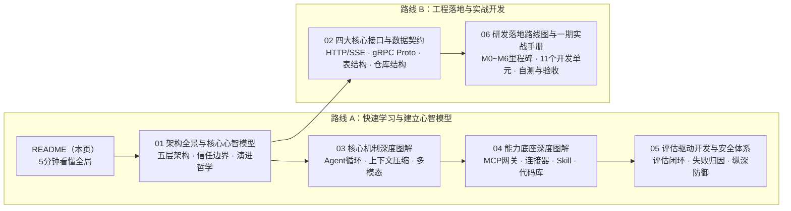
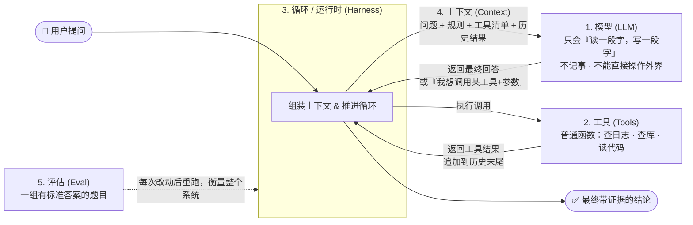
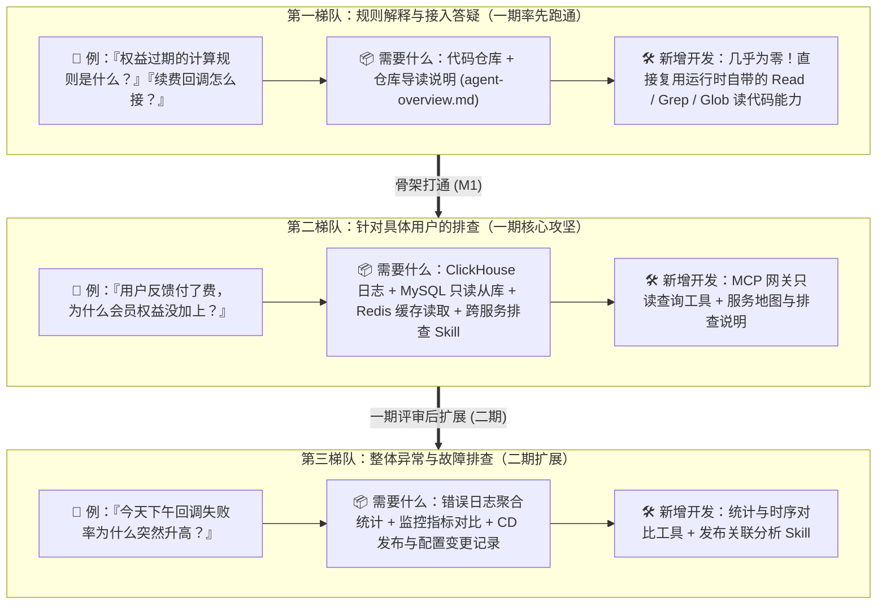
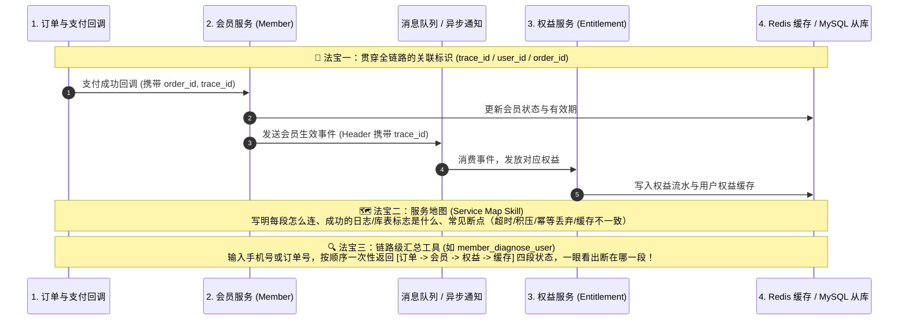

# 海外 AI Native 研发平台：架构设计与实战指南（精炼完整版）

> [!NOTE]
> **关于本文档集（`argon_polish`）**
> 本目录是对 `docs/ai-native-design/` 下 12 份早期草稿文档的**系统性重构、冲突消解与工程化补全**。
> 原草稿在演进过程中存在“早期全量设计（`01-总体设计`）”与“后期收敛方案（`00-从这里开始`、`架构总览`、`一期二期规划`）”并存的情况。本版文档**统一了架构口径**，补充了**大量可视化架构图、时序图、状态机**，并将抽象概念落地为**可直接编码的接口契约、数据模型与分步指南**，兼顾**“深入理解原理”**与**“直接指导开发”**两大目标。

---

## 1. 文档导航地图

无论你是想先建立对 Agent 系统的全局认知，还是准备动手写代码，都可以按以下路线阅读：

| 编号 | 文档名称 | 核心解决的问题 | 适合什么时候读 |
| :--- | :--- | :--- | :--- |
| **00** | [README.md](file:///Users/xuye/360/oversea/oversea_AI/docs/argon_polish/README.md)（本文档） | 这个项目到底要做什么？背后的核心概念是什么？业务从哪里切入？ | **第一站，必读** |
| **01** | [01-架构全景与核心心智模型.md](file:///Users/xuye/360/oversea/oversea_AI/docs/argon_polish/01-架构全景与核心心智模型.md) | 系统分几层？为什么用 Go + Python？如何保证运行时拿不到数据库密码？ | **动手前必读**，建立全局骨架 |
| **02** | [02-四大核心接口与数据契约规范.md](file:///Users/xuye/360/oversea/oversea_AI/docs/argon_polish/02-四大核心接口与数据契约规范.md) | 前后端怎么通信？`runtime.proto` 怎么写？数据库建哪几张表？代码目录怎么分？ | **编码落地时查阅**，直接喂给 AI 编码工具 |
| **03** | [03-核心机制深度图解：运行时、上下文与多模态.md](file:///Users/xuye/360/oversea/oversea_AI/docs/argon_polish/03-核心机制深度图解：运行时、上下文与多模态.md) | Agent 循环怎么转？为什么历史只追加不修改？多轮对话怎么压缩才不贵又不失忆？ | 学习 Agent 核心原理、开发自研运行时与多轮会话时读 |
| **04** | [04-能力底座深度图解：MCP网关、连接器、Skill与代码仓库.md](file:///Users/xuye/360/oversea/oversea_AI/docs/argon_polish/04-能力底座深度图解：MCP网关、连接器、Skill与代码仓库.md) | 工具怎么设计才不会乱？提示词、Skill、知识怎么分工？如何让 Agent 读到线上版本代码？ | 开发 MCP 网关、编写业务排查说明、管理多代码仓库时读 |
| **05** | [05-评估驱动开发（EDD）与安全防护体系.md](file:///Users/xuye/360/oversea/oversea_AI/docs/argon_polish/05-评估驱动开发（EDD）与安全防护体系.md) | 改了一行提示词怎么知道变好还是变差？答错了该改哪里？如何防止提示词注入与数据外泄？ | 搭建评估脚本、日常调优迭代、上线前安全评审时读 |
| **06** | [06-研发落地路线图与一期实战手册.md](file:///Users/xuye/360/oversea/oversea_AI/docs/argon_polish/06-研发落地路线图与一期实战手册.md) | 一期 M0~M6 具体先做什么后做什么？每个单元怎么交给 AI 写代码、怎么验收、怎么自测？ | **日常开发案头手册**，按里程碑逐个推进 |

---

## 2. 第一性原理：整个系统其实只有“五个基本概念”

不要被 Agent 领域层出不穷的新名词吓住。剥开外壳，整个系统只围绕**五个核心概念**运转：

### 2.1 五大基础概念用大白话讲透

| 核心概念 | 本质是什么（大白话） | 关键特性与设计推论 |
| :--- | :--- | :--- |
| **1. 模型 (Model)** | 一个只会**“读入一段文字，再续写一段文字”**的无状态程序。 | **它不记事**（每次调用都是第一次见面）；**它没有手脚**（不能自己连数据库或读文件，只能写出“我想调用某某函数”的文字）。 |
| **2. 工具 (Tool)** | 一个普通的程序函数，比如“查 ClickHouse 日志”、“读代码文件”。 | 模型负责**提议**（写出工具名和参数），外围程序负责**执行**。工具的名字和说明就是写给模型看的说明书。 |
| **3. 循环 / 运行时 (Runtime / Harness)** | 包在模型外面、反复跑的一段 `while` 循环程序。 | 把问题给模型 → 模型说要调工具 → 程序去调 → 把结果塞回给模型 → 直到模型说“我查清了，答案是……”。**我们用 Claude Agent SDK 或自研代码写的，就是这一层。** |
| **4. 上下文 (Context)** | 单次调用模型时，塞给它看的**全部文字**。 | 包含：系统规则、工具清单、用户问题、之前每一步的工具结果。**模型只知道上下文里有的东西**；太长会贵且漏看，太短会缺信息。 |
| **5. 评估 (Evaluation)** | 一组提前写好标准答案和得分点的测试题（YAML 文件）。 | 改了提示词、加了工具或换了模型后，批量重跑一遍。**没有评估，所有的优化都是凭感觉撞大运。** |

### 2.2 其他高大上的名词，都只是规模扩大后的“管理办法”

当你理解了上面五个概念，文档里出现的所有其他组件都能立刻对号入座：

| 派生名词 | 它本质上是五大概念里的什么？ | 什么时候才真正需要它？ | 一期怎么做？ |
| :--- | :--- | :--- | :--- |
| **Skill（技能）** | 放在**上下文**里的“某类问题排查说明书”（Markdown 文件） | 模型不知道“会员未到账该先查什么后查什么”时 | 写 1~2 份核心排查说明文件，按需读取 |
| **MCP 协议** | **工具**的一种标准化接口格式（类似工具界的 USB 接口） | 工具不仅要给平台网页用，还要给本地 Claude Code 共用时 | 网关对外暴露标准 MCP 接口 |
| **MCP 网关** | 所有**工具**的统一大门，集中做鉴权、脱敏、限流和审计 | 不能把数据库账号直接给模型运行时，且多人使用时要记账 | Go 写的轻量网关，管控 4 类只读工具 |
| **连接器 (Connector)** | 把某个业务的“**工具 + Skill + 知识文档 + 评估题**”打包放进一个文件夹 | 平台核心代码不想和具体业务逻辑耦合，或者有第 2 个业务要接入时 | 仓库里的 `connectors/membership/` 目录 |
| **多轮会话 (Session)** | 用户连续追问时，决定哪些历史保留、哪些压缩成**上下文** | 用户问完第一句，接着问“那为什么会超时？”时 | 保存三份数据（展示、模型历史、轨迹） |
| **代码仓库管理** | 把线上正在跑的代码提前准备好，让读文件**工具**去读 | 回答业务逻辑或排查线上报错，需要看具体代码实现时 | 脚本拉取三个仓库到固定只读目录 |
| **模型网关** | 调用**模型**的统一代理（负责多厂商路由、降级、算账） | 同时接多家大模型、需要按任务类型切便宜模型时 | **一期不做**，运行时直接调模型官方接口 |

---

## 3. 业务背景与切入策略：做什么、问什么、怎么跨服务？

### 3.1 项目定位与演进目标

海外业务的核心基础服务（**用户 User、会员 Member、权益 Entitlement**）在日常研发和运营中面临两大痛点：
1. **业务规则与接入答疑耗人**：业务方接入或产品询问规则时，高度依赖少数熟悉代码的研发人工翻代码答疑。
2. **线上问题排查链条长**：一个“用户付了钱但没拿到权益”的问题，横跨订单、支付回调、会员状态、权益发放、缓存、日志和发布记录，人工排查需要在多个系统间反复横跳。

**本项目的目标**：
- **一期（搭骨架、跑通闭环、小范围可用）**：聚焦**用户、会员、权益**三个基础服务，实现**全部只读**的“规则解释/接入答疑”与“具体用户问题排查”；打通五层架构与两个可切换运行时（Claude Agent SDK + 自研 Python 运行时），用真实评估集验证效果。
- **二期（平台化、能力深化、推广扩展）**：根据一期积累的真实提问与评估数据，按需扩展到整体异常排查、业务自助接入连接器、按线上 Commit 自动准备代码、轮次边界压缩与多模态等。

### 3.2 用户提问的三类场景与起步顺序

不同类型的提问，工程建设成本天差地别。我们严格遵循**从低成本到高成本**的顺序推进：

### 3.3 跨服务链路排查的设计精髓：一个 Agent + 三件法宝

“付费后权益未到账”横跨**订单/支付 → 会员服务 → 权益服务**三个微服务。
> [!IMPORTANT]
> **核心架构决策：跨服务排查不需要搞复杂的“多 Agent 协同（每个服务一个 Agent）”！**
> 只需要**一个 Agent**，配合以下三件基础设施即可高效定位断点：

### 3.4 面向不同岗位同事的“双层回答设计”

向系统提问的内部同事包括**产品、运营、测试、客户端与后端研发**。产品和运营同事不一定懂技术术语，但事实本身不因提问人而异。因此系统强制采用**“双层回答结构”**：

| 层级 | 给谁看 | 内容要求 | 前端呈现形式 |
| :--- | :--- | :--- | :--- |
| **第一层：结论卡片** | 所有人（特别是产品、运营、测试） | **用大白话写，严禁堆砌代码类名或底层术语**。直接回答三件事： 1. **是什么情况**（当前状态） 2. **什么原因导致的**（业务语言解释） 3. **接下来找谁处理 / 怎么做** | 回答最上方的醒目**结论卡片（Conclusion Card）** |
| **第二层：证据与依据** | 研发、测试或需要核实细节的人 | 附上确凿的**证据来源**： - 哪条日志（含时间戳、`trace_id`） - 数据库哪张表哪条记录的状态值 - 代码哪个仓库、哪个文件、第几行 - 还有哪些不确定项与已排除的假设 | 可折叠展开的**依据面板**与**步骤轨迹行** |

---

## 4. 已确认的工程前提与技术栈总览

在动手开发前，以下外部条件与技术选型已经确认，无需在实现时反复摇摆：

| 维度 | 已确认结论 | 工程落地影响 |
| :--- | :--- | :--- |
| **数据合规** | 日志、脱敏后的用户信息、业务代码均允许发给选定的大模型服务 | 一期无需额外部署本地开源小模型，也不用做复杂的区域路由 |
| **日志数据源** | 存放在 **ClickHouse**，通过 MCP 网关提供只读查询 | 一期自用阶段可提供带严格限制（只读账号 + 强制时间范围 + `LIMIT` + 超时限制）的查询工具；后续将高频查询固化为语义化工具 |
| **业务数据库** | **MySQL** 与 **Redis**，提供只读访问 | **MySQL**：连只读从库 + 专用只读账号 + 敏感字段脱敏/不授权 + 强制行数与耗时上限。 **Redis**：**从第一天起就只提供按业务语义封装的读取工具**，严禁开放任意命令，严禁 `KEYS *` / 全量扫描 |
| **代码仓库** | 直接读取服务器上的本地只读代码目录 | 一期用只读 Deploy Key 脚本拉取并更新到固定目录，生成 `INDEX.md` 清单 |
| **评估起点** | 暂无成规模的历史故障快照，但有一批高频常见问题 | 从“规则答疑 + 常见用户排查”起步（15~20 题），前期直连线上只读数据 + 人工判分；**从现在起记录用户的每一个真实提问** |
| **后端技术栈** | **Go + Python** 双语言按信任边界切分 | **平台区（持有数据库与 Git 凭据）用 Go**：`agent-service`、`gateway`、`repo-sync`。 **隔离区（无凭据，驱动模型）用 Python**：`runtimes/sdk`、`runtimes/native`、`evals`。 跨语言处仅**运行时接口**一处，采用 **gRPC Streaming（`runtime.proto`）** |
| **前端技术栈** | **React + TypeScript + Vite + Tailwind CSS + shadcn/ui** | 纯客户端 SPA，通过 `HTTP + SSE` 与 `agent-service` 通信；使用 `assistant-ui` 等流式对话组件，支持 Markdown 与 Mermaid 渲染 |

---

## 5. 现在就开始：你的第一步行动清单（M0 准备）

在写第一行平台代码之前，先完成以下 5 件准备工作（对应一期的 **M0 里程碑**）：

- [ ] **手工基线体验**：用现有的本地 Claude CLI 手工问 5 个用户常问的真实问题，把它的回答过程、耗时、对错记成一张表格。
- [ ] **编写首批评估案例**：把手头的 15~20 个常见问题写成标准的 YAML 案例文件（写出 `expected_answer` 和 `key_points`）。
- [ ] **建立真实问题收集箱**：建一个共享表格或文档，从今天起，同事在群里每问一个问题，就原样记录下来。
- [ ] **申请只读凭据**：申请 ClickHouse 只读账号、MySQL 只读从库账号、Redis 只读访问权限，以及三个代码仓库的只读 Deploy Key。
- [ ] **撰写初版《服务地图》**：画出“用户下单 → 支付回调 → 会员生效 → 权益发放”经过哪几个服务、每段成功的日志/库表标志是什么。

准备好后，请翻开下一篇：**[01-架构全景与核心心智模型.md](file:///Users/xuye/360/oversea/oversea_AI/docs/argon_polish/01-架构全景与核心心智模型.md)**。
