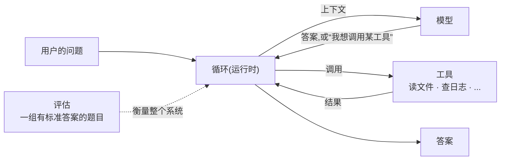

# 从这里开始

先看 [架构总览](架构总览.md):它用一张图讲清整个系统分几层、有哪些组件、靠哪四个接口连接,以及先搭什么。

本文档讲三件事:整个系统背后的五个基本概念、已经确认的前提、用户会问的四类问题。实现计划和学习内容分别在 [一期二期规划](一期二期规划.md) 和 [一期学习手册](一期学习手册.md) 中。

## 1. 整个系统其实只有五个概念

所有文档讲的东西,都是下面五个概念的展开。先把这五个弄懂,其他的都能对上号。

| 概念 | 用大白话说 |
| --- | --- |
| 模型 | 一个只会“读一段文字,再写一段文字”的程序。它不记事,不能自己做任何操作 |
| 工具 | 一个普通的函数,比如“查日志”“读文件”。模型不能直接调用,只能写出“我想调用查日志,参数是这些” |
| 循环 | 一段反复执行的程序:把问题给模型 → 模型说要调用工具 → 程序去调用 → 把结果再给模型 → 直到模型给出答案。这段程序就叫运行时(harness) |
| 上下文 | 每次给模型看的全部文字:问题、规则、工具清单、之前的工具结果。模型只知道上下文里有的东西 |
| 评估 | 一组有标准答案的题目。改了任何东西之后重新跑一遍,看分数是升是降 |



其他名词都是这五个概念在规模变大之后的管理办法:

| 名词 | 它其实是 | 什么时候才需要 |
| --- | --- | --- |
| Skill | 写给模型看的操作说明,放在上下文里 | 模型不知道某类问题该怎么查的时候 |
| MCP | 工具的一种标准接法 | 工具要给多个程序共用的时候 |
| MCP 网关 | 工具多了以后的统一入口,负责权限和审计 | 要给别人用的时候 |
| 连接器 | 别的团队把自己的工具和说明打包交给你 | 有第二个业务要接入的时候 |
| 会话 | 用户多次提问之间,保留哪些内容 | 要支持追问的时候 |
| 代码仓库管理 | 代码这种特殊资料怎么准备给模型读 | 要分析线上版本的代码的时候 |
| 模型网关 | 调用模型的统一入口 | 要用多个模型的时候 |

## 2. 文档地图

专题文档共八份。一期只需要学习手册中指明的章节,其余主要服务于二期。

| 类别 | 文档 | 说明 |
| --- | --- | --- |
| 一期会用到部分章节 | [02-评估系统](02-评估系统-原理与设计.md) | 学习手册单元 1、11 |
| 一期会用到部分章节 | [03-自研运行时](03-自研运行时-原理与设计.md) | 学习手册单元 2 |
| 一期会用到部分章节 | [06-上下文与多轮会话](06-上下文与多轮会话-原理与设计.md) | 学习手册单元 6、7 |
| 一期会用到部分章节 | [05-MCP网关与Skill管理](05-MCP网关与Skill管理-原理与设计.md) | 学习手册单元 3、4 |
| 一期会用到部分章节 | [08-代码仓库管理](08-代码仓库管理-原理与设计.md) | 学习手册单元 10 |
| 二期 | [04-连接器接入规范](04-连接器接入规范-原理与设计.md) | 有第二个业务要接入时再读 |
| 二期 | [07-多模态](07-多模态-原理与设计.md) | 要支持截图和文件上传时再读 |
| 框架 | [架构总览](架构总览.md) | 最先读。分层、组件、接口、搭建顺序 |
| 计划 | [一期二期规划](一期二期规划.md) | 两期各做什么、里程碑、评审方式 |
| 学习与评审 | [一期学习手册](一期学习手册.md) | 一期十一个单元,逐个学习、实现、评审 |
| 详细参考 | [01-总体设计](01-总体设计.md) | 早期的完整设计,内容较多。需要某一块的细节时查阅,不需要通读 |

## 3. 已确认的前提

| 事项 | 结论 | 对实现的影响 |
| --- | --- | --- |
| 数据能否交给模型 | 日志、用户信息、代码都可以 | 不需要为合规调整方案 |
| 日志在哪里 | ClickHouse,通过 MCP 提供查询 | 自己使用的阶段可以让模型直接写查询语句,配合只读账号、执行时间和行数上限;给他人使用时再提供封装好的工具 |
| 代码怎么给 Agent | 直接读服务器上的代码目录 | 第 0–5 步手动克隆即可 |
| 评估案例 | 没有历史故障,有一批用户常问的问题,数量不多 | 第一个场景是答疑。评估从常见问题做起,人工判断;从现在开始记录每一个真实提问 |
| 日志、监控、发布系统 | 都有查询接口,功能不全,但团队有开发权限 | 缺什么查询能力由评估中的失败案例决定,再到对应系统里补 |
| 谁来提问 | 内部同事:测试、客户端和后端研发、产品。产品不一定懂技术 | 回答分两层:结论用大白话,不含技术术语;依据(代码位置、日志、记录)供需要的人查看。事实不因人而异。提问人的岗位由 Agent 服务写入任务信息。追问和工具参数使用对方手上有的标识(手机号、订单号) |
| 开发语言 | 后端 Go 加 Python;前端 React 加 TypeScript、Vite、Tailwind CSS 加 shadcn/ui | 平台区的服务用 Go,隔离区的运行时和评估程序用 Python;只有 Agent 服务调用运行时这一处跨语言,用 gRPC |
| 业务数据在哪里 | MySQL 和 Redis,提供只读访问 | MySQL 连只读从库,专用只读账号,敏感字段不授权或脱敏,限制执行时间和返回行数;自己使用的阶段可让模型直接写查询,给他人使用时换成封装好的工具。Redis 从一开始就只提供按业务语义读取的工具,不开放任意命令,禁止全量扫描 |

## 4. 四类问题与起步顺序

用户的提问分四类,需要的东西差别很大。按成本从低到高,一类一类做。

| 顺序 | 类型 | 例子 | 需要什么 | 要新做的东西 |
| --- | --- | --- | --- | --- |
| 1 | 规则解释、接入 | “某某业务逻辑是什么”“续费回调怎么接” | 代码、文档 | 几乎没有,读代码的能力现成就有 |
| 2 | 针对具体用户的排查 | “我付费了,权益为啥没加上” | 订单、会员、权益的数据,该用户的日志 | 两三个查询工具,一份排查说明 |
| 3 | 整体异常排查 | “今天回调失败率为什么升高” | 日志统计、监控、发布记录 | 统计类查询、发布记录查询 |

与两期的对应:一期覆盖第 1、2 类问题;第 3 类放在二期。

人工评估时的判断要点:

| 类型 | 答得好的标志 |
| --- | --- |
| 规则解释、接入 | 指出代码的具体位置;讲清条件和分支,不只讲主流程;逻辑受配置或开关影响时明确说明;代码里找不到依据时说“没找到”,不编造 |
| 针对具体用户的排查 | 缺用户标识或订单号时先提问;沿“订单 → 支付回调 → 会员状态 → 权益发放”逐段确认,指出断在哪一段;结论附证据;查不出来时说明已排除什么、还缺什么;检查数据库与缓存是否一致;结论部分不懂技术的同事也能看懂 |
| 整体异常排查 | 先确认异常是否存在、何时开始、影响多大;检查该时间点前后的发布和配置变更;区分相关和原因,证据不足时不下定论 |

第一批要准备的东西:

| 类型 | 工具 | 给模型看的说明 |
| --- | --- | --- |
| 规则解释、接入 | 无需新增 | 每个仓库一份说明:目录结构、关键入口、主要业务流程分别在哪里 |
| 针对具体用户的排查 | ClickHouse 日志查询;MySQL 只读查询(从库、脱敏视图);读取某个用户缓存的 Redis 工具;之后把反复出现的查询固化成按订单或用户返回链路各段状态的汇总工具 | 一份排查说明:链路有哪几段、每段怎么确认;日志表、业务表的结构和字段含义、状态取值;缓存 key 的命名规则及其与数据表的对应 |
| 整体异常排查 | 最近的发布记录;监控指标 | 一份排查说明;指标清单及含义 |

跨服务的问题:

用户、会员、权益是不同的服务,“付费后权益没到账”这类问题是一条跨服务链路上某一段断了。处理它用一个 Agent 即可,不需要每个服务一个 Agent。需要准备三样东西:

| 要准备的 | 内容 | 形式 |
| --- | --- | --- |
| 服务地图 | 按业务流程写:一条链路经过哪些服务、每一段靠什么连接(接口调用或消息)、每一段成功的标志、常见的断点 | 一份排查说明(Skill) |
| 贯穿各服务的关联标识 | 每条日志带调用链标识;涉及用户或订单的日志记录用户标识和订单号;发消息时把调用链标识放进消息头 | 在各服务中补齐日志字段 |
| 链路级的工具 | 输入订单号或用户标识,按链路顺序返回每一段的状态,直接看出断在哪一段 | 一个汇总查询工具 |

每个仓库的说明文件里另外写明两项:对外提供的接口和消费的消息在哪里实现;依赖的下游是谁、调用了什么接口、发了什么消息。

排查说明里列出跨服务问题的常见原因:同步调用超时、消息丢失或积压或消费失败、重试与幂等、最终一致的延迟、各服务版本不一致、各服务配置不一致。

链路类的排查说明和工具归属于业务流程,不归属于单个服务。现阶段三个服务由同一个团队负责,放在同一个连接器里即可。

案例文件的写法:

案例就是考题。一个文件是一道给 Agent 的题目,外加一份由人事先写好的标准答案和评分要点。评估时,程序只把 `question` 发给 Agent;其余字段 Agent 看不到,是留给人判断回答对错用的。

| 字段 | 含义 | 谁用 |
| --- | --- | --- |
| `id` | 题号,不重复即可 | 程序、人 |
| `type` | 问题属于哪一类,用于分类统计 | 人 |
| `question` | 题目,原样发给 Agent | Agent |
| `app`、`env` | 关于哪个服务、查哪个环境 | 程序(写入任务信息) |
| `expected_answer` | 标准答案,由人在运行之前写好 | 人 |
| `key_points` | 评分要点:回答里必须具备的内容 | 人 |
| `context` | 可选。Agent 追问之后才提供给它的信息,用来考察“信息不够时是否先提问” | 程序 |

下面两个例子中,括号里的文字是占位,需要换成真实内容。数量少时用一张表格记录也可以,列与上表相同。

```yaml
id: rule-001
type: 规则解释
question: 权益过期的规则是什么?
app: entitlement
env: prod
expected_answer: |
  (正确的答案:过期时间如何计算、有哪些例外情况)
key_points:
  - 指出过期逻辑所在的代码位置
  - 说明过期时间的计算方式
  - 说明续费、退款等情况下的处理
  - 如果受配置影响,指出是哪个配置
```

```yaml
id: user-001
type: 用户排查
question: 我付费了,权益为啥没加上
app: member
env: prod
context:                    # 模拟用户对追问的回答,第一轮不提供
  user_id: "脱敏后的用户标识"
  order_id: "脱敏后的订单号"
expected_answer: |
  (这个案例的真实原因)
key_points:
  - 没有用户标识时先提问
  - 确认订单已支付
  - 找到链路上断开的环节
  - 结论附带日志或记录作为证据
```

## 5. 实现计划

项目分两期进行。实现计划以 [一期二期规划](一期二期规划.md) 为准,一期每个部分的原理、实现要点和评审清单在 [一期学习手册](一期学习手册.md) 中。

## 6. 三条使用建议

1. **一次只做一个里程碑。** 当前里程碑的完成标志达到之前,不要读后面的内容。后面的设计现在看不懂是正常的,做到那里自然就懂了。
2. **设计文档是给 AI 的输入。** 每个单元把“交给 AI 时要说清的”连同指定的文档章节一起交给编码工具。你负责读懂它写的东西,并判断是否符合设计。
3. **卡住时缩小问题。** 把那一步的文档章节、你的代码、报错信息放在一起问。如果是设计本身没讲清楚,回来改设计文档。

## 7. 现在就做的事

一期的 M0:用现有的 CLI 手工问 5 个用户常问的问题并记成一张表;把手上的常见问题写成案例并写出参考答案;开始记录用户的每一个真实提问;申请各数据源的只读账号;写出服务地图的初稿。
