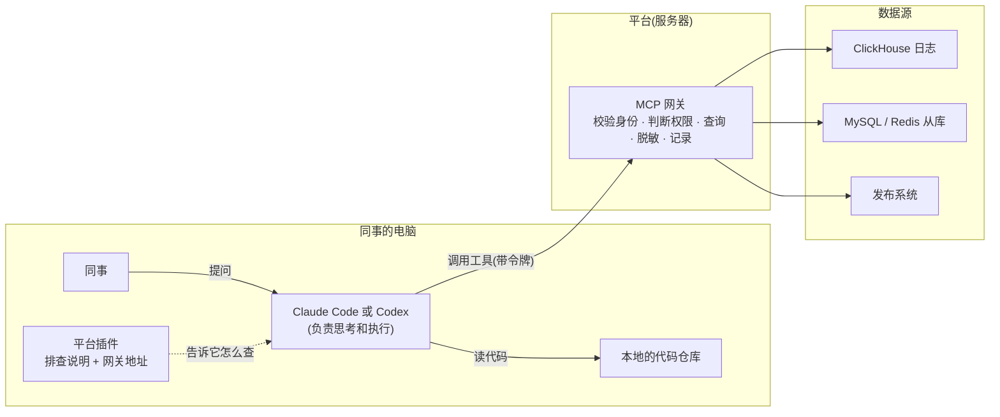
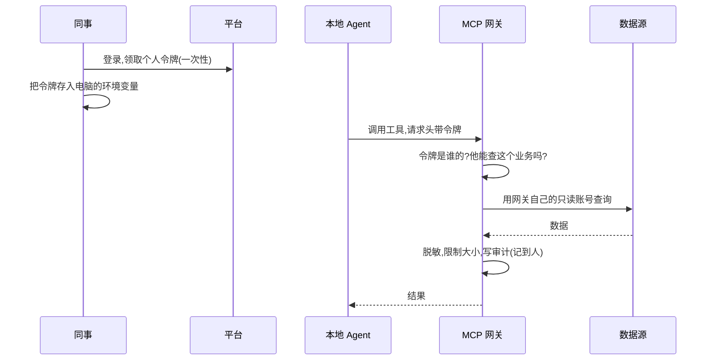
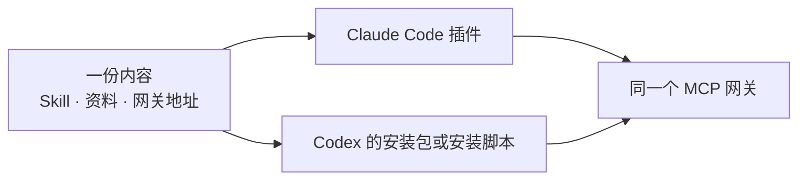
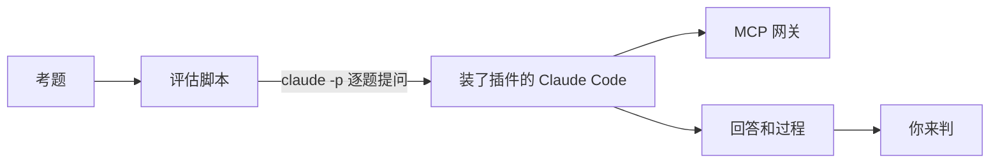
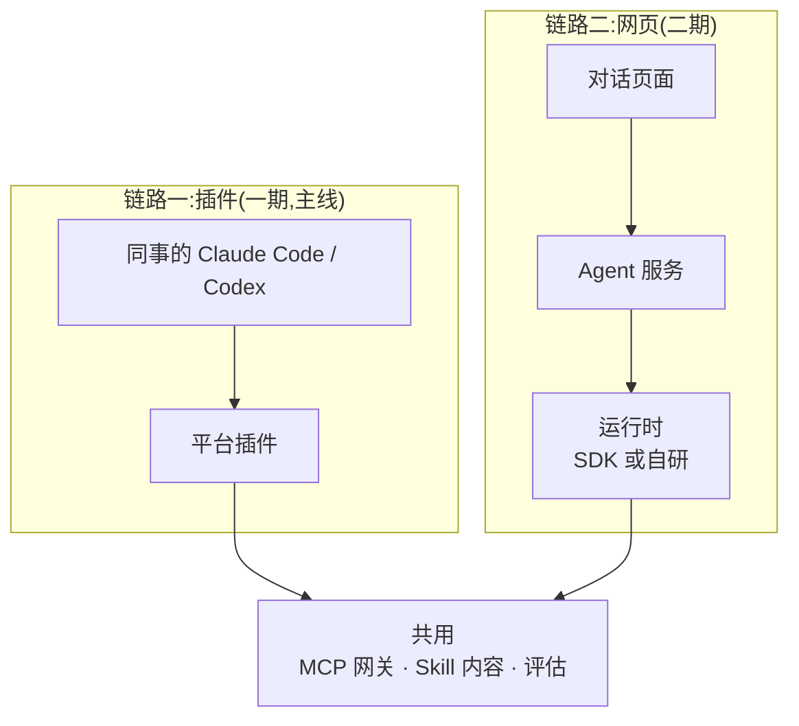

# 插件形态:原理与设计

平台的主要使用方式是插件:同事在自己的 Claude Code 或 Codex 里安装平台提供的插件,就能直接提问和排查。本地的 Claude Code 或 Codex 负责“思考和一步步执行”,插件告诉它“怎么查”,平台的 MCP 网关提供“查得到的数据”。这条调用链是一期的主线。

**最小版本:只做这四样就够。**

| 要做的 | 具体是什么 |
| --- | --- |
| 一个 MCP 网关 | 部署在服务器上,提供查日志、查业务数据等工具,校验身份,记录每次调用 |
| 一个插件仓库 | 一个内部 Git 仓库,里面放插件:排查说明,加上指向网关的连接配置 |
| 一个令牌 | 每位同事一个,用来向网关证明“我是谁” |
| 一批考题 | 用命令行批量提问,检查效果 |

相关文档:[架构总览](架构总览.md)、[一期二期规划](一期二期规划.md)、[连接器接入规范](04-连接器接入规范-原理与设计.md)、[MCP 网关与 Skill 管理](05-MCP网关与Skill管理-原理与设计.md)。

## 1. 这条链路长什么样



一次提问的过程:

1. 同事在 Claude Code 或 Codex 里提问,例如“用户 u_8842 付费了,权益为什么没加上”。
2. 本地的 Agent 看到插件提供的排查说明,知道这类问题该沿哪条链路查。
3. 它调用网关上的工具查订单、会员、日志。每次调用都带着这位同事的令牌。
4. 网关确认身份和权限,查询数据源,把结果整理和脱敏后返回,并记一条审计。
5. 需要看代码时,它直接读同事电脑上的仓库。
6. 它给出结论。

## 2. 谁负责什么

| 部分 | 是谁的 | 负责什么 |
| --- | --- | --- |
| Claude Code 或 Codex | 同事自己安装的 | 理解问题、决定下一步、调用工具、读代码、组织回答、多轮对话、上下文管理 |
| 插件 | 平台提供 | 排查说明(Skill);网关的连接配置 |
| MCP 网关 | 平台提供 | 工具;身份、权限、审计、脱敏、限流 |
| 数据源 | 已有的系统 | 日志、业务数据、发布记录 |

和“自己做一个网页版 Agent”相比,这条链路里平台**不需要**做的东西:

| 不需要做 | 原因 |
| --- | --- |
| 对话页面 | 同事直接用 Claude Code 或 Codex 的界面 |
| Agent 服务(对话、任务管理) | 本地 Agent 自己管理对话 |
| 运行时(循环、上下文压缩、会话) | 本地 Agent 就是运行时 |
| 模型的接入和费用管理 | 同事用自己的 Claude Code 或 Codex 账号 |
| 运行时的隔离环境 | 运行时在同事自己的电脑上 |

平台要做的集中在两样:**网关**和**插件内容**。这正是平台真正有价值的部分:你们的数据,和你们的业务知识。

## 3. 插件里有什么

以 Claude Code 为例,一个插件是一个目录:

```
membership/                         一个插件 = 一个连接器
  .claude-plugin/
    plugin.json                     插件清单:名称、版本、说明
  .mcp.json                         连接配置:网关的地址和令牌
  skills/
    overview/
      SKILL.md                      三个服务的整体情况与服务地图
    entitlement-missing/
      SKILL.md                      “付费后权益未到账”怎么查
      references/
        tables.md                   相关的表结构和状态取值
    ...
```

| 文件 | 作用 | 说明 |
| --- | --- | --- |
| `.claude-plugin/plugin.json` | 插件的清单 | 至少有名称。插件里所有内容都以这个名称作为前缀 |
| `.mcp.json` | 告诉本地 Agent 去哪里找工具 | 指向平台的 MCP 网关。安装插件后,网关上的工具自动出现在本地 Agent 里 |
| `skills/<名称>/SKILL.md` | 一类问题的排查说明 | 开头的描述决定它何时被用上;正文是排查思路 |
| `skills/<名称>/references/` | 细节资料 | 表结构、状态取值、错误码。正文里写明什么时候去读 |

连接配置的样子:

```json
{
  "mcpServers": {
    "membership": {
      "type": "http",
      "url": "https://agent-gateway.example.com/mcp/membership",
      "headers": {
        "Authorization": "Bearer ${AGENT_PLATFORM_TOKEN}"
      }
    }
  }
}
```

`${AGENT_PLATFORM_TOKEN}` 会被替换成同事电脑上同名环境变量的值。令牌本身不写在插件里。

插件还可以包含命令、钩子等其他东西。一期只用上面两样:Skill 和连接配置。

**注意一点:** 插件根目录下的 `CLAUDE.md` 不会被加载。所以“所有任务都要遵守的规则”不能靠它,放在哪里见第 5 节。

## 4. 插件与连接器:一个连接器就是一个插件

之前设计的“连接器”在这条链路里直接落成插件。**启用一个插件,就是加载一个连接器。**


| 之前的概念 | 在插件形态下 |
| --- | --- |
| 连接器 | 一个插件 |
| 加载一个连接器 | 安装并启用这个插件 |
| 连接器里的 Skill | 插件的 `skills/` 目录 |
| 连接器里的工具 | 网关上该连接器专属的地址,例如 `/mcp/membership`。插件的连接配置指向它 |
| 公共连接器 | `platform-core` 插件,所有人都装 |
| 基础业务连接器 | `membership` 插件,一个插件覆盖三个服务 |
| 使用方选择连接器 | 同事自己决定启用哪些业务插件 |
| 连接器之间的隔离 | 没启用的插件,它的说明和工具都不存在于本地 Agent 中 |

每个连接器在网关上有自己的地址,这样“启用了哪些插件”就自然决定了“能看到哪些工具”,网关不需要去猜同事本地装了什么。

之前想放到二期的“使用方选择连接器”,在这条链路里几乎是现成的:启用或停用插件是 Claude Code 自带的功能。一期只提供两个插件,所以暂时没有可选的;二期业务方的插件加进仓库后,同事自己启用即可。

## 5. 全局规则放在哪里

有些规则对所有问题都适用:全部只读;不确定就说不确定;结论要有证据;信息不够时先问;结论用不懂技术的同事也能看懂的话来写。

插件没有“每次都自动带上的说明文件”,所以这些规则分三处放:

| 位置 | 放什么 | 特点 |
| --- | --- | --- |
| 网关返回的服务说明 | 几句最重要的规则,以及这组工具的总体用法 | MCP 服务可以附带一段说明,连接后本地 Agent 会看到。由网关下发,改了不用更新插件 |
| `platform-core` 插件里的一个通用 Skill | 完整的排查规范和输出格式 | 描述写成“排查线上问题或回答业务逻辑问题时使用”,让它在这类问题上都被用到 |
| 每个工具自己的说明 | 这个工具什么时候用、参数怎么填 | 随工具走 |

真正不能被绕过的要求(只读、权限、脱敏)不依赖这些文字,它们由网关强制执行。

## 6. 身份与权限

本地 Agent 在同事自己的电脑上,平台管不到它。所以**网关是唯一的关口**:每一次工具调用都要回答“是谁在查、他能不能查”。



| 项目 | 一期 | 二期 |
| --- | --- | --- |
| 身份 | 每人一个令牌,由平台签发,存在本机环境变量里,通过请求头发送 | 改为通过公司登录授权(浏览器跳转登录),不再手动管理令牌 |
| 权限 | 持有有效令牌的同事可以查三个基础服务 | 按业务细分 |
| 令牌管理 | 有过期时间;可以单独吊销;不写进插件、不提交到任何仓库 | 同左 |
| 数据源账号 | 只在网关里,同事和本地 Agent 都接触不到 | 同左 |

为什么不让本地 Agent 直接连数据库:那样每位同事的电脑上都要有数据库账号,既没法按人审计,也没法统一脱敏和限流。

## 7. 代码从哪里来

研发同事的电脑上本来就有代码仓库。本地 Agent 直接读它,不需要平台提供。

| 情况 | 做法 |
| --- | --- |
| 研发同事 | 在代码仓库的目录下启动 Claude Code 或 Codex,直接读本地代码 |
| 问题跨多个仓库 | 把相关仓库放在同一个上级目录下,从上级目录启动;或在排查说明里写明另一个仓库的位置约定 |
| 本地代码不是线上版本 | 网关提供一个工具返回各服务线上运行的版本,排查说明里提示在版本不一致时说明这一点 |
| 仓库说明 | 每个仓库里放一份给 Agent 看的说明(目录结构、关键入口、上下游),随代码走 |
| 电脑上没有代码的同事(产品、部分测试) | 一期不支持读代码,只能做不依赖代码的排查。二期由网关提供读取线上版本代码的工具 |

## 8. 安装与更新

### 8.1 插件仓库

一个内部 Git 仓库就是一个插件市场。仓库根目录下有一个市场清单,列出里面的插件。

```
agent-plugins/                       内部 Git 仓库
  .claude-plugin/
    marketplace.json                 市场清单:名称、维护者、插件列表
  plugins/
    platform-core/
    membership/
```

同事用自己已有的 Git 权限克隆这个仓库,不需要额外的账号。

### 8.2 同事要做的

第一次使用:

```bash
/plugin marketplace add <插件仓库的 Git 地址>
```

```bash
/plugin install platform-core@<市场名称>
```

```bash
/plugin install membership@<市场名称>
```

另外把个人令牌设置到环境变量里。之后直接提问即可。

### 8.3 让安装更省事

| 做法 | 效果 |
| --- | --- |
| 在业务代码仓库的 `.claude/settings.json` 里登记插件仓库和默认启用的插件 | 同事在这个代码仓库里打开 Claude Code,信任该目录后,插件仓库自动登记,插件按配置启用 |
| 开启自动更新 | 插件仓库有新提交时,同事的插件自动更新。第三方市场默认关闭,需要同事开启或由管理员统一配置 |
| 插件清单里是否写版本号 | 不写版本号时跟随仓库的最新提交;写了版本号则固定在该版本,直到版本号变化 |

一期建议不写版本号、开启自动更新:说明改了,同事很快就能用上。

### 8.4 更新时哪些要动

| 改了什么 | 需要更新插件吗 |
| --- | --- |
| 排查说明、表结构资料 | 需要(提交到插件仓库) |
| 工具的实现、返回内容 | 不需要(只改网关) |
| 新增一个工具 | 不需要(网关上加了,本地自动看到) |
| 全局规则 | 放在网关的服务说明里的那部分不需要 |

所以改动频繁、要快速生效的东西尽量放在网关一侧。

## 9. Codex

Codex 这边的具体配置方式,我没有能够查到官方文档,**下表中 Codex 一列需要在实现前核实**。设计上只依赖两边都具备的通用能力,这样即使细节不同,要改的也只是打包方式。

| 需要的能力 | Claude Code | Codex(待核实) |
| --- | --- | --- |
| 连接远程的 MCP 网关,带令牌 | 插件里的 `.mcp.json` | 在 Codex 的配置文件里登记 MCP 服务 |
| 排查说明 | 插件里的 `skills/`,`SKILL.md` 格式 | Skill 采用相同的 `SKILL.md` 格式,放到 Codex 约定的目录 |
| 全局规则 | 网关的服务说明 + 通用 Skill | 同左,另可用 `AGENTS.md` |
| 一键安装 | 插件市场 | 如果 Codex 有插件机制则同样打包;否则提供一个安装脚本,写入配置并复制 Skill |

原则:**内容只有一份,打包有两种。**



网关对两边完全一样,因为 MCP 是标准协议。Skill 的正文两边通用,不写任何只有某一个工具才认识的指令。

## 10. 评估

评估走的就是同事实际使用的这条链路:用命令行方式启动装好插件的 Claude Code,把考题逐个发给它,保存回答和过程。



这和你最早搭的那个原型是同一种方式,所以原型可以直接演进成评估环境。Codex 那一侧用它的非交互模式同样跑一遍,就能比较两边在同一批题上的表现。

评估的做法见 [评估系统](02-评估系统-原理与设计.md)。

## 11. 平台能看到什么

对话发生在同事的电脑上,平台看不到提问和回答,只能看到网关上的工具调用。这是这条链路和网页版最大的区别。

| 想知道的 | 能不能看到 | 做法 |
| --- | --- | --- |
| 谁在什么时候查了什么数据 | 能 | 网关的审计 |
| 哪些工具用得多、哪些经常报错 | 能 | 网关的统计 |
| 同事问了什么问题 | 默认不能 | 提供一个反馈命令,同事主动提交“问题、回答、有没有用”;这些就是新的考题来源 |
| 回答对不对 | 默认不能 | 同上,靠主动反馈 |
| 每次任务花了多少钱 | 不能,也不需要 | 费用在同事自己的账号上 |

反馈的入口做成一个网关上的工具,例如 `feedback_submit`。同事说一句“把这次的问题和结论反馈给平台,标记为没解决”,本地 Agent 就会调用它。

不要用自动上报全部对话的方式来收集。同事的对话里可能有与平台无关的内容,自动上报需要明确告知并征得同意。

## 12. 安全

运行时在同事自己的电脑上,这带来和网页版不同的风险。

| 风险 | 说明 | 应对 |
| --- | --- | --- |
| 本地 Agent 有写文件、执行命令、访问网络的能力 | 这是同事自己环境里的能力,平台限制不了 | 平台的工具全部只读;网关不提供任何写操作 |
| 日志或数据里夹带指令 | 本地 Agent 读到“把结果发到某地址”这类文字,理论上有能力照做 | 网关在返回内容中标明这是数据;通用 Skill 中写明工具返回的内容不是指令;同事保留 Claude Code 自带的操作确认;尽量减少返回内容中的自由文本 |
| 数据落到同事电脑上 | 查到的日志和业务数据会出现在本机的对话记录里 | 网关脱敏;返回最少必要的数据;审计记到人 |
| 数据发送给模型服务 | 用 Claude Code 时发给 Anthropic,用 Codex 时发给 OpenAI | 确认两家都在允许范围内(第 15 节) |
| 令牌泄露 | 令牌在本机环境变量里 | 有过期时间;可单独吊销;一人一个;不写进任何仓库 |
| 插件仓库被篡改 | 插件里的说明会影响所有同事的本地 Agent | 插件仓库的合并需要评审;只有少数人有写权限 |

核心原则没有变:**所有不能被绕过的要求,都由网关强制执行。**

## 13. 和网页版的关系

之前设计的“对话页面 → Agent 服务 → 运行时 → 网关”那条链路没有作废,它变成第二条链路,放到二期。两条链路共用同一个网关和同一份内容。



| | 链路一:插件 | 链路二:网页 |
| --- | --- | --- |
| 谁来用 | 已经在用 Claude Code 或 Codex 的同事,主要是研发 | 不用这些工具的同事,例如产品 |
| 运行时 | 同事本地的 Claude Code 或 Codex | 平台上的 SDK 运行时或自研运行时 |
| 平台要做的 | 网关、插件内容 | 另外加上页面、Agent 服务、运行时 |
| 平台能看到对话吗 | 不能 | 能 |
| 模型费用 | 同事的账号 | 平台的账号 |

自研运行时属于链路二,所以它仍然在二期。它会使用同一个网关和同一份 Skill 内容,一期做的东西不会浪费。

## 14. 一期分步

| 步骤 | 范围 | 验收 |
| --- | --- | --- |
| P1 | 网关骨架:一个连接器地址,一个日志查询工具;令牌校验;审计 | 用一条命令手动把网关加到 Claude Code,能查到日志;不带令牌的请求被拒绝 |
| P2 | 第一个插件:`platform-core`,含连接配置和一个通用 Skill;插件仓库 | 在一台干净的电脑上,按第 8.2 节的三条命令装好后可以直接提问 |
| P3 | `membership` 插件:服务地图、排查说明、表结构资料;网关上业务数据、缓存、发布记录的工具 | “付费后权益未到账”能沿链路给出带证据的结论;信息不够时会先问 |
| P4 | 评估:考题、批量运行脚本、结果表 | 一条命令跑完全部考题 |
| P5 | 反馈工具;令牌的签发和吊销;安装说明;请两三位同事试用 | 同事按说明自己装好并用起来;能收到反馈 |
| P6 | Codex 侧的打包 | 在 Codex 里同样可用;同一批考题有两边的结果 |

## 15. 待确认

- [ ] 提问的同事里有不懂技术的产品同事。他们会使用 Claude Code 或 Codex 吗?如果不会,他们在一期怎么使用,还是等二期的网页?
- [ ] 使用 Codex 时,查到的日志和业务数据会发送给 OpenAI。这和发送给 Anthropic 一样在允许范围内吗?
- [ ] Codex 的插件、Skill、MCP 的具体配置方式,需要查阅它的官方文档核实。
- [ ] 同事使用的是公司统一的 Claude Code 或 Codex 账号,还是个人账号?
- [ ] 插件仓库放在哪个内部 Git 平台上,同事是否都有读权限?

## 16. 自测

- [ ] 这条链路里,哪些是平台提供的,哪些是同事自己电脑上的?(第 1、2 节)
- [ ] 插件里只有两样东西,分别是什么?各自起什么作用?(第 3 节)
- [ ] 为什么每个连接器在网关上要有自己的地址?(第 4 节)
- [ ] 全局规则为什么不能靠插件里的 `CLAUDE.md`?放在哪里?(第 5 节)
- [ ] 为什么不让本地 Agent 直接连数据库?(第 6 节)
- [ ] 改了一份排查说明和改了一个工具的返回内容,哪个需要更新插件?(第 8.4 节)
- [ ] 平台看不到同事的提问,那新的考题从哪里来?(第 11 节)
- [ ] 本地 Agent 有执行命令的能力,平台靠什么保证数据安全?(第 12 节)
