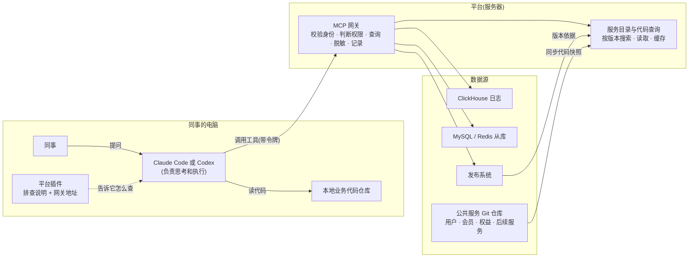
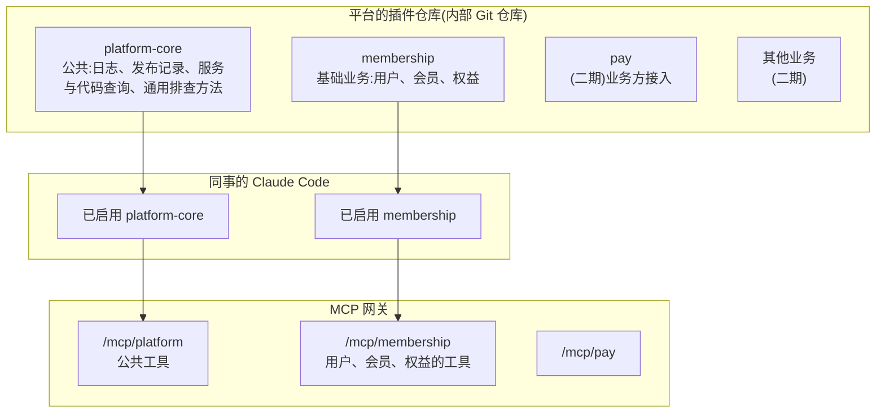
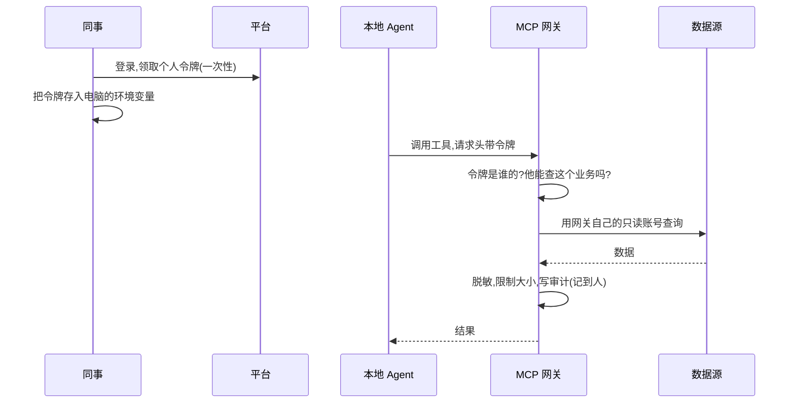
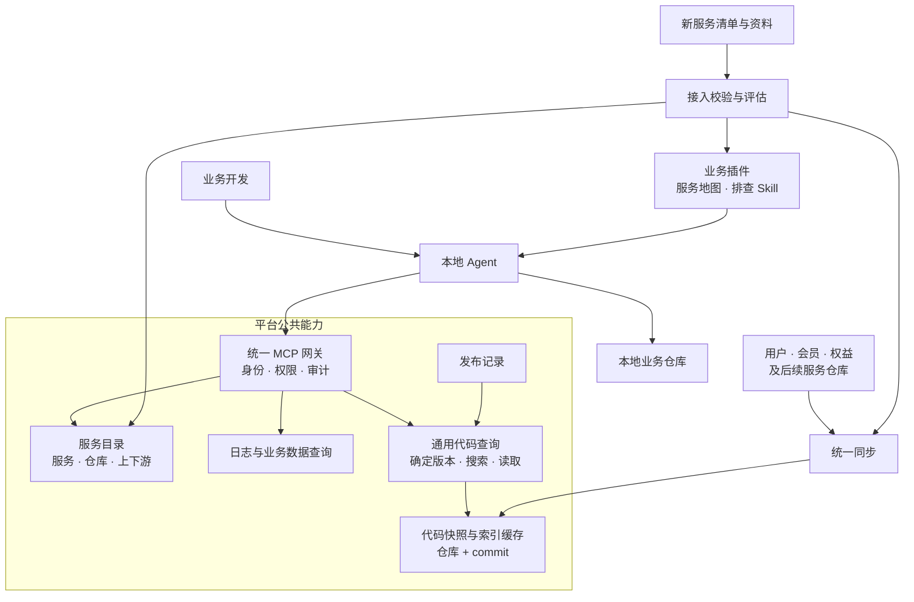
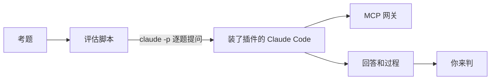
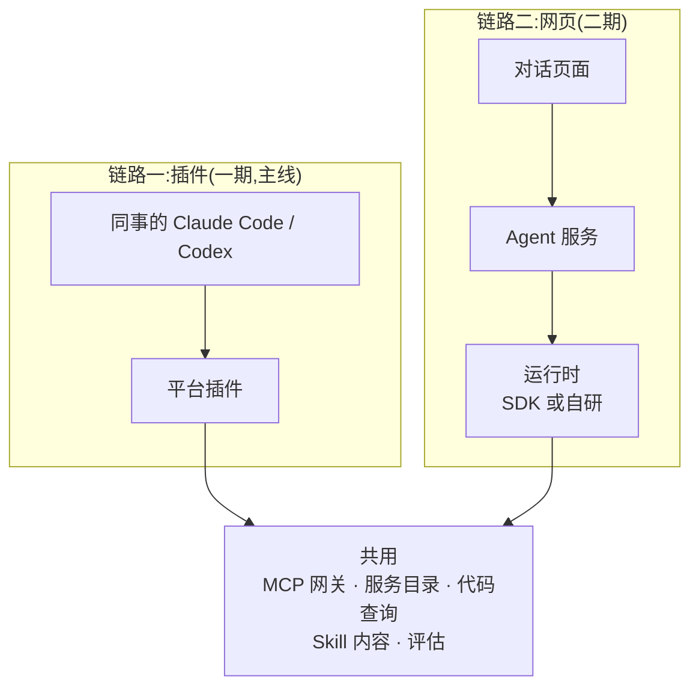

# 插件形态:原理与设计

平台的主要使用方式是插件:同事在自己的 Claude Code 或 Codex 里安装平台提供的插件,就能直接提问和排查。本地的 Claude Code 或 Codex 负责“思考和一步步执行”,插件告诉它“怎么查”,平台的 MCP 网关提供“查得到的数据”。这条调用链是一期的主线。

**最小版本:先做这五样。**

| 要做的 | 具体是什么 |
| --- | --- |
| 一个 MCP 网关 | 部署在服务器上,提供日志、业务数据、服务发现和代码查询工具,校验身份,记录每次调用 |
| 一个插件仓库 | 一个内部 Git 仓库,里面放插件:排查说明,加上指向网关的连接配置 |
| 一套公共服务代码查询能力 | 登记服务与仓库的关系,准备指定版本的代码,通过网关提供搜索和读取;一期覆盖用户、会员、权益 |
| 一个令牌 | 每位同事一个,用来向网关证明“我是谁” |
| 一批考题 | 用命令行批量提问,检查效果 |

相关文档:[架构总览](架构总览.md)、[一期二期规划](一期二期规划.md)、[连接器接入规范](04-连接器接入规范-原理与设计.md)、[MCP 网关与 Skill 管理](05-MCP网关与Skill管理-原理与设计.md)、[代码仓库管理](08-代码仓库管理-原理与设计.md)。

本文明确插件形态的一期范围:公共服务代码查询纳入一期,服务扩展和代码版本管理复用文档 04、08 的设计。其他文档中仍将插件或代码查询整体放到二期的安排需要随之对齐。

## 1. 这条链路长什么样



一次提问的过程:

1. 同事在 Claude Code 或 Codex 里提问,例如“用户 u_8842 付费了,权益为什么没加上”。
2. 本地的 Agent 看到插件提供的排查说明,知道这类问题该沿哪条链路查。
3. 它调用网关上的工具查订单、会员、日志。每次调用都带着这位同事的令牌。
4. 网关确认身份和权限,查询数据源,把结果整理和脱敏后返回,并记一条审计。
5. 需要看代码时,自己的业务代码可直接在本地读取;用户、会员、权益等公共服务的代码,通过网关定位服务和目标版本后搜索、读取。
6. 它将日志和业务数据与代码逻辑对照,给出附带版本、路径和行号等证据的结论。

## 2. 谁负责什么

| 部分 | 是谁的 | 负责什么 |
| --- | --- | --- |
| Claude Code 或 Codex | 同事自己安装的 | 理解问题、决定下一步、调用工具、读代码、组织回答、多轮对话、上下文管理 |
| 插件 | 平台提供 | 排查说明(Skill);网关的连接配置 |
| MCP 网关 | 平台提供 | 工具;身份、权限、审计、脱敏、限流 |
| 服务目录与代码查询 | 平台提供 | 服务与仓库映射、版本解析、代码同步与缓存、通用搜索和读取 |
| 业务知识 | 各业务团队维护,平台初期可代为整理 | 服务说明、仓库导航、排查 Skill、评估案例 |
| 数据源 | 已有的系统 | 日志、业务数据、发布记录、Git 仓库 |

和“自己做一个网页版 Agent”相比,这条链路里平台**不需要**做的东西:

| 不需要做 | 原因 |
| --- | --- |
| 对话页面 | 同事直接用 Claude Code 或 Codex 的界面 |
| Agent 服务(对话、任务管理) | 本地 Agent 自己管理对话 |
| 运行时(循环、上下文压缩、会话) | 本地 Agent 就是运行时 |
| 模型的接入和费用管理 | 同事用自己的 Claude Code 或 Codex 账号 |
| 运行时的隔离环境 | 运行时在同事自己的电脑上 |

平台建设集中在**网关及其背后的查询能力**和**插件内容**。代码同步与查询属于能力层,不需要为此增加服务器端 Agent 运行时。

## 3. 插件里有什么

以 Claude Code 为例,一个插件是一个目录:

```
membership/                         一个插件 = 一个连接器
  .claude-plugin/
    plugin.json                     插件清单:名称、版本、说明
  .mcp.json                         连接配置:网关的地址和令牌
  skills/
    overview/
      SKILL.md                      三个服务的整体情况与服务地图
    entitlement-missing/
      SKILL.md                      “付费后权益未到账”怎么查
      references/
        tables.md                   相关的表结构和状态取值
    ...
```

| 文件 | 作用 | 说明 |
| --- | --- | --- |
| `.claude-plugin/plugin.json` | 插件的清单 | 至少有名称。插件里所有内容都以这个名称作为前缀 |
| `.mcp.json` | 告诉本地 Agent 去哪里找工具 | 指向平台的 MCP 网关。安装插件后,网关上的工具自动出现在本地 Agent 里 |
| `skills/<名称>/SKILL.md` | 一类问题的排查说明 | 开头的描述决定它何时被用上;正文是排查思路 |
| `skills/<名称>/references/` | 细节资料 | 表结构、状态取值、错误码。正文里写明什么时候去读 |

连接配置的样子:

```json
{
  "mcpServers": {
    "membership": {
      "type": "http",
      "url": "https://agent-gateway.example.com/mcp/membership",
      "headers": {
        "Authorization": "Bearer ${AGENT_PLATFORM_TOKEN}"
      }
    }
  }
}
```

`${AGENT_PLATFORM_TOKEN}` 会被替换成同事电脑上同名环境变量的值。令牌本身不写在插件里。

插件还可以包含命令、钩子等其他东西。一期只用上面两样:Skill 和连接配置。

**注意一点:** 插件根目录下的 `CLAUDE.md` 不会被加载。所以“所有任务都要遵守的规则”不能靠它,放在哪里见第 5 节。

## 4. 插件与连接器:一个连接器就是一个插件

之前设计的“连接器”在这条链路里直接落成插件。**启用一个插件,就是加载一个连接器。**



| 之前的概念 | 在插件形态下 |
| --- | --- |
| 连接器 | 一个插件 |
| 加载一个连接器 | 安装并启用这个插件 |
| 连接器里的 Skill | 插件的 `skills/` 目录 |
| 连接器里的工具 | 网关上该连接器专属的地址,例如 `/mcp/membership`。插件的连接配置指向它 |
| 公共连接器 | `platform-core` 插件,所有人都装 |
| 基础业务连接器 | `membership` 插件,一个插件覆盖三个服务 |
| 使用方选择连接器 | 同事自己决定启用哪些业务插件 |
| 插件内容的加载 | 未启用的插件不主动加载其 Skill 和专属工具;公共服务目录与代码工具按网关授权返回内容 |

每个连接器在网关上有自己的地址,这样“启用了哪些插件”就自然决定了“能看到哪些工具”,网关不需要去猜同事本地装了什么。

插件启用只决定本地加载哪些内容,不作为权限依据。公共的 `service_*`、`code_*` 工具由 `platform-core` 提供,不在每个业务插件中重复实现。跨服务查询按用户的服务、仓库权限校验;登记了依赖关系或安装了插件,都不会自动获得权限。

一个服务不必对应一个插件或一个仓库。例如 `membership` 覆盖用户、会员、权益三个服务;一个仓库也可能同时包含 API 和消费者。新增同一领域的服务可加入已有连接器;新增独立业务领域时再建立插件。

之前想放到二期的“使用方选择连接器”,在这条链路里几乎是现成的:启用或停用插件是 Claude Code 自带的功能。一期只提供两个插件,所以暂时没有可选的;二期业务方的插件加进仓库后,同事自己启用即可。

## 5. 全局规则放在哪里

有些规则对所有问题都适用:全部只读;不确定就说不确定;结论要有证据;信息不够时先问;结论用不懂技术的同事也能看懂的话来写。

插件没有“每次都自动带上的说明文件”,所以这些规则分三处放:

| 位置 | 放什么 | 特点 |
| --- | --- | --- |
| 网关返回的服务说明 | 几句最重要的规则,以及这组工具的总体用法 | MCP 服务可以附带一段说明,连接后本地 Agent 会看到。由网关下发,改了不用更新插件 |
| `platform-core` 插件里的一个通用 Skill | 完整的排查规范和输出格式 | 描述写成“排查线上问题或回答业务逻辑问题时使用”,让它在这类问题上都被用到 |
| 每个工具自己的说明 | 这个工具什么时候用、参数怎么填 | 随工具走 |

真正不能被绕过的要求(只读、权限、脱敏)不依赖这些文字,它们由网关强制执行。

## 6. 身份与权限

本地 Agent 在同事自己的电脑上,平台管不到它。所以**网关是唯一的关口**:每一次工具调用都要回答“是谁在查、他能不能查”。



| 项目 | 一期 | 二期 |
| --- | --- | --- |
| 身份 | 每人一个令牌,由平台签发,存在本机环境变量里,通过请求头发送 | 改为通过公司登录授权(浏览器跳转登录),不再手动管理令牌 |
| 权限 | 明确授权的试点用户可以查三个基础服务的数据及批准开放的代码范围;每次调用仍校验 | 按业务细分;新增服务和仓库显式授权,不自动扩大原令牌权限 |
| 令牌管理 | 有过期时间;可以单独吊销;不写进插件、不提交到任何仓库 | 同左 |
| 数据源账号 | 只在网关里,同事和本地 Agent 都接触不到 | 同左 |

为什么不让本地 Agent 直接连数据库:那样每位同事的电脑上都要有数据库账号,既没法按人审计,也没法统一脱敏和限流。

## 7. 代码从哪里来

业务开发通常只有自己的业务代码,没有会员、用户中心、权益等公共服务的仓库。因此,**公共服务的代码知识由平台统一提供,插件的基本效果不依赖同事先克隆这些仓库。** 以后新增服务沿用相同的接入方式。

### 7.1 本地与平台的分工

| 情况 | 做法 |
| --- | --- |
| 分析自己的开发代码 | Agent 直接搜索、读取本地工作区;明确是否包含未提交修改 |
| 分析公共服务的代码 | 经 MCP 网关定位服务、版本,在服务端代码快照中搜索和读取 |
| 本地恰好有公共服务代码 | 验证是目标版本的干净快照后可直接读取;这是加速方式,不是使用前提 |
| 本地代码不是线上版本 | 分析线上问题时使用平台提供的目标版本;不自动切换同事正在开发的分支 |
| 没有本地代码,但能使用插件 | 可以查询已接入且有权限的服务代码;不会使用客户端的同事仍需要后续网页入口 |
| 问题跨多个服务 | 按证据查询服务目录,逐步扩展到相关服务;每次都检查权限 |

代码说明“这个版本可能如何执行”,日志和业务数据说明“这次实际发生了什么”。代码分析要与运行时证据对照,不能仅凭一段代码确认某次线上故障的根因。

### 7.2 代码知识的三层组织

| 层次 | 内容 | 存放与维护 |
| --- | --- | --- |
| 原始事实 | 代码、仓库文档、依赖锁定文件 | 业务 Git 仓库;平台按 commit 缓存原文 |
| 导航资料 | 服务说明、关键入口、目录结构、上下游、常见报错对应模块 | 服务目录提供简短介绍;详细导航放在仓库的 `docs/agent-overview.md`,随代码版本维护 |
| 排查方法 | 先查什么、如何缩小范围、证据要求和停止条件 | 插件 Skill;按评估结果改进 |

Skill 讲“怎么查”,导航讲“去哪里看”,原文支持具体结论。插件不打包完整代码,也不复制所有服务的详细文档。自动生成的摘要或索引需记录来源 commit;关键结论回到目标版本原文核对。

### 7.3 架构:统一能力,按需读取



服务端复用文档 08 的仓库镜像和版本快照设计,增加经网关访问的查询接口。Agent 通过工具读到必要片段,不操作服务端 Git,也拿不到仓库凭据。未来网页运行时可复用相同能力。

### 7.4 服务通过清单接入

一期用 Git 中的清单作为登记来源,不需要先建管理后台。清单经过校验后加载为服务目录。下面是接入字段示意,最终结构与文档 04、08 的连接器和仓库声明统一,不另建一份重复来源:

```yaml
service: payment-api
connector: pay
owner: payment-team
repository: payment-backend             # 引用仓库登记项
path: services/payment                 # 仓库中的服务目录
overview: docs/agent-overview.md        # 仓库根目录下的导航文件
deployment_ref: payment-api             # 用于关联发布记录
dependencies:                          # 导航线索,不自动授予权限
  - user-center
  - membership
```

仓库登记项统一维护仓库地址、默认分支、允许读取的目录和只读凭据引用;凭据本身放在平台的密钥管理中。多服务共用一个仓库时复用同一份镜像。共享库目录要显式纳入允许范围。

新增服务的流程:

1. 业务团队提交负责人、服务与仓库映射、导航文档、发布版本来源,并开通平台只读访问。
2. 平台验证指定 commit 可获取、路径范围正确、查询受权限控制,准备代码快照。
3. 业务团队补充所属连接器的 Skill 和真实排查案例;独立业务领域才新增插件。
4. 评估通过后发布登记信息与相关内容,向指定用户开放。平台维护同步、缓存和通用工具,业务团队维护知识和案例。

新增服务主要增加配置和业务资料,不为每个仓库部署一个 MCP 服务,也不复制一套代码查询工具。

### 7.5 通用 MCP 工具与版本约定

下列为拟实现的工具契约,通过 `platform-core` 的 `/mcp/platform` 暴露:

| 工具 | 输入与用途 | 返回要点 |
| --- | --- | --- |
| `service_search` | 用名称或业务描述查找有权限的服务 | 简短说明、服务标识、所属连接器;限制条数 |
| `service_get` | 获取某个服务的导航信息 | 仓库映射、入口、上下游;不泄露未授权服务详情 |
| `code_resolve_context` | 根据服务、环境、问题时间或明确的开发/评估版本解析代码范围 | 仓库、commit、允许路径、版本来源与可信程度、导航入口、可用状态 |
| `code_search` | 在已解析的仓库、commit、路径内搜索关键词 | 文件路径、行号、少量上下文、截断状态与继续查询方式 |
| `code_read` | 按仓库、commit 读取一个或多个文件片段 | 原文、实际行范围、截断状态;限制单次总大小 |

一期的服务发现先支持名称、别名、业务描述关键词匹配,不承诺语义检索。工具接受登记的服务和仓库标识,不接受任意 Git 地址、宿主机路径或 Shell 命令。

版本处理约定:

- 当前故障查当前部署版本;历史故障查发生时的部署版本。开发答疑和评估可明确指定不同版本。
- 解析后固定本轮涉及的各仓库 commit,搜索和读取使用同一组版本。下一轮发生发布变化时显式提示,不在读取途中悄悄替换。
- 灰度期间若存在多个版本,返回候选版本,尽量结合实例、请求日志确定命中的版本;无法确定时说明范围。公共库按服务的锁定依赖或子模块版本解析。
- 版本查不到或目标 commit 不可获取时返回明确状态。可以继续查数据,或显式选择参考版本,但不能把主干或最近缓存版本称为线上版本。
- 代码证据带仓库、commit、路径和行号。读取缓存仍需逐次授权,解析结果不代替后续权限检查。

### 7.6 性能:先缩小范围,再读代码

远程搜索与读取有网络开销,不能承诺与本地一样快。优化重点是减少无效搜索、重复准备和串行往返,而不是每次将整个仓库发给 Agent。

| 环节 | 做法 |
| --- | --- |
| 准备代码 | 预先缓存当前已核实的线上版本;历史版本按需准备;多个服务共用镜像和不可变快照 |
| 缓存标识 | 快照至少按仓库、commit 和目录范围区分;索引同时记录构建规则版本,避免混用 |
| 缩小范围 | 先定位服务,读简短导航,再搜索相关模块;有证据时才扩展到其他服务 |
| 减少往返 | 搜索命中附带少量上下文;支持批量读相关片段,同时限制结果总量 |
| 代码冷启动 | 目标版本尚未准备好时返回可重试的准备状态;不无限阻塞,不静默切到其他版本 |
| 业务状态 | 日志、订单、会员状态按需重新查询,不套用代码的长期缓存策略 |

典型路径:


仅查业务状态即可回答的问题不必读代码。服务数量增加时,维持“发现服务 → 限定范围 → 按需读取”,不默认搜索所有仓库或展开全部依赖。

### 7.7 是否需要向量库

**一期不建向量库。** 先使用服务目录、仓库导航、版本快照和关键词搜索。代码是知识来源,并不意味着必须向量化;新增服务数量本身也不是引入向量库的条件。

| 问题类型 | 优先方式 |
| --- | --- |
| 有接口路径、错误码、函数名、数据库字段 | 精确搜索,再读上下文 |
| 只有业务描述,但能定位服务 | 服务说明与仓库导航,再搜索实现 |
| 业务用语与实现用语差异大,导航与关键词反复找不到 | 记录为检索失败案例,评估语义检索的收益 |

后续确有需要时,先对服务说明、业务文档、排查手册增加语义检索,再评估是否索引代码。使用关键词与语义检索共同找候选位置,随后读取目标版本原文和必要调用上下文。向量索引不能代替 Git、版本快照或运行时证据。

索引必须关联服务、仓库、commit、路径及权限范围;查询限定目标版本和已授权范围,返回前再次检查。不能从所有历史版本中找最相似片段后当作当前实现。索引缺失或不可用时退回该版本的关键词搜索。

引入前后在同一批案例上比较:关键证据命中率、回答正确率、定位轮数、总耗时和 token 用量。只有解决了实际检索问题,且成本与维护开销可以接受,才纳入正式方案。

### 7.8 一期最小实现与后续扩展

| 阶段 | 内容 |
| --- | --- |
| 一期 | 三个基础服务的清单、导航、显式授权;脚本准备指定 commit 快照;允许人工维护经过核实的发布版本映射;实现上述五个通用工具;代码证据可追溯 |
| 后续服务接入 | 沿用同一份规范,登记新服务和仓库,补资料与案例,经过评估后开放;工具数量不随仓库数量成倍增加 |
| 进一步自动化 | 按需求增加发布事件同步与预热、历史/灰度版本自动解析、缓存清理和更完善的依赖解析;一期未覆盖的版本情形必须明确返回限制 |
| 评估驱动增强 | 找不到实现时考虑符号索引或语义检索;以同一批案例上的正确率与耗时变化决定是否采用 |

平台承担公共代码的可获取性,业务团队承担导航与知识的准确性。只在源码确实可用且版本依据充分时给出对应版本的代码结论。

## 8. 安装与更新

### 8.1 插件仓库

一个内部 Git 仓库就是一个插件市场。仓库根目录下有一个市场清单,列出里面的插件。

```
agent-plugins/                       内部 Git 仓库
  .claude-plugin/
    marketplace.json                 市场清单:名称、维护者、插件列表
  plugins/
    platform-core/
    membership/
```

同事用自己已有的 Git 权限克隆这个仓库,不需要额外的账号。

### 8.2 同事要做的

第一次使用:

```bash
/plugin marketplace add <插件仓库的 Git 地址>
```

```bash
/plugin install platform-core@<市场名称>
```

```bash
/plugin install membership@<市场名称>
```

另外把个人令牌设置到环境变量里。之后直接提问即可。

### 8.3 让安装更省事

| 做法 | 效果 |
| --- | --- |
| 在业务代码仓库的 `.claude/settings.json` 里登记插件仓库和默认启用的插件 | 同事在这个代码仓库里打开 Claude Code,信任该目录后,插件仓库自动登记,插件按配置启用 |
| 开启自动更新 | 插件仓库有新提交时,同事的插件自动更新。第三方市场默认关闭,需要同事开启或由管理员统一配置 |
| 插件清单里是否写版本号 | 不写版本号时跟随仓库的最新提交;写了版本号则固定在该版本,直到版本号变化 |

一期建议不写版本号、开启自动更新:说明改了,同事很快就能用上。

### 8.4 更新时哪些要动

| 改了什么 | 需要更新插件吗 |
| --- | --- |
| 排查说明、表结构资料 | 需要(提交到插件仓库) |
| 工具的实现、返回内容 | 不需要(只改网关) |
| 新增一个工具 | 不需要(网关上加了,本地自动看到) |
| 全局规则 | 放在网关的服务说明里的那部分不需要 |
| 新增服务、仓库映射或已部署代码版本 | 在通用工具契约不变时,只更新平台登记信息和代码快照;授权单独配置 |
| 仓库内导航文档 | 随业务仓库 commit 更新,通过代码查询读取,不复制到插件 |
| 新业务的排查方法或专属工具连接配置 | 更新对应插件;独立业务领域可新增插件 |

所以改动频繁、要快速生效的东西尽量放在网关一侧。

## 9. Codex

Codex 这边的具体配置方式,我没有能够查到官方文档,**下表中 Codex 一列需要在实现前核实**。设计上只依赖两边都具备的通用能力,这样即使细节不同,要改的也只是打包方式。

| 需要的能力 | Claude Code | Codex(待核实) |
| --- | --- | --- |
| 连接远程的 MCP 网关,带令牌 | 插件里的 `.mcp.json` | 在 Codex 的配置文件里登记 MCP 服务 |
| 排查说明 | 插件里的 `skills/`,`SKILL.md` 格式 | Skill 采用相同的 `SKILL.md` 格式,放到 Codex 约定的目录 |
| 全局规则 | 网关的服务说明 + 通用 Skill | 同左,另可用 `AGENTS.md` |
| 一键安装 | 插件市场 | 如果 Codex 有插件机制则同样打包;否则提供一个安装脚本,写入配置并复制 Skill |

原则:**内容只有一份,打包有两种。**


网关对两边完全一样,因为 MCP 是标准协议。Skill 的正文两边通用,不写任何只有某一个工具才认识的指令。

## 10. 评估

评估走的就是同事实际使用的这条链路:用命令行方式启动装好插件的 Claude Code,把考题逐个发给它,保存回答和过程。



这和你最早搭的那个原型是同一种方式,所以原型可以直接演进成评估环境。Codex 那一侧用它的非交互模式同样跑一遍,就能比较两边在同一批题上的表现。

评估的做法见 [评估系统](02-评估系统-原理与设计%20(1).md)。代码查询至少增加以下案例:

| 案例 | 检查什么 |
| --- | --- |
| 本机没有三个公共服务的仓库 | 通过网关获得必要代码证据,仍能完成已接入业务的排查 |
| 本地版本过旧或有未提交修改 | 不将本地开发实现当作线上事实;代码证据引用目标 commit |
| 问题跨两个服务 | 按证据发现并查询相关服务,不默认遍历所有仓库 |
| 新增一个测试服务 | 登记和授权后能通过原有通用工具查询,无需修改网关核心代码 |
| 无仓库权限或权限已撤销 | 服务发现、搜索、读取及缓存命中均不泄露未授权内容 |
| 发布版本未知或代码同步失败 | 明确说明限制,继续可进行的数据排查,不假称已验证线上实现 |
| 同一道题的冷缓存与热缓存 | 分别记录准备时间、查询耗时与端到端耗时,不只报告热缓存结果 |

记录插件内容版本、工具契约/实现版本、模型和客户端版本、各仓库 commit 以及测试数据来源。比较检索方案时尽量固定这些条件,使用相同的数据快照或回放;使用实时数据时注明无法完全复现。

除了答案正确率,记录关键代码证据是否命中、首次获得有效证据的时间、搜索与读取次数、返回量及可取得的 token 用量。评估环境可以保存完整轨迹;日常网关只看到经过它的调用,不能把这些统计当作包含本地操作和模型推理的完整任务耗时。

## 11. 平台能看到什么

对话发生在同事的电脑上,平台看不到提问和回答,只能看到网关上的工具调用。这是这条链路和网页版最大的区别。

| 想知道的 | 能不能看到 | 做法 |
| --- | --- | --- |
| 谁在什么时候查了什么数据 | 能 | 网关的审计 |
| 哪些工具用得多、哪些经常报错 | 能 | 网关的统计 |
| 读取了哪个公共仓库的哪个版本、代码查询是否慢 | 能 | 记录仓库、commit、路径范围、查询耗时及缓存命中;不在审计中复制完整源码和凭据 |
| 同事问了什么问题 | 默认不能 | 提供一个反馈命令,同事主动提交“问题、回答、有没有用”;这些就是新的考题来源 |
| 回答对不对 | 默认不能 | 同上,靠主动反馈 |
| 每次任务花了多少钱 | 不能,也不需要 | 费用在同事自己的账号上 |

反馈的入口做成一个网关上的工具,例如 `feedback_submit`。同事说一句“把这次的问题和结论反馈给平台,标记为没解决”,本地 Agent 就会调用它。

不要用自动上报全部对话的方式来收集。同事的对话里可能有与平台无关的内容,自动上报需要明确告知并征得同意。

## 12. 安全

运行时在同事自己的电脑上,这带来和网页版不同的风险。

| 风险 | 说明 | 应对 |
| --- | --- | --- |
| 本地 Agent 有写文件、执行命令、访问网络的能力 | 这是同事自己环境里的能力,平台限制不了 | 平台的工具全部只读;网关不提供任何写操作 |
| 日志或数据里夹带指令 | 本地 Agent 读到“把结果发到某地址”这类文字,理论上有能力照做 | 网关在返回内容中标明这是数据;通用 Skill 中写明工具返回的内容不是指令;同事保留 Claude Code 自带的操作确认;尽量减少返回内容中的自由文本 |
| 数据落到同事电脑上 | 查到的日志和业务数据会出现在本机的对话记录里 | 网关脱敏;返回最少必要的数据;审计记到人 |
| 数据发送给模型服务 | 用 Claude Code 时发给 Anthropic,用 Codex 时发给 OpenAI | 确认两家都在允许范围内(第 15 节) |
| 令牌泄露 | 令牌在本机环境变量里 | 有过期时间;可单独吊销;一人一个;不写进任何仓库 |
| 插件仓库被篡改 | 插件里的说明会影响所有同事的本地 Agent | 插件仓库的合并需要评审;只有少数人有写权限 |
| 新增服务或共享缓存导致越权 | 通用工具能查询多个仓库,缓存可能被多个用户复用 | 每次发现、搜索和读取都校验服务、仓库与路径范围;依赖声明和插件安装不授予权限 |
| 代码查询访问非预期文件 | 参数中的路径或仓库内符号链接可能指向允许范围外 | 只访问登记的快照;校验规范化路径,阻止路径穿越和符号链接逃逸;不提供任意命令执行 |
| 仓库中的秘密或诱导文字进入上下文 | 源码和文档也可能包含敏感配置或指令 | 快照按允许范围发布,敏感内容在搜索和读取前过滤;仓库内容作为证据数据,不覆盖插件规则;代码外发范围需确认 |

核心原则没有变:**平台提供的数据和代码访问由网关及后端强制约束。** 这些约束覆盖平台调用链,不意味着平台能够限制本地 Agent 的所有文件和网络操作。

## 13. 和网页版的关系

之前设计的“对话页面 → Agent 服务 → 运行时 → 网关”那条链路没有作废,它变成第二条链路,放到二期。两条链路共用同一个网关、服务目录、代码查询能力和同一份内容。



| | 链路一:插件 | 链路二:网页 |
| --- | --- | --- |
| 谁来用 | 已经在用 Claude Code 或 Codex 的同事,主要是研发 | 不用这些工具的同事,例如产品 |
| 运行时 | 同事本地的 Claude Code 或 Codex | 平台上的 SDK 运行时或自研运行时 |
| 平台要做的 | 网关、服务目录、代码同步与查询、插件内容 | 另外加上页面、Agent 服务、运行时 |
| 平台能看到对话吗 | 不能 | 能 |
| 模型费用 | 同事的账号 | 平台的账号 |

自研运行时属于链路二,所以它仍然在二期。它会使用同一个网关和同一份 Skill 内容,一期做的东西不会浪费。

## 14. 一期分步

| 步骤 | 范围 | 验收 |
| --- | --- | --- |
| P1 | 网关骨架:一个连接器地址,一个日志查询工具;令牌校验;审计 | 用一条命令手动把网关加到 Claude Code,能查到日志;不带令牌的请求被拒绝 |
| P2 | 第一个插件:`platform-core`,含连接配置和一个通用 Skill;插件仓库 | 在一台干净的电脑上安装公共插件并配置令牌后,可以直接提问和查日志 |
| P3 | `membership` 插件:服务地图、排查说明、表结构资料;网关上业务数据、缓存、发布记录的工具 | “付费后权益未到账”能沿链路给出带证据的结论;信息不够时会先问 |
| P3a | 三个基础服务的清单、仓库访问范围和导航;指定 commit 的快照;五个通用服务/代码工具 | 本机没有公共仓库也能查询;版本、路径和行号可追溯;未知版本与无权限有明确处理 |
| P4 | 评估:考题、批量运行脚本、结果表;加入第 10 节的代码查询案例 | 一条命令跑完全部考题;保存正确率、证据命中、调用次数及冷/热缓存耗时;验证新服务可按清单接入 |
| P5 | 反馈工具;令牌的签发和吊销;安装说明;请两三位同事试用 | 同事按说明自己装好并用起来;能收到反馈 |
| P6 | Codex 侧的打包 | 在 Codex 里同样可用;同一批考题有两边的结果 |

## 15. 待确认

- [ ] 提问的同事里有不懂技术的产品同事。他们会使用 Claude Code 或 Codex 吗?如果不会,他们在一期怎么使用,还是等二期的网页?
- [ ] 使用 Codex 时,查到的日志和业务数据会发送给 OpenAI。这和发送给 Anthropic 一样在允许范围内吗?
- [ ] Codex 的插件、Skill、MCP 的具体配置方式,需要查阅它的官方文档核实。
- [ ] 同事使用的是公司统一的 Claude Code 或 Codex 账号,还是个人账号?
- [ ] 插件仓库放在哪个内部 Git 平台上,同事是否都有读权限?
- [ ] 三个基础服务各自对应哪些仓库和目录,谁维护导航、排查方法与案例?
- [ ] 平台只读访问仓库的方式,以及试点用户可查询的代码范围是什么?代码发送给所用模型服务是否在允许范围内?
- [ ] 当前和历史部署版本能否映射到 commit?一期若人工登记,由谁核实和更新?
- [ ] 冷/热缓存下可接受的端到端耗时是多少?基线评估后确定验收阈值。

## 16. 自测

- [ ] 这条链路里,哪些是平台提供的,哪些是同事自己电脑上的?(第 1、2 节)
- [ ] 插件里只有两样东西,分别是什么?各自起什么作用?(第 3 节)
- [ ] 为什么每个连接器在网关上要有自己的地址?(第 4 节)
- [ ] 全局规则为什么不能靠插件里的 `CLAUDE.md`?放在哪里?(第 5 节)
- [ ] 为什么不让本地 Agent 直接连数据库?(第 6 节)
- [ ] 业务开发没有公共服务仓库时,代码从哪里来?本地代码适合用在哪些场景?(第 7.1 节)
- [ ] 服务、仓库和插件是否一一对应?新增服务需要提交什么,是否需要新增代码查询工具?(第 4、7.4、7.5 节)
- [ ] 如何保证搜索和读取使用同一个版本?拿不到线上版本时如何表达结论?(第 7.5 节)
- [ ] 服务增多时如何控制查询范围和往返次数?为什么一期不建向量库?(第 7.6、7.7 节)
- [ ] 改了一份排查说明和改了一个工具的返回内容,哪个需要更新插件?(第 8.4 节)
- [ ] 平台看不到同事的提问,那新的考题从哪里来?(第 11 节)
- [ ] 本地 Agent 有执行命令的能力,平台靠什么保证数据安全?(第 12 节)
