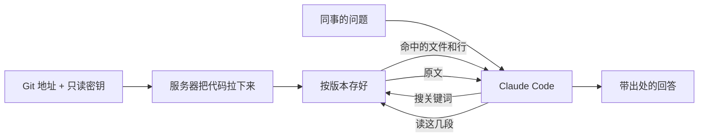
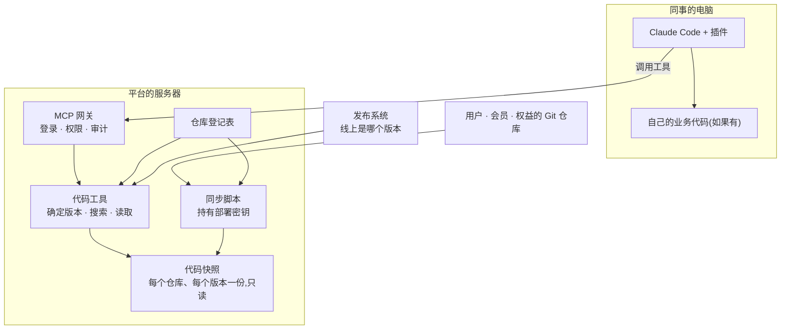

# 代码查询:原理与设计

提问的同事大多没有用户、会员、权益这三个服务的代码。所以平台把这三个仓库的代码放在服务器上,通过网关提供“搜索”和“读取”两类工具,本地的 Claude Code 需要看代码时来问网关。这项能力在一期建设。

**最小版本:只做这四样。**

| 要做的 | 具体是什么 |
| --- | --- |
| 一张仓库登记表 | 一个文件,写明三个服务各自对应哪个仓库、哪个目录 |
| 一个同步脚本 | 用只读的部署密钥把代码拉到服务器上,按版本各存一份 |
| 三个工具 | 确定版本、搜索、读取。属于公共连接器,所有业务的仓库共用这一组 |
| 每个仓库一份导航 | 告诉 Agent 这个仓库里什么东西在哪 |

不需要搜索引擎,不需要向量库,不需要在服务器上运行 Agent。三个仓库的规模,直接在文件上做文本搜索就足够快。

相关文档:[插件形态](09-插件形态-原理与设计.md)、[代码仓库管理](08-代码仓库管理-原理与设计.md)(仓库怎么拉取、怎么按版本存放,本文复用它的做法)。

## 1. 先纠正一个常见的误解

“给一个 Git 地址,AI 就能理解整个仓库”,实际发生的事情是这样的:

模型并没有“学会”这个仓库。它是每次遇到问题时现查:先搜,再读命中的那几段,然后回答。这和一位新同事接手陌生代码时的做法一样。

所以这件事的关键不在模型,而在三点:代码拿得到、版本对得上、能快速找到相关的那几段。

## 2. 整体结构

| 部分 | 做什么 |
| --- | --- |
| 仓库登记表 | 服务、仓库、目录、谁负责。每个仓库登记在它所属的业务连接器名下(文档 09 第 4 节)。新增一个业务不需要新写代码工具,只需要登记仓库 |
| 同步脚本 | 定时或手动拉取代码;按需准备某个版本的快照 |
| 代码快照 | 某个仓库在某个版本下的全部文件,只读。快照以“仓库 + 版本号”命名,内容永远不变 |
| 代码工具 | 网关里的三个工具,在快照上搜索和读取 |

Git 仓库仍然是代码的正本。服务器上的只是一份供查询的副本。服务器不运行仓库里的任何代码和脚本。

Git 的密钥只在同步脚本那里。网关、Claude Code、模型都接触不到。

## 3. 最重要的一件事:版本

同一个文件,上周的版本和今天的版本可能不一样。排查线上问题时读错版本,会得出错误的结论,而且看起来很有道理。

| 问的是什么 | 应该读哪个版本 |
| --- | --- |
| 现在线上的问题 | 这个服务现在线上运行的版本 |
| 上周三发生的问题 | 上周三当时线上运行的版本 |
| “某某逻辑是什么”、怎么接入 | 线上版本;问的是还没上线的功能时,用主干最新版本并说明 |
| 评估考题 | 考题里写死的版本 |

四条约定:

1. **先确定版本,再搜索和读取。** 一次提问里,对同一个仓库的所有搜索和读取都用同一个版本。
2. **版本用提交号表示。** 分支名会移动,提交号不会变。
3. **查不到线上版本时要明说。** 可以用主干最新版本作参考,但回答里必须写“未能确认这是线上版本”。不能把主干当成线上。
4. **每段代码证据都带出处。** 仓库、提交号、文件路径、行号。

“线上是哪个版本”来自发布系统。发布系统暂时给不出时,一期允许人工维护一张“服务 → 当前线上提交号”的表,并写明是谁、什么时候核实的。

代码说明“这个版本会怎样执行”,日志和业务数据说明“这一次实际发生了什么”。两者要对照着用,只凭一段代码不能认定某次线上故障的原因。

## 4. 三个工具

| 工具 | 输入 | 返回 |
| --- | --- | --- |
| `code_resolve_context` | 服务名;环境;问题发生的时间,或一个明确指定的版本 | 仓库、提交号、这个版本是怎么确定的、导航文件的位置、快照是否已准备好 |
| `code_search` | 仓库、提交号、关键词;可选的目录范围 | 命中的文件、行号、前后几行;结果被截断时说明总数和如何缩小范围 |
| `code_read` | 仓库、提交号、文件路径、行范围;可以一次读几段 | 原文、实际返回的行范围、是否被截断 |

设计要点:

- 工具只接受登记表里的服务和仓库。不接受任意的 Git 地址、服务器路径或命令。
- 路径解析之后必须落在快照目录之内,防止通过 `../` 或符号链接读到别的文件。
- 单次返回的大小有上限。
- 返回值要能区分这几种情况,不能都返回空:没有匹配;没有权限;版本未知;快照正在准备;同步失败;查询超时。
- 快照里的密钥文件、配置里的密码等敏感内容,在搜索和读取之前就排除掉。
- 每次调用都校验身份,并记一条审计:谁、哪个仓库、哪个版本、搜了什么或读了哪个文件。审计里不保存源码原文。

## 5. 导航:让 Agent 少走弯路

没有任何指引时,Agent 只能靠猜关键词来搜,又慢又容易漏。每个仓库里放一份导航文件,例如 `docs/agent-overview.md`,随代码一起维护:

- 这个服务负责什么。
- 目录结构,每个目录放什么。
- 关键入口:对外接口在哪、消费消息的地方在哪、定时任务在哪。
- 上游和下游各是谁。
- 常见报错对应哪个模块。

三类内容各放各的位置,不要互相复制:

| 内容 | 回答的问题 | 放在哪里 |
| --- | --- | --- |
| 排查说明(Skill) | 这类问题怎么查 | 插件 |
| 导航 | 去仓库的哪里看 | 业务仓库,随版本走 |
| 代码原文 | 具体是怎么写的 | 快照 |

建议的查找顺序:确定服务 → 读导航 → 在相关目录里搜 → 读命中的函数和它的上下文。优先搜接口路径、错误码、字段名、函数名这类精确的词。证据指向另一个服务时,再扩展到那个服务,不要一上来就搜全部仓库。

只查业务数据就能回答的问题,不必读代码。

## 6. 本地代码和服务器代码

| 情况 | 做法 |
| --- | --- |
| 问的是自己正在开发的代码 | Claude Code 直接读本地 |
| 问的是用户、会员、权益的代码 | 通过网关的代码工具 |
| 本地恰好有这三个仓库 | 排查线上问题时仍以网关的版本为准。本地可能是旧的,也可能有没提交的修改 |
| 问题跨几个服务 | 按证据一个一个查,每个服务各自确定版本 |

## 7. 权限

一期的规则很简单:登录并且在允许名单里的同事,可以查询这三个仓库中登记表允许的目录。

仓库跟着连接器走:同事没有启用某个业务连接器时,代码工具搜不到也读不到那个业务的仓库。

实现前需要先回答一个政策问题:**其他团队的同事,可以看到基础服务的源码片段吗?** 这和“数据可以发给模型”是两个问题。

| 答案 | 影响 |
| --- | --- |
| 可以 | 按本文做 |
| 部分可以 | 在登记表里限定允许读取的目录;或按团队区分 |
| 不可以 | `code_read` 不能开放。改为只提供接口文档和导航,或者把读代码放到服务器上做、只返回结论。这是另一套方案 |

需要注意:即使没有“下载仓库”的按钮,有读取权限的人也可以通过多次调用积累出大量源码。开放范围要按“他能看到这些目录的全部内容”来考虑。

## 8. 一期分步

| 步骤 | 内容 | 验收 |
| --- | --- | --- |
| C1 | 仓库登记表;同步脚本;指定提交号的快照 | 同一个提交号重复准备,得到的内容一致;准备失败时不会拿别的版本顶替 |
| C2 | 三个工具接入网关 | 本机没有这三个仓库,也能找到相关实现;读不到快照目录之外的文件 |
| C3 | 三个仓库的导航文件;通用规范里加入“先确定版本”的要求 | 回答里的代码证据带仓库、提交号、路径、行号 |
| C4 | 线上版本的来源(发布系统,或人工维护的表) | 把线上版本改成一个旧版本后提问,读到的是旧版本的代码 |
| C5 | 评估考题(第 9 节) | 这些题进入每次的批量运行 |

## 9. 评估要增加的考题

| 考题 | 检查什么 |
| --- | --- |
| 本机没有三个基础服务的仓库 | 通过网关拿到代码证据,完成排查 |
| 本地有一份旧版本的代码 | 没有把本地的实现当成线上事实 |
| 问题跨两个服务 | 按证据找到第二个服务,没有把所有仓库搜一遍 |
| 线上版本查不到 | 明确说明限制,继续做能做的数据排查,没有假称已核对线上实现 |
| 只靠业务数据就能回答 | 没有多余地去读代码 |

每次运行记录各仓库使用的提交号。除了对错,再记两项:关键的那段代码有没有找到;搜索和读取各用了几次。

## 10. 进阶内容(小系统可以先不做)

以下几项都有明确的启动条件。条件没有出现之前不做。

| 能力 | 是什么 | 什么时候才需要 |
| --- | --- | --- |
| 代码搜索引擎 | 预先给代码建索引,让搜索更快。开源的有 Zoekt、OpenGrok;商业的有 Sourcegraph | 仓库增加到几十个以上,或实测文本搜索明显变慢 |
| 符号和引用导航 | “这个函数被谁调用” | 错题里经常出现“找到了定义但找不到调用方” |
| 语义检索(向量库) | 用业务的说法找到用词不同的代码 | 错题里经常出现“关键词反复搜不到”。先对文档和服务说明做,再考虑代码 |
| 服务器上的代码分析 Agent | 在服务器上多轮查代码,只返回结论 | 源码不允许返回到同事电脑上;或跨仓库探索的往返次数多到影响体验。这需要平台自己运行模型,成本和复杂度都会上升 |
| 自动的版本解析 | 历史版本、灰度期间多个版本并存、依赖库的版本 | 出现因为这些情况而答错的案例 |
| 发布后自动预热 | 新版本一发布就准备好快照 | 同事经常等待快照准备 |

为了以后能换,代码工具内部把“搜索”做成一个独立的部分:现在是在文件上做文本搜索,以后可以换成搜索引擎,三个工具对外的输入和返回不变。

引入任何一项之前,在同一批考题上比较引入前后的结果:关键证据的命中、回答的正确率、耗时。有改善并且维护得起,再正式采用。

关于第三方产品,你提供的文档里引用了一些我无法核实的信息(例如某产品近期改为闭源的公告、几个客户案例)。真要选型时,以当时的官方文档、许可证和你自己的试用结果为准。

## 11. 待确认

- [ ] 其他团队的同事可以看到基础服务的哪些源码?(第 7 节)
- [ ] 三个服务各自对应哪些仓库和目录?谁来写和维护导航文件?
- [ ] 发布系统能不能给出“某个服务在某个时间点线上运行的提交号”?暂时不能的话,谁来维护那张人工的表?
- [ ] 代码快照放在哪台服务器上,磁盘空间够不够保留若干个历史版本?

## 12. 自测

- [ ] 配了 Git 地址之后,模型是“学会”了仓库吗?它实际是怎么回答代码问题的?(第 1 节)
- [ ] 为什么要先确定版本再搜索?读错版本会有什么后果?(第 3 节)
- [ ] 查不到线上版本时,回答应该怎么写?(第 3 节)
- [ ] 三个工具分别做什么?为什么不让工具接受任意的 Git 地址和路径?(第 4 节)
- [ ] 为什么不给每个业务各做一套代码工具?(第 2 节)
- [ ] 排查说明、导航、代码原文,各放在哪里?(第 5 节)
- [ ] 为什么一期不需要搜索引擎和向量库?什么情况出现后才考虑?(第 10 节)
