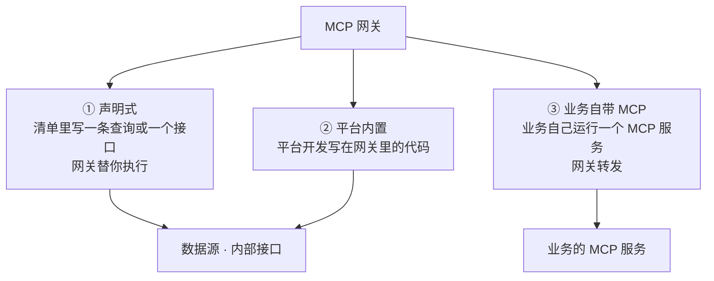
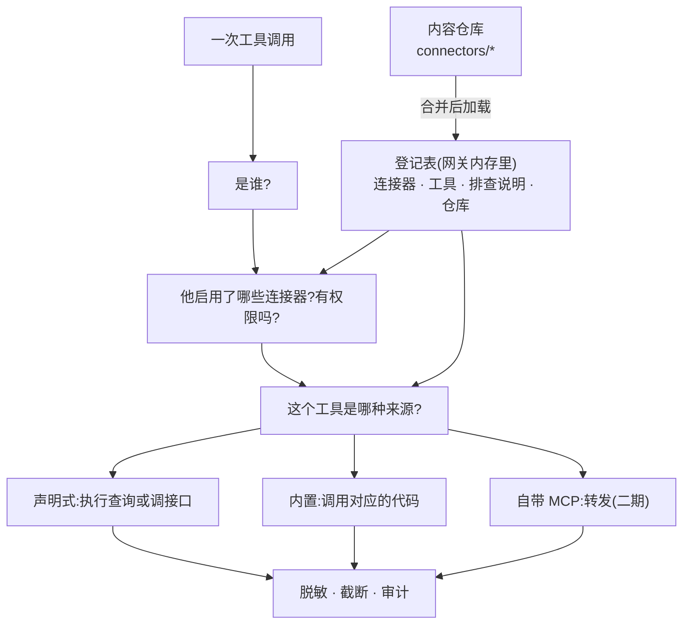

# 连接器接入协议:原理与设计

一个业务要接入平台,只需要按固定的格式交一个目录:里面写明它有哪些工具、哪些排查说明、哪些代码仓库。网关读这个目录就能提供服务,网关自己的代码里不出现任何业务。用户、会员、权益是按这套协议接入的第一个业务;以后别的服务照着做就行。

**最小版本:接入一个业务,交这五样。**

| 要交的 | 是什么 |
| --- | --- |
| 一份清单 | `connector.yaml`:这个业务叫什么、谁负责、有哪些工具和仓库 |
| 工具 | 大部分工具不用写代码,在清单里写一条查询语句或一个接口地址即可 |
| 排查说明 | 几份 Markdown:这类问题怎么查 |
| 代码仓库登记 | 清单里的几行:哪个服务对应哪个仓库、哪个目录 |
| 几道考题 | 证明接入之后确实答得对 |

相关文档:[插件形态](09-插件形态-原理与设计.md)(连接器在云端,第 4、5 节)、[代码查询](10-代码查询-原理与设计.md)、[评估系统](02-评估系统-原理与设计.md)。早期的 [04-连接器接入规范](04-连接器接入规范-原理与设计.md) 是按网页版写的,格式以本文为准。

## 1. 为什么要有协议

没有协议时,每接一个业务都要改网关的代码,接到第三个就会乱。有了协议,分工变成这样:


| 谁 | 负责什么 |
| --- | --- |
| 业务(或替业务接入的平台开发) | 说清楚“我有什么”:工具、说明、仓库、考题。只有业务自己懂这些 |
| 平台 | 所有业务都一样的部分:登录、权限、脱敏、查询上限、审计、代码搜索、取排查说明 |

你提到的两种接入方式,交的东西完全相同,区别只是谁来写这个目录:

| 方式 | 谁写目录 | 适合 |
| --- | --- | --- |
| 平台代接 | 平台的开发,向业务了解情况后来写 | 一期的用户、会员、权益;以及没有人力的业务 |
| 业务自助 | 业务团队自己写,提交给平台检查 | 二期,有别的团队想接入时 |

因为交的东西相同,一期用“平台代接”做出来的会员连接器,同时也是这套协议的第一个样板。

## 2. 一个连接器的目录

所有连接器放在同一个内容仓库里,每个连接器一个目录:

```
agent-content/                        内容仓库(内部 Git 仓库)
  connectors/
    platform/                         公共连接器(平台自己维护)
    membership/                       基础业务连接器:用户、会员、权益
      connector.yaml                  清单
      tools/
        orders.yaml                   工具定义,按主题分文件
        membership.yaml
        entitlement.yaml
      guides/
        overview.md                   整体情况与服务地图
        entitlement-missing.md        “付费后权益未到账”怎么查
      references/
        tables.md                     表结构和状态取值
      evals/
        cases.yaml                    考题
```

五样东西各自回答一个问题:

| 部分 | 回答的问题 | 给谁用 |
| --- | --- | --- |
| 清单 | 这是谁的业务、包含什么 | 平台 |
| 工具 | 能查到什么数据 | Agent 调用 |
| 排查说明和资料 | 这类问题怎么查、字段是什么意思 | Agent 阅读 |
| 仓库登记 | 代码在哪 | 代码查询工具 |
| 考题 | 接入之后答得对不对 | 平台和业务一起看 |

## 3. 清单

```yaml
# connectors/membership/connector.yaml
id: membership                  # 唯一标识,只用小写字母和连字符
name: 用户、会员、权益
description: 用户账号、会员订阅、权益发放相关的问题排查和业务逻辑解答
owner: 基础服务组               # 出了问题找谁
contact: 负责人的联系方式
tool_prefix: member             # 这个连接器所有工具名的前缀
default_enabled: true           # 是否对所有人默认启用

datasources:                    # 用到哪些数据源。这里只写名字,账号在平台的密钥管理里
  - member_mysql_ro
  - member_redis_ro

services:                       # 有哪些服务,各自的代码在哪
  - id: user-service
    name: 用户服务
    repository: git@git.example.com:base/user-service.git
    path: /                     # 服务在仓库里的目录。一个仓库多个服务时用它区分
    overview: docs/agent-overview.md    # 仓库里的导航文件
    deployment: user-service    # 在发布系统里的名字,用来查线上版本
    exclude:                    # 不允许读取的路径
      - config/secrets/
  - id: member-service
    name: 会员服务
    repository: git@git.example.com:base/member-service.git
    path: /
    overview: docs/agent-overview.md
    deployment: member-service
  - id: entitlement-service
    name: 权益服务
    repository: git@git.example.com:base/entitlement-service.git
    path: /
    overview: docs/agent-overview.md
    deployment: entitlement-service

tools:                          # 工具定义文件
  - tools/orders.yaml
  - tools/membership.yaml
  - tools/entitlement.yaml

guides:                         # 排查说明
  - guides/overview.md
  - guides/entitlement-missing.md

evals:
  - evals/cases.yaml
```

要点:

- **清单里没有任何账号和密码。** 数据源只写名字。真正的连接信息由平台管理员登记在平台的密钥管理里,业务方和 Agent 都看不到。
- **仓库登记在连接器名下。** 代码查询的三个工具是平台公共的,它们按这里的登记去找仓库(文档 10)。
- **`tool_prefix` 保证不同业务的工具不重名。**

## 4. 工具的三种来源

这是协议里最重要的一部分。工具从哪里来,有三种方式:



| | ① 声明式 | ② 平台内置 | ③ 业务自带 MCP |
| --- | --- | --- | --- |
| 要写代码吗 | 不用,写配置 | 要,平台开发来写 | 要,业务自己写一个服务 |
| 接入速度 | 最快 | 中 | 最慢 |
| 适合 | 按条件查一张表、调一个查询接口 | 逻辑复杂,例如把订单、会员、权益串成一条链路一次返回 | 业务已经有 MCP 服务,或逻辑只有业务自己能维护 |
| 只读、脱敏、上限由谁保证 | 平台,统一强制 | 平台 | 业务自己,平台只能检查不能保证 |
| 一期 | 做 | 做 | 协议里定好格式,暂不实现 |

建议的选择顺序:能用 ① 就用 ①;① 表达不了再用 ②;③ 留给二期真正有外部业务带着自己的服务来接入的时候。

### 4.1 声明式工具:查数据库

```yaml
# connectors/membership/tools/orders.yaml
- name: member_get_order
  title: 查询订单
  description: >
    按订单号查询一笔订单的支付状态、金额和支付时间。
    排查“付费后会员或权益没有到账”时首先使用,用来确认钱是否付成功。
  type: sql
  datasource: member_mysql_ro
  readonly: true
  params:
    - name: order_id
      type: string
      required: true
      description: 订单号,例如 O202611160001
  query: |
    SELECT order_id, user_id, product_id, status, amount, paid_at, created_at
    FROM orders
    WHERE order_id = :order_id
    LIMIT 1
  mask:                         # 需要脱敏的返回字段
    - user_phone
  limits:
    timeout_ms: 3000
    max_rows: 20
  status_hint: status 的各个取值见 references/tables.md
```

网关替你做的事:校验参数;把参数安全地填进查询(参数只能作为值,不能改变语句的结构);用只读账号执行;超时就中断;超过行数就截断并说明;把 `mask` 里的字段脱敏;记审计。

### 4.2 声明式工具:调内部接口

```yaml
- name: member_get_entitlement
  title: 查询用户权益
  description: >
    查询一个用户当前拥有的权益列表和各自的有效期。
    确认权益是否已经发放时使用。
  type: http
  readonly: true
  request:
    method: GET                 # 只允许 GET
    url: http://entitlement-service.internal/api/v1/users/{user_id}/entitlements
  params:
    - name: user_id
      type: string
      required: true
      description: 用户标识
  response:
    fields: [entitlement_id, name, status, start_at, end_at]   # 只返回这些字段
  limits:
    timeout_ms: 3000
```

接口地址由平台管理员审核后才生效,不允许指向任意地址。

### 4.3 每个工具必须写清的内容

| 字段 | 要求 | 原因 |
| --- | --- | --- |
| `name` | `<前缀>_<动词>_<对象>`。动词只用 get、list、search、count、diagnose、diff 这几个 | 模型看名字就知道大概做什么;只有“查”,没有“改” |
| `description` | 写清“做什么”和“什么时候用” | 模型只凭这段话决定用不用。只写“查询订单”是不够的 |
| `params` | 每个参数有类型和说明;尽量用提问的人手上有的标识(订单号、手机号) | 模型要知道怎么填 |
| `readonly` | 一期必须为 `true` | 一期全部只读 |
| `limits` | 超时和行数上限 | 不依赖模型自觉 |
| `mask` | 列出敏感字段 | 脱敏由网关统一做 |

每个工具的返回都要能区分三种情况,这一点由网关统一处理,业务不用管:确实没有数据;参数错了;查询失败。

### 4.4 平台内置工具

当一个工具需要连续查几张表、还要做判断时,声明式写不出来。这时由平台开发在网关里写一段代码,清单里只引用它:

```yaml
- name: member_diagnose_purchase
  title: 诊断一笔购买的全链路
  description: >
    给定订单号,依次检查支付回调、订单状态、消息投递、会员开通、权益发放,
    返回每一段是否成功,以及第一个失败的环节。排查“付费后未到账”时优先使用。
  type: builtin
  handler: membership.diagnose_purchase
  readonly: true
  params:
    - name: order_id
      type: string
      required: true
      description: 订单号
```

内置工具的代码放在网关的适配层里,按连接器分目录。网关的其他部分仍然不出现业务名词。

### 4.5 业务自带 MCP(二期)

业务自己运行一个 MCP 服务,清单里登记它的地址:

```yaml
upstream_mcp:
  - id: pay-mcp
    url: http://pay-mcp.internal/mcp
    credential: pay_mcp_token       # 平台访问它用的凭据的名字
    tools: [pay_get_payment, pay_list_refunds]   # 只开放列出的这些工具
```

这种方式下有几条必须遵守的规则,二期实现时使用:

- 只开放清单里列出的工具。业务的服务上多出来的新工具,默认不开放,要改清单并经过评审。
- 工具的说明或参数变了,要重新评审。
- 业务的服务只允许平台访问,同事不能绕过网关直接连它。
- 只读和脱敏由业务保证。平台在评审时检查,但无法强制。所以数据敏感的工具优先用 ① 或 ②。

## 5. 排查说明的格式

```markdown
---
id: entitlement-missing
title: 付费后权益未到账
when: 用户付了钱,但会员没有开通或权益没有加上。常见说法:“付了钱没开通”“会员没生效”“权益没到账”
tools: [member_get_order, member_diagnose_purchase, member_get_entitlement, log_search]
---

## 需要的信息
订单号,或者用户标识加大致的付费时间。没有就先问。

## 链路
支付回调 → 订单变为已支付 → 发出消息 → 会员服务开通 → 权益服务发放

## 怎么查
……

## 查到什么程度才能下结论
必须指出断在哪一段,并给出这一段的日志或数据记录。

## 资料
各表的状态取值见 tables.md
```

| 字段 | 要求 |
| --- | --- |
| `when` | 写具体的现象和同事常用的说法。它会进入目录,决定这份说明会不会被取用 |
| `tools` | 这份说明会用到的工具。平台检查这些工具是否都存在 |
| 正文 | 写思路和判断标准,不写死步骤;必须写清“查到什么程度才能下结论” |

每个连接器必须有一份 `overview.md`,内容是服务地图:有哪些服务、一条业务链路依次经过谁、每一段靠什么字段关联、每一段成功的标志是什么。

## 6. 考题

每个连接器接入时至少带几道考题,格式和 [评估系统](02-评估系统-原理与设计.md) 相同:问题、标准答案、评分要点。

| 要求 | 原因 |
| --- | --- |
| 每份排查说明至少对应一道题 | 没有题,就不知道这份说明有没有用 |
| 至少一道“信息不够,应该先问”的题 | 检查它不乱猜 |
| 至少一道业务逻辑题(答案在代码里) | 检查仓库登记和导航是否管用 |

考题通过是上线的条件。之后每次修改这个连接器的内容,都重跑它的考题。

## 7. 接入的流程


| 步骤 | 做什么 | 谁做 |
| --- | --- | --- |
| ① 准备 | 申请数据源的只读账号和仓库的只读部署密钥,交给平台管理员登记;在每个仓库里写导航文件 | 业务提供,平台登记 |
| ② 写目录 | 清单、工具、排查说明、考题 | 平台代接,或业务自助 |
| ③ 自动检查 | 一条命令检查格式和规则(第 8 节) | 写的人自己跑 |
| ④ 试用环境加载 | 只对写的人自己启用,在 Claude Code 里实际问几个问题 | 写的人 |
| ⑤ 跑考题 | 评估脚本跑这个连接器的考题 | 写的人 |
| ⑥ 评审合并 | 平台看安全相关的部分:查询语句、接口地址、脱敏字段、开放的仓库目录。业务负责人看内容对不对 | 平台和业务 |
| ⑦ 上线 | 合并后网关加载;按清单决定是默认启用还是由同事自己启用 | 自动 |

连接器的状态:

| 状态 | 含义 |
| --- | --- |
| 试用 | 只有指定的人能启用 |
| 已上线 | 按清单的设置对同事开放 |
| 停用 | 对所有人不可见,内容保留 |

## 8. 自动检查的规则

一条命令,对一个连接器目录做下面的检查。检查不通过不能合并。

| 类别 | 规则 |
| --- | --- |
| 格式 | 清单的必填项齐全;引用的文件都存在;`id` 和工具名没有和别的连接器重复 |
| 命名 | 工具名以本连接器的前缀开头;动词在允许的范围内 |
| 只读 | 查询语句只能是查询,不能有修改数据的语句;接口只能用 GET;`readonly` 为 `true` |
| 上限 | 每个工具都有超时;查询语句带行数限制;日志类查询必须带时间范围 |
| 说明 | 工具的 `description` 不少于两句,包含“什么时候用”;排查说明有 `when` 和“下结论的标准” |
| 引用 | 排查说明里列的工具都存在;数据源的名字已在平台登记 |
| 安全 | 目录里没有账号、密码、密钥;接口地址在允许的范围内 |
| 考题 | 满足第 6 节的最低要求 |

检查写成规则之后,平台代接和业务自助用的是同一把尺子。

## 9. 网关怎么用这些目录



网关的代码里只有“怎么执行一条声明式查询”“怎么脱敏”这类通用逻辑。会员、订单这些词只出现在内容仓库和内置工具的那个目录里。检验架子搭得好不好的标准只有一条:**接入一个只用声明式工具的新业务,网关的代码一行都不用改。**

## 10. 一个新服务接入的样子

假设以后“优惠券服务”要接入,需要做的全部事情:

1. 把优惠券库的只读账号和仓库的部署密钥交给平台管理员登记。
2. 在仓库里写一份导航文件。
3. 新建 `connectors/coupon/`:清单里登记一个服务和它的仓库;写三四个声明式工具(查券、查领取记录、查核销记录);写一份服务地图和一两份排查说明;写五道考题。
4. 跑检查,在试用环境里问几个问题,跑考题。
5. 提交评审,合并。

同事那边什么都不用装。想用的人启用“优惠券”连接器即可。

## 11. 一期做到哪里

| 部分 | 一期 | 二期 |
| --- | --- | --- |
| 目录和清单的格式 | 定稿 | 按使用情况修订,带版本号 |
| 声明式工具(查数据库、调接口) | 做 | |
| 平台内置工具 | 做 | |
| 业务自带 MCP | 只定格式 | 实现转发、工具审批 |
| 仓库登记 | 做 | |
| 排查说明和考题 | 做 | |
| 自动检查 | 做 | 增加规则 |
| 接入方式 | 平台代接。用户、会员、权益作为第一个连接器 | 业务自助;提交和评审的页面 |
| 启用和权限 | 两个连接器都默认启用;一张允许名单 | 同事自己启用;按连接器授权 |
| 加载方式 | 合并后网关重新加载 | 不重启就生效;按人灰度 |

一期的验收办法:会员连接器做完之后,再用同样的格式接一个很小的假业务(一个工具、一份说明、一道题)。如果不改网关代码就能接上,说明架子是对的。

## 12. 待确认

- [ ] 用户、会员、权益的数据,哪些通过查数据库拿,哪些已经有现成的内部查询接口?这决定工具用哪种类型。
- [ ] 内容仓库和插件仓库是合成一个还是分开?建议分开:内容仓库改得勤,插件仓库几乎不动。
- [ ] 数据源的账号和部署密钥存在哪里?公司有没有现成的密钥管理?
- [ ] 评审由谁做:平台这边谁看安全,业务这边谁看内容?

## 13. 自测

- [ ] 接入一个业务要交哪五样东西?各自回答什么问题?(第 2 节)
- [ ] 平台代接和业务自助,交的东西有区别吗?(第 1 节)
- [ ] 清单里为什么不能写数据库账号?账号在哪里?(第 3 节)
- [ ] 工具有哪三种来源?该按什么顺序选?(第 4 节)
- [ ] 声明式工具里,只读、脱敏、上限是谁保证的?业务自带 MCP 时呢?(第 4 节)
- [ ] 工具的 `description` 只写“查询订单”有什么问题?(第 4.3 节)
- [ ] 怎么检验“架子搭得好不好”?(第 9、11 节)
