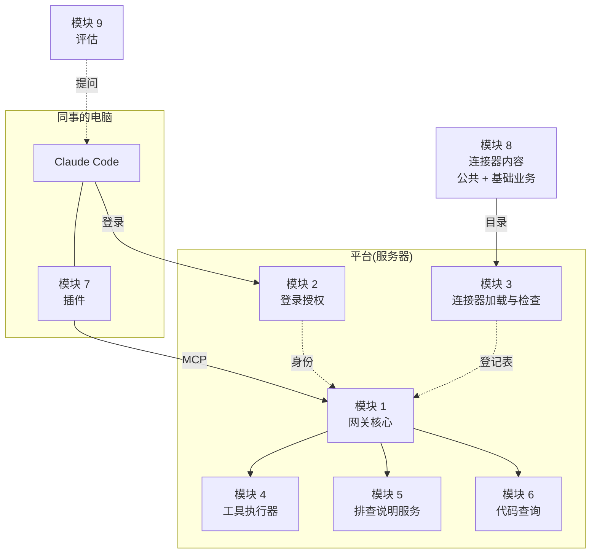

# 开发路线

本文档回答三个问题:插件这条链路拆成哪几个可以独立开发的模块;模块之间靠什么约定连接;按什么顺序做、在哪几个点上合起来跑整体流程。

范围见 [一期二期规划](一期二期规划.md)。

## 1. 九个模块

拆分的原则:每个模块有明确的输入和输出,可以单独开发、单独验收;模块之间只通过第 2 节的几个约定打交道。

| # | 模块 | 是什么 | 交付物 | 类型 |
| --- | --- | --- | --- | --- |
| 1 | 网关核心 | 一次调用经过的流水线:认出是谁 → 判断能不能用 → 找到工具 → 执行 → 脱敏和截断 → 记审计 | 一个 MCP 服务 | 代码(Go) |
| 2 | 登录授权 | 平台的 OAuth 页,背后接公司 SSO;发通行证;允许名单 | 一个授权服务 | 代码,尽量用现成组件 |
| 3 | 连接器加载与检查 | 读连接器目录,检查是否合规,生成一张登记表 | 一个检查命令;一个加载器 | 代码(Go) |
| 4 | 工具执行器 | 执行三种工具:查数据库、调接口、内置代码 | 三个执行器 | 代码(Go) |
| 5 | 排查说明服务 | 取排查说明的两个工具;生成按人下发的服务说明 | 两个工具;服务说明生成 | 代码(Go) |
| 6 | 代码查询 | 仓库同步、按版本的快照、三个代码工具 | 一个同步脚本;三个工具 | 代码(Go) |
| 7 | 插件 | 网关地址、入口说明、安装说明 | 一个插件仓库 | 配置和文字 |
| 8 | 连接器内容 | 公共连接器(查日志、发布记录、反馈、通用规范)和基础业务连接器(用户、会员、权益的工具、排查说明、仓库登记、考题) | 两个连接器目录 | 配置和文字,需要业务知识 |
| 9 | 评估 | 批量提问的脚本、结果表、汇总 | 一个脚本 | 代码(Python) |

模块 1 至 6 是平台的“架子”,做一次。模块 8 是“内容”,每接一个业务做一份。以后新服务接入,只做模块 8 那样的一个目录。

## 2. 模块之间的六个约定

模块能独立开发,靠的是先把它们之间的约定定下来。每个模块按约定开发,用假的对方来测试。

| # | 约定 | 谁提供 | 谁使用 | 内容 | 定义在 |
| --- | --- | --- | --- | --- | --- |
| ① | MCP 协议 | 模块 1 | Claude Code(经模块 7) | 列出工具、调用工具、服务说明 | 公开标准 |
| ② | 身份 | 模块 2 | 模块 1 | 给一张通行证,返回“这是谁”或“无效”。返回:员工标识、姓名、是否在允许名单 | 文档 09 第 6 节 |
| ③ | 登记表 | 模块 3 | 模块 1、4、5、6 | 有哪些连接器;每个连接器有哪些工具、排查说明、仓库 | 文档 11 第 9 节 |
| ④ | 执行器 | 模块 4、5、6 | 模块 1 | 给工具定义和参数,返回结果。结果分四种:成功、没有数据、参数错误、执行失败;并说明是否被截断 | 文档 11 第 4 节 |
| ⑤ | 连接器目录格式 | 模块 8 | 模块 3 | 清单、工具、排查说明、仓库登记、考题的格式 | 文档 11 |
| ⑥ | 命令行提问 | Claude Code | 模块 9 | 用 `claude -p` 提问,得到回答和完整过程 | 文档 02 |

有了这些约定,每个模块都可以用“假的对方”独立测试:

| 模块 | 独立测试时用什么代替对方 |
| --- | --- |
| 1 网关核心 | 一个固定的假身份;一张手写的登记表;一个只会原样返回的假工具 |
| 2 登录授权 | 一个不带任何工具的空 MCP 服务 |
| 3 连接器加载与检查 | 几个样例目录:一个合规的,几个故意写错的 |
| 4 工具执行器 | 一个测试数据库;一个假接口 |
| 5 排查说明服务 | 几份样例排查说明 |
| 6 代码查询 | 一个公开的小仓库 |
| 7 插件 | 模块 1 的假工具版本 |
| 8 连接器内容 | 模块 3 的检查命令 |
| 9 评估 | 不装平台插件的 Claude Code 加两道与平台无关的题 |

## 3. 执行顺序和三个合流点

| 顺序 | 模块 | 为什么排在这里 | 这个模块自己的验收 |
| --- | --- | --- | --- |
| 0 | 阶段 0 验证 | 先排除最大的不确定性(第 4 节) | 结果表填完 |
| 1 | 模块 1 网关核心 | 其他所有模块都挂在它上面 | 用假身份调用假工具,返回正确;审计里有记录;没有身份的请求被拒绝 |
| 2 | 模块 7 插件 | 很小,做完就能看到第一个效果 | 一台干净的电脑按说明装好 |
| | **合流点一:链路通** | | 在 Claude Code 里问一句话,它调用了网关上的假工具 |
| 3 | 模块 2 登录授权 | 换掉假身份 | 浏览器登录一次后可用;未登录、不在名单、过期,三种情况提示不同 |
| 4 | 模块 3 连接器加载与检查 | 换掉手写的登记表 | 合规的样例通过;每个故意写错的样例都被指出错在哪 |
| 5 | 模块 4 工具执行器 | 换掉假工具 | 样例里的查询工具能查到测试库的数据;超时和超行数被拦下;脱敏生效;四种结果能区分 |
| | **合流点二:架子通** | | 写一个只有一个查日志工具的样例连接器,不改网关代码,登录后在 Claude Code 里能查到真实日志 |
| 6 | 模块 5 排查说明服务 | 内容要靠它送到 Agent | 能按名称取到正文和资料;服务说明里有当前这个人可用的目录 |
| 7 | 模块 8 连接器内容 | 架子好了才能装内容 | 两个连接器目录通过检查命令 |
| | **合流点三:业务通** | | “付费后权益未到账”能沿链路给出带证据的结论;信息不够时先问 |
| 8 | 模块 6 代码查询 | 独立性最强,放在后面不挡路 | 本机没有仓库也能搜到和读到指定版本的代码;读不到快照之外的文件 |
| 9 | 模块 9 评估 | 之后所有的改进都靠它衡量 | 一条命令跑完全部考题,生成结果表 |
| | **整体流程** | | 至少三轮“看错题、改一样、重跑”;两三位同事试用;一期评审 |

几点说明:

**为什么不等全部做完再合。** 你希望每个模块独立开发好之后再走整体流程,模块的独立性这里是保证的:每个模块有自己的验收,用假的对方测试。但合流我建议分三次,不要留到最后一次。原因是模块之间的约定写在纸上时总有没想到的地方,越晚发现改动越大。三个合流点各只需要半天,换来的是每一步都知道前面是对的。

**可以并行的部分。** 只有一个人时按上面的顺序做。有帮手,或者想让编码工具同时开几个任务时,下面这些互不依赖:

| 可以同时做 | 前提 |
| --- | --- |
| 模块 2、模块 3、模块 6 | 第 2 节的约定 ②、③、④ 已经定下 |
| 模块 8 的文字部分(服务地图、排查说明、表结构说明、考题) | 文档 11 的格式已定。这部分从今天就可以开始写 |
| 模块 9 的考题表 | 无 |

**模块 8 里最花时间的是内容,不是代码。** 服务地图、状态字段的含义、排查思路,只有懂业务的人能写。建议和代码开发同时进行。

**对应关系。** 合流点一、二对应 [一期二期规划](一期二期规划.md) 的 M1,合流点三和模块 6 对应 M2,模块 9 和改进对应 M3,试用对应 M4,评审对应 M5。

## 4. 阶段 0:六项验证

这六项是整个方案里不确定性最大的地方。其中第 2 至 6 项不需要先写任何平台代码。

| # | 不确定的是什么 | 怎么测 | 记录什么 | 不通过怎么办 |
| --- | --- | --- | --- | --- |
| 1 | 登录:Claude Code 的插件能不能对接平台的 OAuth 页 | 一个不带任何工具的 MCP 服务,加上 OAuth 页。看能否弹出浏览器、登录成功、过期后自动续期。顺便试一次 `claude -p` 加服务令牌 | 每一步是否成功;客户端是怎么登记的;遇到的报错 | 调整客户端登记方式;最差情况下一期先用令牌 |
| 2 | 数据:三个服务的日志和数据能不能关联起来 | 取 3 个真实的“付费后权益未到账”,自己写 SQL 在 ClickHouse 和 MySQL 里把整条链路查出来 | 每一段靠什么字段关联;哪一段关联不上;各服务的日志表结构是否一致 | 人都串不起来,Agent 也做不到。先在服务里补日志字段 |
| 3 | 版本:能不能拿到线上运行的提交号 | 询问发布系统的负责人,或调用它的接口 | 能否按“服务 + 时间”查到提交号 | 一期人工维护一张表 |
| 4 | 代码:只靠搜索和读取,能不能找到业务逻辑 | 分两步,见第 4.1 节 | 见第 4.1 节 | 加强导航;仍不行再考虑搜索引擎或语义检索 |
| 5 | 查询:模型写的 SQL 靠不靠谱 | 把表结构说明交给 Claude Code,问 10 个问题,只看它写出的 SQL | 语句对不对;跑了多久;扫了多少行;返回有多大;状态字段有没有理解错 | 换成封装好的工具,不让模型自由写查询 |
| 6 | 说明:排查说明放在云端,模型会不会主动去取 | 同样 10 种问法测两组:说明做成插件里的 Skill;说明要调用工具去取 | 两组各被用上几次;没用上的是哪种问法 | 改服务说明里的目录和入口说明;仍不行就把最常用的几份放回插件 |

### 4.1 代码查询的两步测试

**第一步,不写代码。** 把三个仓库克隆到本机,在 Claude Code 里问 10 个业务逻辑问题。本地读文件最快、最不受限,所以这一步的结果是效果的上限。如果这样都答不好,问题在导航和代码本身,不在工具。

然后做一组对照:同样的题,加上一份导航文件再问一遍。两次的差距就是导航的价值。

**第二步,写一个一次性的小工具。** 一个只有搜索和读取两个工具的 MCP 服务,直接在本机目录上做文本搜索,不做登录,不做版本。把本地仓库移走,同样 10 道题再问一遍。和第一步的差距就是“远程”的代价。

每道题记四样:

| 记录项 | 说明 |
| --- | --- |
| 答对了吗 | 对照事先写好的标准答案 |
| 找到关键代码了吗 | 回答里引用的位置对不对 |
| 搜索和读取各几次 | 次数多说明它在乱找 |
| 用了多久 | 从提问到给出回答 |

### 4.2 阶段 0 的结果表

| # | 验证项 | 结果 | 结论 | 对方案的影响 |
| --- | --- | --- | --- | --- |
| 1 | 登录 | | | |
| 2 | 数据关联 | | | |
| 3 | 线上版本 | | | |
| 4 | 代码查询 | | | |
| 5 | 模型写查询 | | | |
| 6 | 排查说明的取用 | | | |

做完后带着这张表回来,再定模块 1 的详细设计。

## 5. 每个模块内部的节奏

交给编码工具时,一次只给一个模块、它涉及的约定和对应的文档章节,并附上 [一期二期规划](一期二期规划.md) 第 2.2 节的“不做”清单。把整个方向一次交出去,范围会越写越大。

## 6. 各模块的设计文档

| 模块 | 设计在哪 | 状态 |
| --- | --- | --- |
| 1 网关核心 | 文档 05 第 1 至 3 节;文档 09 第 4 节;文档 11 第 9 节 | 分散在三处,需要合成一份精简的模块设计 |
| 2 登录授权 | 文档 09 第 6 节 | 已有,待阶段 0 的试验验证 |
| 3 连接器加载与检查 | 文档 11 第 2、3、8 节 | 已有 |
| 4 工具执行器 | 文档 11 第 4 节 | 已有 |
| 5 排查说明服务 | 文档 09 第 5 节;文档 11 第 5 节 | 已有 |
| 6 代码查询 | 文档 10 | 已有 |
| 7 插件 | 文档 09 第 3、8 节 | 已有;入口说明的正文和安装说明待写 |
| 8 连接器内容 | 文档 11(格式) | 格式已有;具体的工具清单和排查说明待写,需要你提供表结构和现有接口 |
| 9 评估 | 文档 02 第一部分;文档 09 第 6.5、10 节 | 已有 |

第 2 节的六个约定里,② 身份、③ 登记表、④ 执行器目前只有文字描述。开始写模块 1 之前,要先把这三个约定写成明确的数据结构,这会放在模块 1 的设计里。

## 7. 最容易走偏的四个地方

| 走偏 | 后果 | 怎么避免 |
| --- | --- | --- |
| 跳过阶段 0 直接开发 | 日志串不起来或登录不通时,后面做的都要返工 | 阶段 0 的结果表填完再开始模块 1 |
| 模块 1 做得太厚 | 迟迟到不了合流点一 | 第一版只要流水线和一个假工具。管理页面、按团队授权不在一期 |
| 约定没定就各做各的 | 合流时对不上,两边都要改 | 第 2 节的约定先写成数据结构,再开始写模块 |
| 做完模块 9 就直接给人用 | 系统能跑,但答得不好,同事用一次就不再用 | 试用之前至少完成三轮改进 |

## 8. 现在的位置

当前处在阶段 0。本周可以做的,按顺序:

1. 开始记题目表。
2. 申请 ClickHouse、MySQL 从库、Redis 的只读账号,以及三个仓库的只读部署密钥。
3. 验证第 2、3 项:手工串 3 个案例;询问发布系统。
4. 验证第 4 项的第一步和第 5、6 项:只需要本机的 Claude Code。
5. 验证第 1 项:登录试验。
6. 同时开始写模块 8 的文字部分:服务地图和表结构说明。
